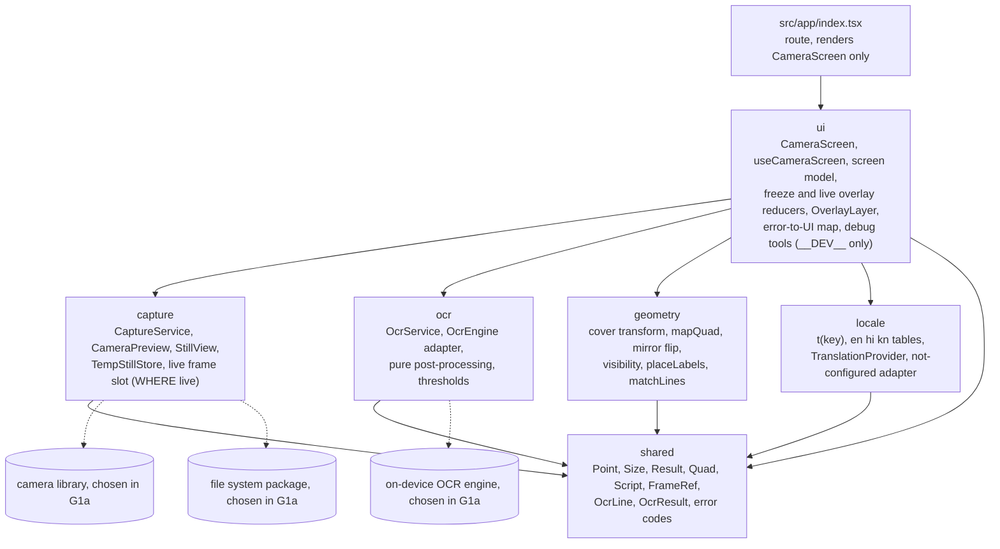
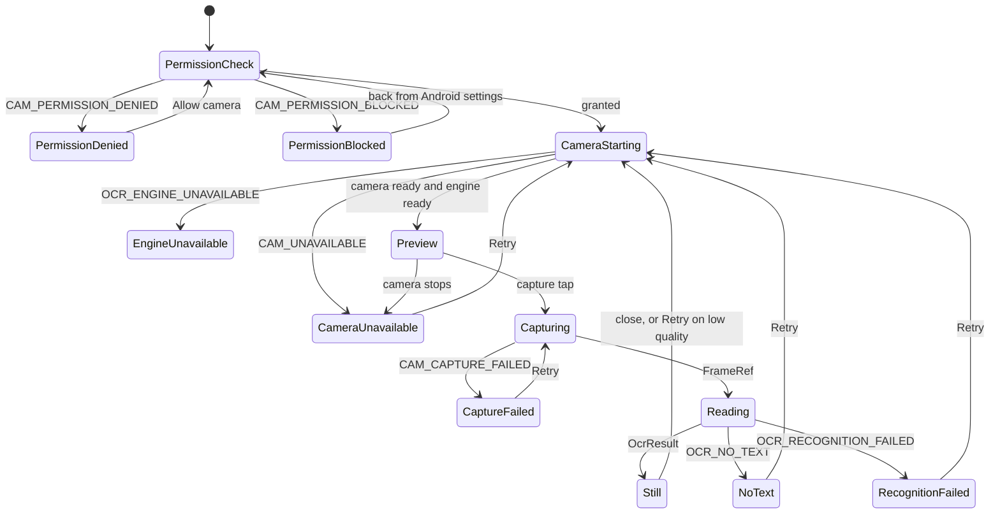
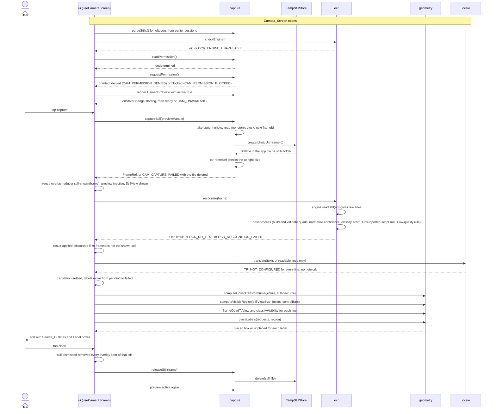
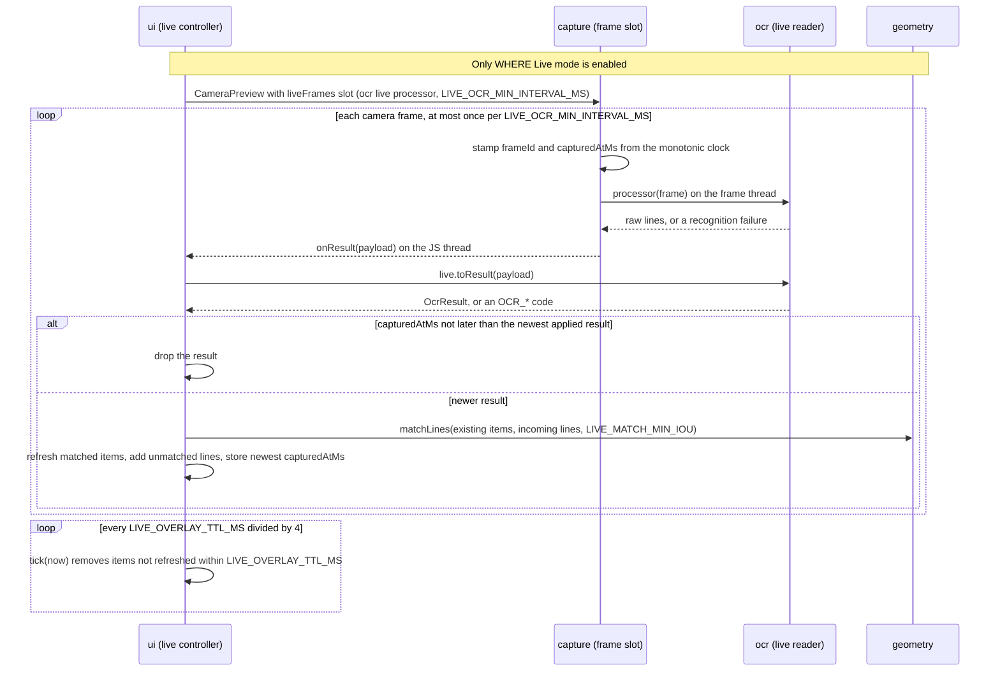

# Design Document: camera-ocr-geometry

Status: **draft, awaiting owner review.** Written 2026-11-18 from `requirements.md` (draft). Open questions OQ-1 to OQ-7 use their recommended defaults. No code exists for this design yet. Every statement about the phone is a plan: device validation pending.

## Overview

This design covers capability A in `docs/CAPABILITY-MAP.md`: camera permission and the back-camera preview, still capture, on-device text recognition into line quads, mapping those quads onto the screen, label placement, and removal of stale overlays. It delivers gate G1 (AT-G1-01 to AT-G1-11) and the QE-1 and QE-2 checks for the `CAM_*` and `OCR_*` codes.

**Freeze-frame first (D-011).** The baseline pipeline is:

1. `capture` asks for camera permission, shows the back-camera preview, takes one still, writes it upright into the app cache, and returns a `FrameRef`.
2. `ocr` reads the still through a vendor adapter, then runs pure post-processing: quad validation, confidence normalization, script classification, the Unsupported-script rule and the Low-quality rule. The output is an `OcrResult` or an `OCR_*` code.
3. `geometry` maps each line's quad from image space to the still view with the existing cover transform, classifies it as visible, clipped or off-screen against the Visible region, and places each label box.
4. `locale` provides `t(key)` and the `TranslationProvider` interface. Its only adapter in this spec returns `TR_NOT_CONFIGURED` for every line (OQ-1).
5. `ui` owns the Camera_Screen state machine, the overlay reducers, the Overlay_Layer, the error-to-UI mapping and the debug-only tools.

**Live mode is optional.** It sits behind a WHERE condition, has a hard cap of one day (G1c in `tasks/plan.md`), and ships only after AT-G1-06 has a PASSED record (R16.1). If it misses its gate, the app ships freeze-frame only.

**What already exists and stays unchanged:** `Point`, `Size` and `Result` in `src/modules/shared/index.ts`; `computeCoverTransform`, `imageToView`, `viewToImage`, `isVisibleInView` and `INVALID_SIZE` in `src/modules/geometry/cover-transform.ts`, with their table tests. New geometry functions sit beside them.

**What doesn't exist yet:** a camera library, an OCR engine binding, a file-system package, `expo-dev-client`, fast-check, the reference phone (owner Q4), the TM-01 image fixture (base panel and CARD-EN/HI/KN/BLANK images, shown on an iPad per `test-fixtures/tm-01/FIXTURE.md`, D-029, D-032; not yet produced or measured), and any recorded OCR snapshot. Vendor names appear only in the G1a spike plan and in the adapter files it creates.

### Design decisions in this document

| ID | Decision | Reason |
| --- | --- | --- |
| DD-1 | Each module exposes a service interface (`CaptureService`, `OcrService`, `TranslationProvider`) built by a factory. `ui` receives services through a React context, so tests pass fakes. | Testable wiring without global state. Vendor adapters stay inside their module. |
| DD-2 | `ocr` splits into a vendor adapter (`OcrEngine`, returns vendor-neutral `RawOcrLine`s) and pure post-processing. | Post-processing runs on recorded snapshots in Jest with no native code. |
| DD-3 | `UnsupportedLine` has no `text` field. | The type system keeps engine text for unsupported lines off the screen and out of translation requests (R7.5, R17.4, AT-G1-08). |
| DD-4 | Lines whose text is empty after trimming, or whose engine output has no corners and no box, are excluded and counted like invalid quads. | Neither can be drawn or translated. Not named in R6; listed under Open design points. |
| DD-5 | "Zero area" means an absolute shoelace area at or below `ZERO_AREA_EPSILON_PX2` (proposed 1e-3 px²). | Collinear corners rarely give exactly 0 in floating point. |
| DD-6 | Overlay view positions are never stored. They are derived from image-space data and the current layout on every render. | R14 holds by construction: a layout or inset change recomputes them. |
| DD-7 | Clipping uses a container with `overflow: 'hidden'` at the Visible region. The outline keeps its mapped position. | R12.3: clipping never moves the quad. |
| DD-8 | Label backings are fully opaque. Low quality uses a different opaque colour plus an icon and a text marker, never text opacity. | Contrast stays exactly computable and at or above 4.5:1 (R8.5, R19.1). |
| DD-9 | The preview is inactive while a still is shown. | Releases the camera and saves power. Dismissing restarts it, which shows "Starting camera…". Revisit if the restart is slow on the phone. |
| DD-10 | `TranslationProvider.translate` returns one `Result` per input text and never rejects. | R17.2 needs one outcome per line. ARCHITECTURE.md §4 only sketches the signature. |
| DD-11 | Recorded snapshots also store the adapter's raw lines (`rawLines`), beyond the R21.2 minimum. | Post-processing tests and threshold tuning need real engine output from before post-processing. |
| DD-12 | Script classification uses explicit Unicode code-point ranges, not `\p{Script=…}` regex escapes. | No dependence on Hermes regex support. The ranges are reviewable data. |
| DD-13 | Debug-only code is reached only through `__DEV__ ? require(…) : null` accessors and carries the marker string `OVERLAYKIT_DEBUG_ONLY`. | Release builds should drop it. The bundle search in R21.6 checks that they do. |
| DD-14 | Live mode is switched by a build-time flag (`EXPO_PUBLIC_OVERLAYKIT_LIVE`), off in distributed builds until AT-G1-06 has a PASSED record. | AT-G1-06 must be measured on a release build. See Open design points. |

## Architecture

### Module map

Arrows mean "may import" (ARCHITECTURE.md §5). Dotted arrows are vendor libraries chosen in G1a, each used by exactly one module. `components`, `guide` and `speech` are not touched by this spec.



Rules this map enforces (R23):

- `capture` never imports `ocr`, and `ocr` never imports `capture`. In Live mode, `ui` hands an `ocr` processor to the `capture` frame slot (ARCHITECTURE.md §5).
- `geometry` imports only `shared`: no React Native, no I/O.
- Vendor types never leave `capture` (camera, file system) or `ocr` (engine). Each module's `index.ts` exposes only `shared` types and its own vendor-neutral types.
- `capture`, `ocr`, `geometry` and `locale` make no network calls (R17.9, R22.1).

### Camera_Screen states



Moving to the background from any state releases the camera, deletes every temporary still and clears the overlays. Returning re-reads the permission and goes to `PermissionCheck` (R1.9, R2.7, R2.8, R4.4, R4.7). `EngineUnavailable` keeps the preview visible with the capture button disabled (R8.8).

### Freeze-frame flow

Geometry runs during render, on every change of the overlay state, the still view size, the safe-area insets, the control-bar heights or the font scale. The diagram shows it once.



### Live flow (WHERE Live mode is enabled)

This path exists only when `LIVE_MODE_AVAILABLE` is true (DD-14). It needs a camera library with frame processors (G1a spike plan).



Live items store image-space quads, like freeze-frame items, and get their view positions at render. Matching runs in image space when consecutive frames have the same size. Bounding-box IoU doesn't change under the cover transform's uniform scale and offset, so the result is the same as matching in view space. When the frame size changes, nothing matches and old items expire by TTL.

### Composition and test seams

- `ui/services.tsx` builds the default services once: `createCaptureService()`, `createOcrService()` and `getTranslationProvider()`. These wrap native adapter instances, which the architecture steering allows as the only singletons.
- `CameraServicesContext` passes them to `useCameraScreen`. Tests render `CameraScreen` with fake services from `test-support/`.
- In debug builds, `ui/debug/fault-injection.ts` wraps the services to force `CAM_CAPTURE_FAILED`, `OCR_ENGINE_UNAVAILABLE` and `OCR_RECOGNITION_FAILED` on demand, toggled from the React Native dev menu (`DevSettings.addMenuItem`, core API). These are the QE-2 test hooks. They exist only behind `__DEV__` (DD-13).
- The clock is `MonotonicClock` from `capture` (`performance.now()`). Tests inject a fake clock.

### File layout

```
src/app/index.tsx                 renders <CameraScreen />, nothing else (R18.2)
src/modules/shared/index.ts       types, error codes, quad helpers
src/modules/capture/
  index.ts                        public API below
  camera-adapter.ts               the only file that imports the camera library
  file-system-port.ts             the only file that imports the file-system package
  still-store.ts, frame.ts, permission.ts, service.ts, CameraPreview.tsx, StillView.tsx
  debug/snapshot-writer.ts        __DEV__ only
src/modules/ocr/
  index.ts, service.ts, engine.ts
  adapters/<engine>.ts            the only file that imports the OCR binding
  post-process/quad.ts, confidence.ts, script.ts, unsupported-rule.ts, low-quality-rule.ts, post-process.ts
  thresholds.ts                   created only after the G1a values are in DECISIONS.md
  debug/raw-lines.ts              __DEV__ only
src/modules/geometry/
  index.ts, cover-transform.ts (unchanged), quad.ts, visibility.ts, placement.ts, track.ts, thresholds.ts
src/modules/locale/
  index.ts, t.ts, strings/en.ts, strings/hi.ts, strings/kn.ts, translation.ts
src/modules/ui/
  index.ts, services.tsx, features.ts, thresholds.ts
  camera-screen/CameraScreen.tsx, useCameraScreen.ts, screen-model.ts, error-map.ts, ModeSwitcher.tsx
  overlay/OverlayLayer.tsx, LabelView.tsx, LabelDetailSheet.tsx, freeze-overlay.ts, live-overlay.ts, build-items.ts, styles.ts, contrast.ts
  debug/index.ts, SnapshotExportButton.tsx, snapshot.ts, fault-injection.ts   __DEV__ only
test-support/                     test-only helpers, never imported by app code
test-fixtures/ocr-snapshots/      recorded snapshots and manifest
```

No folder or file inside a module is named after another module (for example no `ui/geometry/`). The boundary lint rule relies on this.

## Components and Interfaces

Code blocks show each module's public surface as TypeScript declarations. Bodies are omitted. Only what a block marks as internal stays outside `index.ts`.

### shared

Existing exports (`Point`, `Size`, `Result`) stay as they are. Additions:

```ts
// src/modules/shared/index.ts (additions)
export type LocaleCode = 'en' | 'hi' | 'kn';

/**
 * Four corners of one text line in the text's reading order:
 * [0] start of the top edge, [1] end of the top edge,
 * [2] end of the bottom edge, [3] start of the bottom edge.
 * The baseline runs from [3] to [2]. For upright left-to-right text in a
 * y-down space this is top-left, top-right, bottom-right, bottom-left:
 * clockwise on screen, with a positive shoelace area.
 */
export type Quad = readonly [Point, Point, Point, Point];

/** Shoelace area. Positive for the corner order above in a y-down space. */
export declare function quadSignedArea(quad: Quad): number;
/** Mean distance of corners [0] and [1] from the baseline through [3] and [2].
 *  Falls back to the mean length of edges [0]-[3] and [1]-[2] when the baseline has zero length. */
export declare function quadLineHeight(quad: Quad): number;

export type ReadableScript = 'latin' | 'devanagari';
export type Script = ReadableScript | 'unsupported';

/** Unique within one app session (R3.2). */
export type FrameId = string;
export type FrameSource = 'still' | 'live';

export type FramePixels =
  | { readonly kind: 'file'; readonly uri: string }
  /** WHERE Live mode. Valid only during the frame-processor call. */
  | { readonly kind: 'live-frame'; readonly handle: unknown };

export type FrameRef = {
  readonly frameId: FrameId;
  /** Milliseconds from the app's MonotonicClock, read at capture time (R3.3). */
  readonly capturedAtMs: number;
  /** Upright pixels, origin top left. Finite and above zero (R3.4, R3.7). */
  readonly size: Size;
  readonly source: FrameSource;
  /** From the camera library's report for this frame. Expected false: back camera (R11.1). */
  readonly mirrored: boolean;
  readonly pixels: FramePixels;
};
```

```ts
// src/modules/shared/index.ts (additions, continued)
export type ReadableLine = {
  readonly script: ReadableScript;
  readonly text: string;          // NFC, trimmed, never empty
  readonly quad: Quad;            // Image space of the FrameRef it came from (R5.4)
  readonly confidence?: number;   // 0..1, present only when the engine gives one (R5.6, R5.7)
};

/** No text field: engine text for an unsupported line is never shown or sent (DD-3). */
export type UnsupportedLine = {
  readonly script: 'unsupported';
  readonly code: 'OCR_UNSUPPORTED_SCRIPT';
  readonly quad: Quad;
  readonly confidence?: number;
};

export type OcrLine = ReadableLine | UnsupportedLine;

export type OcrResult = {
  readonly frameId: FrameId;              // copied from the FrameRef (R5.2)
  readonly capturedAtMs: number;          // copied from the FrameRef (R5.2)
  readonly imageSize: Size;               // the FrameRef's upright size (R5.3)
  /** At least one line. A read with no valid line is OCR_NO_TEXT, never an empty OcrResult. */
  readonly lines: readonly OcrLine[];
  readonly excludedLineCount: number;     // R6.3
  readonly qualityFlag?: 'OCR_LOW_QUALITY'; // R8.3
};

export type CamErrorCode =
  | 'CAM_PERMISSION_DENIED' | 'CAM_PERMISSION_BLOCKED' | 'CAM_UNAVAILABLE' | 'CAM_CAPTURE_FAILED';
export type OcrErrorCode =
  | 'OCR_ENGINE_UNAVAILABLE' | 'OCR_NO_TEXT' | 'OCR_LOW_QUALITY' | 'OCR_UNSUPPORTED_SCRIPT'
  | 'OCR_RECOGNITION_FAILED'; // OQ-7, added to ARCHITECTURE.md §8 through a DECISIONS.md entry
/** Spec A adds only TR_NOT_CONFIGURED. Spec B adds the other TR_* codes. */
export type TrErrorCode = 'TR_NOT_CONFIGURED';

/** Every code once, for exhaustive QE-1 tests. */
export declare const CAM_ERROR_CODES: readonly CamErrorCode[];
export declare const OCR_ERROR_CODES: readonly OcrErrorCode[];

/** A monotonic clock in milliseconds. capture provides the app's clock. */
export type MonotonicClock = () => number;
```

`OCR_LOW_QUALITY` and `OCR_UNSUPPORTED_SCRIPT` are markers on a successful result, never `Result` errors. The `Result` error union for `recognize` is `OcrFailureCode` in `ocr`.

### capture

```ts
// src/modules/capture/index.ts
import type { ReactElement, Ref } from 'react';
import type { StyleProp, ViewStyle } from 'react-native';
import type { FrameRef, MonotonicClock, Result, Size } from '../shared';

export type PermissionState =
  | { readonly kind: 'checking' }
  | { readonly kind: 'undetermined' }       // never requested: the hook requests at once (R1.1)
  | { readonly kind: 'granted' }
  | { readonly kind: 'denied'; readonly code: 'CAM_PERMISSION_DENIED' }   // R1.3
  | { readonly kind: 'blocked'; readonly code: 'CAM_PERMISSION_BLOCKED' }; // R1.6

export type CameraState =
  | { readonly kind: 'starting' }
  | { readonly kind: 'ready' }
  | { readonly kind: 'unavailable'; readonly code: 'CAM_UNAVAILABLE' };   // R2.4

/** Opaque handle to a mounted preview. Only capture reads it. */
export type PreviewHandle = { readonly __brand: 'PreviewHandle' };

export type StillDeleteOutcome = 'deleted' | 'missing' | 'failed';

export interface CaptureService {
  readPermission(): Promise<PermissionState>;
  requestPermission(): Promise<PermissionState>;                      // R1.5
  openAppSettings(): Promise<void>;                                    // Linking.openSettings(), R1.8
  /** One still from the back camera. Never rejects (R3.1, R3.6). */
  captureStill(preview: PreviewHandle): Promise<Result<FrameRef, 'CAM_CAPTURE_FAILED'>>;
  releaseStill(frame: FrameRef): Promise<StillDeleteOutcome>;          // R4.2, R4.3
  /** Deletes every temporary still. Resolves to the number of files it could not delete. */
  purgeStills(): Promise<number>;                                      // R4.4, R4.5
  readonly clock: MonotonicClock;
}
export declare function createCaptureService(): CaptureService;

export declare function useCameraPermission(service: CaptureService): {
  readonly state: PermissionState;
  readonly request: () => Promise<void>;
  readonly refresh: () => Promise<void>;   // called on app foreground (R1.9)
};

export type CameraPreviewProps = {
  readonly ref?: Ref<PreviewHandle>;
  /** false releases the camera: app in background, or a still is shown (R2.7, DD-9). */
  readonly active: boolean;
  readonly onStateChange: (state: CameraState) => void;
  /** WHERE Live mode is enabled (R16.2). */
  readonly liveFrames?: LiveFrameSlot<unknown>;
  readonly style?: StyleProp<ViewStyle>;
};
/** Back camera only (R2.1). Centred cover scaling, checked in G1a (R10.5). */
export declare function CameraPreview(props: CameraPreviewProps): ReactElement;

export type StillViewProps = {
  readonly frame: FrameRef;                        // pixels.kind === 'file'
  readonly onLayout: (viewSize: Size) => void;
  readonly style?: StyleProp<ViewStyle>;
};
/** React Native Image with resizeMode "cover": the scaling geometry assumes (R3.10). */
export declare function StillView(props: StillViewProps): ReactElement;
```

```ts
// src/modules/capture/index.ts (continued)

// WHERE Live mode is enabled. capture calls the processor on the camera's frame thread,
// at most once per minIntervalMs, then calls onResult on the JS thread.
// capture stamps frameId and capturedAtMs; it never looks inside the payload.
export type LiveFrameProcessor<T> = (frame: FrameRef) => T;
export type LiveFrameSlot<T> = {
  readonly processor: LiveFrameProcessor<T>;
  readonly minIntervalMs: number;
  readonly onResult: (payload: T) => void;
};

// Debug only (R21). Returns null in release builds (DD-13).
export interface SnapshotWriter {
  /** Writes <baseName>.json and copies the still to <baseName>.jpg under <app documents>/ocr-snapshots/. */
  write(baseName: string, json: string, still: FrameRef): Promise<Result<{ readonly jsonPath: string; readonly photoPath: string }, 'EXPORT_FAILED'>>;
}
export declare function getSnapshotWriter(): SnapshotWriter | null;
```

Internal to `capture` (not exported from `index.ts`):

```ts
// camera-adapter.ts: the only file that imports the camera library.
export type PermissionSnapshot = { readonly status: 'undetermined' | 'granted' | 'denied'; readonly canAskAgain: boolean };
export type UprightPhoto = { readonly uri: string; readonly size: Size; readonly mirrored: boolean };
export interface CameraAdapter {
  readonly id: string;                                  // library name and version, for DECISIONS.md and snapshots
  getPermission(): Promise<PermissionSnapshot>;
  requestPermission(): Promise<PermissionSnapshot>;
  readonly Preview: ComponentType<AdapterPreviewProps>; // vendor preview, back device only
  /** Resolves to pixels already upright, with EXIF orientation 1 or absent. Never rejects. */
  takeUprightPhoto(preview: PreviewHandle): Promise<Result<UprightPhoto, 'CAM_CAPTURE_FAILED'>>;
}

// file-system-port.ts: the only file that imports the file-system package.
export interface FileSystemPort {
  cacheDirectory(): string;
  documentDirectory(): string;
  ensureDirectory(path: string): Promise<boolean>;
  move(from: string, to: string): Promise<boolean>;
  copy(from: string, to: string): Promise<boolean>;
  writeText(path: string, text: string): Promise<boolean>;
  delete(path: string): Promise<StillDeleteOutcome>;
  list(directory: string): Promise<readonly string[]>;
}

// still-store.ts: folder <cache>/overlaykit-stills/, file name <frameId>.jpg (R4.1).
export type StillFile = { readonly uri: string; readonly frameId: FrameId };
export interface TempStillStore {
  create(sourceUri: string, frameId: FrameId): Promise<Result<StillFile, 'CAM_CAPTURE_FAILED'>>;
  delete(file: StillFile): Promise<StillDeleteOutcome>;
  purgeAll(): Promise<number>;
}
export declare function createTempStillStore(fs: FileSystemPort): TempStillStore;
```

```ts
// frame.ts and permission.ts: pure, unit-tested without native code.
/** undetermined → undetermined; granted → granted; denied and canAskAgain → denied;
 *  denied and not canAskAgain → blocked. */
export declare function toPermissionState(snapshot: PermissionSnapshot): PermissionState;
/** Swaps width and height for EXIF orientations 5 to 8. Used by the adapter when the
 *  library reports stored dimensions. */
export declare function uprightSizeForExif(stored: Size, exifOrientation: number | undefined): Size;
/** CAM_CAPTURE_FAILED when a dimension is not finite or not above zero (R3.7). */
export declare function toFrameRef(input: {
  readonly frameId: FrameId; readonly capturedAtMs: number; readonly size: Size;
  readonly mirrored: boolean; readonly uri: string;
}): Result<FrameRef, 'CAM_CAPTURE_FAILED'>;  // source is always 'still' (R3.5)
/** Ids "still-1", "still-2", … or "live-1", …, unique within the session (R3.2). */
export declare function createFrameIdSource(source: FrameSource): { next(): FrameId };
export declare function createCaptureServiceFrom(deps: {
  readonly camera: CameraAdapter; readonly store: TempStillStore;
  readonly fs: FileSystemPort; readonly clock: MonotonicClock;
}): CaptureService;
```

`captureStill(preview)` runs these steps and catches every exception:

1. Take the next `frameId`.
2. Call `camera.takeUprightPhoto(preview)`. On failure, return `CAM_CAPTURE_FAILED`.
3. Read `capturedAtMs` from the clock as soon as the photo is reported taken. The library's own sensor timestamp isn't used, because its clock base differs between libraries.
4. `store.create(photo.uri, frameId)` moves the file into the stills folder. On failure, delete `photo.uri` and return `CAM_CAPTURE_FAILED` (R4.6).
5. `toFrameRef(…)` checks the upright size. On failure, delete the still and return `CAM_CAPTURE_FAILED` (R3.7, R4.6).
6. Return the `FrameRef`.

Upright pixels: the adapter must hand over a file whose pixels are already upright and whose EXIF orientation is 1 or absent, so no later reader can rotate it a second time (R3.4). If the chosen library only writes an EXIF tag, the spike adds a rotation step. That step may need an image-manipulation package, which needs owner approval.

Deletion never throws. A file that can't be deleted stays in the stills folder, and the next `purgeStills()` (background or app start) tries again. `ui` logs the failure count in debug builds only. DT-G1-10 catches a persistent failure on the phone.

Permission: on Android, the spike checks that the chosen library reports `undetermined` before the first request. If it reports `denied` with `canAskAgain` instead, the app can't tell "never asked" from "denied once", and R1.1 needs a stored "asked before" flag. That would be recorded as a spike finding.

### ocr

```ts
// src/modules/ocr/index.ts
import type { FrameRef, OcrResult, Point, ReadableScript, Result } from '../shared';

export type OcrFailureCode = 'OCR_ENGINE_UNAVAILABLE' | 'OCR_NO_TEXT' | 'OCR_RECOGNITION_FAILED';

export interface OcrService {
  /** Loads the engine and its bundled model once, at screen open (R8.6, R8.7). */
  checkEngine(): Promise<Result<void, 'OCR_ENGINE_UNAVAILABLE'>>;
  /** Never rejects (R5.1, R5.10). */
  recognize(frame: FrameRef): Promise<Result<OcrResult, OcrFailureCode>>;
  /** Latin and Devanagari unless the G1a spike changes D-005 (R5.8). */
  getSupportedScripts(): readonly ReadableScript[];
  /** WHERE Live mode is enabled. Absent when the engine can't read live frames. */
  readonly live?: LiveOcr;
}

/** Opaque payload carried from the frame thread back to the JS thread. */
export type LiveRecognition = { readonly __brand: 'LiveRecognition' };
export interface LiveOcr {
  readonly processor: (frame: FrameRef) => LiveRecognition;
  toResult(payload: LiveRecognition): Result<OcrResult, OcrFailureCode>;
}

export declare function createOcrService(): OcrService;

/** Vendor-neutral engine output before post-processing. Stored in recorded snapshots (DD-11). */
export type RawOcrLine = {
  readonly text: string;
  readonly corners: readonly Point[] | null;   // as the engine reports them, upright image pixels
  readonly box: { readonly left: number; readonly top: number; readonly right: number; readonly bottom: number } | null;
  readonly confidence: number | null;
  readonly language: string | null;            // BCP-47 code when the engine reports one (R7.3)
};
export type ConfidenceScale = 'unit' | 'percent' | 'none';

// Debug only (R21). Returns null in release builds (DD-13).
export interface OcrDebugTools {
  rawLinesFor(frameId: string): readonly RawOcrLine[] | null;   // last few frames only
  engineInfo(): { readonly id: string; readonly supportedScripts: readonly ReadableScript[]; readonly confidenceScale: ConfidenceScale };
}
export declare function getOcrDebugTools(): OcrDebugTools | null;
```

Internal to `ocr`:

```ts
// engine.ts: implemented by adapters/<engine>.ts, the only file that imports the OCR binding.
export interface OcrEngine {
  readonly id: string;
  readonly supportedScripts: readonly ReadableScript[];
  readonly confidenceScale: ConfidenceScale;
  load(): Promise<boolean>;                                   // false or rejection → OCR_ENGINE_UNAVAILABLE
  readStill(uri: string): Promise<readonly RawOcrLine[]>;     // rejection → OCR_RECOGNITION_FAILED
  readLiveFrame?(handle: unknown): readonly RawOcrLine[];     // WHERE Live mode, frame thread
}
export declare function createOcrServiceFrom(engine: OcrEngine, thresholds: OcrThresholds): OcrService;
```

```ts
// post-process/*.ts: pure. Runs in Jest on recorded snapshots, no native code.
export type QuadCheck = 'ok' | 'missing' | 'non-finite' | 'zero-area';
/** Four corners in the engine's documented order mapped to Quad order, else the box corners, else null. */
export declare function buildQuad(raw: RawOcrLine): Quad | null;
/** non-finite: any coordinate NaN or ±Infinity (R6.1). zero-area: |quadSignedArea| ≤ epsilon (R6.2, DD-5). */
export declare function validateQuad(quad: Quad | null, zeroAreaEpsilonPx2: number): QuadCheck;
/** undefined for null, non-finite or scale 'none'; otherwise mapped to 0..1 and clamped (R5.6, R5.7). */
export declare function normalizeConfidence(raw: number | null, scale: ConfidenceScale): number | undefined;
/** By Unicode code-point ranges (DD-12). */
export declare function classifyScript(text: string): Script;
export declare function isUnsupportedLine(input: {
  readonly text: string; readonly confidence: number | undefined; readonly language: string | null;
  readonly supportedScripts: readonly ReadableScript[];
}, t: UnsupportedScriptThresholds): boolean;
export declare function isLowQuality(lines: readonly ReadableLine[], engineGivesConfidence: boolean, t: LowQualityThresholds): boolean;
export declare function postProcess(
  raw: readonly RawOcrLine[], frame: FrameRef,
  engine: { readonly supportedScripts: readonly ReadableScript[]; readonly confidenceScale: ConfidenceScale },
  thresholds: OcrThresholds,
): Result<OcrResult, 'OCR_NO_TEXT'>;
```

`recognize(frame)`:

1. If `frame.pixels.kind` isn't `'file'`, return `OCR_RECOGNITION_FAILED` (a programming error, not a user state).
2. Load the engine once and cache the outcome. `false` or a rejection gives `OCR_ENGINE_UNAVAILABLE` (R8.7).
3. `engine.readStill(uri)` inside `try`. A throw or rejection gives `OCR_RECOGNITION_FAILED` (R5.10, R8.9).
4. Return `postProcess(raw, frame, engine, thresholds)`.

`postProcess` runs in this order:

1. For each raw line, in input order: normalize the text to NFC and trim it, build the quad, validate it. A line with an invalid quad (`missing`, `non-finite`, `zero-area`) or empty text is excluded, and `excludedLineCount` goes up by one (R6.1 to R6.3, DD-4).
2. Normalize the confidence.
3. `classifyScript(text)`. If the script is `unsupported`, or `isUnsupportedLine` is true, the line becomes an `UnsupportedLine` and its text is dropped (R7.4, DD-3). Otherwise it becomes a `ReadableLine` with script `latin` or `devanagari` (R7.1, R7.2).
4. No lines left: return `OCR_NO_TEXT` (R8.1).
5. `qualityFlag` is `'OCR_LOW_QUALITY'` when `isLowQuality` holds over the readable lines. Lines are never removed or changed by this step (R8.3).
6. Copy `frameId`, `capturedAtMs` and `size` from the frame (R5.2, R5.3).

**Script classification (DD-12).** Each code point counts as Latin, Devanagari, neutral or other:

| Class | Code points |
| --- | --- |
| Latin letter | U+0041–005A, U+0061–007A, U+00C0–024F except U+00D7 and U+00F7, U+1E00–1EFF |
| Devanagari | U+0900–097F (includes the danda and Devanagari digits), U+A8E0–A8FF, U+1CD0–1CFF |
| Neutral | whitespace, U+0021–0040, U+005B–0060, U+007B–007E, U+00A0–00BF, U+00D7, U+00F7, U+2000–206F, U+20A0–20CF, U+2190–21FF |
| Other | every other code point, for example Kannada U+0C80–0CFF |

A line is `unsupported` when its other count exceeds its Latin plus Devanagari count. Otherwise it is `devanagari` when its Devanagari count exceeds its Latin count, and `latin` in every remaining case. A line of neutral characters only (for example "₹ 20") is `latin`, because the Latin model reads ASCII digits and punctuation.

**Unsupported-script rule (R7.3, R7.4, R7.6).** A pure function of the line text, its normalized confidence, the engine's reported language and the engine's supported scripts. A line is unsupported when any of these holds:

1. `classifyScript(text)` is `unsupported`.
2. The engine reported a language in `UNSUPPORTED_SCRIPT_LANGUAGES`, a fixed list of codes whose script the engine can't read (for example `kn`, `ta`, `te`, `ml`). `und` or an unknown code decides nothing.
3. Garbled output: the line's symbol fraction (characters that are neither Latin or Devanagari letters, digits nor whitespace) is at least `UNSUPPORTED_MIN_SYMBOL_FRACTION`, or its minority-script fraction (the smaller of the Latin and Devanagari counts over their sum) is at least `UNSUPPORTED_MIN_MINORITY_SCRIPT_FRACTION`. When the engine gives a confidence, the line must also be below `UNSUPPORTED_MAX_LINE_CONFIDENCE`.

The G1a spike sets the three values from CARD-KN, CARD-EN, CARD-HI and TM-01 captures. It may drop a sub-check that doesn't separate CARD-KN from the readable cards, and records that in DECISIONS.md. The values must keep CARD-KN lines from being shown as text (AT-G1-08) and keep TM-01 recall at 90% or more (AT-G1-02).

**Low-quality rule (R8.3, R9.1 to R9.3).** Over the readable lines only. When every line is unsupported, the unsupported state applies and the flag isn't set.

1. Low quality when the total non-whitespace character count is below `LOW_QUALITY_MIN_TOTAL_CHARS`.
2. When the engine gives confidence (`confidenceScale` isn't `'none'`), low quality when the mean confidence of lines that have one is below `LOW_QUALITY_MIN_MEAN_CONFIDENCE` (R9.2).
3. When it doesn't, the heuristic "few characters or small text" applies: low quality when the median `quadLineHeight` is below `LOW_QUALITY_MIN_MEDIAN_LINE_HEIGHT_PX` (R9.3). Its name, inputs and values go into DECISIONS.md.

**Two recognizers.** If the chosen engine needs separate Latin and Devanagari recognizers, the adapter runs both and merges their lines before returning raw lines: when a Latin line and a Devanagari line overlap, it keeps the one from the recognizer whose script matches `classifyScript` of that line's text. The spike decides whether this is needed and measures its cost against AT-G1-05.

**Self-intersecting quads** aren't rejected by R6. The spike records whether the engine ever returns one. If it does, a new criterion is needed.

### geometry

```ts
// src/modules/geometry/index.ts: existing exports kept exactly as they are.
export { computeCoverTransform, imageToView, isVisibleInView, viewToImage } from './cover-transform';
export type { CoverTransform, CoverTransformError } from './cover-transform';

// New, beside them.
import type { FrameRef, Point, Quad, Result, Size } from '../shared';

export type Rect = { readonly x: number; readonly y: number; readonly width: number; readonly height: number };
export type Insets = { readonly top: number; readonly right: number; readonly bottom: number; readonly left: number };
/** Heights of the Camera_Screen's opaque top and bottom control bars, inside the safe area. */
export type ControlBars = { readonly top: number; readonly bottom: number };
/** For drawing a quad as a rotated box (ARCHITECTURE.md §7). */
export type RotatedBox = { readonly centre: Point; readonly width: number; readonly height: number; readonly angleRad: number };

/** imageToView on each corner, same index order (R10.4). */
export declare function mapQuad(quad: Quad, transform: CoverTransform): Quad;
/** x → imageWidth − x on each corner, same index order (R11.2). */
export declare function mirrorQuadX(quad: Quad, imageWidth: number): Quad;
/** mirrorQuadX when frame.mirrored, then mapQuad. */
export declare function frameQuadToView(quad: Quad, frame: Pick<FrameRef, 'size' | 'mirrored'>, transform: CoverTransform): Quad;

/** Inside the safe-area insets and outside the control bars. EMPTY_REGION when no positive area is left. */
export declare function computeVisibleRegion(view: Size, insets: Insets, bars: ControlBars): Result<Rect, 'EMPTY_REGION'>;
export type Visibility = 'visible' | 'clipped' | 'off-screen';
/** visible: every corner inside the closed region. off-screen: the quad clipped to the region has zero area.
 *  clipped: otherwise. Never changes the quad (R12.1, R12.3, R12.4). */
export declare function classifyVisibility(quad: Quad, region: Rect): Visibility;
export declare function quadBounds(quad: Quad): Rect;
/** centre = mean of corners; width = |[1] − [0]|; height = quadLineHeight; angle of edge [0]→[1]. */
export declare function quadToRotatedBox(quad: Quad): RotatedBox;

export type LabelRequest = { readonly id: string; readonly quad: Quad; readonly size: Size };  // view space, unique ids
export type LabelPlacement =
  | { readonly id: string; readonly kind: 'placed'; readonly box: Rect }
  | { readonly id: string; readonly kind: 'unplaced' };
/** Deterministic and independent of input order (R13.2 to R13.5, R13.7). */
export declare function placeLabels(requests: readonly LabelRequest[], region: Rect, gapDp?: number): readonly LabelPlacement[];

// WHERE Live mode is enabled (R16.4).
export type TrackedLine = { readonly id: string; readonly text: string; readonly quad: Quad };
export type LineMatch = { readonly incomingIndex: number; readonly existingId: string | null };
export declare function matchLines(
  existing: readonly TrackedLine[], incoming: readonly { readonly text: string; readonly quad: Quad }[], minIou: number,
): readonly LineMatch[];

export { LABEL_GAP_DP, LIVE_MATCH_MIN_IOU, ROUND_TRIP_TOLERANCE_PX } from './thresholds';
```

**Visible region.** The still view and the preview fill the screen, and the control bars sit over them inside the safe area. So:
`x = insets.left`, `y = insets.top + bars.top`, `width = view.width − insets.left − insets.right`, `height = view.height − insets.top − insets.bottom − bars.top − bars.bottom`. A result that isn't finite, or has a width or height of zero or less, is `EMPTY_REGION`.

**Visibility.** `classifyVisibility` clips the quad polygon against the region rectangle (Sutherland–Hodgman) and takes the shoelace area of the result. The input quad is returned to the caller unchanged, and `ui` draws it at its mapped position inside a clip container (DD-7). `isVisibleInView` keeps its current meaning: a point check against the whole view, with no insets.

**Label placement.** `placeLabels(requests, region, gap = LABEL_GAP_DP)`:

1. Sort the requests by the top of their quad's bounding box, then its left edge, then id. Ids are unique, so the order doesn't depend on the input order.
2. For each request, try four candidate boxes of the requested size, in this order:
   - below the bounding box, `gap` under it, left-aligned with it, then slid horizontally to fit inside the region;
   - above it, the same way;
   - right of it, `gap` beside it, vertically centred, then slid vertically to fit;
   - left of it, the same way.
3. Accept the first candidate that lies fully inside the region, has zero overlap area with its own quad polygon, and has zero overlap area with every box placed so far. Sliding along one axis keeps the gap on the other axis, so a candidate never moves onto its own text.
4. If no candidate passes, the label is `unplaced` (R13.5).

Labels may cover other lines' source text; R13 doesn't forbid it. Revisit after the DT-G1-03 screenshots. The cost is O(n²) in the number of lines, which is small for one panel.

**Line matching (WHERE Live mode).** Text is compared after NFC normalization, trimming, collapsing whitespace and lower-casing. For each incoming line in index order, the candidates are the existing lines not yet matched, with equal normalized text and a bounding-box IoU of at least `minIou`. The one with the highest IoU wins, with ties broken by the smaller id. Each existing line matches at most once. Unsupported lines have no text, so they match on overlap alone, and only with other unsupported lines.

### locale

Spec A adds only `t(key)`, its string tables, the `TranslationProvider` interface and the not-configured adapter (OQ-1, OQ-2). No API key, no secure storage and no network code (R17.9, D-028).

```ts
// src/modules/locale/index.ts
import type { LocaleCode, Result, TrErrorCode } from '../shared';

export type StringKey = keyof typeof EN_STRINGS;   // the en table is the key source
/** Replaces {name} placeholders. A missing parameter leaves its placeholder visible. */
export declare function t(key: StringKey, params?: Readonly<Record<string, string | number>>): string;
/** 'en' until spec B adds the language setting (R20.4). */
export declare function getUiLocale(): LocaleCode;
/** 'en' until spec B adds the target-language setting. The not-configured adapter ignores it. */
export declare function getTargetLocale(): LocaleCode;

export type TranslationRequest = {
  readonly texts: readonly string[];
  readonly source: 'auto';            // spec B may add explicit sources
  readonly target: LocaleCode;
};
export type Translation = { readonly text: string; readonly providerId: string };
export type TranslationOutcome = Result<Translation, TrErrorCode>;
export interface TranslationProvider {
  readonly id: string;
  /** Exactly one outcome per input text, in input order. Never rejects (DD-10). */
  translate(request: TranslationRequest): Promise<readonly TranslationOutcome[]>;
}
/** id 'not-configured'. Returns TR_NOT_CONFIGURED for every text. Makes no network request (R17.2). */
export declare const notConfiguredProvider: TranslationProvider;
/** notConfiguredProvider in spec A (R17.1). */
export declare function getTranslationProvider(): TranslationProvider;

export type StringReview = 'unreviewed' | { readonly reviewer: string; readonly reviewedOn: string };
```

String tables: `strings/en.ts` holds plain strings. `strings/hi.ts` and `strings/kn.ts` are typed `Record<StringKey, { readonly text: string; readonly review: StringReview }>`, so a missing key is a type error (R20.2). Every value this spec adds has `review: 'unreviewed'` (R20.3). The `hi` and `kn` drafts are written by the team, never machine-translated at runtime, and never shown while the UI language is `en`. Spec B records reviewers.

### ui

`src/modules/ui/index.ts` exports only `CameraScreen`. The route file is:

```tsx
// src/app/index.tsx (R18.1, R18.2)
import { CameraScreen } from '../modules/ui';
export default function Index() {
  return <CameraScreen />;
}
```

**Screen model** (`camera-screen/screen-model.ts`, pure):

```ts
type EngineState =
  | { readonly kind: 'checking' } | { readonly kind: 'ready' }
  | { readonly kind: 'unavailable'; readonly code: 'OCR_ENGINE_UNAVAILABLE' };

type Flow =
  | { readonly kind: 'preview' }
  | { readonly kind: 'capturing' }
  | { readonly kind: 'capture-failed'; readonly code: 'CAM_CAPTURE_FAILED' }
  | { readonly kind: 'reading'; readonly frame: FrameRef }
  | { readonly kind: 'still'; readonly frame: FrameRef; readonly result: OcrResult }
  | { readonly kind: 'still-error'; readonly frame: FrameRef; readonly code: 'OCR_NO_TEXT' | 'OCR_RECOGNITION_FAILED' };

type ScreenModel = {
  readonly permission: PermissionState;   // from capture
  readonly engine: EngineState;
  readonly camera: CameraState;           // from capture
  readonly appActive: boolean;
  readonly flow: Flow;
};

type ScreenEvent =
  | { readonly type: 'permission-changed'; readonly state: PermissionState }
  | { readonly type: 'engine-checked'; readonly result: Result<void, 'OCR_ENGINE_UNAVAILABLE'> }
  | { readonly type: 'camera-changed'; readonly state: CameraState }
  | { readonly type: 'capture-started' }
  | { readonly type: 'capture-finished'; readonly result: Result<FrameRef, 'CAM_CAPTURE_FAILED'> }
  | { readonly type: 'ocr-finished'; readonly frameId: FrameId; readonly result: Result<OcrResult, OcrFailureCode> }
  | { readonly type: 'still-dismissed' }
  | { readonly type: 'retry-camera' }
  | { readonly type: 'app-background' }
  | { readonly type: 'app-foreground' };

declare function screenReducer(model: ScreenModel, event: ScreenEvent): ScreenModel;
/** true only when the app is active, permission is granted and flow is preview, capturing or capture-failed. */
declare function previewActive(model: ScreenModel): boolean;
declare function toScreenView(model: ScreenModel): ScreenView;
```

`ocr-finished` for a `frameId` other than the one in `reading` is ignored (R15.7). `ocr-finished` with `OCR_ENGINE_UNAVAILABLE` sets the engine state too. `app-background` sets `flow` to `preview` and `appActive` to false; the hook then purges the stills and clears the overlays (R4.4, R4.7).

**Screen view.** `toScreenView` picks exactly one view, in this order of precedence: permission, then engine, then camera, then flow. Every view carries a message key, so the screen always shows text (R18.4).

```ts
type ScreenView =
  | { readonly kind: 'checking-permission'; readonly messageKey: 'camera.permission.checking' }
  | { readonly kind: 'permission-denied'; readonly code: 'CAM_PERMISSION_DENIED'; readonly messageKey: 'camera.permission.why';
      readonly action: { readonly kind: 'request-permission'; readonly labelKey: 'camera.permission.allow' } }
  | { readonly kind: 'permission-blocked'; readonly code: 'CAM_PERMISSION_BLOCKED'; readonly messageKey: 'camera.permission.why';
      readonly action: { readonly kind: 'open-settings'; readonly labelKey: 'camera.permission.openSettings' } }
  | { readonly kind: 'engine-unavailable'; readonly code: 'OCR_ENGINE_UNAVAILABLE'; readonly messageKey: 'ocr.engineUnavailable';
      readonly captureEnabled: false; readonly translateEnabled: false }
  | { readonly kind: 'camera-starting'; readonly messageKey: 'camera.status.starting' }
  | { readonly kind: 'camera-unavailable'; readonly code: 'CAM_UNAVAILABLE'; readonly messageKey: 'camera.unavailable';
      readonly action: { readonly kind: 'retry-camera'; readonly labelKey: 'action.retry' } }
  | { readonly kind: 'preview'; readonly messageKey: 'camera.status.ready'; readonly captureEnabled: true }
  | { readonly kind: 'capturing'; readonly messageKey: 'status.capturing' }
  | { readonly kind: 'capture-failed'; readonly code: 'CAM_CAPTURE_FAILED'; readonly messageKey: 'camera.captureFailed';
      readonly action: { readonly kind: 'retry-capture'; readonly labelKey: 'action.retry' } }
  | { readonly kind: 'reading'; readonly frameId: FrameId; readonly messageKey: 'status.reading' }
  | { readonly kind: 'still'; readonly frameId: FrameId;
      readonly messageKey: 'still.status.shown' | 'ocr.lowQuality.hint' | 'ocr.unsupported.allLines';
      readonly action: { readonly kind: 'back-to-preview'; readonly labelKey: 'action.retry' } | null }
  | { readonly kind: 'no-text'; readonly code: 'OCR_NO_TEXT'; readonly messageKey: 'ocr.noText';
      readonly action: { readonly kind: 'back-to-preview'; readonly labelKey: 'action.retry' } }
  | { readonly kind: 'recognition-failed'; readonly code: 'OCR_RECOGNITION_FAILED'; readonly messageKey: 'ocr.recognitionFailed';
      readonly action: { readonly kind: 'back-to-preview'; readonly labelKey: 'action.retry' } };
```

In the `still` view, `ocr.lowQuality.hint` with a Retry action appears when the result carries `OCR_LOW_QUALITY` (R8.4). `ocr.unsupported.allLines` appears when every line is unsupported. `back-to-preview` dismisses the still: overlays removed, temporary file deleted, preview restarted. `retry-capture` takes a new still at once. The still view always has a close button (R15.4).

**Hook** (`useCameraScreen(services)`): owns the `screenReducer`, the freeze overlay reducer, the layout (still view size from `onLayout`, insets from `react-native-safe-area-context`, control-bar heights from their `onLayout`, font scale from `PixelRatio.getFontScale()`), and the `AppState` listener. It runs effects on mount: `purgeStills()`, `checkEngine()` and `readPermission()`, then `requestPermission()` if the state is `undetermined`. Async work (capture, recognize, translate) runs in event handlers, not effects, so React StrictMode can't send a request twice.

**Mode switcher.** One mode, Translate (R18.3, CM-4). WHERE Live mode is enabled, Translate also shows a Live toggle.

**Label state and freeze-frame overlay reducer** (`overlay/freeze-overlay.ts`, pure):

```ts
/** Exactly one per label (R17.7, QE-3). */
type LabelState =
  | { readonly kind: 'pending' }                                               // R17.5
  | { readonly kind: 'translated'; readonly text: string; readonly providerId: string } // R17.8, unreachable in spec A
  | { readonly kind: 'failed'; readonly code: TrErrorCode }                    // R17.6
  | { readonly kind: 'unsupported'; readonly code: 'OCR_UNSUPPORTED_SCRIPT' }; // R17.4

type OverlaySource = {
  readonly id: string;            // `${frameId}/${lineIndex}`
  readonly frameId: FrameId;      // R15.1
  readonly line: OcrLine;         // image space
  readonly label: LabelState;
};

type FreezeOverlayState = {
  readonly shown: FrameRef | null;
  readonly lowQuality: boolean;
  readonly sources: readonly OverlaySource[];
};

type FreezeOverlayAction =
  | { readonly type: 'still-shown'; readonly frame: FrameRef }      // replaces any shown still: old sources removed first (R15.6)
  | { readonly type: 'result-applied'; readonly result: OcrResult } // ignored unless result.frameId is the shown still (R15.7)
  | { readonly type: 'translation-settled'; readonly frameId: FrameId;
      readonly outcomes: readonly { readonly id: string; readonly outcome: TranslationOutcome }[] }
  | { readonly type: 'still-dismissed' }                            // removes every source (R15.5)
  | { readonly type: 'cleared' };                                   // app background (R4.7)

declare function freezeOverlayReducer(state: FreezeOverlayState, action: FreezeOverlayAction): FreezeOverlayState;
/** The texts to send for one result: readable lines only, once each, in line order (R17.3, R17.4). */
declare function translationRequestFor(result: OcrResult): { readonly ids: readonly string[]; readonly texts: readonly string[] };
```

`result-applied` gives readable lines `pending` and unsupported lines `unsupported`. `translation-settled` changes only `pending` labels of the shown frame: an `ok` outcome gives `translated`, an error gives `failed` with its code. Nothing else creates `translated`, so a label shows a translation only when a `TranslationProvider` returned it (R17.8). The hook calls `translationRequestFor` and `translate` once, in the same handler that dispatches `result-applied`.

**Overlay items** (`overlay/build-items.ts`, pure): view positions are derived on each render and never stored (DD-6).

```ts
type OverlayLayout = { readonly view: Size; readonly insets: Insets; readonly bars: ControlBars; readonly fontScale: number };

type LabelContent = {
  readonly text: string | null;    // the recognized text; null for unsupported lines (DD-3)
  readonly markerKey: 'label.pending' | 'label.notAvailable' | 'label.translated' | 'ocr.unsupported.marker';
  readonly lowQuality: boolean;    // adds the ocr.lowQuality.marker row and icon (R8.5)
};

type OverlayItem = {
  readonly id: string;
  readonly frameId: FrameId;
  readonly visibility: 'visible' | 'clipped';   // off-screen lines produce no item (R12.2)
  readonly quad: Quad;                          // view space, never moved by clipping
  readonly outline: RotatedBox;                 // Source_Outline (R13.1)
  readonly label: LabelPlacement;               // placed box or unplaced (R13.5)
  readonly content: LabelContent;
  readonly state: LabelState;
};

declare function buildOverlayItems(state: FreezeOverlayState, layout: OverlayLayout):
  Result<{ readonly items: readonly OverlayItem[]; readonly region: Rect }, 'INVALID_SIZE' | 'EMPTY_REGION'>;
```

`buildOverlayItems` runs: `computeCoverTransform(shown.size, layout.view)` → `computeVisibleRegion` → for each source `frameQuadToView` and `classifyVisibility` → drop off-screen lines → `placeLabels` with sizes from `labelBoxSize` → items. Any `Result` error gives no items (R10.3). `useMemo` keys on the state and every layout field, which is what makes R14.1 and R14.2 hold.

`labelBoxSize`: width is the outline's width, at least `MIN_TOUCH_TARGET_DP` and at most the Visible region's width. Height is two text rows (content, then state marker) at `LABEL_FONT_SIZE_SP × fontScale × LABEL_LINE_HEIGHT_FACTOR`, plus padding. Content is one line with an ellipsis (R19.3). The tap sheet shows the full text with wrapping and no fixed height.

**Overlay_Layer rendering** (`overlay/OverlayLayer.tsx`):

- An absolutely positioned clip container at the Visible region, with `overflow: 'hidden'`. Outlines and labels inside it are offset by the region's origin (DD-7, R12.3).
- Each Source_Outline is a bordered `View` sized and rotated from its `RotatedBox` (ARCHITECTURE.md §7).
- Each placed label is a `Pressable` with an opaque backing, text at 14 sp or more with font scaling on, and a state row with a drawn icon and the marker text (R19.1, R19.2, R19.5). No icon library is added.
- Tapping a label opens `LabelDetailSheet` (React Native `Modal`) with the full text and state (R19.4).
- An unplaced label's outline becomes the `Pressable`, with `hitSlop` so the touch target reaches 48 × 48 dp, and opens the same sheet (R13.6, R19.6).
- Every `Pressable` has `accessibilityRole="button"` and an `accessibilityLabel` built from the `label.a11y` key with the text and state (R19.7, R19.8).
- Text containers set a generous `lineHeight` and no fixed height on the text itself, so Devanagari and Kannada marks aren't clipped (R19.9, checked on screenshots).

**Live overlay reducer** (`overlay/live-overlay.ts`, pure, WHERE Live mode is enabled):

```ts
type LiveItem = OverlaySource & {
  readonly frame: Pick<FrameRef, 'size' | 'mirrored'>;
  readonly refreshedAtMs: number;    // capturedAtMs of the last result that created or refreshed it
};
type LiveOverlayState = { readonly newestAppliedAtMs: number | null; readonly items: readonly LiveItem[]; readonly nextId: number };
type LiveOverlayAction =
  | { readonly type: 'live-result'; readonly result: OcrResult; readonly frame: Pick<FrameRef, 'size' | 'mirrored'> }
  | { readonly type: 'tick'; readonly nowMs: number }
  | { readonly type: 'cleared' };
declare function liveOverlayReducer(state: LiveOverlayState, action: LiveOverlayAction): LiveOverlayState;
```

- `live-result` with `capturedAtMs` at or below `newestAppliedAtMs` returns the state unchanged (R16.3).
- Otherwise it calls `matchLines` with `LIVE_MATCH_MIN_IOU`. A matched item takes the new `frameId`, quad and `refreshedAtMs`, and keeps its label state because its text is equal. An unmatched line becomes a new item. Then `newestAppliedAtMs` becomes the result's `capturedAtMs` (R16.4).
- `tick(nowMs)` and `live-result` both remove items with `nowMs − refreshedAtMs > LIVE_OVERLAY_TTL_MS` (R16.5). The ui timer only removes overlays. It never adds or advances anything.
- Both clocks are the `capture` monotonic clock.

**Error-to-UI map** (`camera-screen/error-map.ts`): a mapped type `{ [C in CamErrorCode | OcrErrorCode | TrErrorCode]: ErrorUi }`, so a missing code is a type error. The full table is under Error Handling (R23.12).

**Debug-only Snapshot_Exporter** (`ui/debug/`, R21):

```ts
// ui/debug/snapshot.ts: pure, holds the schema (see Data Models).
declare function buildSnapshot(input: {
  readonly frame: FrameRef; readonly result: OcrResult; readonly rawLines: readonly RawOcrLine[];
  readonly layout: OverlayLayout; readonly engine: ReturnType<OcrDebugTools['engineInfo']>;
  readonly device: { readonly model: string; readonly manufacturer: string; readonly androidApiLevel: number };
  readonly exportedAt: string; readonly photo: string;
}): OcrSnapshotV1;
declare function serializeSnapshot(snapshot: OcrSnapshotV1): string;
declare function parseSnapshot(json: string): Result<OcrSnapshotV1, 'SNAPSHOT_INVALID'>;
```

- `CameraScreen` reads `const DebugTools = __DEV__ ? require('./debug').DebugTools : null`. The export button renders only when `DebugTools` exists and a still with its `OcrResult` is shown (R21.1).
- On tap it builds the JSON with the device fields from `Platform.constants` (`Model`, `Manufacturer`) and `Platform.Version`, so no new dependency is needed. Then it calls `getSnapshotWriter()` from `capture` (R21.2, R21.3).
- Files go to `<app documents>/ocr-snapshots/<yyyyMMdd-HHmmss>_<frameId>.json` and `.jpg`, outside the cache and outside shared media (R21.4, R21.5).
- They are pulled with `adb exec-out run-as com.overlaykit.app cat files/ocr-snapshots/<name>.json > <local path>`. The spike confirms the exact on-device path.
- Debug UI text is developer-facing and English only. It doesn't go through `t()`, and the literal-string lint rule exempts `ui/debug/`.
- Every debug file contains the string `OVERLAYKIT_DEBUG_ONLY`. Release exclusion (R21.6) is checked by searching the output of `npx expo export --platform android` for that marker. If the output is Hermes bytecode and the search can't be trusted, the check also exports without bytecode, if `npx expo export --help` for SDK 58 lists such a flag. If the marker is found, the release build fails the gate until the debug code moves behind a build-time module alias.

**Live mode flag** (`ui/features.ts`, DD-14):

```ts
/** Off unless the build sets EXPO_PUBLIC_OVERLAYKIT_LIVE=1. Distributed builds leave it unset
 *  until AT-G1-06 has a PASSED record in docs/DEVICE-TESTS.md (R16.1). */
export const LIVE_MODE_AVAILABLE: boolean = process.env.EXPO_PUBLIC_OVERLAYKIT_LIVE === '1';
```

Expo inlines `EXPO_PUBLIC_*` variables at bundle time. A DT-G1-05 measurement build sets the variable for that build only. After the PASSED record, a commit changes the default, with a DECISIONS.md entry.

## Data Models

The runtime types (`Quad`, `FrameRef`, `OcrLine`, `OcrResult`, error codes) are defined in the shared section above. This section covers the recorded data and the constants.

### Recorded OCR snapshot (schema version 1)

```ts
type SnapshotPoint = { readonly x: number; readonly y: number };
type OcrSnapshotV1 = {
  readonly schema: 'overlaykit.ocr-snapshot';
  readonly version: 1;
  readonly exportedAt: string;                       // ISO 8601 wall-clock time
  readonly device: { readonly model: string; readonly manufacturer: string; readonly androidApiLevel: number };
  readonly frame: {                                  // FrameRef without pixels
    readonly frameId: string; readonly capturedAtMs: number;
    readonly size: { readonly width: number; readonly height: number };
    readonly source: 'still' | 'live'; readonly mirrored: boolean;
  };
  readonly view: {                                   // the still view when exported
    readonly size: { readonly width: number; readonly height: number };
    readonly insets: { readonly top: number; readonly right: number; readonly bottom: number; readonly left: number };
    readonly controlBars: { readonly top: number; readonly bottom: number };
    readonly fontScale: number;
  };
  readonly engine: { readonly id: string; readonly supportedScripts: readonly ('latin' | 'devanagari')[]; readonly confidenceScale: 'unit' | 'percent' | 'none' };
  readonly rawLines: readonly {                      // RawOcrLine, before post-processing (DD-11)
    readonly text: string;
    readonly corners: readonly SnapshotPoint[] | null;
    readonly box: { readonly left: number; readonly top: number; readonly right: number; readonly bottom: number } | null;
    readonly confidence: number | null;
    readonly language: string | null;
  }[];
  /** The OcrResult shown, or null for spike exports taken before the thresholds existed. */
  readonly result: {
    readonly frameId: string; readonly capturedAtMs: number;
    readonly imageSize: { readonly width: number; readonly height: number };
    readonly lines: readonly (
      | { readonly script: 'latin' | 'devanagari'; readonly text: string; readonly quad: readonly SnapshotPoint[]; readonly confidence?: number }
      | { readonly script: 'unsupported'; readonly code: 'OCR_UNSUPPORTED_SCRIPT'; readonly quad: readonly SnapshotPoint[]; readonly confidence?: number }
    )[];
    readonly excludedLineCount: number;
    readonly qualityFlag?: 'OCR_LOW_QUALITY';
  } | null;
  readonly photo: string;                            // file name of the still beside this JSON
};
```

- JSON has no `NaN` or `Infinity`. `parseSnapshot` rejects any required number that is missing, `null` or not finite, and any quad without exactly four points, with `SNAPSHOT_INVALID`.
- Non-finite and zero-area cases are built in test code from a parsed snapshot, never stored (R25.7).
- No app commit is stored, because the app doesn't know it at runtime. The manifest records it.

### Fixture files and naming

```
test-fixtures/
  ocr-snapshots/
    manifest.json
    <fixture-id>/<conditions>_<yyyymmdd>_<nn>.json    for example TM-01/L2-D60-A0_20261120_01.json
    <fixture-id>/<conditions>_<yyyymmdd>_<nn>.jpg     the still, same base name (R21.3)
  ground-truth/
    TM-01.labels.json        TM-01's ground-truth strings L01 to L09 from FIXTURE.md §3, with boxes measured from the final image (needs the produced image)
    CARD-EN.lines.json, CARD-HI.lines.json, CARD-KN.lines.json
```

Recorded files are renamed when copied into the repo but never edited. Their metadata lives in `manifest.json`:

```json
{
  "snapshots": [
    {
      "file": "TM-01/L2-D60-A0_20261120_01.json",
      "exportedName": "20261120-101500_still-3.json",
      "fixture": "TM-01",
      "conditions": ["L2", "D60", "A0"],
      "build": { "commit": "<short hash>", "variant": "debug" },
      "imageReview": { "reviewer": "<name>", "date": "2026-11-20", "ownedFixtureOnly": true }
    }
  ]
}
```

`imageReview` records the R21.7 check: the photo shows only a team-owned fixture, with no people, faces, documents or card numbers. A unit test checks that every snapshot file has a manifest entry with a review, and that every manifest entry points at an existing file pair.

### String keys added by this spec

English values are proposals for owner review. `hi` and `kn` hold team drafts marked `unreviewed` (R20.3).

| Key | en | Used for |
| --- | --- | --- |
| `camera.permission.checking` | Checking camera permission… | R1, R18.4 |
| `camera.permission.why` | OverlayKit uses the camera to read text on signs and machines. | R1.4, R1.7 |
| `camera.permission.allow` | Allow camera | R1.4 |
| `camera.permission.openSettings` | Open settings | R1.7 |
| `camera.status.starting` | Starting camera… | R2.3 |
| `camera.status.ready` | Point the camera at text and take a photo. | R18.4 |
| `camera.unavailable` | Camera unavailable | R2.5 |
| `camera.captureFailed` | Couldn't take the photo. | R3.8 |
| `status.capturing` | Taking photo… | R3.9 |
| `status.reading` | Reading text… | R3.9 |
| `still.status.shown` | Tap a label to see all of it. | R18.4 |
| `ocr.noText` | No text found. Move closer or add light. | R8.2 |
| `ocr.lowQuality.hint` | Move closer or add light. | R8.4 |
| `ocr.lowQuality.marker` | Low quality | R8.5 |
| `ocr.unsupported.marker` | This script can't be read yet | R7.5 |
| `ocr.unsupported.allLines` | The text in this photo uses a script that can't be read yet. | R18.4 |
| `ocr.engineUnavailable` | Text reading isn't available on this device. | R8.8 |
| `ocr.recognitionFailed` | Couldn't read the text in this photo. | R8.10 |
| `label.pending` | Translating… | R17.5 |
| `label.notAvailable` | Translation not available | R17.6 |
| `label.translated` | Translated | spec B; unreachable in A |
| `label.a11y` | {text}. {state} | R19.7, R19.8 |
| `action.retry` | Retry | R2.5, R3.8, R8 |
| `action.capture` | Take photo | R19.7 |
| `action.closeStill` | Close photo | R15.4, R19.7 |
| `action.closeSheet` | Close | R19.4 |
| `mode.translate` | Translate | R18.3 |
| `mode.live` | Live | R16, WHERE Live mode |

### Named threshold constants

One file per owning module. Each constant has a pinned-value test and a test on both sides of the threshold (R9.5, R25.10). Changing a value needs a DECISIONS.md entry (quality steering). No value is invented for the OQ-5 constants: their files and tests are added only after the G1a or G1c entry records the value.

| Constant | File | Unit | Used by | Value |
| --- | --- | --- | --- | --- |
| `LOW_QUALITY_MIN_TOTAL_CHARS` | `ocr/thresholds.ts` | characters | Low-quality rule, both paths | Set by the G1a spike, recorded in DECISIONS.md |
| `LOW_QUALITY_MIN_MEAN_CONFIDENCE` | `ocr/thresholds.ts` | 0..1 | Low-quality rule with confidence (R9.2) | Set by the G1a spike, recorded in DECISIONS.md |
| `LOW_QUALITY_MIN_MEDIAN_LINE_HEIGHT_PX` | `ocr/thresholds.ts` | image px | Low-quality heuristic without confidence (R9.3) | Set by the G1a spike, recorded in DECISIONS.md |
| `UNSUPPORTED_MAX_LINE_CONFIDENCE` | `ocr/thresholds.ts` | 0..1 | Unsupported-script rule, garble check | Set by the G1a spike, recorded in DECISIONS.md |
| `UNSUPPORTED_MIN_SYMBOL_FRACTION` | `ocr/thresholds.ts` | 0..1 | Unsupported-script rule, garble check | Set by the G1a spike, recorded in DECISIONS.md |
| `UNSUPPORTED_MIN_MINORITY_SCRIPT_FRACTION` | `ocr/thresholds.ts` | 0..1 | Unsupported-script rule, mixed-script check | Set by the G1a spike, recorded in DECISIONS.md |
| `UNSUPPORTED_SCRIPT_LANGUAGES` | `ocr/thresholds.ts` | list of BCP-47 codes | Unsupported-script rule, engine language | Set by the G1a spike from the engine's language list |
| `ZERO_AREA_EPSILON_PX2` | `ocr/thresholds.ts` | image px² | `validateQuad` (DD-5) | Proposed 1e-3. Float rounding of the shoelace sum for coordinates up to 20,000 px stays near 1e-6 px², and a readable text line covers hundreds of px². |
| `ROUND_TRIP_TOLERANCE_PX` | `geometry/thresholds.ts` | image px | Round-trip and mirror property tests (R25.3) | Proposed 1e-6. Measured error is a few multiples of 2.2e-16 × 20,000 ≈ 4e-12 px for the generator's ranges, so 1e-6 leaves a wide margin and is still far below one pixel, so a wrong scale or offset fails. |
| `LABEL_GAP_DP` | `geometry/thresholds.ts` | dp | `placeLabels` | Proposed 4. Visibly separates the label from a 2 dp outline on a 360 dp screen and keeps it next to its line. Confirmed on DT-G1-03 screenshots. |
| `LIVE_MATCH_MIN_IOU` | `geometry/thresholds.ts` | 0..1 | `matchLines` (R16.4) | Set in G1c, recorded in DECISIONS.md |
| `LIVE_OVERLAY_TTL_MS` | `ui/thresholds.ts` | ms | Live overlay reducer (R16.5, R16.6) | Set in G1c, recorded in DECISIONS.md |
| `LIVE_OCR_MIN_INTERVAL_MS` | `ui/thresholds.ts` | ms | Live frame slot throttle | Set in G1c, recorded in DECISIONS.md. Must allow at least 2 updates per second (AT-G1-06). |

The pure rule functions take their thresholds as a parameter, so their tests and the spike's tuning script can run before `ocr/thresholds.ts` exists.

### UI style constants

In `ui/overlay/styles.ts`. They come from requirements or are layout choices, not recognition thresholds.

| Constant | Value | Source |
| --- | --- | --- |
| `LABEL_FONT_SIZE_SP` | 14, scaled by the system font scale | R19.2 |
| `MIN_TOUCH_TARGET_DP` | 48 | R19.6 |
| `LABEL_LINE_HEIGHT_FACTOR` | Proposed 1.5 | Room for Devanagari and Kannada marks (R19.9). Confirmed on screenshots. |
| `LABEL_PADDING_DP`, `OUTLINE_WIDTH_DP` | Proposed 4 and 2 | Layout choice |
| Label colour pairs per state, plus the low-quality pair | Opaque backing with white text | Each pair tested with `contrastRatio(fg, bg) ≥ 4.5` (R8.5, R19.1, DD-8) |

## Error Handling

**Rules**

- No function throws across a module boundary. Every service method wraps vendor calls in `try`/`catch` and resolves to a `Result` or a state value (CAPABILITY-MAP.md §1 rule 5).
- Each code is produced by exactly one module, as in ARCHITECTURE.md §8, and maps to exactly one UI state through `ERROR_UI` (R23.12).
- Geometry-local errors (`INVALID_SIZE`, `EMPTY_REGION`) are not shared codes. They mean "draw no overlay items" and never replace the screen's message.
- Release builds log nothing about OCR text or images (R22.3). `no-console` is an error in `src/modules`; `ui` logs only behind `__DEV__`.

| Code | Produced by | Shape | UI state (`ScreenView.kind`) | Message key and control | Recovery action |
| --- | --- | --- | --- | --- | --- |
| `CAM_PERMISSION_DENIED` | `capture`: `toPermissionState`, via `readPermission` / `requestPermission` | `PermissionState { kind: 'denied', code }` | `permission-denied` | `camera.permission.why`, button `camera.permission.allow` | `request-permission` asks again (R1.5) |
| `CAM_PERMISSION_BLOCKED` | same | `PermissionState { kind: 'blocked', code }` | `permission-blocked` | `camera.permission.why`, button `camera.permission.openSettings` | `open-settings` opens Android settings; the state is re-read on foreground (R1.8, R1.9) |
| `CAM_UNAVAILABLE` | `capture`: `CameraPreview` adapter (init error, runtime error, no back device) | `CameraState { kind: 'unavailable', code }` via `onStateChange` | `camera-unavailable` | `camera.unavailable`, button `action.retry` | `retry-camera` remounts the preview (R2.6) |
| `CAM_CAPTURE_FAILED` | `capture`: `captureStill` | `{ ok: false, error: 'CAM_CAPTURE_FAILED' }`, temporary file deleted | `capture-failed`, over the preview | `camera.captureFailed`, button `action.retry` | `retry-capture` takes a new still (R3.8) |
| `OCR_ENGINE_UNAVAILABLE` | `ocr`: `checkEngine`, or `recognize` when loading fails | `{ ok: false, error: 'OCR_ENGINE_UNAVAILABLE' }` | `engine-unavailable`, preview visible, capture and Translate disabled | `ocr.engineUnavailable` | None in the app (ARCHITECTURE.md §8) |
| `OCR_NO_TEXT` | `ocr`: `postProcess` | `{ ok: false, error: 'OCR_NO_TEXT' }` | `no-text` | `ocr.noText`, button `action.retry` | `back-to-preview` dismisses the still (R8.2) |
| `OCR_LOW_QUALITY` | `ocr`: `postProcess` | `OcrResult.qualityFlag` on an ok result, lines kept | `still` with the hint; labels dimmed with icon and `ocr.lowQuality.marker` | `ocr.lowQuality.hint`, button `action.retry` | `back-to-preview` (R8.4) |
| `OCR_UNSUPPORTED_SCRIPT` | `ocr`: `postProcess` | `UnsupportedLine.code` on an ok result | `still`; that line's label is `unsupported`; `ocr.unsupported.allLines` when every line is | `ocr.unsupported.marker` on the label | None (ARCHITECTURE.md §8) |
| `OCR_RECOGNITION_FAILED` (OQ-7) | `ocr`: `recognize` when the engine throws or rejects | `{ ok: false, error: 'OCR_RECOGNITION_FAILED' }` | `recognition-failed` | `ocr.recognitionFailed`, button `action.retry` | `back-to-preview` (R8.10) |
| `TR_NOT_CONFIGURED` | `locale`: `notConfiguredProvider.translate` | One `{ ok: false, error: 'TR_NOT_CONFIGURED' }` per text | Label `failed` with its recognized text | `label.notAvailable` | None (ARCHITECTURE.md §8) |
| `INVALID_SIZE` (geometry-local) | `geometry`: `computeCoverTransform` | `Result` error | No overlay items; the screen message stays. Image sizes are already checked by `capture`, so in practice this means the view has no layout yet. | none | Recomputed on the next layout (R10.3) |
| `EMPTY_REGION` (geometry-local) | `geometry`: `computeVisibleRegion` | `Result` error | No overlay items | none | Recomputed on the next layout or inset change |
| Still deletion failure (internal) | `capture`: `TempStillStore.delete` / `purgeAll` | `'failed'` outcome or a failure count | Nothing shown; debug log only | none | Next `purgeStills()` on background or start |
| `EXPORT_FAILED` (debug only) | `capture`: `SnapshotWriter.write` | `Result` error | Debug-only notice | none | Export again |
| `SNAPSHOT_INVALID` (tests only) | `ui/debug/snapshot.ts`: `parseSnapshot` | `Result` error | None (test failure) | none | Fix or re-export the fixture |

When two conditions hold at once, `toScreenView` uses the precedence permission, engine, camera, flow. For example, a blocked permission hides an unavailable engine, because nothing else can work until the camera is allowed.

QE-2 test hooks: `ui/debug/fault-injection.ts` adds dev-menu items that force `CAM_CAPTURE_FAILED`, `OCR_ENGINE_UNAVAILABLE` and `OCR_RECOGNITION_FAILED` for the next call. They are `__DEV__` only and carry the debug marker.

## Correctness Properties

*A property is a characteristic or behavior that should hold true across all valid executions of a system-essentially, a formal statement about what the system should do. Properties serve as the bridge between human-readable specifications and machine-verifiable correctness guarantees.*

The property-test library is fast-check, which still needs owner approval under the stack steering (see Testing Strategy). Each property runs at least 100 iterations.

### Property 1: The cover transform covers the view and centres the image

*For any* image size and view size whose width and height are finite and above zero, in portrait and landscape aspects, `computeCoverTransform` returns `ok` with `scale = max(viewW / imgW, viewH / imgH)`, `imgW × scale ≥ viewW` and `imgH × scale ≥ viewH`, `offsetX = (viewW − imgW × scale) / 2 ≤ 0`, `offsetY = (viewH − imgH × scale) / 2 ≤ 0`, and every field finite.

**Validates: Requirements 10.1, 25.1, 25.2**

### Property 2: Image-to-view round trip

*For any* valid image and view sizes and any point with `x` in `[−0.5 × imgW, 1.5 × imgW]` and `y` in `[−0.5 × imgH, 1.5 × imgH]`, `imageToView(p)` is finite and `viewToImage(imageToView(p))` lies within `ROUND_TRIP_TOLERANCE_PX` of `p` on each axis.

**Validates: Requirements 25.2, 25.3**

### Property 3: Invalid sizes are rejected

*For any* image and view size pair in which at least one width or height is zero, negative, `NaN`, `+Infinity` or `−Infinity`, `computeCoverTransform` returns `{ ok: false, error: 'INVALID_SIZE' }`.

**Validates: Requirements 10.2**

### Property 4: mapQuad keeps the corner order

*For any* quad (rotated rectangles at random centre, size and angle, and arbitrary four-point quads) and any valid cover transform, `mapQuad(q, t)[i]` equals `imageToView(q[i], t)` for each `i` in 0..3, and `quadSignedArea(mapQuad(q, t))` equals `quadSignedArea(q) × scale²` within a relative tolerance of 1e-9, so the orientation is kept.

**Validates: Requirements 10.4, 25.1**

### Property 5: Mirroring flips x and is its own inverse

*For any* quad and any image width `w` above zero, `mirrorQuadX(q, w)[i]` is `(w − q[i].x, q[i].y)` for each `i`; `mirrorQuadX(mirrorQuadX(q, w), w)` lies within `ROUND_TRIP_TOLERANCE_PX` of `q`, and equals it exactly when `w` and the coordinates are integers; and `frameQuadToView` with `mirrored: false` equals `mapQuad`.

**Validates: Requirements 11.2, 25.9**

### Property 6: Every mapped line has exactly one visibility state, and clipping never moves it

*For any* view size, safe-area insets and control-bar heights that leave a region of positive area, and any quad in view space: the region from `computeVisibleRegion` lies inside the view minus the insets and bars; `classifyVisibility` returns exactly one of `visible`, `clipped` or `off-screen`; `visible` implies every corner is inside the closed region; `off-screen` implies no corner is strictly inside it and, for convex quads, a separating axis exists (an independent check); `clipped` implies at least one corner is outside; and the quad given to the renderer equals the input quad.

**Validates: Requirements 12.1, 12.3, 12.4, 25.1, 25.4**

### Property 7: Label placement is valid or reported unplaced

*For any* list of label requests with unique ids (random view-space quads and label sizes) and any Visible region, `placeLabels` returns exactly one entry per request id; every `placed` box lies fully inside the region, has zero overlap area with its own quad, and has zero overlap area with every other placed box; and every request whose label is wider or taller than the region is `unplaced`.

**Validates: Requirements 13.2, 13.3, 13.4, 13.5, 25.5**

### Property 8: Label placement is deterministic and independent of input order

*For any* request list with unique ids and any permutation of it, `placeLabels` returns the same placement for each id, and two calls with the same input return deep-equal output.

**Validates: Requirements 13.7**

### Property 9: Invalid quads are excluded and counted

*For any* recorded snapshot and any subset S of its raw lines, where each line in S has one named field changed (one corner coordinate set to `NaN`, `+Infinity` or `−Infinity`, or all corners moved onto one straight line or one point), `postProcess` returns no line that came from S, keeps every other valid line in input order, and reports `excludedLineCount` equal to the count for the unchanged snapshot plus the size of S; when no valid line remains, it returns `OCR_NO_TEXT`.

**Validates: Requirements 6.1, 6.2, 6.3, 8.1, 25.7**

### Property 10: Post-processing keeps the frame's identity and never drops lines for quality

*For any* recorded snapshot's raw lines and any `FrameRef` with a random `frameId`, `capturedAtMs` and valid size, an `ok` result from `postProcess` has the frame's `frameId` and `capturedAtMs` and `imageSize` equal to the frame's size; and its lines are identical whether the Low-quality thresholds make the flag true or false.

**Validates: Requirements 5.2, 5.3, 8.3**

### Property 11: Confidence is on 0..1 or absent

*For any* raw confidence (any double, including `NaN`, `±Infinity`, negative values and values above 100, or `null`) and any `ConfidenceScale`, `normalizeConfidence` returns `undefined` when the raw value is `null`, not finite, or the scale is `'none'`, and otherwise a number in `[0, 1]`; a `'unit'` value already in `[0, 1]` is returned unchanged, and a `'percent'` value in `[0, 100]` is divided by 100.

**Validates: Requirements 5.6, 5.7**

### Property 12: Script classification follows the code-point classes

*For any* string made of Latin letters and neutral characters with at least one Latin letter, `classifyScript` returns `latin`; *for any* string of Devanagari characters and neutral characters with at least one Devanagari character, it returns `devanagari`; and *for any* string whose "other" code points (for example from the Kannada block) outnumber its Latin and Devanagari characters, it returns `unsupported`, and `postProcess` turns such a line into an `UnsupportedLine` with code `OCR_UNSUPPORTED_SCRIPT` and no text.

**Validates: Requirements 7.1, 7.2, 7.4, 7.5**

### Property 13: Still frames are valid and uniquely identified

*For any* `n` from 1 to 1,000, `n` calls to a frame-id source give `n` distinct ids; *for any* upright size with a dimension that is not finite or not above zero, `toFrameRef` returns `CAM_CAPTURE_FAILED` and `captureStill` deletes the still it wrote (the fake store records one delete); and *for any* valid size, the `FrameRef` has `source: 'still'` and that size.

**Validates: Requirements 3.2, 3.5, 3.7, 4.6**

### Property 14: Freeze-frame overlays belong only to the shown still

*For any* sequence of `freezeOverlayReducer` actions (`still-shown` with random frame ids, `result-applied` for the shown frame or for other frame ids with lines from recorded snapshots, `translation-settled`, `still-dismissed`, `cleared`), after every step: every source's `frameId` equals the shown still's `frameId`; there are no sources when no still is shown; an action for a `frameId` that isn't shown leaves the state unchanged; a shown still's sources stay until `still-dismissed`, a `still-shown` for another frame, or `cleared`; and after `still-shown` for a new frame, none of the old frame's sources remain.

**Validates: Requirements 15.1, 15.2, 15.3, 15.5, 15.6, 15.7, 4.7**

### Property 15: Every label has exactly one valid state

*For any* applied result from recorded snapshots and any interleaving of `translation-settled` events carrying not-configured outcomes: every source has exactly one `LabelState`; unsupported lines are `unsupported` and never appear in `translationRequestFor`; every readable line appears in `translationRequestFor` exactly once; a readable label is `pending` until its outcome arrives and then `failed` with `TR_NOT_CONFIGURED`; and no label is ever `translated` unless a `translation-settled` event carried an `ok` outcome for that label's id.

**Validates: Requirements 17.3, 17.4, 17.5, 17.6, 17.7, 17.8**

### Property 16: The not-configured adapter answers every line with TR_NOT_CONFIGURED

*For any* list of texts (including empty strings, very long strings and any Unicode) and any target locale, `notConfiguredProvider.translate` resolves to a list of the same length in which every entry is `{ ok: false, error: 'TR_NOT_CONFIGURED' }`, while a stubbed `fetch` that throws is never called.

**Validates: Requirements 17.2**

### Property 17: Overlay positions follow the current layout

*For any* applied result from recorded snapshots and any sequence of layouts (still view size, safe-area insets, control-bar heights, font scale) applied to a rendered `useCameraScreen`, the overlay items after the last change equal `buildOverlayItems(state, finalLayout)` computed directly.

**Validates: Requirements 14.1, 14.2**

### Property 18: Live results are applied in strictly increasing capture order

*For any* sequence of live results with random `capturedAtMs` values, including duplicates and out-of-order values, the results that `liveOverlayReducer` applies have strictly increasing `capturedAtMs`, and every dropped result had a `capturedAtMs` at or below the newest applied value when it arrived.

**Validates: Requirements 16.3**

### Property 19: Live items expire after the time-to-live unless refreshed

*For any* sequence of live results and ticks with non-decreasing clock values, after each step with clock value `now` (the tick's `nowMs`, or the applied result's `capturedAtMs`), an item id is present exactly when the latest time `r` at which that item was created or refreshed satisfies `now − r ≤ LIVE_OVERLAY_TTL_MS`; and a refresh sets the item's `frameId` and quad to those of the refreshing result.

**Validates: Requirements 16.4, 16.5**

### Property 20: Live line matching is one-to-one and consistent

*For any* existing tracked lines and incoming lines, `matchLines` matches each existing line at most once and each incoming line at most once; every matched pair has equal normalized text and a bounding-box IoU of at least `minIou`; and the same input gives the same output.

**Validates: Requirements 16.4**

### Property 21: Recorded snapshots survive a serialize and parse round trip

*For any* valid `OcrSnapshotV1` value (finite numbers, any Unicode text, optional fields present or absent), `parseSnapshot(serializeSnapshot(s))` returns `ok` with a value deep-equal to `s`; and *for any* such JSON with a required field removed, or a required number replaced by `null`, `parseSnapshot` returns `SNAPSHOT_INVALID`.

**Validates: Requirements 21.2**

## Testing Strategy

### Tools and conventions

- Jest 30 with the `jest-expo` preset, run by `npm test` (`jest --ci`). `npm run verify` runs typecheck, lint and test. The `PostTaskExec` hook runs it after each spec task.
- Property tests use **fast-check, which is not installed and needs owner approval** (stack steering, step 1, naming this spec's property-test task). It is a dev-only pure-JS tool, so it would be added with `npm install -D fast-check`, followed by `npx expo install --check` and `npx expo-doctor`. Until it is approved, the property tests can't be written, and Requirement 25 criteria 1 to 5 stay unmet. A seeded generator written by hand would be a replacement library and needs the same decision.
- Each property test runs at least 100 iterations (`fc.assert(…, { numRuns: 100 })` or more) and starts with the comment `// Feature: camera-ocr-geometry, Property <n>: <title>`.
- Tests never use `.skip`, `.only` or `xit`, and are never re-snapshotted to pass (quality steering).
- `test-support/` (repo root, test-only) holds:
  - `loadSnapshot(path)`, which reads a file from `test-fixtures/` and calls `parseSnapshot`;
  - `deriveSnapshot(snapshot, { changedFields, apply })`, which requires a list of the changed field paths, so every derived case states what it changed (R25.7);
  - fakes for `CaptureService`, `OcrService`, `TranslationProvider`, `CameraAdapter`, `FileSystemPort` and `OcrEngine`. The fake engine either fails on demand or replays the raw lines of a recorded snapshot. It never invents lines.
- App code may not import `test-support/`. The lint rule below enforces this (R18.6).

### Unit tests (examples and edge cases)

| Module | Test | Requirements |
| --- | --- | --- |
| geometry | Existing `cover-transform.test.ts` table tests, unchanged | R10 |
| geometry | `computeVisibleRegion` with zero and oversized insets gives `EMPTY_REGION` | R12 |
| capture | `toPermissionState` over the four snapshot cases | R1.1, R1.3, R1.6 |
| capture | `uprightSizeForExif` over EXIF orientations 1 to 8 and absent | R3.4 |
| capture | `captureStill` with fake adapter, store and clock: success, adapter failure, store failure, invalid size; delete calls and `capturedAtMs` equal to the clock | R3.1, R3.3, R3.6, R4.6 |
| capture | Still store with a fake `FileSystemPort`: folder inside the cache, file name, `delete` outcomes, `purgeAll` failure count | R4.1 to R4.5 |
| capture | Mirrored flag mapped from the adapter's report, including EXIF orientations 2, 4, 5 and 7 | R11.1 |
| ocr | Fake engine: load false, load rejects, `readStill` throws, `readStill` rejects, non-file pixels | R5.10, R8.7, R8.9 |
| ocr | Recorded CARD-EN, CARD-HI and CARD-KN snapshots: scripts per line, unsupported lines have no text | R7.1 to R7.5 |
| ocr | Recorded BLANK snapshot gives `OCR_NO_TEXT` | R8.1 |
| ocr | Each threshold constant: pinned value, and one derived line or result on each side of it | R9, R25.10 |
| ocr | `getSupportedScripts` returns the engine's declared list | R5.8 |
| locale | Every key has `en`, `hi` and `kn` values; every `hi` and `kn` value is `unreviewed`; placeholder sets match across locales; `getUiLocale()` is `en` | R20.2 to R20.5 |
| ui | `toScreenView` over every reachable combination of permission, engine, camera and flow: exactly one view, non-empty message key, precedence order | R18.4, R1, R2, R3, R8 |
| ui | `screenReducer`: background clears the flow, foreground re-reads permission, retry restarts the camera, close dismisses | R1.9, R2.6 to R2.8, R4.7, R15.4 |
| ui | `buildOverlayItems` on a recorded TM-01 snapshot: off-screen lines give no item, outlines for visible and clipped lines, zero view size gives no items | R10.3, R12.2, R13.1 |
| ui | Overlay and label views: accessibility role and label, 48 dp targets including `hitSlop`, `numberOfLines` and ellipsis, tap opens the full-text sheet, unplaced outline is tappable | R13.6, R19.3 to R19.8 |
| ui | `contrastRatio` for every label colour pair, including low quality, at least 4.5; font size at least 14 | R8.5, R19.1, R19.2 |
| ui | Mode switcher shows only Translate; with `LIVE_MODE_AVAILABLE` false, no Live toggle | R18.3, R16.1 |
| ui | Debug: export button only when `__DEV__` and a still with its result are shown; snapshot path builder (documents folder, same base name) | R21.1, R21.3, R21.4 |
| fixtures | Every snapshot has a manifest entry with a garbled-text check of its source image (D-031: unreviewed by any second person), and every entry has its file pair | R21.7, R25.6 |

### Property tests

| Property | Test file | Generators | Can run before the phone? |
| --- | --- | --- | --- |
| 1, 2, 3 | `geometry/__tests__/cover-transform.property.test.ts` | Integer image sizes 1 to 20,000 px; view sizes 1 to 5,000 dp; both aspects; invalid dimensions from {0, negative, NaN, ±Infinity} | Yes, once fast-check is approved |
| 4, 5 | `geometry/__tests__/quad.property.test.ts` | Rotated rectangles (centre, size, angle in [−π, π]) and arbitrary quads; image widths | Yes |
| 6 | `geometry/__tests__/visibility.property.test.ts` | View sizes, insets, bar heights, quads inside, across and outside the region | Yes |
| 7, 8 | `geometry/__tests__/placement.property.test.ts` | 0 to 40 requests with unique ids, label sizes, regions down to one label in size | Yes |
| 20 | `geometry/__tests__/track.property.test.ts` | Tracked and incoming lines from a small text alphabet so that text collisions happen | Yes |
| 11 | `ocr/__tests__/confidence.property.test.ts` | Any double or null; each scale | Yes |
| 12 | `ocr/__tests__/script.property.test.ts` | Strings from the code-point classes in the classification table | Yes, see Open design points |
| 9, 10 | `ocr/__tests__/post-process.property.test.ts` | Recorded snapshots, random subsets and named field changes; random frame identity | No: needs recorded snapshots |
| 13 | `capture/__tests__/frame.property.test.ts` | `n` from 1 to 1,000; invalid and valid sizes | Yes |
| 16 | `locale/__tests__/not-configured.property.test.ts` | Arrays of arbitrary Unicode strings; target locales | Yes |
| 14, 15 | `ui/__tests__/freeze-overlay.property.test.ts` | Model-based action sequences (`fc.commands`); line payloads from recorded snapshots | No: needs recorded snapshots |
| 17 | `ui/__tests__/layout.property.test.tsx` | Layout sequences on a rendered hook; recorded snapshot lines | No: needs recorded snapshots |
| 18, 19 | `ui/__tests__/live-overlay.property.test.ts` | Timestamp sequences with duplicates and reordering; tick times; recorded snapshot lines | No: needs recorded snapshots and the G1c constants. WHERE Live mode only. |
| 21 | `ui/debug/__tests__/snapshot.property.test.ts` | Arbitrary `OcrSnapshotV1` values; field removals | Yes |

### QE-1 tests per code

Each code gets one test that its owning module produces it and one that `ui` maps it to the state in the Error Handling table (R25.8). The mapping test iterates `CAM_ERROR_CODES` and `OCR_ERROR_CODES`, so a new code without a mapping fails.

| Code | Producer test | Blocked until |
| --- | --- | --- |
| `CAM_PERMISSION_DENIED`, `CAM_PERMISSION_BLOCKED` | `toPermissionState` and the service with a fake adapter | Not blocked |
| `CAM_UNAVAILABLE` | `CameraPreview` with a fake adapter that reports an init error or no back device | Not blocked |
| `CAM_CAPTURE_FAILED` | `captureStill` with a failing fake adapter, failing store, invalid size | Not blocked |
| `OCR_ENGINE_UNAVAILABLE` | `checkEngine` and `recognize` with a fake engine whose load fails | Not blocked |
| `OCR_RECOGNITION_FAILED` | `recognize` with a fake engine whose read throws or rejects | Not blocked |
| `OCR_NO_TEXT` | `postProcess` on the BLANK snapshot, and on a snapshot with every line changed (R25.7) | Recorded snapshots |
| `OCR_LOW_QUALITY` | `postProcess` on a TM-01 L3 snapshot, and derived confidences on both sides | Recorded snapshots and G1a values |
| `OCR_UNSUPPORTED_SCRIPT` | `postProcess` on CARD-KN snapshots | Recorded snapshots and G1a values |
| `TR_NOT_CONFIGURED` | `notConfiguredProvider.translate` | Not blocked |

All mapping tests can run before the phone: they need codes, not OCR output.

### Module-boundary lint rule (gate Q4)

ESLint's core `no-restricted-imports` supports `patterns` with `regex` (eslint.org/docs/latest/rules/no-restricted-imports, checked 2026-11-18), so the rule needs no new dependency. It goes into `eslint.config.js` as one config object per module, generated from the dependency map:

```js
// eslint.config.js (sketch)
const MODULES = ['shared', 'capture', 'ocr', 'geometry', 'locale', 'components', 'guide', 'speech', 'ui'];
const ALLOWED = {
  shared: [], capture: ['shared'], ocr: ['shared'], geometry: ['shared'], locale: ['shared'], speech: ['shared'],
  components: ['geometry', 'shared'], guide: ['components', 'geometry', 'shared'],
  ui: ['guide', 'components', 'locale', 'speech', 'ocr', 'capture', 'geometry', 'shared'],
};
const VENDOR = { capture: [/* camera and file-system packages, added with the G1a install */], ocr: [/* OCR binding */] };
const NETWORK_FREE = ['shared', 'capture', 'ocr', 'geometry', 'locale'];   // locale until spec B (D-028)

const boundaryConfigs = MODULES.map((name) => {
  const forbidden = MODULES.filter((m) => m !== name && !ALLOWED[name].includes(m));
  const otherVendors = Object.entries(VENDOR).filter(([owner]) => owner !== name).flatMap(([, pkgs]) => pkgs);
  const patterns = [
    { regex: `^(\\.\\./)+(${MODULES.join('|')})/.+`, message: 'Import other modules through their index.ts only (ARCHITECTURE.md §5).' },
    { regex: '^@/modules/[^/]+/.+', message: 'Import other modules through their index.ts only.' },
    { regex: '(^|/)test-support(/|$)', message: 'test-support is for tests only.' },
  ];
  if (forbidden.length > 0) {
    patterns.push({ regex: `^((\\.\\./)+|@/modules/)(${forbidden.join('|')})$`, message: `${name} may not import these modules (ARCHITECTURE.md §5).` });
  }
  if (name === 'shared' || name === 'geometry') {
    patterns.push({ regex: '^(react|react-native|expo|expo-.+)(/.*)?$', message: `${name} has no React, React Native or Expo imports.` });
  }
  if (otherVendors.length > 0) {
    patterns.push({ regex: `^(${otherVendors.join('|')})(/.*)?$`, message: 'Vendor libraries stay inside their own module.' });
  }
  return {
    files: [`src/modules/${name}/**/*.{ts,tsx}`],
    ignores: [`src/modules/${name}/**/__tests__/**`],
    rules: {
      'no-restricted-imports': ['error', { patterns }],
      ...(NETWORK_FREE.includes(name) ? { 'no-restricted-globals': ['error', 'fetch', 'XMLHttpRequest', 'WebSocket', 'EventSource'] } : {}),
      'no-console': 'error',
    },
  };
});
```

- Test files get a looser config: they may import `test-support/` and their own module's internals, but still not other modules' internals.
- `ui/debug/**` is exempt from the literal-string rule. For R20.1, `react/jsx-no-literals` from `eslint-plugin-react` applies to `src/modules/ui/**/*.tsx`. That plugin already comes with `eslint-config-expo`; whether it is registered as `react` is checked when the rule is added.
- A media-library package (gallery writes) is banned everywhere (R4.8, R21.5).
- Known limits: the rule checks static imports only, not `require()`; the `__DEV__` accessors use relative `require` inside their own module. Relative-path patterns can't see folder depth, which is why no module folder or file is named after another module.
- The lint config keeps an alternative open: `import/no-restricted-paths` from `eslint-plugin-import`, also bundled with `eslint-config-expo`, checks resolved paths. It isn't needed while the naming convention holds.
- AT-G0-04 check: add a deliberate forbidden import, run `npm run lint`, record the failure in `docs/build-log.md`, then remove the import.

### Device tests

No phone is connected (owner Q4), so every row is **device validation pending**. A row counts only with a PASSED record in `docs/DEVICE-TESTS.md` naming the build commit, variant, device and date. The `physical-device-qa` skill gives the session protocol. Performance rows use release builds (B2).

| Device test | Build | Checks | Requirements |
| --- | --- | --- | --- |
| DT-G1-01 | debug, fresh install | Grant, deny, "don't ask again"; Open settings; return after changing the permission | R1, R24.1 |
| DT-G1-02 | debug | TM-01 recall over 10 captures against `ground-truth/TM-01.labels.json` | R24.2 |
| DT-G1-03 | debug | Outline-centre offset on screenshots at D30, D60, D100 × A0, A30; the mirrored flag logged as false; an inset change during the session; iPad capture checks (full brightness, glare, moire) at each distance and angle per FIXTURE.md §9 | R10.5, R11, R12, R13, R14, R24.3, R24.4 |
| DT-G1-04 | release | Capture tap to overlays visible, p50 and p95 over 20 captures | R24.5 |
| DT-G1-05 | release with `EXPO_PUBLIC_OVERLAYKIT_LIVE=1` | Update rate, jitter at M0, 10-minute run | R16, R24.6 to R24.8 (WHERE Live mode) |
| DT-G1-06 | debug | CARD-HI lines read as Devanagari | R7.2, R24.9 |
| DT-G1-07 | debug | CARD-KN shows unsupported or no text, never garbled text | R7.4, R7.5, R24.10 |
| DT-G1-08 | release | BLANK shows no text within 2 s | R8.1, R8.2, R24.11 |
| DT-G1-09 | debug, fresh install, airplane mode | DT-G1-02 offline, including the first launch | R22.4, R24.12 |
| DT-G1-10 | debug | 5 captures, dismiss the last, `adb shell run-as com.overlaykit.app ls cache` and the stills folder | R4, R24.13 |
| DT-ERR-01 | debug | Another app holds the camera | R2.4 to R2.6 |
| DT-ERR-02 | debug with the dev-menu hooks | Forced `CAM_CAPTURE_FAILED`, `OCR_ENGINE_UNAVAILABLE`, and `OCR_RECOGNITION_FAILED` once DEVICE-TESTS.md lists it (OQ-7) | R3.6, R3.8, R8.7 to R8.10, R25.11 |
| DT-ERR-03 | debug | TM-01 at L3 shows the low-quality hint and dimmed labels | R8.3 to R8.5 |

Also on the phone, outside the DT table: backgrounding during preview and during a shown still (R2.7, R2.8, R4.4), the R10.5 cover-scaling comparison (G1a spike plan), and the manifest check after `npx expo prebuild` (Q9, R22.5).

### Tests blocked until the phone exists

- Everything that needs a recorded snapshot: Properties 9, 10, 14, 15, 17, 18 and 19; the snapshot-based unit tests in `ocr` and `ui`; the QE-1 producer tests for `OCR_NO_TEXT`, `OCR_LOW_QUALITY` and `OCR_UNSUPPORTED_SCRIPT`. The first Snapshot_Exporter run needs a debug build on the reference phone (B1), the chosen camera and OCR libraries, and the fixture images (TM-01 base panel, CARD-EN, CARD-HI, CARD-KN, BLANK) produced and measured per FIXTURE.md.
- Every threshold test in `ocr` and `ui`: the values come from the G1a and G1c captures.
- Every device test above.

Tests that can run now, once fast-check is approved: Properties 1 to 8, 11 to 13, 16, 20 and 21; the capture, locale and screen-model unit tests; and every QE-1 mapping test. Tasks must order the snapshot-dependent tests after the first export, because a test that can't pass yet is never committed as skipped.

## G1a Spike Plan

This is the only section that names vendors. **None of the candidates has been checked against SDK 58 / React Native 0.88 yet.** Each install needs the owner's approval first, naming G1a and the package (stack steering).

### Candidates

| Role | Candidate | Why it is a candidate | Main open question |
| --- | --- | --- | --- |
| Development build | `expo-dev-client` | D-004: camera frames and on-device OCR don't run in Expo Go | None expected; SDK package |
| Camera | `expo-camera` | SDK package, versioned for SDK 58 by `npx expo install`; permission, preview and still capture | No frame processors, so no Live mode |
| Camera | `react-native-vision-camera` | Frame processors, needed for Live mode | Community package; New Architecture support, and whether its worklet runtime works beside the installed `react-native-worklets` 0.13.0 and `react-native-reanimated` 4.7.1 |
| OCR | An ML Kit Text Recognition v2 React Native binding, for example `@react-native-ml-kit/text-recognition` | D-005 path 1 | Community package; New Architecture support; bundled model; what it exposes |
| OCR | A local Expo Module in Kotlin around ML Kit (`npx create-expo-module@latest --local`) | D-005 path 2, if no binding works within 1 day | One more day (G1 stop condition). A live path would also need a frame-processor plugin. Lives in a root `modules/` folder, not `src/modules/`. |
| Temporary stills, debug export | `expo-file-system` | SDK package | Exact cache and documents paths on Android |
| Upright pixels, only if needed | An image-manipulation package, for example `expo-image-manipulator` | Only if the camera library writes an EXIF tag instead of rotated pixels | Adds re-encode time to AT-G1-05 |

Recommendation: try both camera candidates on day 1. If both build and pass, and G1c will be attempted, prefer `react-native-vision-camera` so the camera adapter isn't swapped twice. Otherwise prefer `expo-camera` for freeze-frame. The owner decides.

### Evaluation criteria

| ID | Criterion | How it is checked |
| --- | --- | --- |
| C1 | Builds and runs with SDK 58, React Native 0.88 and the New Architecture | The package docs or repo state support (source cited); `npx expo prebuild --clean` and `npx expo run:android --device` succeed on the reference phone with no red box |
| C2 | Bundled model, works offline on first launch | Fresh install, airplane mode, CARD-EN read on the first launch (AT-G1-10) |
| C3 | Exposes per-line text, corner points or a box, confidence, and recognized language | Exported raw lines; each item recorded as yes or no |
| C4 | Reads Devanagari; one recognizer or two | CARD-HI captures; time for one and for two recognizers |
| C5 | Rotation and EXIF applied exactly once | An asymmetric printed card; overlays land on the right text (R3.4) |
| C6 | Preview and still scaling are centred cover, or settable to it | Cover-scaling check below (R10.5) |
| C7 | Licence fits a public open-source repo | Package licence and the ML Kit terms, cited |
| C8 | Maintained | Last release date, open New Architecture issues, cited with the date checked |
| C9 | Latency | Capture to raw lines on a release build, as input to AT-G1-05 |
| C10 | No extra Android permissions | Merged manifest after prebuild (Q9) |
| C11 | Permission states | `undetermined` reported before the first request, and `canAskAgain` false after "don't ask again" |

### Steps

1. Preconditions: owner Q4 answered and B1 passing on the reference phone. CARD-EN, CARD-HI, CARD-KN and BLANK produced as images for the iPad (FIXTURE.md). The TM-01 base panel is needed for the threshold values and AT-G1-02, not for the library choice.
2. Ask the owner to approve the candidate list, naming G1a and each package.
3. For each package, check the official docs or repo for SDK 58 / RN 0.88 / New Architecture support, and note the source and date.
4. Install with `npx expo install <package>`. Then run `npx expo install --check`, `npx expo-doctor`, `npx expo prebuild --clean` and `npx expo run:android --device`. Native settings go through `app.json` or config plugins. `android/` is never edited.
5. Build a spike branch with the real adapters and a debug export of raw lines (`result: null`). The spike branch isn't merged, except for the chosen adapter files.
6. Measure C1 to C11 for each candidate. Export raw-line snapshots of CARD-EN, CARD-HI, CARD-KN and BLANK, and of TM-01 at L2 and L3 once it exists.
7. Cover-scaling check (R10.5): capture a printed grid card with numbered marks. Then:
   - screenshot the still view and the preview;
   - compare each mark's screen position with the position `computeCoverTransform` and `imageToView` predict from the raw lines;
   - record the device, the image and view sizes, the largest offset and the verdict in `docs/build-log.md`.
   Also record whether the preview and the still share an aspect ratio. If they don't, the still shows a different crop than the user aimed with, and the spike notes which capture format avoids that. If the scaling isn't centred cover, R10.6 applies.
8. Tune the OQ-5 values offline with the pure rule functions on the exported raw lines.
9. Record the results, then uninstall every candidate that wasn't chosen (`npm uninstall`) and re-run the checks in step 4.

### Records

- A DECISIONS.md entry for the camera library, the OCR binding and the file-system package: sources checked with dates, C1 to C11 results, alternatives, consequences. It also updates D-004 and D-005 status, and says whether D-005 changes the supported scripts.
- A DECISIONS.md entry with the OQ-5 values, the Low-quality heuristic's name and inputs (R9.3), `UNSUPPORTED_SCRIPT_LANGUAGES`, and any rule sub-check dropped, made before any G1 device measurement (R9.4).
- The R10.5 comparison in `docs/build-log.md`, plus every command run and its exit code.
- The `VENDOR` lists in the lint config, updated in the same commit as each install.

## Decisions to Record After Owner Approval

Nothing below is recorded yet. Each item needs the owner's decision first, then a new DECISIONS.md entry (history isn't edited).

| Item | Entry to add | Other documents to update |
| --- | --- | --- |
| OQ-3: when the temporary still is deleted | AT-G1-11's "deleted after OCR" becomes "deleted when the still is dismissed or replaced, when the app goes to the background, and at the next start for leftovers" | QUALITY-GATES.md AT-G1-11 wording; DEVICE-TESTS.md DT-G1-10 steps ("after dismissing the last still"); ARCHITECTURE.md §11 T1; CAPABILITY-MAP.md §4.A |
| OQ-6: what AT-G1-03 measures | AT-G1-03 measures the Source_Outline centre against the source text centre, for lines whose quad centre is inside the Visible region; Label boxes sit beside the text | QUALITY-GATES.md AT-G1-03; PRODUCT.md Modes wording ("over the source text's position") if the owner wants it aligned |
| OQ-7: per-frame recognition failure | New code `OCR_RECOGNITION_FAILED`, raised by `ocr`, shown as a short error with Retry | ARCHITECTURE.md §8 new row; CAPABILITY-MAP.md §5 row A; DEVICE-TESTS.md DT-ERR-02 adds the code |
| OQ-5: constant values | Values for the Low-quality and Unsupported-script constants after G1a; `LIVE_OVERLAY_TTL_MS`, `LIVE_MATCH_MIN_IOU` and `LIVE_OCR_MIN_INTERVAL_MS` after G1c | QUALITY-GATES.md threshold note, if any G1 threshold is confirmed or changed |
| OQ-1 and OQ-2: allocation | The not-configured `TranslationProvider` adapter and `t(key)` with A's string keys move from spec B to spec A | CAPABILITY-MAP.md §4.A, §4.B and §5 |
| Camera and OCR library choice | See the G1a spike records | `docs/build-log.md`; lint `VENDOR` lists |
| Proposed tolerances and layout values | `ZERO_AREA_EPSILON_PX2`, `ROUND_TRIP_TOLERANCE_PX`, `LABEL_GAP_DP`, `LABEL_LINE_HEIGHT_FACTOR` | None |
| Live mode release (DD-14) | Live mode on by default, after AT-G1-06 has a PASSED record | README limits, if Live mode ships |
| fast-check | Dependency approval for property tests | `docs/build-log.md` install record |

## Traceability

| Requirement | Design section | Planned tests |
| --- | --- | --- |
| R1 Camera permission | capture (`PermissionState`, `useCameraPermission`); ui screen model; Error Handling | Unit: `toPermissionState`, screen reducer foreground; QE-1 `CAM_PERMISSION_*`; DT-G1-01 |
| R2 Preview and interruptions | capture `CameraPreview`, `CameraState`; ui `previewActive`; `app.json` portrait | QE-1 `CAM_UNAVAILABLE`; screen reducer background and foreground; DT-ERR-01, backgrounding check |
| R3 Still capture | capture `captureStill`, frame helpers, `StillView` | Property 13; unit `captureStill` cases; DT-G1-03 |
| R4 Temporary stills | capture `TempStillStore`; ui lifecycle | Unit with fake `FileSystemPort`; Property 14 (4.7); lint media-library ban; DT-G1-10 |
| R5 OCR adapter | ocr `OcrService`, `OcrEngine`, `postProcess` | Properties 10, 11; unit fake-engine failures; snapshot tests |
| R6 Rejected quads | ocr `validateQuad` | Property 9 |
| R7 Scripts | ocr script table, Unsupported-script rule; ui label content | Property 12; CARD-EN, CARD-HI, CARD-KN snapshot tests; DT-G1-06, DT-G1-07 |
| R8 OCR outcome states | ocr `postProcess`, Low-quality rule, `checkEngine`; Error Handling | QE-1 `OCR_*`; Properties 9, 10; contrast tests; DT-G1-08, DT-ERR-02, DT-ERR-03 |
| R9 Thresholds | Named threshold constants | Pinned-value and both-sides tests; DECISIONS.md review |
| R10 Cover transform and mapping | geometry (existing transform, `mapQuad`); G1a cover-scaling check | Properties 1 to 4; existing table tests; build-log record; DT-G1-03 |
| R11 Mirrored frames | capture mirrored flag; geometry `mirrorQuadX`, `frameQuadToView` | Property 5; unit EXIF mirror mapping |
| R12 Visibility and clipping | geometry `computeVisibleRegion`, `classifyVisibility`; ui clip container | Property 6; unit `buildOverlayItems` |
| R13 Label placement | geometry `placeLabels`; ui unplaced touch target | Properties 7, 8; TM-01 snapshot tests; view tests |
| R14 Layout changes | ui `buildOverlayItems` derived per layout (DD-6) | Property 17; unit safe-area controls |
| R15 Freeze-frame lifetime | ui `freezeOverlayReducer` | Property 14 |
| R16 Live mode | capture slot; ocr `LiveOcr`; geometry `matchLines`; ui live reducer, `LIVE_MODE_AVAILABLE` | Properties 18 to 20; DT-G1-05 |
| R17 Translate labels | locale provider; ui `LabelState`, `translationRequestFor` | Properties 15, 16; lint network ban |
| R18 Camera screen | route file; `CameraScreen`; `ScreenView`; mode switcher | Exhaustive `toScreenView` test; view tests; lint `test-support` ban |
| R19 Readable, accessible overlays | ui Overlay_Layer, styles | Style and contrast tests; view accessibility tests; device screenshots |
| R20 UI strings | locale tables, `t()` | Table completeness and placeholder tests; `react/jsx-no-literals` |
| R21 Snapshot export | ui/debug; capture `SnapshotWriter`; Data Models | Property 21; path tests; manifest test; bundle marker search |
| R22 Privacy and permissions | Architecture rules; lint network and console bans | Lint; Q9 manifest check; DT-G1-09 |
| R23 Boundaries and errors | Architecture; boundary lint rule; Error Handling | `npm run typecheck`, `npm run lint`; QE-1 |
| R24 Device measurements | Testing Strategy, device tests | DT-G1-01 to DT-G1-10 |
| R25 Tests and evidence | Testing Strategy | All of the above; `npm test` counts |

## Risks

| Risk | Effect | Early signal | Response |
| --- | --- | --- | --- |
| No OCR binding works with SDK 58 / RN 0.88 | G1 blocked | G1a day 1 | G1 stop condition: local Kotlin Expo Module (1 more day), then stop and re-plan with the owner. Moving to an earlier SDK would need a new decision. |
| Recall below 70% in good light (AT-G1-02) | G2 can't start; translation on bad OCR proves nothing | First TM-01 captures | G1 stop condition: fix capture resolution, focus or the fixture first |
| Live overlays miss AT-G1-06 after 1 day | No live overlays | G1c | Ship freeze-frame only (D-011); `LIVE_MODE_AVAILABLE` stays false |
| Kannada reading becomes required | Scope change | Owner request | G1 stop condition: new decision on D-005 |
| No reference phone yet (Q4) | No device test, no recorded snapshot, so the snapshot-based tests and every threshold value wait | Now | Write and run the tests that don't need snapshots first; say "device validation pending" everywhere else |
| TM-01 not settled (Q2) | No ground truth for AT-G1-02; DT-G1-02, DT-G1-03 and DT-G1-04 can't run; low-quality tuning lacks TM-01 at L3 | Now | Use the cards for the library choice; recommend option (b) to the owner |
| Community libraries don't support SDK 58 or the New Architecture | Build failures, or a camera library without frame processors | G1a C1 | Prefer SDK packages; Kotlin module fallback for OCR; Live mode dropped if only `expo-camera` works |
| Worklet runtime conflict between a frame-processor library and the installed Reanimated and Worklets | Build or runtime failure in Live mode | G1a C1 for `react-native-vision-camera` | Freeze-frame with `expo-camera`; Live mode dropped |
| The real preview or still view isn't centred cover | Overlays misaligned (AT-G1-03) | G1a cover-scaling check | R10.6: implement the observed scaling, with a DECISIONS.md entry |
| Preview and still aspect ratios differ | The still shows a different crop than the user aimed with | G1a step 7 | Choose a matching capture format, or record the limit |
| Rotation applied twice, or not at all | Overlays on the wrong text | G1a C5 | Adapter guarantee in the capture section; rotation step with owner approval if needed |
| Debug code not stripped from release | Snapshot export or fault hooks in the judges' APK | R21.6 bundle search | Build-time module alias for the debug entry points; the release gate fails until the marker is gone |
| Unsupported-script rule too strict or too loose | English shown as unsupported (recall drops), or garbled Kannada shown as text | G1a tuning on cards and TM-01 | Values must pass AT-G1-02 and AT-G1-08 together; record the trade-off in DECISIONS.md |
| Low-quality rule flags short, clear text | A one-word sign shows the low-quality hint | G1a tuning | Tune `LOW_QUALITY_MIN_TOTAL_CHARS` on real captures; record it |
| Large system font scale | More labels unplaced, more outlines as touch targets | View tests at the largest scale; device screenshots | Accepted: unplaced labels stay reachable (R13.6) |
| fast-check not approved | Requirement 25 criteria 1 to 5 unmet | Task planning | Ask the owner before the first property-test task |

## Open Design Points

These need the owner's view. The design uses the stated default until then.

1. **R16.1 and AT-G1-06.** R16.1 keeps Live mode out of release builds until AT-G1-06 passes, but AT-G1-06 is measured on a release build. Default (DD-14): a measurement build sets `EXPO_PUBLIC_OVERLAYKIT_LIVE=1` for DT-G1-05 only; distributed builds stay freeze-frame until the PASSED record. R16.1 is read as "distributed release builds".
2. **Live OCR and vendor types.** A live OCR call has to accept the camera library's native frame inside the frame processor. The design passes it as `unknown` through `FramePixels`, so neither `capture` nor `ocr` exposes a vendor type. The `ocr` live adapter may still have to import the camera library's plugin API, which would put a camera-library dependency in `ocr`. If G1c finds that unavoidable, it needs a DECISIONS.md entry, or live recognition moves into a Kotlin module that both sides call through vendor-neutral types.
3. **`UnsupportedLine` has no text (DD-3).** The requirements glossary gives every OcrLine a text. The design drops it for unsupported lines so it can't be shown or sent. Raw text stays in debug snapshots for tuning.
4. **Extra exclusions (DD-4).** Empty-text lines and lines with no geometry are excluded and counted with the R6 exclusions. R6 names only non-finite and zero-area quads.
5. **Numeric zero (DD-5).** R6.2 says "zero area". The design treats an area at or below `ZERO_AREA_EPSILON_PX2` as zero.
6. **`translate` signature (DD-10)** differs from the ARCHITECTURE.md §4 sketch (`Promise<Result<Translation[]>>`): one outcome per text instead of one `Result` for the batch. ARCHITECTURE.md §4 would be updated when spec B is designed.
7. **Target locale in spec A.** No target-language setting exists until spec B. `getTargetLocale()` returns `en` as a stand-in, and the not-configured adapter ignores it.
8. **Fixed label heights.** The native-ux steering says no fixed heights on text containers and allow wrapping. Placement needs a label size before render, so overlay labels have a computed two-row height that scales with the font scale and truncate with an ellipsis (R19.3). The full-text sheet wraps freely.
9. **Generated strings in Property 12.** The quality steering says unit-test inputs are recorded OCR snapshots. Property 12 generates strings because it tests a code-point classifier, not OCR output. Recorded snapshots cover real engine output in the script unit tests.
10. **Snapshot-dependent property tests.** Properties 14, 15, 17, 18 and 19 take line payloads from recorded snapshots so they don't invent OCR output. That puts the overlay reducer's property tests after the first export on the phone.
11. **Preview inactive under a still (DD-9).** Saves power but restarts the camera on every dismissal. To revisit if the restart is slow on the phone.
12. **Not-yet-asked permission on Android (C11).** If the chosen library can't report `undetermined`, meeting R1.1 needs a stored "asked before" flag, which needs a storage decision.
