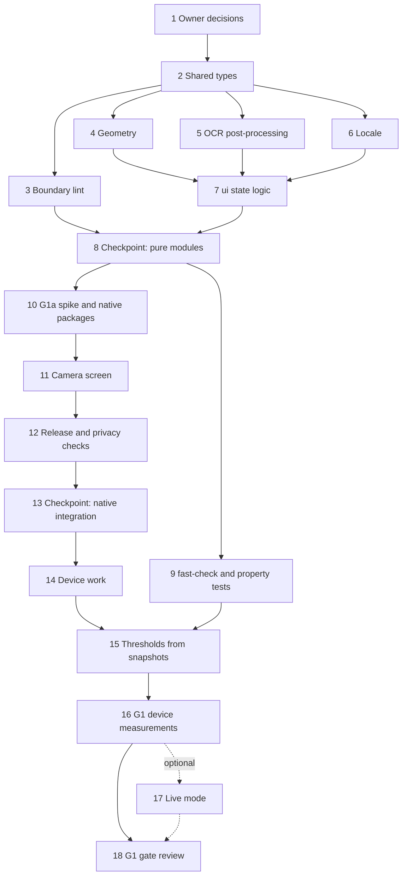

# Implementation Plan: camera-ocr-geometry

Status: **draft.** Written 2026-11-18 from `requirements.md` and `design.md`. No task is started or complete. A task is checked off only after its done check ran and its output was recorded.

## Overview

Order:
1. Pure TypeScript that needs no new package and no phone: shared types, geometry, OCR post-processing, locale, ui reducers and error map, and the boundary lint rule.
2. Approval-gated tooling: fast-check, then the property tests.
3. The G1a spike and native integration: dev client, camera, file system, OCR.
4. The camera screen.
5. Phone work: snapshots, thresholds, device tests.
6. Live mode (optional).
7. G1 gate review.

Blockers:
- **Owner Q4:** reference phone not named or connected. Blocks every device task.
- **TM-01 images (task 1.3):** TM-01 is the iPad image fixture (D-029, D-032), with ground truth in `test-fixtures/tm-01/FIXTURE.md`. Until the images are produced and measured, the DRAFT boxes can't be relied on. This blocks the AT-G1-02 ground truth and the TM-01 device tests.
- **fast-check approval:** blocks the property-test tasks.
- **Native package approvals** (expo-dev-client, camera library, OCR binding or Kotlin module, file-system package): block tasks 9 to 11.
- **Recorded OCR snapshots:** block the snapshot-based tests and the threshold values (OQ-5).

Done check for every task, unless the task says more: `npm run verify` exits 0 and `npx expo-doctor` passes. The PostTaskExec hook also runs `npm run verify`. Report the commands, exit codes, files changed, test counts and device status, as the quality steering requires.

Never skip, weaken or re-snapshot a test to make it pass. Tests that need OCR output use recorded snapshots from `test-fixtures/`. Under R25.7 a test may change named fields of a snapshot, and must state which fields.

## Tasks

- [ ] 1. Record owner decisions before code
  - [ ] 1.1 Ask the owner to decide OQ-1 to OQ-7 and CM-1 to CM-5
    - Present each recommended default from requirements.md and CAPABILITY-MAP.md §6. Record the answers in DECISIONS.md, one entry each, or one combined entry.
    - OQ-7 approved: add the `OCR_RECOGNITION_FAILED` row to ARCHITECTURE.md §8.
    - OQ-3 and OQ-6 approved: add the AT-G1-11 and AT-G1-03 wording entries.
    - OQ-1 and OQ-2 approved: move the not-configured adapter and `t(key)` from §4.B to §4.A in CAPABILITY-MAP.md, and update §5.
    - If the owner changes a default, update the affected requirement criteria and design sections before task 2 starts.
    - _Requirements: 8.9, 8.10, 12.1, 12.3, 13.1, 13.6, 17.1, 17.6, 20.1, 24.3, 24.13_
  - [ ] 1.2 Update the CAPABILITY-MAP.md status table
    - Only after the owner approves requirements and design, with the date. Generating a document isn't approval.
  - [ ] 1.3 Produce and measure the TM-01 base panel and CARD-EN/HI/KN/BLANK images per `test-fixtures/tm-01/FIXTURE.md`
    - Replace every DRAFT box (FIXTURE.md §3 and §4) with values measured from the final images. Record the generator and the date in FIXTURE.md §1. Check every image for garbled or misspelt text before use. D-031: no reviewer, so record the check as unreviewed, never "reviewed".
    - Write `test-fixtures/ocr-snapshots/ground-truth/TM-01.labels.json` (L01 to L09) and the CARD-EN, CARD-HI and CARD-KN line files from the measured images.
    - _Requirements: 21.7, 24.2, 25.6_

- [ ] 2. Add shared types and error codes
  - Files: `src/modules/shared/index.ts`, `src/modules/shared/__tests__/quad.test.ts`.
  - Add `Quad` (fixed corner order), `Script`, `FrameRef`, `OcrLine`, `UnsupportedLine`, `OcrResult` (with `excludedLineCount` and the quality flag), and the `CamErrorCode`, `OcrErrorCode` and `TrErrorCode` unions as defined in the design's shared section. `TrErrorCode` has only `TR_NOT_CONFIGURED` in this spec.
  - Add the quad helpers from the design (`quadSignedArea`, bounding box). No React or React Native imports.
  - Keep `Point`, `Size` and `Result` unchanged.
  - Unit tests for the helpers, using example quads.
  - _Requirements: 5.1, 5.4, 5.5, 23.1_

- [ ] 3. Add the module-boundary lint rule
  - [ ] 3.1 Configure ESLint core `no-restricted-imports` per module
    - Files: `eslint.config.js`.
    - Use the pattern list in the design's Testing Strategy: no deep imports, only allowed modules per ARCHITECTURE.md §5, vendor packages only in their owning adapter file, and `test-support` only in tests. No new dependency.
    - _Requirements: 23.4, 23.5, 23.6, 23.9, 23.10, 23.11_
  - [ ] 3.2 Prove the rule fails on a forbidden import
    - Add a deliberate forbidden import (for example `geometry` importing `ui`). Run `npm run lint` and record the failing output in `docs/kiro-evidence.md`. Remove the import and run `npm run lint` again to exit 0 (AT-G0-04, gate Q4).
    - _Requirements: 23.11_

- [ ] 4. Extend geometry
  - [ ] 4.1 Add quad mapping and the mirrored-frame flip
    - Files: `src/modules/geometry/quad.ts`, `src/modules/geometry/index.ts`, `src/modules/geometry/__tests__/quad.test.ts`.
    - `mapQuad`, `mirrorQuadX`, `frameQuadToView`. `cover-transform.ts` stays unchanged, and its existing tests must still pass.
    - Unit tests with example quads, including the mirrored case.
    - _Requirements: 10.4, 11.2, 25.9_
  - [ ] 4.2 Add the visible region and visibility classification
    - Files: `src/modules/geometry/visibility.ts`, its test, `index.ts`.
    - `computeVisibleRegion` (view, safe-area insets, control-bar heights) and `classifyVisibility` returning `visible`, `clipped` or `off-screen`. Keep `isVisibleInView` unchanged.
    - Unit tests for each state at each edge.
    - _Requirements: 12.1, 12.2, 12.3, 12.4_
  - [ ] 4.3 Add label placement
    - Files: `src/modules/geometry/placement.ts`, `src/modules/geometry/thresholds.ts` (label gap and line-height factor, using the design's proposed values with their reasons), their tests, `index.ts`.
    - `placeLabels`: deterministic, outside the source quad, inside the Visible region, no overlaps, and `unplaced` when no position fits.
    - Unit tests on example layouts, including a crowded one that forces `unplaced`. Pinned-value tests for each constant.
    - _Requirements: 13.2, 13.3, 13.4, 13.5, 13.7, 25.10_

- [ ] 5. Add OCR post-processing (pure, no engine)
  - [ ] 5.1 Add quad validation and confidence normalization
    - Files: `src/modules/ocr/post-process/quad.ts`, `confidence.ts`, their tests.
    - Exclude lines with non-finite corners or an area at or below the zero-area tolerance, and count them. `normalizeConfidence` returns a value in 0..1 or `undefined`.
    - Tests use hand-built raw lines only until snapshots exist. Task 15.2 re-runs them on snapshots.
    - _Requirements: 5.6, 5.7, 6.1, 6.2, 6.3_
  - [ ] 5.2 Add script classification and the rule functions
    - Files: `src/modules/ocr/post-process/script.ts`, `unsupported-rule.ts`, `low-quality-rule.ts`, their tests.
    - `classifyScript` uses explicit Unicode ranges. The unsupported-script and low-quality rules take their thresholds as a parameter, with no default values (OQ-5). `ocr/thresholds.ts` is created later, in task 15.
    - Unit tests on both sides of a test-supplied threshold.
    - _Requirements: 7.1, 7.2, 7.3, 7.4, 9.1, 9.2, 9.3_
  - [ ] 5.3 Add `postProcess`
    - Files: `src/modules/ocr/post-process/post-process.ts`, its test, `src/modules/ocr/engine.ts` (the `OcrEngine` interface and vendor-neutral raw line type), `src/modules/ocr/index.ts`.
    - Copies `frameId`, `capturedAtMs` and the image size. Returns `OCR_NO_TEXT` when no valid line remains. Attaches the low-quality flag without dropping lines. Turns unsupported lines into `UnsupportedLine` with no text.
    - _Requirements: 5.1, 5.2, 5.3, 5.4, 5.5, 5.9, 7.4, 8.1, 8.3, 23.3, 23.5, 23.7_

- [ ] 6. Add the locale strings and the not-configured adapter
  - Files: `src/modules/locale/index.ts`, `t.ts`, `strings/en.ts`, `strings/hi.ts`, `strings/kn.ts`, `translation.ts`, their tests.
  - `t(key)` with the string keys from the design's Data Models. `hi` and `kn` drafts are marked `unreviewed` (D-031: no reviewers, so never "reviewed"), and the UI language stays `en`.
  - The `TranslationProvider` interface and `notConfiguredProvider`, which returns `TR_NOT_CONFIGURED` per line with no network call. No API key, no secure storage, no OpenRouter.
  - Tests:
    - every key has all three locales;
    - every `hi` and `kn` value is `unreviewed`;
    - the adapter returns one `TR_NOT_CONFIGURED` per input, and a stubbed `fetch` is never called.
  - _Requirements: 17.1, 17.2, 17.9, 20.1, 20.2, 20.3, 20.4, 20.5_

- [ ] 7. Add the ui state logic (no camera yet)
  - [ ] 7.1 Add the error-to-UI map
    - Files: `src/modules/ui/camera-screen/error-map.ts`, its test.
    - Every `CAM_*` and `OCR_*` code (including `OCR_RECOGNITION_FAILED`, under OQ-7) maps to its ARCHITECTURE.md §8 message key and recovery action.
    - One QE-1 test per code.
    - _Requirements: 1.4, 1.7, 2.5, 3.8, 8.2, 8.4, 8.8, 8.10, 23.12, 25.8_
  - [ ] 7.2 Add the freeze-frame overlay reducer and item builder
    - Files: `src/modules/ui/overlay/freeze-overlay.ts`, `build-items.ts`, their tests.
    - Items carry the `frameId` of their result. Results and translations for frames that aren't shown are discarded. Items are removed on dismiss or replace. Exactly one label state per item. Positions are built from the current layout through geometry, never stored.
    - Unit tests with example action sequences, including a late result for a replaced frame.
    - _Requirements: 4.7, 14.1, 14.2, 15.1, 15.2, 15.3, 15.5, 15.6, 15.7, 17.3, 17.4, 17.5, 17.6, 17.7, 17.8_
  - [ ] 7.3 Add the screen model and overlay style constants
    - Files: `src/modules/ui/camera-screen/screen-model.ts`, `src/modules/ui/overlay/styles.ts`, `contrast.ts`, their tests.
    - The Camera_Screen state union from the design. Every state has a message key.
    - Style constants: text at 14 sp or larger, 48 dp touch targets, and colour pairs with contrast of at least 4.5:1, tested with `contrastRatio`.
    - _Requirements: 8.5, 18.3, 18.4, 19.1, 19.2, 19.5, 19.6_

- [ ] 8. Checkpoint: pure modules
  - Run `npm run verify` and `npx expo-doctor`, and record the output.
  - Run the read-only `vision-reviewer` agent, or the `vision-safety-review` skill, on the diff. Fix any BLOCKER or HIGH finding before task 9, and record the review in `docs/kiro-evidence.md`.
  - Ask the owner if questions came up.

- [ ] 9. Add fast-check and the property tests
  - [ ] 9.1 Ask the owner to approve fast-check
    - Check its official repo for maintenance and Jest 30 compatibility, and cite the source. On approval, run `npm install -D fast-check` (dev-only, not covered by `expo install`) with the exact version npm resolves, then `npx expo install --check` and `npx expo-doctor`. Record the decision in DECISIONS.md.
  - [ ] 9.2 Write geometry property tests (Properties 1 to 8)
    - Files: `src/modules/geometry/__tests__/*.property.test.ts`, `test-support/arbitraries.ts`.
    - At least 100 runs each.
    - _Requirements: 10.1, 10.2, 10.4, 11.2, 12.1, 12.3, 12.4, 13.2, 13.3, 13.4, 13.5, 13.7, 25.1, 25.2, 25.3, 25.4, 25.5, 25.9_
  - [ ] 9.3 Write property tests for confidence, script, the not-configured adapter and still frames (Properties 11, 12, 13, 16)
    - Property 13 needs the frame-id source and `toFrameRef` from task 10.3. Write it in that task if 10.3 isn't done yet.
    - _Requirements: 3.2, 3.5, 3.7, 4.6, 5.6, 5.7, 7.1, 7.2, 7.4, 7.5, 17.2_

- [ ] 10. Run the G1a spike and add the native packages
  - [ ] 10.1 Evaluate the camera and OCR candidates
    - Follow the design's G1a spike plan: expo-camera and react-native-vision-camera for the camera; an ML Kit Text Recognition v2 binding or a local Kotlin Expo Module for OCR (D-005).
    - Check each against the criteria: builds with SDK 58 and RN 0.88 New Architecture, model bundled for offline first launch, quads and confidence exposed, licence, maintenance. Cite sources.
    - Present the results to the owner and record the choice in DECISIONS.md.
    - If no OCR binding builds within 1 day, apply the G1 stop and pivot conditions.
  - [ ] 10.2 Install expo-dev-client, the chosen camera library and the file-system package
    - Ask the owner first, for each package.
    - On approval: `npx expo install <pkg>`, `npx expo install --check`, `npx expo-doctor`, `npx expo prebuild --clean`. Change native settings only through `app.json` or config plugins, never in `android/`.
    - Blocked on: owner approval and task 10.1.
  - [ ] 10.3 Implement the capture module
    - Files: `src/modules/capture/` as in the design's file layout: `camera-adapter.ts` (the only camera-library import), `file-system-port.ts` (the only file-system import), `still-store.ts`, `frame.ts`, `permission.ts`, `service.ts`, `CameraPreview.tsx`, `StillView.tsx`, `index.ts`, plus tests with fakes from `test-support/`.
    - Covers the permission states, the back camera only, release on background, `captureStill` returning `Result<FrameRef, CamErrorCode>`, upright normalization exactly once, unique frame ids, a monotonic clock, and the mirrored flag.
    - `TempStillStore`: stills only in the cache directory, deleted on dismiss, replace, background, start-up purge and failed capture, and never in the gallery.
    - QE-1 tests for each `CAM_*` code.
    - _Requirements: 1.1, 1.3, 1.5, 1.6, 2.1, 2.4, 2.6, 2.7, 3.1, 3.2, 3.3, 3.4, 3.5, 3.6, 3.7, 4.1, 4.2, 4.3, 4.4, 4.5, 4.6, 4.8, 11.1, 22.1, 22.2, 23.2, 23.4, 23.6_
  - [ ] 10.4 Implement the OCR engine adapter
    - Files: `src/modules/ocr/adapters/<engine>.ts` (the only OCR-binding import, or the Kotlin Expo Module bridge), `service.ts`, `index.ts`, and a test against a fake engine.
    - Engine load check, then `recognize(frame)`, which calls the adapter and passes the result to `postProcess`. Maps engine failures to `OCR_ENGINE_UNAVAILABLE` or `OCR_RECOGNITION_FAILED` with no throw across the boundary. Model loaded from the app package.
    - Blocked on: owner approval of the OCR package or module, and task 10.1.
    - _Requirements: 5.8, 5.9, 5.10, 8.6, 8.7, 8.9, 22.1, 22.4, 23.3, 23.5_

- [ ] 11. Build the camera screen
  - [ ] 11.1 Wire services and the camera screen hook
    - Files: `src/modules/ui/services.tsx`, `features.ts`, `camera-screen/useCameraScreen.ts`, its test with fake services.
    - Covers the freeze-frame flow from the design's sequence diagram, and recomputes positions on layout, inset, control-bar and font-scale changes.
    - _Requirements: 1.2, 1.9, 2.3, 2.8, 3.9, 3.10, 14.1, 14.2, 15.4, 23.10_
  - [ ] 11.2 Render the screen, overlays and accessibility
    - Files: `camera-screen/CameraScreen.tsx`, `ModeSwitcher.tsx`, `overlay/OverlayLayer.tsx`, `LabelView.tsx`, `LabelDetailSheet.tsx`, `src/modules/ui/index.ts`, and `src/app/index.tsx` (renders `<CameraScreen />` only).
    - Covers: the Translate-only switcher; a message in every state; the clip container at the Visible region; outlines and labels; ellipsis with tap for the full text; roles and labels in the UI language; 48 dp targets; controls inside the safe area; portrait only through `app.json`; no fake OCR output, boxes or demo text.
    - Tests: render tests for the states and accessibility props.
    - _Requirements: 1.4, 1.7, 1.8, 2.2, 2.5, 3.8, 7.5, 8.2, 8.4, 8.5, 8.8, 8.10, 12.2, 13.1, 13.6, 14.3, 18.1, 18.2, 18.3, 18.4, 18.5, 18.6, 19.3, 19.4, 19.6, 19.7, 19.8, 19.9_
  - [ ] 11.3 Add the debug snapshot exporter and fault-injection hooks
    - Files: `src/modules/capture/debug/snapshot-writer.ts`, `src/modules/ocr/debug/raw-lines.ts`, `src/modules/ui/debug/*`, the snapshot schema with `parseSnapshot` and `serializeSnapshot`, and tests.
    - Everything behind `__DEV__`, with the debug marker string. Exports go to app-specific storage outside the cache, never to the gallery.
    - Fault-injection hooks for `CAM_CAPTURE_FAILED`, `OCR_ENGINE_UNAVAILABLE` and `OCR_RECOGNITION_FAILED`.
    - Write Property 21 here if fast-check is approved.
    - _Requirements: 21.1, 21.2, 21.3, 21.4, 21.5, 25.11_

- [ ] 12. Run release and privacy checks
  - [ ] 12.1 Search the release bundle for debug code
    - Run `npx expo export --platform android`. Search the output for the debug marker and the test-hook names, and record the command and the result (no matches) in `docs/build-log.md`.
    - _Requirements: 21.6_
  - [ ] 12.2 Check network calls, keys and log statements
    - Search `src/modules/capture`, `ocr` and `geometry` for `fetch`, `XMLHttpRequest`, `WebSocket` and HTTP libraries. Search `src/modules/locale` for API-key storage and `openrouter`. Check that release builds log no OCR text or image data. Record the results.
    - _Requirements: 17.9, 22.1, 22.2, 22.3_
  - [ ] 12.3 Inspect the merged Android manifest permissions
    - After `npx expo prebuild --clean`, list the merged permissions. Justify each one in `docs/build-log.md`: only `CAMERA`, `INTERNET` and those required by Expo/RN core (gate Q9).
    - _Requirements: 22.5_

- [ ] 13. Checkpoint: native integration
  - Run `npm run verify` and `npx expo-doctor`. Then run the debug build, `npx expo run:android --device` (B1), and the vision-reviewer agent on the diff.
  - Blocked on: owner Q4 phone. Without it, report "device validation pending" and keep this task open.

- [ ] 14. Device work on the reference phone
  - Blocked on: owner Q4 for every sub-task. Use the `physical-device-qa` skill. Record PASSED, FAILED or NOT TESTED in `docs/DEVICE-TESTS.md`, with commit, variant, device and date.
  - [ ] 14.1 Check cover scaling against the real still view
    - Compare overlay positions with the chosen library's real still view, and record the result in `docs/build-log.md`. If the scaling isn't centred cover, add a DECISIONS.md entry and change geometry (R10.6) before task 16.
    - _Requirements: 3.10, 10.5, 10.6_
  - [ ] 14.2 Export recorded OCR snapshots
    - Blocked on: task 1.3.
    - Export the TM-01 base panel and CARD-EN, CARD-HI, CARD-KN and BLANK images shown on the iPad, at L2, L3 and the DT-G1-03 distances and angles.
    - Copy them into `test-fixtures/ocr-snapshots/` with manifest entries and the garbled-text check from task 1.3 (R21.7).
    - _Requirements: 21.7, 25.6_
  - [ ] 14.3 Run DT-G1-01 and DT-ERR-01
    - Permission paths and camera in use.
    - _Requirements: 1.1 to 1.9, 2.4, 2.5, 24.1_
  - [ ] 14.4 Run the iPad capture checks
    - Per FIXTURE.md §9: full brightness, auto-lock off, and glare and moire (screen pattern) at D30, D60, D100 and at A0 and A30. Record each as PASSED, FAILED or NOT TESTED in `docs/DEVICE-TESTS.md`. If recall is under 70% in good light, stop and try paper before changing code (G1 stop condition).
    - _Requirements: 24.2, 24.3_

- [ ] 15. Set thresholds from the snapshots
  - Blocked on: task 14.2.
  - [ ] 15.1 Measure and record the OQ-5 values
    - Tune the low-quality rule (TM-01 at L3) and the unsupported-script rule (CARD-KN) on the recorded snapshots. Present the values to the owner, then record them in DECISIONS.md before the G1 measurements.
    - _Requirements: 7.6, 9.3, 9.4_
  - [ ] 15.2 Create `ocr/thresholds.ts` and the snapshot-based tests
    - Pinned-value tests and tests on both sides of each threshold.
    - Re-run task 5's tests on recorded snapshots.
    - Write Properties 9 and 10.
    - Add snapshot-based tests for Properties 14, 15 and 17.
    - _Requirements: 5.2, 5.3, 6.1, 6.2, 6.3, 7.6, 8.1, 8.3, 9.1, 9.4, 9.5, 14.1, 14.2, 15.1 to 15.7, 17.3 to 17.8, 25.6, 25.7, 25.10_

- [ ] 16. Run the G1 device measurements
  - Blocked on: owner Q4, task 1.3 (TM-01 images), and task 15. Run timing tests on a release build: `npx expo run:android --device --variant release` (B2). Record each DT result.
  - [ ] 16.1 Run DT-G1-02, DT-G1-03 and DT-G1-04
    - TM-01 recall, overlay alignment at each distance and angle, and latency.
    - _Requirements: 24.2, 24.3, 24.4, 24.5_
  - [ ] 16.2 Run DT-G1-06, DT-G1-07 and DT-G1-08
    - Hindi, Kannada and blank.
    - _Requirements: 7.5, 24.9, 24.10, 24.11_
  - [ ] 16.3 Run DT-G1-09 and DT-G1-10
    - Airplane mode after a fresh install, and the cache directory after the last still is dismissed.
    - _Requirements: 4.2, 22.4, 24.12, 24.13_
  - [ ] 16.4 Reach every remaining CAM and OCR state (QE-2)
    - DT-ERR-02 with the debug fault-injection hooks, and DT-ERR-03 in dim light.
    - _Requirements: 8.4, 8.5, 8.8, 8.10, 25.11_

- [ ]* 17. Live mode (optional, G1c, 1-day cap)
  - Freeze-frame ships without it (D-011). Start only after task 16 passes and only with a camera library that has frame processors. Stop at the 1-day cap.
  - [ ]* 17.1 Add the live frame slot, line matching and the live overlay reducer
    - Files: the capture frame-processor slot, `src/modules/geometry/track.ts`, `src/modules/ui/overlay/live-overlay.ts`, tests.
    - Write Properties 18, 19 and 20. Record the TTL and the matching threshold in DECISIONS.md.
    - _Requirements: 16.2, 16.3, 16.4, 16.5, 16.6_
  - [ ]* 17.2 Run DT-G1-05 on a release measurement build
    - Build with `EXPO_PUBLIC_OVERLAYKIT_LIVE` on. Measure the update rate, jitter, and 10-minute stability. Enable live mode in distributed builds only after a PASSED record and a DECISIONS.md entry.
    - _Requirements: 16.1, 24.6, 24.7, 24.8_

- [ ] 18. G1 gate review
  - Report AT-G1-01 to AT-G1-11, QE-1, QE-2 and QE-3 as PASSED, FAILED or pending, each with its evidence path in `docs/DEVICE-TESTS.md`, `docs/build-log.md` or the test output.
  - Run the vision-reviewer agent on the full spec diff. Apply the G1 stop and pivot conditions if any measurement fails.
  - Update the CAPABILITY-MAP.md status table, and the `tasks/todo.md` G1 items that are actually done.
  - _Requirements: 24.1 to 24.13, 25.8, 25.11_

## Task Dependency Graph



```json
{
  "waves": [
    { "id": 0, "tasks": ["1.1"] },
    { "id": 1, "tasks": ["2", "1.3"] },
    { "id": 2, "tasks": ["3.1", "4.1", "4.2", "5.1", "5.2", "6"] },
    { "id": 3, "tasks": ["3.2", "4.3", "5.3"] },
    { "id": 4, "tasks": ["7.1", "7.2", "7.3"] },
    { "id": 5, "tasks": ["8"] },
    { "id": 6, "tasks": ["9.1", "10.1"] },
    { "id": 7, "tasks": ["9.2", "10.2"] },
    { "id": 8, "tasks": ["10.3", "10.4"] },
    { "id": 9, "tasks": ["9.3", "11.1"] },
    { "id": 10, "tasks": ["11.2", "11.3"] },
    { "id": 11, "tasks": ["12.1", "12.2", "12.3"] },
    { "id": 12, "tasks": ["13"] },
    { "id": 13, "tasks": ["14.1", "14.2", "14.3", "14.4"] },
    { "id": 14, "tasks": ["15.1"] },
    { "id": 15, "tasks": ["15.2"] },
    { "id": 16, "tasks": ["16.1", "16.2", "16.3", "16.4"] },
    { "id": 17, "tasks": ["17.1"] },
    { "id": 18, "tasks": ["17.2"] },
    { "id": 19, "tasks": ["18", "1.2"] }
  ]
}
```

Tasks 3 to 6 can run in parallel after task 2. Task 9 can run in parallel with task 10. Every task from 13 on needs the reference phone (owner Q4).

## Notes

- Task 17 is the only optional work (`*`). Every other task, including the property tests, is required by the quality steering.
- No task is complete. Check one off only after its done check ran and its output was recorded, never because a document was generated.
- Owner approvals gate tasks 1, 9.1, 10.1, 10.2, 10.4 and 15.1. Ask before installing or recording anything.
- Device results without a `docs/DEVICE-TESTS.md` record count as "device validation pending".