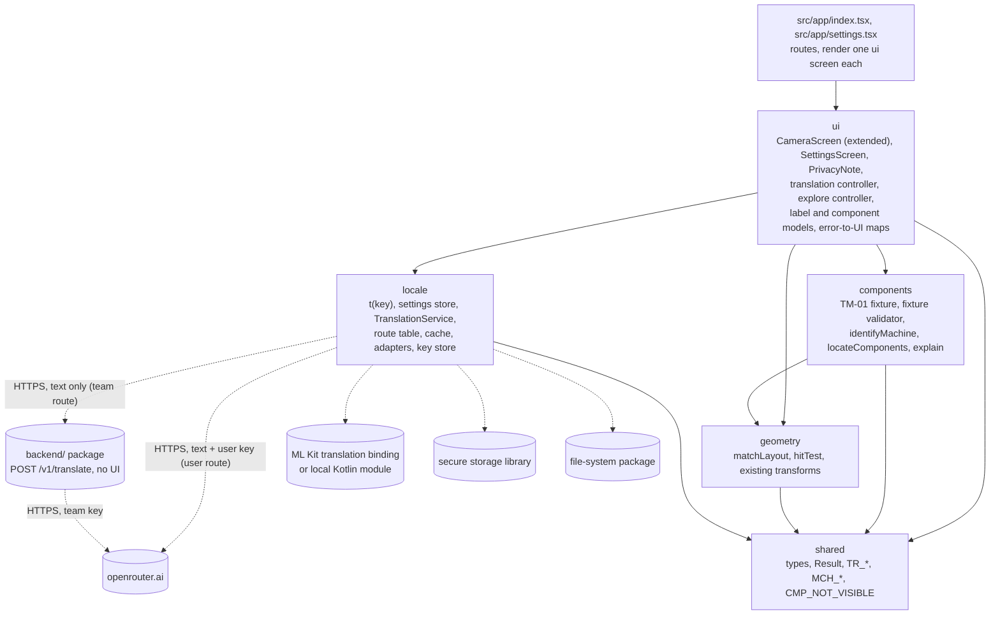
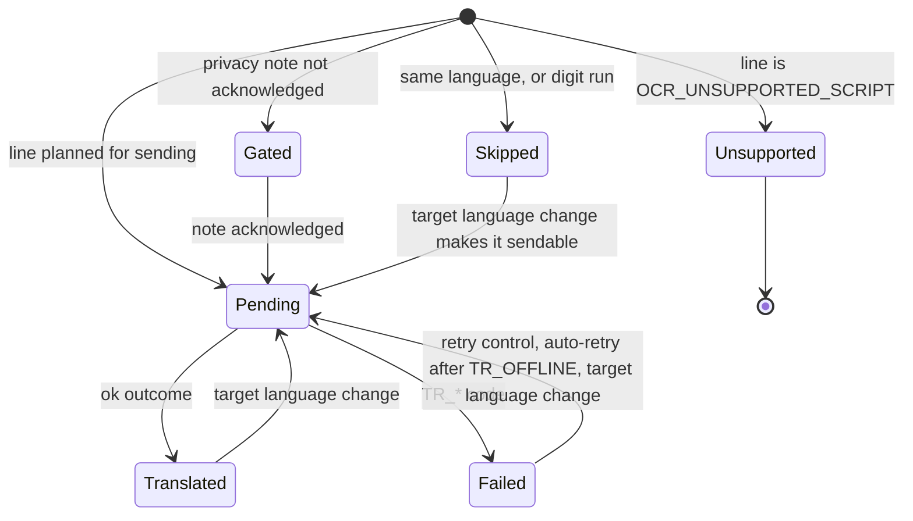
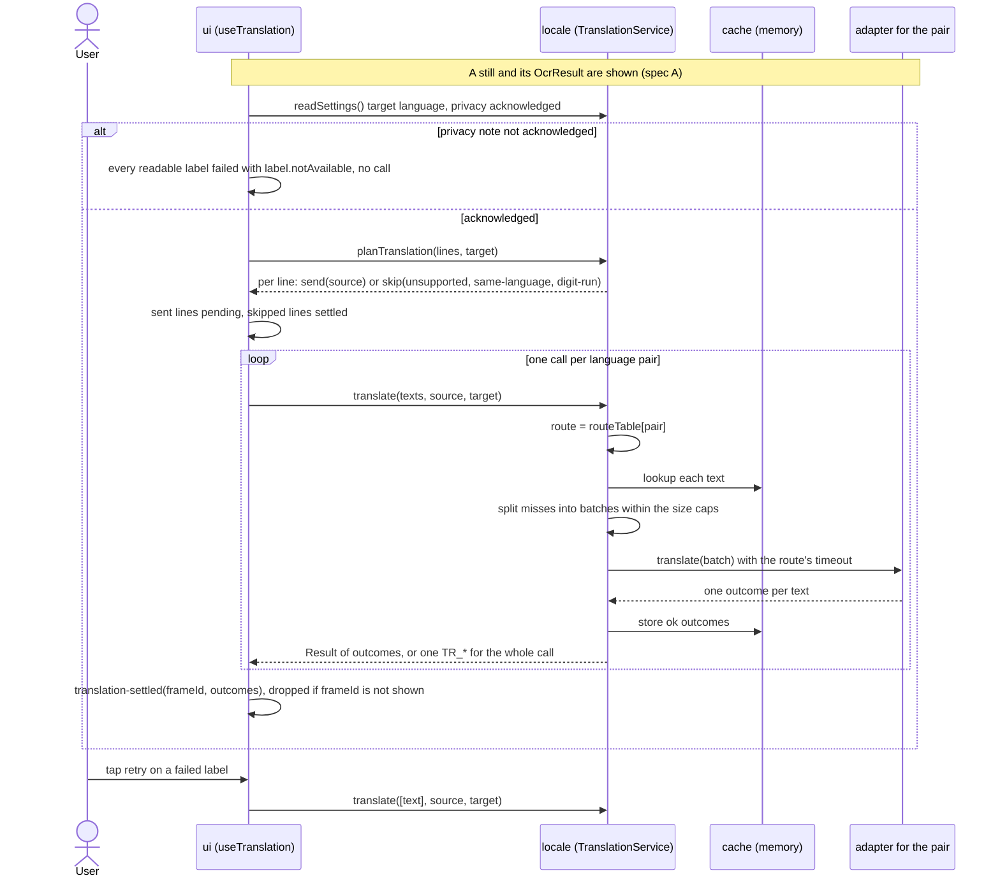
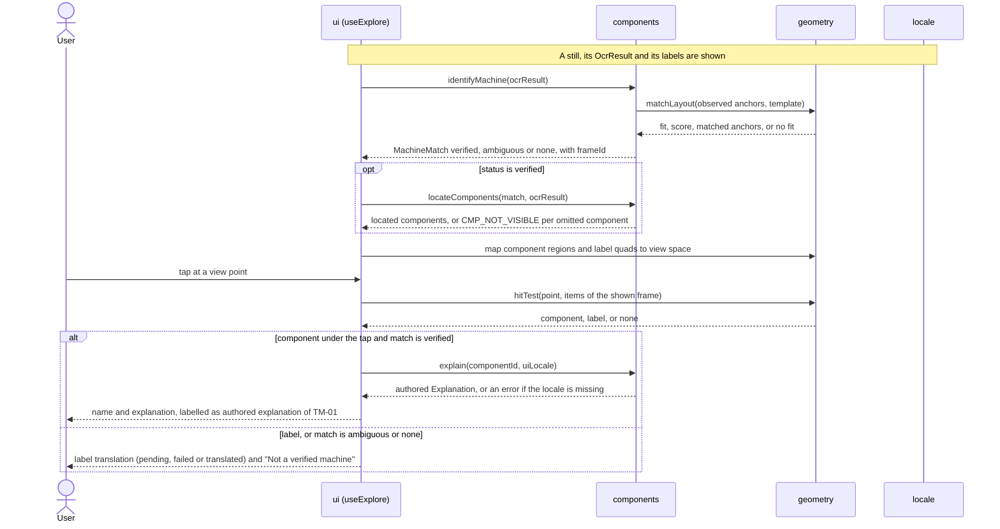

# Design Document: translation-explore

Status: **draft, awaiting owner review.** Written from `requirements.md` (draft). Open questions OQ-1 to OQ-10 use their recommended defaults. No code exists for this design yet. Every statement about the phone is a plan: device validation pending.

## Overview

This design covers capability B in `docs/CAPABILITY-MAP.md` (§4.B): translating recognized text through a real provider, switching the target language, showing one state per label, the Settings route (language, OpenRouter key, privacy note), and Explore, which explains the components of the verified machine TM-01 and shows only a translation everywhere else. It delivers gate G2 (AT-G2-01 to AT-G2-11), gate G3 (AT-G3-01 to AT-G3-06), and the QE-1, QE-2 and QE-3 checks for the `TR_*`, `MCH_*` and `CMP_NOT_VISIBLE` codes.

**Translate path.** For one shown still (spec A), `ui` plans which recognized lines to send (skip unsupported script, same-language, long digit runs), groups the rest by language pair, and calls `locale`'s `TranslationService` once per pair. The service reads the fixed **route table** (D-027) and picks one adapter per pair:

1. `on-device`: ML Kit translation, only for pairs that pass AT-G2-02 and the latency criterion.
2. DEFERRED (D-030) `cloud`: OpenRouter, with one pinned model and the same safeguards on two routes. The **user route** is used when a key is saved (directly from the phone). Otherwise the **team route** through the `backend/` proxy (D-028).
3. `not-configured`: `TR_NOT_CONFIGURED` for every string of that pair (D-007).

Each outcome becomes exactly one Label state in `ui` (translated, pending, failed, unsupported).

**Decisions D-029 to D-032 applied to this design.**
- D-030: ML Kit on-device only for now. The `cloud` route (item 2 above), the OpenRouter adapters, the `backend/` proxy and the OpenRouter key section in Settings are **DEFERRED**. Their text below is kept and is not part of current work. The route table defaults each pair to `on-device` (ML Kit) or `not-configured`. Gate tests use only `en`, `hi` and `kn`. Other ML Kit languages are evaluation extras and are not shipped.
- D-031: there are no reviewers. Every `hi` and `kn` value, and the fixture's `review` field, can hold the state `unreviewed`, never `reviewed`. The README and demo disclose it.
- D-029, D-032: TM-01 is the iPad image fixture. Its anchors (L01 to L09), components (C-*) and ground truth come from `test-fixtures/tm-01/FIXTURE.md` sections 3 and 4, with every box DRAFT until measured from the final image.

**Explore path.** `ui` passes the shown `OcrResult` to `components.identifyMachine`. The result is `verified`, `ambiguous` or `none`, decided by `geometry.matchLayout` over several anchors. On `verified`, `components.locateComponents` maps component regions into the frame, `geometry` maps them to view space, and a tap goes through `geometry.hitTest`. A located component shows its authored explanation. Any other tap, and every tap on `ambiguous` or `none`, shows the label's translation and "Not a verified machine". Fixture text is never a translation source, and `locale` never reads the fixture (D-008, R11).

**What spec A provides and this design extends** (spec A `design.md`, locale and geometry sections): `TranslationProvider`, `TranslationRequest`, `TranslationOutcome`, `notConfiguredProvider`, `t(key)`, the string tables, `FrameRef`, `OcrResult`, `OcrLine`, `Quad`, `mapQuad`, `frameQuadToView`, `classifyVisibility`, `placeLabels`, the Overlay_Layer, the freeze-frame overlay reducer and `translationRequestFor`. If the owner rejects spec A's OQ-1 and OQ-2, B adds the first four items first (OQ-10). Nothing in this design changes an existing A test.

**What doesn't exist yet:** every adapter named below, the `backend/` package, a route table, a pinned model, the final TM-01 images and measured boxes (D-029, D-032), the reference phone (Q4), Hindi and Kannada reviewers (none, D-031), fast-check, and any recorded OCR snapshot. Vendor and package names appear only in the G2 evaluation plan and in the adapter files it creates.

### Design decisions in this document

| ID | Decision | Reason |
| --- | --- | --- |
| DD-1 | `locale` exposes a `TranslationService` built from a route table, adapters, a cache, a key store and a settings store, all injected. `ui` gets it through the same services context as spec A. | Tests pass fakes. Routing logic is one pure function plus wiring. |
| DD-2 | The spec A `TranslationProvider` interface keeps its shape: one outcome per input text, never rejects. A whole-call failure is represented by every outcome carrying the same `TR_*` code. The service converts that case to `Result` `ok: false` (`collapseUniformFailure`, R1.1). | No change to A's contract or tests. R1.1 is still met at the service. |
| DD-3 | The service, not the adapters, owns the cache, the timeouts, the batch splitting and the rate-limit gate. Adapters make one HTTP or native call per batch. | One place to test R4.6, R5.14, R7.16, R9.5, R12.3. Adapters stay thin. |
| DD-4 | Source language of a line is inferred from its script: `devanagari` is `hi`, `latin` is `en`. The proxy and user route still send `source` explicitly, never `auto`, in this spec. | The camera reads English and Hindi only (D-005). Romanized Hindi is a known limit (Open design points). |
| DD-5 | DEFERRED (D-030). The translation prompt and the output check live in two copies, `locale/protocol/` and `backend/src/protocol/`. A golden file `test-fixtures/translation-protocol/protocol.golden.json` holds the prompt, the routing settings and the shared cases. Both copies are tested against it. | R5.12 and D-028 need one shared test set. `backend/` is never imported by app code, and `locale` cannot import `backend`, so a shared import is impossible. |
| DD-6 | The Injection set and the output-check cases are JSON data in `test-fixtures/translation-protocol/`, not code. | Both packages and the Fluent_Reviewers read the same file. |
| DD-7 | The in-memory cache stores only successful translations, keyed by `source`, `target` and exact text. It is cleared when a key is saved or removed. | R10.9. A route change could change output, so old entries are dropped. |
| DD-8 | `ui` never decides verification. It calls `identifyMachine` and reads `status`. | R26.6, architecture steering. |
| DD-9 | `hitTest` takes already mapped view-space items, each tagged `kind: 'component' | 'label'`. Priority is a parameter of the item set (components first), not logic in `ui`. | R21.2, R21.9, OQ-7. |
| DD-10 | Component and label items are rebuilt from image-space data and the current layout on every render, as in spec A DD-6. | Taps always hit what is drawn, including after inset or font-scale changes. |
| DD-11 | `locale` keeps persistent state in two stores only: `SettingsStore` (non-secret, file-backed) and `KeyStore` (Keystore-backed). | R13.6, R8.7. |
| DD-12 | Debug fault injection for `TR_*` states wraps the route table's adapters, not the UI, and is reached only through `__DEV__ ? require(…) : null` accessors with the marker `OVERLAYKIT_DEBUG_ONLY`. | R9.12. Release bundle search checks it is gone. |
| DD-13 | A same-language or not-sent line is displayed as a translated-state label whose `origin` is not `provider`. | R10.1 shows it "in the translated state's place". See Open design points DP-1 for the R2.6 tension. |

## Architecture

### Module map

Arrows mean "may import" (ARCHITECTURE.md §5). `capture`, `ocr`, `guide` and `speech` are not touched. `backend` is a separate package that nothing imports; `locale` reaches it only over HTTPS. Dotted arrows are vendor libraries, each used by one adapter file.



Rules this map enforces (R26):

- `locale` and `components` never import each other. `ui` passes text and results between them.
- `components` imports only `geometry` and `shared`. `geometry` imports only `shared`, with no React Native and no I/O.
- Vendor types never leave `locale`. The ML Kit binding, the secure-storage library and the file-system package are each used by one adapter file.
- `components` and `geometry` make no network calls. `locale` is the only app module with network code, and its calls go only to the configured proxy URL and `https://openrouter.ai`.
- The static boundary rule from spec A's lint sketch gets one change: `locale` leaves `NETWORK_FREE`, and its `fetch` use is limited to `locale/adapters/*-route.ts` files by a per-file override.

### Label states

One Label state per recognized line. `ui` owns the transitions.



`Skipped` renders in the translated state with `origin: 'same-language'` or `'not-sent'` (DD-13). `Gated` renders as `failed` with the marker "Translation not available" and sends nothing (R15.6). Moving to a different still, or dismissing the still, discards every pending outcome by `frameId` (R2.8).

### Translate flow



### Explore flow



`MCH_NOT_VERIFIED` and `MCH_AMBIGUOUS` select the second branch. `CMP_NOT_VISIBLE` drives the "Point the camera at the [component]" prompt only when a specific component is requested (by spec C's Guide, or by the Explore component list, see `ComponentPrompt` below).

### Composition and test seams

- `ui/services.tsx` (spec A) gains `translation: TranslationService`, `settings: SettingsStore`, and `machines: MachineService`. Defaults are built once. Tests render with fakes from `test-support/`.
- `locale` takes a `Clock` (`MonotonicClock` from spec A's `shared`), an `HttpPort` (a thin wrapper over global `fetch` with abort support), a `KeyStore`, a `SettingsStore`, an `OnDeviceEngine` port and the route table. `test-support/` fakes all six.
- Debug fault injection (`ui/debug/translation-faults.ts`, `__DEV__` only) swaps the `HttpPort` and `OnDeviceEngine` for wrappers that force timeout, 429, 5xx and unsupported-pair for the next call (R9.12). Dev-menu items use `DevSettings.addMenuItem`.
- No state library. React state and hooks in `ui`, plus the one settings store in `locale` (R26.11).

### File layout

```
src/app/index.tsx                          unchanged (spec A)
src/app/settings.tsx                       renders <SettingsScreen />, nothing else (R16.1, R16.2)
src/modules/shared/index.ts                additions below
src/modules/geometry/
  layout-match.ts, hit-test.ts, similarity.ts, thresholds.ts (additions)
src/modules/components/
  index.ts, fixture-types.ts, fixtures/tm-01.ts, validate-fixture.ts,
  identify.ts, locate.ts, explain.ts, anchor-text.ts, thresholds.ts
src/modules/locale/
  index.ts, t.ts, strings/{en,hi,kn}.ts (additions), settings-store.ts, settings-file-adapter.ts
  service.ts, route-table.ts, plan.ts, cache.ts, batching.ts, collapse.ts, rate-gate.ts, thresholds.ts
  key-store.ts, key-store-secure-adapter.ts, key-check.ts
  protocol/prompt.ts, protocol/request.ts, protocol/output-check.ts, protocol/http-map.ts
  adapters/not-configured.ts (spec A), adapters/on-device.ts, adapters/team-route.ts, adapters/user-route.ts
  debug/fault-wrappers.ts                  __DEV__ only
src/modules/ui/
  settings/SettingsScreen.tsx, LanguageSection.tsx, OpenRouterKeySection.tsx, PrivacyNote.tsx, useSettings.ts
  translate/useTranslation.ts, label-model.ts, translation-reducer.ts, error-map.ts, thresholds.ts
  explore/useExplore.ts, explore-model.ts, ExplorePanel.tsx, ComponentPrompt.tsx
  overlay/ (spec A, extended: LabelView states, component outlines)
  debug/translation-faults.ts              __DEV__ only
backend/
  package.json, src/handler.ts, src/limits.ts, src/rate-limit.ts, src/openrouter.ts,
  src/protocol/{prompt,request,output-check,http-map}.ts, test/
test-fixtures/translation-protocol/        protocol.golden.json, injection-set.json, output-check-cases.json
test-fixtures/ocr-snapshots/               spec A snapshots, plus the TM-01 and NEG-01 to NEG-10 captures
test-support/                              fakes: HttpPort, KeyStore, SettingsStore, OnDeviceEngine, Clock
```

No folder or file inside a module is named after another module. `backend/` has no import from `src/`, and `src/` has no import from `backend/` (R26.9, Q4).

## Components and Interfaces

Code blocks show each module's public surface as TypeScript declarations. Bodies are omitted. Only what a block marks as internal stays outside `index.ts`.

### shared

Additions to `src/modules/shared/index.ts`, beside spec A's types.

```ts
// Complete TR_* list from ARCHITECTURE.md §8. Spec A had only TR_NOT_CONFIGURED.
export type TrErrorCode =
  | 'TR_NOT_CONFIGURED' | 'TR_OFFLINE' | 'TR_TIMEOUT' | 'TR_RATE_LIMITED'
  | 'TR_PROVIDER_ERROR' | 'TR_UNSUPPORTED_PAIR' | 'TR_KEY_INVALID' | 'TR_NO_CREDITS';
export type MchErrorCode = 'MCH_NOT_VERIFIED' | 'MCH_AMBIGUOUS';
export type CmpErrorCode = 'CMP_NOT_VISIBLE';
export declare const TR_ERROR_CODES: readonly TrErrorCode[];   // exhaustive QE-1 tests
export declare const MCH_ERROR_CODES: readonly MchErrorCode[];
export declare const CMP_ERROR_CODES: readonly CmpErrorCode[];

export type SourceLocale = 'en' | 'hi';                     // languages the camera reads (D-005)
export type LanguagePair = { readonly source: SourceLocale; readonly target: LocaleCode };

/** Spec A's Translation, extended. detectedSource is null when the provider reports none. */
export type Translation = {
  readonly text: string;
  readonly providerId: string;
  readonly detectedSource: LocaleCode | null;
};
export type TranslationOutcome = Result<Translation, TrErrorCode>;

/** Similarity from Machine space to Image space: uniform scale, rotation, translation (ARCHITECTURE.md §7). */
export type MachineFit = {
  readonly scale: number;          // finite, > 0
  readonly rotationRad: number;    // finite
  readonly translation: Point;     // finite
};

export type MachineStatus = 'verified' | 'ambiguous' | 'none';
export type MachineMatch =
  | { readonly status: 'verified'; readonly machineId: 'TM-01'; readonly frameId: FrameId;
      readonly fit: MachineFit; readonly score: number; readonly matchedAnchors: number }
  | { readonly status: 'ambiguous'; readonly frameId: FrameId; readonly code: 'MCH_AMBIGUOUS';
      readonly matchedAnchors: number }
  | { readonly status: 'none'; readonly frameId: FrameId; readonly code: 'MCH_NOT_VERIFIED' };

export type ComponentKind =
  'card-reader' | 'coin-slot' | 'note-slot' | 'touchscreen' | 'button' | 'ticket-tray' | 'other';
/** A fixture component mapped into the frame. frameId is the OcrResult's (R20.1). */
export type LocatedComponent = {
  readonly id: string;
  readonly kind: ComponentKind;
  readonly frameId: FrameId;
  readonly quad: Quad;             // Image space, finite
};
```

`shared` keeps spec A's rule: types and pure helpers only. `MachineFit` lives here, not in `geometry`, so `components` and `ui` can name it without a second import path. `geometry.matchLayout` returns it.

### geometry additions

```ts
// src/modules/geometry/index.ts (additions, existing exports unchanged)
import type { MachineFit, Point, Quad } from '../shared';

export type AnchorTemplate = { readonly key: string; readonly pos: Point };            // Machine space
export type ObservedAnchor = { readonly key: string; readonly pos: Point };            // Image space, centre of the matched line quad
export type LayoutMatch =
  | { readonly kind: 'fit'; readonly fit: MachineFit; readonly score: number; readonly matched: readonly string[] }
  | { readonly kind: 'no-fit' };

/**
 * Least-squares similarity (scale, rotation, translation) between the matched template anchors and the
 * observed anchors. score in [0, 1] from the normalized residual. Non-finite observed points are ignored.
 * 'no-fit' when fewer than `minPoints` distinct template keys are matched, or the fit is degenerate.
 */
export declare function matchLayout(
  observed: readonly ObservedAnchor[], template: readonly AnchorTemplate[], minPoints: number,
): LayoutMatch;

/** Applies a fit to a Machine-space quad. Returns an Image-space quad, same corner order. */
export declare function applyFit(fit: MachineFit, machineQuad: Quad): Quad;

export type HitItem =
  | { readonly kind: 'component'; readonly id: string; readonly quad: Quad }          // View space
  | { readonly kind: 'label'; readonly id: string; readonly quad: Quad };             // View space
export type HitResult =
  | { readonly kind: 'hit'; readonly item: HitItem; readonly via: 'inside' | 'margin' }
  | { readonly kind: 'none' };

/**
 * Item under the point. Inside beats margin. Among items that contain the point, a 'component' beats a 'label'
 * (OQ-7), then the smaller quad area wins, then the smaller id. Within the margin and containing nothing:
 * the nearest quad edge distance wins, ties by kind then id. Non-finite point or minTargetDp: 'none'.
 */
export declare function hitTest(point: Point, items: readonly HitItem[], minTargetDp: number): HitResult;

export { ROTATION_TOLERANCE_RAD, HIT_MIN_TARGET_DP } from './thresholds';
```

**`matchLayout` method.** Pair each observed anchor with the template anchor of the same `key` (one per key; if the key was observed twice, the pair with the lowest residual under the first fit is kept, ties by index). Solve the 2D similarity in closed form (Umeyama / Procrustes: centroids, then scale and rotation from the 2×2 cross-covariance). The score is `1 − min(1, rmsResidual / observedExtent)`, where `rmsResidual` is the root-mean-square distance between fitted and observed points and `observedExtent` is the largest pairwise distance between matched observed points. Both numerator and denominator scale with the panel, so the score does not change under uniform scale, translation or rotation of the observed points (R19.3). A fit whose `|rotationRad|` exceeds `ROTATION_TOLERANCE_RAD` is `no-fit` (R19.7), as is a fit with `scale ≤ 0`, a non-finite field, or `observedExtent` of zero. The function takes `minPoints` as a parameter, so its tests run before `components/thresholds.ts` holds a value.

**Why a similarity and not an affine or homography fit.** Spec B's requirement is tolerance for distance, position and small rotation (ARCHITECTURE.md §7). A uniform-scale fit has four parameters and cannot absorb a wrong anchor into a skewed solution. Perspective tilt shows up as a worse score, which is the safe direction: more `ambiguous`, fewer false `verified`. DT-G3-01 includes A30 captures; if recall at A30 is below the gate, the fix is a new decision, not a silent model change.

**`hitTest` method.** Containment uses the even-odd rule on the quad polygon. Edge distance is the minimum point-to-segment distance over the four edges. The touch margin is not a free number. It is derived per item from the 48 dp minimum touch target that native-ux and spec A already fix (`MIN_TOUCH_TARGET_DP`): each side of the item's bounding box that is shorter than `minTargetDp` gets `(minTargetDp − side) / 2` of margin, and a side already long enough gets none. So every item has an effective target of at least `minTargetDp` × `minTargetDp`, which is what R21.4 asks for. The function takes `minTargetDp` as a parameter, and `geometry/thresholds.ts` exports `HIT_MIN_TARGET_DP = 48` with its source. A point inside the expanded box but outside the quad is a `'margin'` hit, ranked by edge distance. R21.4 calls the margin a Named threshold constant; this design names the 48 dp target as the constant and derives the margin from it (see DP-4).

### components

```ts
// src/modules/components/index.ts
import type {
  CmpErrorCode, ComponentKind, LocaleCode, LocatedComponent, MachineMatch, MchErrorCode, OcrResult, Quad, Result,
} from '../shared';

export interface MachineService {
  /** Never throws. 'none' with MCH_NOT_VERIFIED when the fixture is rejected by the validator (R17.7, R18.5). */
  identifyMachine(ocr: OcrResult): MachineMatch;
  /** Empty list unless match.status is 'verified' (R20.4). frameId of each item is ocr.frameId. */
  locateComponents(match: MachineMatch, ocr: OcrResult): LocateResult;
  /** Authored text only. Error when the locale has no text (R22.3). */
  explain(componentId: string, locale: LocaleCode): Result<Explanation, 'EXPLANATION_MISSING'>;
  /** Names for prompts such as "Point the camera at the [component]". Authored, per locale. */
  componentName(componentId: string, locale: LocaleCode): Result<string, 'EXPLANATION_MISSING'>;
  listComponents(): readonly { readonly id: string; readonly kind: ComponentKind }[];
}
export type Explanation = { readonly componentId: string; readonly locale: LocaleCode; readonly text: string };
export type LocateResult = {
  readonly located: readonly LocatedComponent[];
  readonly notVisible: readonly { readonly componentId: string; readonly code: CmpErrorCode }[];
};
export declare function createMachineService(fixture?: MachineFixtureB): MachineService;

/** TM-01 fixture content for this spec. screens and workflows belong to spec C (CM-1, R17.9, R17.12). */
export type MachineFixtureB = {
  readonly id: 'TM-01';
  readonly version: number;
  readonly verification: {
    readonly verifiedBy: string; readonly verifiedOn: string;
    readonly method: 'on-site' | 'replica'; readonly evidence: readonly string[];
  };
  readonly identification: {
    readonly anchors: readonly { readonly text: string; readonly pos: Point }[];
    readonly minAnchors: number;
    readonly minScore: number;
  };
  readonly components: readonly {
    readonly id: string;
    readonly kind: ComponentKind;
    readonly region: Quad;                                    // Machine space
    readonly name: Readonly<Record<LocaleCode, string>>;
    readonly explanation: Readonly<Record<LocaleCode, string>>;
  }[];
  /** D-031: 'unreviewed' is an allowed state and is the only state while no reviewer exists. */
  readonly review: Readonly<Record<'hi' | 'kn',
    | 'unreviewed'
    | { readonly reviewer: string; readonly reviewedOn: string }>>;
};

export type FixtureIssue = { readonly rule: FixtureRule; readonly path: string };
export type FixtureRule =
  | 'TOO_FEW_ANCHORS' | 'MISSING_LOCALE' | 'EMPTY_REVIEW' | 'BAD_REGION' | 'DUPLICATE_COMPONENT_ID'
  | 'BAD_THRESHOLD' | 'EMPTY_ANCHOR_TEXT' | 'NON_FINITE_POSITION';
/** Pure. Reports every issue, not the first (R17.6). */
export declare function validateFixture(fixture: MachineFixtureB): readonly FixtureIssue[];
```

`MachineFixtureB` is the subset of ARCHITECTURE.md §10's `MachineFixture` that this spec fills. Spec C widens it to the full type by adding `workflows` and `screens`. One addition beyond §10: a per-locale `name` for each component, needed for the `CMP_NOT_VISIBLE` prompt (R20.6). It is authored content under the same review rule (OQ-6) and is flagged in Open design points DP-3.

**`identifyMachine`.**

1. If `validateFixture(fixture)` returns any issue, return `none` with `MCH_NOT_VERIFIED`.
2. Keep lines whose `script` is `latin` or `devanagari` and drop the rest (R18.8). Normalize each line's text and each anchor's text: NFC, trim, collapse whitespace, lower-case. Anchor match is exact equality of normalized text.
3. Each anchor with one or more matching lines becomes an `ObservedAnchor` at the centre of the best line's quad. When several lines match one anchor, the one whose centre is closest to the position predicted by a first fit over the anchors with a single match wins; if there is no first fit, the first line in OCR order wins. This tie-break is deterministic.
4. Call `matchLayout(observed, template, minAnchors)`.
5. `fit` with `matched.length ≥ minAnchors` and `score ≥ minScore`: `verified`, unless `ocr.qualityFlag === 'OCR_LOW_QUALITY'`, which gives `ambiguous` (R18.9).
6. Otherwise, if at least one anchor matched: `ambiguous` with `MCH_AMBIGUOUS`. If none matched: `none` with `MCH_NOT_VERIFIED`.

The function reads nothing but its arguments and the bundled fixture, so equal input gives equal output (R18.11). It performs no translation and no network call (R18.12). A single text can never produce `verified`, because `minAnchors` must be at least 2 for `fit` to exist and the validator rejects `minAnchors < 2` (`BAD_THRESHOLD`).

**`locateComponents`.** For a `verified` match, map each component's Machine-space quad with `geometry.applyFit(match.fit, region)`. A component whose mapped quad has a non-finite coordinate is omitted without a code (R20.8). A quad whose polygon has zero overlap with the frame rectangle `[0, imageWidth] × [0, imageHeight]` goes to `notVisible` with `CMP_NOT_VISIBLE` (R20.3). The overlap test uses `geometry.classifyVisibility(quad, frameRect)` from spec A, which is a pure function over `shared` types. For a non-`verified` match the result is empty in both lists (R20.4).

**`explain`.** Reads `fixture.components[id].explanation[locale]` and returns it, or `EXPLANATION_MISSING` when the id or the locale is absent or the string is empty. There is no fallback to another locale, because a different language would be wrong, and none to any generator (R22.2, R22.3). `ui` shows the failed state for the error.

**Fixture content.** `fixtures/tm-01.ts` is authored when owner Q2 (form of TM-01) and Q5 (reviewers) are answered. Until then the file exports a fixture that fails the validator on purpose (`review` field missing), so every machine is `none`. A unit test pins that behaviour. The real content comes from `test-fixtures/tm-01/FIXTURE.md` sections 3 and 4 (anchors L01 to L09, components C-SCREEN to C-TRAY), every box marked DRAFT until measured from the final image, with `review` set to `'unreviewed'` for `hi` and `kn`. The validator accepts `'unreviewed'` and rejects a missing `review` field or a reviewer record with an empty reviewer or date.

### locale

```ts
// src/modules/locale/index.ts (additions to spec A's exports: t, getUiLocale, getTargetLocale,
// TranslationProvider, TranslationRequest, notConfiguredProvider, StringKey, StringReview)
import type {
  LanguagePair, LocaleCode, OcrLine, Result, SourceLocale, TrErrorCode, TranslationOutcome,
} from '../shared';

// ---- settings (R13, R15) ----
export type LocaleSettings = {
  readonly targetLocale: LocaleCode;         // also the UI language and the Explanation language (OQ-1)
  readonly privacyAcknowledged: boolean;
};
export interface SettingsStore {
  load(): Promise<LocaleSettings>;           // defaults: targetLocale 'en', privacyAcknowledged false (OQ-1)
  save(next: Partial<LocaleSettings>): Promise<Result<void, 'SETTINGS_WRITE_FAILED'>>;
}
/** The one settings store. Holds no key and no image data (R13.6). */
export declare function createSettingsStore(): SettingsStore;
export declare function useLocaleSettings(): {
  readonly loaded: boolean;
  readonly targetLocale: LocaleCode;
  readonly uiLocale: LocaleCode;             // equal to targetLocale under OQ-1
  readonly privacyAcknowledged: boolean;
  readonly setTargetLocale: (l: LocaleCode) => Promise<void>;
  readonly acknowledgePrivacy: () => Promise<void>;
};

// ---- planning what to send (R10, R2.5) ----
export type SendPlan =
  | { readonly kind: 'send'; readonly source: SourceLocale; readonly text: string }
  | { readonly kind: 'skip'; readonly reason: 'unsupported-script' | 'same-language' | 'digit-sequence'; readonly text: string | null };
/** Pure. One entry per input line, same order. Unsupported lines carry no text (spec A DD-3). */
export declare function planTranslation(lines: readonly OcrLine[], target: LocaleCode, digitRunMin: number): readonly SendPlan[];

// ---- the service (R1, R4, R5, R12) ----
export type Route = 'on-device' | 'cloud' | 'not-configured';
export type RouteTable = Readonly<Record<PairKey, Route>>;
export type PairKey = `${SourceLocale}>${LocaleCode}`;          // 'en>hi', 'hi>kn', 'en>kn', 'hi>en', and the same-language keys

export interface TranslationService {
  /**
   * One call per language pair. ok:false means the whole call failed the same way for every text
   * (route missing, offline, timeout, rate limit, key invalid, no credits, provider error).
   * Otherwise one outcome per input, same order and count (R1.3). Never throws (R1.6).
   */
  translate(texts: readonly string[], pair: LanguagePair): Promise<Result<readonly TranslationOutcome[], TrErrorCode>>;
  routeFor(pair: LanguagePair): Route;                           // after the key and proxy checks of R5.1 to R5.3
  /** Milliseconds until a rate-limited route may be tried again, or null (R9.5). */
  retryAfterMs(): number | null;
  clearCache(): void;                                            // called on key save and remove (DD-7)
}
export declare function createTranslationService(deps: TranslationServiceDeps): TranslationService;
export declare function getTranslationService(): TranslationService;   // wraps native adapter instances

export type TranslationServiceDeps = {
  readonly routes: RouteTable;
  readonly onDevice: TranslationProvider | null;
  readonly team: TranslationProvider | null;                      // null when no proxy URL is configured
  readonly user: (key: string) => TranslationProvider;
  readonly keys: KeyStore;
  readonly clock: MonotonicClock;
  readonly limits: ServiceLimits;
};
export type ServiceLimits = {
  readonly onDeviceTimeoutMs: number;
  readonly cloudTimeoutMs: number;
  readonly maxStringsPerRequest: number;
  readonly maxCharsPerRequest: number;
  readonly cacheMaxEntries: number;
};

// ---- OpenRouter key (R8) ----
export interface KeyStore {
  read(): Promise<string | null>;
  write(key: string): Promise<Result<void, 'KEY_WRITE_FAILED'>>;
  remove(): Promise<Result<void, 'KEY_WRITE_FAILED'>>;
}
export type KeyCheckResult = Result<void, 'KEY_REJECTED' | 'KEY_CHECK_OFFLINE' | 'KEY_CHECK_FAILED'>;
export interface OpenRouterKeyService {
  /** GET https://openrouter.ai/api/v1/key with the key. Saves only on acceptance (R8.3 to R8.6, OQ-8). */
  checkAndSave(key: string): Promise<KeyCheckResult>;
  remove(): Promise<Result<void, 'KEY_WRITE_FAILED'>>;
  /** Null when no key. Otherwise the masked form (R8.8). The raw key is never returned. */
  masked(): Promise<string | null>;
}
/** '••••' plus at most the last four characters. Pure. */
export declare function maskKey(key: string): string;
export declare function createOpenRouterKeyService(deps: { keys: KeyStore; http: HttpPort; service: TranslationService }): OpenRouterKeyService;
```

**Ports (internal to `locale`, not exported from `index.ts`):**

```ts
export type HttpRequest = {
  readonly url: string;                         // must start with 'https://' (R5.11); checked in HttpPort
  readonly method: 'GET' | 'POST';
  readonly headers: Readonly<Record<string, string>>;
  readonly body?: string;
  readonly timeoutMs: number;
};
export type HttpReply =
  | { readonly kind: 'response'; readonly status: number; readonly headers: Readonly<Record<string, string>>; readonly bodyText: string }
  | { readonly kind: 'offline' }            // fetch rejected before any response (TypeError)
  | { readonly kind: 'timeout' };           // aborted by timeoutMs
export interface HttpPort { send(req: HttpRequest): Promise<HttpReply> }   // never rejects; wraps global fetch + AbortController

export interface OnDeviceEngine {                                          // vendor adapter around ML Kit translation
  readonly id: string;
  isModelReady(pair: LanguagePair): Promise<boolean>;
  downloadModel(pair: LanguagePair): Promise<Result<void, 'OFFLINE' | 'FAILED'>>;
  translate(texts: readonly string[], pair: LanguagePair): Promise<Result<readonly string[], 'UNSUPPORTED' | 'FAILED'>>;
}
```

`HttpPort` sends nothing when the URL does not start with `https://` or its host is neither the configured proxy host nor `openrouter.ai`. In that case it returns `{ kind: 'response', status: 0, … }`, which every mapper turns into `TR_PROVIDER_ERROR`. The adapter factories also refuse to be built with a non-HTTPS proxy URL, so the check is made twice (R5.11, T5). The user's key is attached only by `user-route.ts`, which is built with the fixed OpenRouter base URL. The team adapter has no code path that reads the key store (R8.10).

**`TranslationService.translate` steps** (all inside `service.ts`, each a small pure function with its own test):

1. Reject an empty list as `ok: true` with an empty array.
2. `route = routeFor(pair)`. For `cloud`: a saved key picks the user adapter, no key and a proxy URL picks the team adapter, neither gives `not-configured` (R5.1 to R5.3). A pair with `source === target` never reaches the service (planned out by `planTranslation`); if it does, the service returns `TR_UNSUPPORTED_PAIR`, which is the same-language guard of last resort.
3. `not-configured`: `ok: false`, `TR_NOT_CONFIGURED`.
4. If the rate-limit gate for the route is closed (`clock() < gate.openAt`), `ok: false`, `TR_RATE_LIMITED` without a call.
5. Look up each text in the cache. Hits become `ok` outcomes with `providerId` of the stored entry (R12.3).
6. Split the misses into batches that each hold at most `maxStringsPerRequest` strings and `maxCharsPerRequest` characters (`splitBatches`, R7.16, R10.6). A single string longer than the character cap gets `TR_PROVIDER_ERROR` for that string without a call, because it can never fit a request. (Flagged as DP-5.)
7. For each batch, call the adapter under `withTimeout(limits.<route>TimeoutMs)`. A timeout yields `TR_TIMEOUT` for the batch's strings (R4.6, R5.14). An adapter that rejects, despite its contract, yields `TR_PROVIDER_ERROR`.
8. On `TR_RATE_LIMITED` with a `Retry-After`, close the gate until `now + retryAfterMs`.
9. Store each `ok` outcome in the cache (evicting the oldest entry beyond `cacheMaxEntries`).
10. Merge cache hits and batch outcomes back into input order. Apply `collapseUniformFailure`: if every outcome is an error with the same code, return `ok: false` with that code, otherwise `ok: true` with the array.

Batches run one after another in input order, so a rate-limit reply in batch 1 stops the later batches, which then get `TR_RATE_LIMITED` from the closed gate. This keeps the call count low on a failing route.

**`planTranslation` rules**, in this order, per line:

1. `script === 'unsupported'`: `skip('unsupported-script')`, `text: null` (R10.2). The line's engine text never reaches this function (spec A DD-3).
2. Source language: `devanagari` is `hi`, `latin` is `en` (DD-4). If that equals `target`: `skip('same-language')` (R10.1).
3. A text that contains a run of `digitRunMin` or more consecutive decimal digits (ASCII, Devanagari or Kannada digit code points): `skip('digit-sequence')` (R10.7, T2).
4. Otherwise `send`.

`digitRunMin` is the Named threshold constant `DIGIT_SEQUENCE_MIN_LENGTH` in `locale/thresholds.ts`, set in G2 and recorded in `docs/DECISIONS.md` (R10.7). The function takes it as a parameter so its test runs before the value exists.

**`maskKey`** returns `'••••'` plus the last `min(4, length)` characters only when `length > 4`. For a key of four characters or fewer it returns `'••••'` alone, so a short key never shows in full (R8.8).

**Settings store.** `createSettingsStore()` persists `LocaleSettings` as JSON through a `SettingsFilePort` (one file in the app's documents directory, written atomically through a temp file and rename). The port is the only code that imports the file-system package. If the file is missing or fails to parse, `load()` returns the defaults. Hence a corrupt file never blocks start-up, and the privacy note shows again, which is the safe direction (R15.1). The store holds nothing else (R13.6).

**Key store.** `createKeyStore()` wraps the secure-storage library's single entry. The adapter refuses to be built if the library reports no hardware-backed or Keystore-backed storage on the phone, and then the key section shows "Secure storage isn't available on this phone" and saves nothing (flagged as DP-6). No other code in `locale` imports the library, and the key is never passed to `console`, to a thrown error message, or to the cache (R8.11).

**Strings added by this spec** are in Data Models.

### locale protocol and adapters

```ts
// src/modules/locale/protocol/ (internal; a second copy lives in backend/src/protocol/)
export declare const TRANSLATION_PROMPT: string;                 // fixed text, no placeholders for recognized text (R5.7, R6.6)
export type RoutingSettings = {
  readonly model: string;                                      // the Pinned model, recorded at G2 (R3.8)
  readonly temperature: 0;
  readonly provider: { readonly data_collection: 'deny'; readonly zdr: true; readonly require_parameters: true };
  readonly response_format: { readonly type: 'json_schema'; readonly json_schema: { readonly name: string; readonly strict: true; readonly schema: object } };
};
export declare const ROUTING_SETTINGS: RoutingSettings;

/** Builds the OpenRouter chat body. Strings go only into the user message as JSON data (R5.7). */
export declare function buildOpenRouterBody(texts: readonly string[], pair: LanguagePair): OpenRouterBody;

export type OutputCheckFailure = 'NOT_JSON' | 'WRONG_SHAPE' | 'COUNT_MISMATCH' | 'EMPTY_TRANSLATION' | 'LENGTH_OUT_OF_PROPORTION';
/** Pure. Valid JSON, exactly one string per input, each non-empty, each within the length ratio (R5.8). */
export declare function checkOutput(
  inputs: readonly string[], replyContent: string, ratio: LengthRatioLimits,
): Result<readonly string[], OutputCheckFailure>;
export type LengthRatioLimits = { readonly maxRatio: number; readonly floorChars: number };

/** Status and body mapping for OpenRouter replies (R8.12, R8.13, R9.8). */
export type OpenRouterOutcome =
  | { readonly kind: 'content'; readonly content: string }
  | { readonly kind: 'error'; readonly code: TrErrorCode; readonly retryAfterMs: number | null };
export declare function mapOpenRouterReply(reply: HttpReply, route: 'user' | 'team-upstream'): OpenRouterOutcome;
```

**Request shape (both routes).** `POST https://openrouter.ai/api/v1/chat/completions` with:

- `model`, `temperature: 0`, `provider: { data_collection: 'deny', zdr: true, require_parameters: true }` and a JSON-schema `response_format` that requires an object `{ "translations": string[] }`. `require_parameters` is a design addition so OpenRouter does not route to a provider that ignores `response_format`. It is flagged under DP-7 and confirmed or removed by the G2 evaluation.
- `messages`: one `system` message holding `TRANSLATION_PROMPT`, and one `user` message holding `JSON.stringify({ source, target, strings })`. The prompt tells the model that the contents of `strings` are text to translate, never instructions, and that the reply is the JSON object only (R6.6). No recognized text appears in any other field (R5.7).
- The user route adds `Authorization: Bearer <key>`. The team route sends `{ texts, source, target }` to the proxy and nothing else (R10.3, R10.4).

**`mapOpenRouterReply`** (user route and the proxy's upstream mapping differ only for 401, 402 and 403):

| OpenRouter reply | User route code | Proxy upstream (team key) |
| --- | --- | --- |
| `offline` | `TR_OFFLINE` | proxy replies 502 |
| `timeout` or 408 | `TR_TIMEOUT` | 502 |
| 401 | `TR_KEY_INVALID` | 502 |
| 402 | `TR_NO_CREDITS` | 502 |
| 403 with `error.metadata.limit_source` showing a spent budget | `TR_NO_CREDITS` | 502 |
| other 403 | `TR_PROVIDER_ERROR` | 502 |
| 429 | `TR_RATE_LIMITED` with `Retry-After` | 429 with `Retry-After` |
| 502, 503, any other 5xx or 4xx | `TR_PROVIDER_ERROR` | 502 |
| 200 with an `error` body | `TR_PROVIDER_ERROR` | 502 |
| 200, content fails `checkOutput` | `TR_PROVIDER_ERROR` | 502 |

Which `limit_source` values count as "a spent budget" is not given in D-028. The G2 spike reads real 403 bodies and records the values. Until then the user route treats only a 403 whose `limit_source` is present and not empty as `TR_NO_CREDITS`, and every other 403 as `TR_PROVIDER_ERROR` (flagged as DP-8).

**Team-route adapter.** Calls the proxy with `POST <proxyUrl>/v1/translate`. Reply mapping (R7.17): 200 parsed and validated against the schema (count equals input count, each `text` a non-empty string, else `TR_PROVIDER_ERROR`); 429 `TR_RATE_LIMITED` with `Retry-After`; 400, 413, 502, other 5xx and malformed bodies `TR_PROVIDER_ERROR`; timeout `TR_TIMEOUT`; `offline` `TR_OFFLINE`. The adapter also runs `checkOutput` length rules on the proxy's reply, because the app does not trust a reply it did not validate (T4, T5). The proxy URL is a build-time value (`EXPO_PUBLIC_OVERLAYKIT_PROXY_URL`). Unset means no team route (R5.3). It is a URL, not a secret.

**User-route adapter.** Built per key. Calls OpenRouter directly, maps the reply with `mapOpenRouterReply(reply, 'user')`, and runs `checkOutput`. A key that returns 401 does not clear itself from the store; Settings shows its state and the user removes it (R8.14, ARCHITECTURE.md §8 recovery).

**On-device adapter.** Calls `OnDeviceEngine`. When `isModelReady(pair)` is false, it calls `downloadModel(pair)` once per pair at a time (a second request for the same pair waits on the first) and reports the state through `onDeviceStatus` (below). Download `OFFLINE` gives `TR_OFFLINE`, `FAILED` gives `TR_PROVIDER_ERROR` (OQ-9). Engine `UNSUPPORTED` gives `TR_UNSUPPORTED_PAIR`.

```ts
// exported from locale for ui (R4.2)
export type OnDeviceStatus = { readonly pair: LanguagePair; readonly state: 'downloading' | 'ready' | 'idle' };
export declare function subscribeOnDeviceStatus(listener: (s: OnDeviceStatus) => void): () => void;
```

While the status is `downloading`, `ui` shows the pending state with "Downloading language data". It reads the status; it does not poll the adapter.

### backend (proxy)

`backend/` is its own package with its own `package.json`. It holds no UI and nothing under `src/` imports it. Its runtime and host are open (OQ-4, D-013). The handler is written against the Web-standard `Request` and `Response`, so it runs on any host that offers them, and the choice of host changes only a thin entry file. Any runtime dependency the package needs (an HTTP server, a rate-limit store) needs owner approval under the stack steering. The design assumes none: in-memory rate limiting and global `fetch`. In-memory limits are per instance, which is weak on a host that scales out; that limit is stated in the hosting decision (flagged as DP-9).

```ts
// backend/src/handler.ts
export type ProxyConfig = {
  readonly openRouterKey: string;               // from the environment only (T3)
  readonly limits: {
    readonly maxStrings: number;                // Named constants, ARCHITECTURE.md §9 proposes 50 and 5,000
    readonly maxChars: number;
    readonly perIpWindowMs: number;
    readonly perIpMaxRequests: number;
  };
  readonly lengthRatio: { readonly maxRatio: number; readonly floorChars: number };
  readonly now: () => number;
  readonly fetch: typeof fetch;                 // injected for tests
};
export declare function handleTranslate(req: Request, cfg: ProxyConfig, clientIp: string): Promise<Response>;
```

**Contract** (ARCHITECTURE.md §9, unchanged): `POST /v1/translate`, body `{ texts: string[], source: 'auto' | 'en' | 'hi', target: 'en' | 'hi' | 'kn' }`, reply `200 { translations: { text, detectedSource }[], provider }`, `400`, `413`, `429`, `502`.

**Handler order:**

1. Reject any method or path other than `POST /v1/translate` with 404 or 405. Reject a non-JSON content type with 400.
2. Read the body with a byte cap derived from `maxChars` (4 bytes per character plus the JSON envelope, computed from the constant, not typed in). Over the cap: 413, before parsing.
3. Parse and validate: `texts` is a non-empty array of strings, `source` and `target` are in their sets, `source !== target`. Failure: 400. More than `maxStrings` strings, or more than `maxChars` characters in total: 413.
4. Per-IP limit check on `clientIp`. Over: 429 with `Retry-After` in whole seconds, rounded up from the window's remaining time.
5. Build the OpenRouter body with the same `buildOpenRouterBody` as the app copy and call OpenRouter with the team key.
6. Map the reply with `mapOpenRouterReply(reply, 'team-upstream')` (table above): 429 passes `Retry-After` through; everything else that is not content becomes 502, including 401, 402 and 403 (R7.8).
7. `checkOutput` on the content. Failure: 502. Success: 200 with `translations` (each `detectedSource` is the request's `source` when it is not `auto`, otherwise `null`) and `provider` set to the pinned model ID.

**What the proxy never does:** log a request body, a text or a translation; return the team key in any body, header or log line; store anything; read an image field (a body with any key other than the three above is 400); require a login (R7.11 to R7.13). Log lines hold only the status code, the stage name and a duration. A unit test feeds a marker string as text and asserts that no log call and no reply other than the 200 body contains it.

`provider` in the 200 reply is a plain string for the app's `providerId`. The app does not trust it for anything but display in debug builds.

### ui

`ui` gains two screens' worth of logic and extends spec A's Camera_Screen. It holds no verification rule (DD-8) and no coordinate math (R21.9). Every user-facing string comes through `t(key)` (R14.1).

**Route:** `src/app/settings.tsx`:

```tsx
import { SettingsScreen } from '../modules/ui';
export default function Settings() {
  return <SettingsScreen />;
}
```

The Camera_Screen gets a Settings control (a 48 dp icon-and-text button that calls `router.push('/settings')` from `expo-router`, already installed). Android back from Settings pops to the Camera_Screen by default Expo Router behaviour. No custom handler is added (R16.4, R16.5). The mode switcher gains `Explore` next to `Translate` (R22.6). `Guide` is added by spec C.

**Label model** (`translate/label-model.ts`, pure):

```ts
export type LabelContent =
  | { readonly state: 'pending'; readonly reason: 'translating' | 'downloading-language-data' }
  | { readonly state: 'translated'; readonly origin: 'provider'; readonly text: string; readonly providerId: string }
  | { readonly state: 'translated'; readonly origin: 'same-language' | 'not-sent'; readonly text: string }
  | { readonly state: 'failed'; readonly code: TrErrorCode | 'PRIVACY_NOT_ACKNOWLEDGED'; readonly recognizedText: string }
  | { readonly state: 'unsupported' };

export type TranslationState = {
  readonly frameId: FrameId | null;
  readonly target: LocaleCode;
  readonly labels: Readonly<Record<string, LabelContent>>;   // by source id, one entry per line of the shown result
};
export type TranslationAction =
  | { readonly type: 'result-applied'; readonly frameId: FrameId; readonly plan: readonly (SendPlan & { id: string })[]; readonly gated: boolean; readonly target: LocaleCode }
  | { readonly type: 'translation-settled'; readonly frameId: FrameId; readonly target: LocaleCode;
      readonly ids: readonly string[]; readonly outcomes: Result<readonly TranslationOutcome[], TrErrorCode> }
  | { readonly type: 'download-state'; readonly frameId: FrameId; readonly ids: readonly string[]; readonly downloading: boolean }
  | { readonly type: 'retry'; readonly frameId: FrameId; readonly ids: readonly string[] }
  | { readonly type: 'target-changed'; readonly target: LocaleCode; readonly plan: readonly (SendPlan & { id: string })[] }
  | { readonly type: 'privacy-acknowledged'; readonly plan: readonly (SendPlan & { id: string })[] }
  | { readonly type: 'still-dismissed' };
export declare function translationReducer(s: TranslationState, a: TranslationAction): TranslationState;
```

Reducer rules: an action carrying a `frameId` other than the shown one, or a `translation-settled` whose `target` differs from the state's current target, is ignored (R2.8, R13.5). `result-applied` creates one entry per source id: `unsupported` for unsupported lines, `translated`/`same-language` or `not-sent` for the two skip reasons, `failed`/`PRIVACY_NOT_ACKNOWLEDGED` when `gated`, otherwise `pending`. `translation-settled` with `ok: false` sets every listed id to `failed` with that code, and with `ok: true` sets entry `i` from outcome `i`. A `translated`/`provider` content can only be produced from an `ok` outcome (R2.6). `retry` sets the listed ids back to `pending` and clears no other state.

**Error and state map** (`translate/error-map.ts`):

```ts
export type FailedMarker = { readonly key: StringKey; readonly control: 'none' | 'retry' | 'auto-retry' | 'open-settings' };
export declare const TR_UI: Readonly<Record<TrErrorCode | 'PRIVACY_NOT_ACKNOWLEDGED', FailedMarker>>;
```

`TR_UI` is a total `Record`, so a new code without an entry fails the type check (R9.10). The table is in Error Handling.

**`useTranslation(shown)`** (hook): when `shown` (a still, its `OcrResult`, and its per-line ids from spec A) changes, it reads settings, builds the plan with `planTranslation`, dispatches `result-applied`, groups the `send` entries by `source`, and calls `translate` once per group (R12.1). It dispatches `translation-settled` when the call resolves. It also:

- re-plans and re-sends on `target-changed` for the shown still (R13.5);
- re-sends the failed `TR_OFFLINE` labels every `OFFLINE_RETRY_INTERVAL_MS` while the still is shown and at least one such label exists, and once when the app returns to the foreground. This uses the request itself as the connectivity probe and adds no package (R9.3, flagged as DP-10);
- when `service.retryAfterMs()` is not null, shows the "Busy, try again shortly" marker and enables the retry control after that delay (R9.5);
- on `still-dismissed` or a new `frameId`, drops the in-flight results. It cannot cancel an HTTP call that already left, but it ignores the reply (R2.8).

**Explore model** (`explore/explore-model.ts`, pure):

```ts
export type ExploreTarget =
  | { readonly kind: 'component'; readonly component: LocatedComponent }
  | { readonly kind: 'label'; readonly labelId: string };

export type ExploreView =
  | { readonly kind: 'explanation'; readonly componentId: string; readonly name: string; readonly text: string }  // authored, TM-01
  | { readonly kind: 'explanation-failed'; readonly componentId: string }                                         // EXPLANATION_MISSING
  | { readonly kind: 'label-translation'; readonly labelId: string; readonly content: LabelContent;
      readonly note: 'not-a-verified-machine' | null; readonly hint: 'move-to-show-more' | null }
  | { readonly kind: 'nothing' };

/** Pure. verified + component under the tap gives an explanation. Everything else gives the label view (D-010, OQ-7). */
export declare function toExploreView(args: {
  readonly match: MachineMatch | null;
  readonly tapped: HitResult;                           // from geometry.hitTest
  readonly labels: Readonly<Record<string, LabelContent>>;
  readonly explain: (id: string) => Result<Explanation, 'EXPLANATION_MISSING'>;
  readonly name: (id: string) => Result<string, 'EXPLANATION_MISSING'>;
}): ExploreView;
```

`toExploreView` rules: a `component` hit is shown as an explanation only when `match.status === 'verified'` (a component can't be in the hit items otherwise, but the check is repeated). A `label` hit gives `label-translation` with `note: 'not-a-verified-machine'` when the status is `ambiguous` or `none`, and `note: null` when it is `verified` (R23.6: a label outside any component on TM-01 shows its translation and no component claim). `hint: 'move-to-show-more'` is set only for `ambiguous`. The view never contains a component name, kind or function for an unverified match (R23.2). The note text is the string `explore.notVerified` (R23.8). The explanation view is labelled `explore.authoredBy` ("Authored explanation of TM-01", R22.4) and appears in the same tap, in a bottom sheet, with no navigation (R22.5).

**Identification timing.** `useExplore` calls `identifyMachine` once per applied `OcrResult`, in the Explore mode only, and stores the `MachineMatch` with its `frameId`. A match or explanation whose `frameId` differs from the shown still is discarded (R22.7). Re-running it on the same result returns the same value, so the hook does not memoize beyond React's own.

**Component prompt.** `ComponentPrompt` renders "Point the camera at the [component]" from `CMP_NOT_VISIBLE`, with the component name from `componentName(id, uiLocale)`. In this spec the prompt is reachable from the Explore component list (a plain list of TM-01 component names shown only when the match is `verified`, tap a name to ask for it). If the named component is in `notVisible`, the prompt shows. If it is located, its outline is highlighted. No highlight is drawn for a component that isn't located (R20.7). Spec C reuses `ComponentPrompt` for Guide steps. The list is a design addition so that `CMP_NOT_VISIBLE` has a user-visible path in this spec (QE-2); it is flagged as DP-2.

**Overlay_Layer extension.** Spec A's layer draws label outlines and boxes. This spec adds:

- label content per `LabelContent.state` (text and an icon per state, R25.3), with failed labels showing the recognized text plus the marker;
- component outlines for located components in Explore mode, drawn from `geometry`-mapped quads (via `frameQuadToView`) with a distinct border style and the component name as accessibility label;
- `hitTest` wiring: a tap's view point and the items of the shown frame (`HitItem` list built from view-space quads) go to `geometry.hitTest`. The layer holds no coordinate math (R21.8, R21.9);
- truncation with an ellipsis for text that doesn't fit its box, and a tap on a truncated label opens the full text in the detail sheet (R25.6).

**Settings_Screen.** Sections: language (three buttons labelled in their own script: English, हिन्दी, ಕನ್ನಡ), OpenRouter key (DEFERRED by D-030; kept for later: paste field, Save, Remove, masked state, the data-flow note), privacy (a button that reopens the Privacy_Note), and honest limits (includes "TM-01 is a first-party simulated machine" when its form is `replica` or a simulator, R17.10). There are no voice controls (R16.6). Every touchable has a 48 dp target, a role and a label in the UI language (R16.7). Save runs `OpenRouterKeyService.checkAndSave`, shows `settings.key.checking` while it runs, and maps the result: accepted shows the masked key, `KEY_REJECTED` shows `settings.key.rejected`, `KEY_CHECK_OFFLINE` shows `settings.key.offline`, `KEY_CHECK_FAILED` shows `settings.key.checkFailed`. On a saved or removed key, `service.clearCache()` runs (DD-7).

**Privacy_Note.** A full-screen first-run view shown before the Camera_Screen sends text, and again from Settings. The body text is chosen by the route table: if any pair is `cloud`, it names OpenRouter and the model provider it routes to; if every pair is `on-device`, it says text stays on the phone (R15.3, R15.4). Its `en`, `hi` and `kn` texts are strings reviewed under R14. Acknowledge saves `privacyAcknowledged: true`.

## Data Models

The runtime types (`TranslationOutcome`, `MachineMatch`, `LocatedComponent`, error codes) are defined in the shared section above. This section covers recorded data, fixture files, strings and constants.

### Route table

`locale/route-table.ts` holds one `RouteTable` constant. Until the G2 decision entry exists, every pair is `not-configured`, and a test pins that, so no adapter other than the Not-configured adapter is reachable before the evaluation is recorded (R3.9). Under D-030, each pair then takes `on-device` (ML Kit; D-030 calls it `ml-kit`) or `not-configured` from the owner's check (AT-G2-02) and the latency criterion. The `cloud` value stays in the type but is DEFERRED and not assigned to any pair. The table covers `en`, `hi` and `kn` only.

| Pair | Value before G2 | Set by |
| --- | --- | --- |
| `en>hi` | `not-configured` | AT-G2-01 and AT-G2-02 results, entry in `docs/DECISIONS.md` |
| `en>kn` | `not-configured` | same |
| `hi>en` | `not-configured` | same |
| `hi>kn` | `not-configured` | same |
| `en>en`, `hi>hi` | not used (planned out by `planTranslation`) | not applicable |

A cloud value is resolved at call time to the user route, the team route or `not-configured` (R5.1 to R5.3). The table never changes at runtime, and nothing falls back from one route to another per request (D-027).

### Protocol golden file and shared cases

`test-fixtures/translation-protocol/`:

```ts
// protocol.golden.json
type ProtocolGolden = {
  readonly schemaVersion: 1;
  readonly prompt: string;                      // equals TRANSLATION_PROMPT in both copies (R5.4, R5.12)
  readonly routing: unknown;                    // equals ROUTING_SETTINGS in both copies, model ID included
  readonly buildBodyCases: readonly { texts: string[]; source: 'en' | 'hi'; target: 'en' | 'hi' | 'kn'; expectedUserMessage: string }[];
};
// output-check-cases.json
type OutputCheckCase = {
  readonly name: string; readonly inputs: readonly string[]; readonly replyContent: string;
  readonly expected: { readonly ok: true; readonly translations: readonly string[] } | { readonly ok: false; readonly failure: OutputCheckFailure };
};
// injection-set.json
type InjectionCase = {
  readonly id: string;                           // 'INJ-01', ...
  readonly text: string;                         // the printed-text attack, fixed
  readonly source: 'en' | 'hi';
  readonly expectation: 'translate-only';        // reviewers confirm no added text (AT-G2-10)
  readonly origin: string;                       // who wrote it and why
};
```

The cases in `output-check-cases.json` cover: valid reply, not JSON, wrong shape, too few and too many items, an empty translation, a length at and just beyond the ratio, a reply wrapped in prose, and a reply that obeys an injection (extra item). Both `locale` and `backend` run every case against their own `checkOutput`, and both compare their prompt and routing settings with the golden file. The golden file is a test fixture. Editing it needs an entry in `docs/DECISIONS.md` because it changes what both packages must send (quality steering, "never change a gate threshold" applies to its length-ratio cases). The Injection set is run against a real OpenRouter model at G2 (R6.7). It cannot run in unit tests, which use a fake model, so the unit test only checks that each case is well formed and that the fake adapter passes each string through the data field.

### Fixture files and naming

```
test-fixtures/ocr-snapshots/           spec A layout. This spec adds: TM-01 at D30, D60, D100 and A0, A30; NEG-01 to NEG-10; partial TM-01 views
test-fixtures/translation-protocol/    as above
test-fixtures/machine/tm-01.expected.json   per snapshot: expected status, expected located component ids, expected anchors seen
```

`tm-01.expected.json` is hand-reviewed ground truth, like spec A's `ground-truth/TM-01.labels.json`. A unit test checks that every recorded TM-01 and NEG snapshot has an expected entry, and every entry has a snapshot. Tests that need OCR input load recorded snapshots only (R27.2). A case that captures can't produce is derived with `deriveSnapshot(snapshot, { changedFields, apply })` from spec A's `test-support/`, which forces the test to name the fields it changed (R27.3). Examples: removing anchors from a TM-01 snapshot to get fewer than `minAnchors`; setting `qualityFlag` to `OCR_LOW_QUALITY`.

### String keys added by this spec

English values are proposals for owner review. `hi` and `kn` hold team drafts with status `unreviewed` (D-031), and none is described as reviewed (R14.3). A test fails if a `hi` or `kn` value has no status, or claims a reviewer without a name and date (R14.4). The README and demo state that the `hi` and `kn` text is `unreviewed` (R14.9).

| Key | English value | Used by |
| --- | --- | --- |
| `label.notAvailable` | Translation not available | `TR_NOT_CONFIGURED`, privacy gate |
| `label.offline` | Offline | `TR_OFFLINE` |
| `label.timedOut` | Timed out | `TR_TIMEOUT` |
| `label.busy` | Busy, try again shortly | `TR_RATE_LIMITED` |
| `label.failed` | Translation failed | `TR_PROVIDER_ERROR` |
| `label.unsupportedPair` | Can't translate this language | `TR_UNSUPPORTED_PAIR` |
| `label.keyInvalid` | Your OpenRouter key wasn't accepted | `TR_KEY_INVALID` |
| `label.noCredits` | Your OpenRouter key has no credit left | `TR_NO_CREDITS` |
| `label.downloading` | Downloading language data | On-device model download (R4.2) |
| `label.pending` | Translating… | Pending state |
| `label.unsupportedScript` | This script can't be read yet | Spec A's `ocr.unsupported.marker`, reused |
| `action.retry` | Retry | Spec A key, reused |
| `explore.notVerified` | Not a verified machine | R23 |
| `explore.moveToShowMore` | Move to show more of the panel | R23.3 |
| `explore.authoredBy` | Authored explanation of TM-01 | R22.4 |
| `explore.pointAt` | Point the camera at the {component} | `CMP_NOT_VISIBLE` |
| `explore.mode` | Explore | Mode switcher |
| `settings.title`, `settings.open` | Settings | Settings route and control |
| `settings.language.title` | Language | Language section |
| `settings.key.title` | OpenRouter key | Key section |
| `settings.key.note` | Recognized text is sent to OpenRouter and the model provider it routes to, and charged to your OpenRouter account. | R8.2 |
| `settings.key.paste`, `settings.key.save`, `settings.key.remove` | Paste your key, Save, Remove | Key section |
| `settings.key.checking` | Checking the key… | R8.3 |
| `settings.key.rejected` | The key wasn't accepted | R8.4 |
| `settings.key.offline` | Can't check the key without a network | R8.5, OQ-8 |
| `settings.key.checkFailed` | The key couldn't be checked. Try again. | OpenRouter 5xx during the check |
| `settings.key.saved` | Key saved: {masked} | R8.8 |
| `settings.key.none` | No key saved | R8.9 |
| `settings.key.noSecureStorage` | Secure storage isn't available on this phone | DP-6 |
| `settings.privacy.open` | Read the privacy note | R15.7 |
| `settings.limits.simulated` | TM-01 is a first-party simulated machine, not a real-world machine. | R17.10 |
| `privacy.title`, `privacy.body.cloud`, `privacy.body.onDevice`, `privacy.ack` | Privacy note texts and the Continue button | R15 |

The language names in the language section are the same in every UI language: `English`, `हिन्दी`, `ಕನ್ನಡ` (R13.1). They are data, not translated strings.

### Named threshold constants

One file per owning module. Each constant has a pinned-value test and a test on both sides of the threshold (R27.6). Changing a value needs a `docs/DECISIONS.md` entry (quality steering). **No value is invented here** (OQ-5): a constant's file is created, and its tests written, only after the G2 or G3 entry records the value. Pure functions take their thresholds as parameters so their tests don't wait.

| Constant | File | Unit | Used by | Value |
| --- | --- | --- | --- | --- |
| `ON_DEVICE_TIMEOUT_MS` | `locale/thresholds.ts` | ms | service `withTimeout` on the on-device route (R4.5) | Set in G2, recorded in DECISIONS.md |
| `CLOUD_TIMEOUT_MS` | `locale/thresholds.ts` | ms | service `withTimeout` on both cloud routes (R5.13) | Set in G2. ARCHITECTURE.md §8 proposes 5 s. |
| `OUTPUT_LENGTH_RATIO_MAX` | `locale/thresholds.ts`, `backend/src/limits.ts` | ratio | `checkOutput` (R5.10) | Set in G2 |
| `OUTPUT_LENGTH_FLOOR_CHARS` | same | characters | `checkOutput`, so short sources aren't rejected on ratio alone | Set in G2. Design addition, see DP-7. |
| `MAX_STRINGS_PER_REQUEST` | `locale/thresholds.ts`, `backend/src/limits.ts` | strings | `splitBatches`, proxy 413 (R7.9) | Set in G2. ARCHITECTURE.md §9 proposes 50. |
| `MAX_CHARS_PER_REQUEST` | same | characters | same | Set in G2. ARCHITECTURE.md §9 proposes 5,000. |
| `PER_IP_WINDOW_MS`, `PER_IP_MAX_REQUESTS` | `backend/src/limits.ts` | ms, count | proxy rate limit (R7.14) | Set in G2 |
| `DIGIT_SEQUENCE_MIN_LENGTH` | `locale/thresholds.ts` | digits | `planTranslation` (R10.7) | Set in G2 |
| `CACHE_MAX_ENTRIES` | `locale/thresholds.ts` | entries | translation cache | Set in G2. Bound only; behaviour doesn't depend on its value. |
| `OFFLINE_RETRY_INTERVAL_MS` | `ui/translate/thresholds.ts` | ms | auto-retry after `TR_OFFLINE` (R9.3) | Set in G2 |
| `MIN_ANCHORS`, `MIN_SCORE` | `components/thresholds.ts`, and the fixture | count, 0..1 | `identifyMachine` (R18.7) | Set from G3 measurements and recorded before the G3 device measurements |
| `ROTATION_TOLERANCE_RAD` | `geometry/thresholds.ts` | radians | `matchLayout` (R19.7) | Set in G3 |
| `HIT_MIN_TARGET_DP` | `geometry/thresholds.ts` | dp | `hitTest` margin (R21.4) | 48, from native-ux and R16.7. Not a recognition threshold. |
| `P50_TRANSLATE_LATENCY_MS` | test only (`DEVICE-TESTS.md`) | ms | DT-G2-06 verdict | 2,000 *(proposed in QUALITY-GATES.md AT-G2-09)* |

`MIN_ANCHORS` and `MIN_SCORE` live in the fixture as `identification.minAnchors` and `identification.minScore`, which is where ARCHITECTURE.md §10 puts them. `components/thresholds.ts` holds the validator's bounds (for example `minAnchors ≥ 2`, a structural fact, not a tuned value) and the pinned-value test compares the fixture to DECISIONS.md.

### UI style constants

Spec A's `ui/overlay/styles.ts` constants apply unchanged: `LABEL_FONT_SIZE_SP` (14, scaled), `MIN_TOUCH_TARGET_DP` (48), `LABEL_LINE_HEIGHT_FACTOR`, `LABEL_PADDING_DP`, `OUTLINE_WIDTH_DP`. This spec adds colour pairs, each tested with `contrastRatio(fg, bg) ≥ 4.5` (R25.1): translated, pending, failed, same-language, component outline label. Backings are fully opaque (spec A DD-8). Failed labels use a distinct opaque colour plus an icon and the marker text, never opacity alone (R2.7, R25.3).

## Error Handling

**Rules**

- No function throws across a module boundary. Adapters wrap vendor calls in `try`/`catch` and resolve to outcomes (CAPABILITY-MAP.md §1 rule 5). `HttpPort.send` never rejects.
- Each code is produced by one module, as in ARCHITECTURE.md §8, and maps to exactly one UI state through a total `Record` (`TR_UI`, `MCH_UI`, `CMP_UI`).
- `locale` produces all `TR_*` codes. `components` produces `MCH_*` and `CMP_NOT_VISIBLE`. No other module produces them (R24.1).
- `PRIVACY_NOT_ACKNOWLEDGED`, `EXPLANATION_MISSING`, `SETTINGS_WRITE_FAILED`, `KEY_*` and `OutputCheckFailure` are module-local values, not shared codes. They map to existing UI states and never replace a `TR_*` code.
- Release builds log no recognized text, translations or keys (R10.8, R8.11). `no-console` is an error in `src/modules`. `locale` has no logging at all, and `backend` logs only status, stage and duration.

| Code | Produced by | Trigger | UI state | Marker key and control | Recovery |
| --- | --- | --- | --- | --- | --- |
| `TR_NOT_CONFIGURED` | `locale`: route table `not-configured`, or cloud with no user key and no proxy URL | `translate` on such a pair | Label `failed`, recognized text visible | `label.notAvailable`, none | None |
| `TR_OFFLINE` | `locale`: `HttpPort` `offline`, or on-device model download `OFFLINE` | No network on a cloud route, or first download | Label `failed`, recognized text visible | `label.offline`, auto-retry | Re-request every `OFFLINE_RETRY_INTERVAL_MS` and on foreground |
| `TR_TIMEOUT` | `locale`: `withTimeout`, `HttpPort` `timeout`, OpenRouter 408 | No reply within `ON_DEVICE_TIMEOUT_MS` or `CLOUD_TIMEOUT_MS` | `failed` | `label.timedOut`, retry | Retry control (R9.9) |
| `TR_RATE_LIMITED` | `locale`: proxy 429 or OpenRouter 429, or a closed rate gate | Rate limit | `failed` | `label.busy`, retry enabled after `Retry-After` | Retry after the delay |
| `TR_PROVIDER_ERROR` | `locale`: 5xx, malformed reply, failed output check, proxy 400/413/502, team-key problem, on-device download `FAILED`, an oversize single string | Any provider-side failure | `failed` | `label.failed`, retry | Retry control |
| `TR_UNSUPPORTED_PAIR` | `locale`: on-device engine `UNSUPPORTED`, or a `source === target` call that reached the service | Provider can't do the pair | `failed` | `label.unsupportedPair`, none | None |
| `TR_KEY_INVALID` | `locale`: user route 401 | The saved key was rejected | `failed` | `label.keyInvalid`, open Settings | Check or remove the key |
| `TR_NO_CREDITS` | `locale`: user route 402, or 403 with a spent-budget `limit_source` | No credit | `failed` | `label.noCredits`, open Settings | Add credit or remove the key |
| `MCH_NOT_VERIFIED` | `components`: `identifyMachine` with no anchor matched, or the validator rejects the fixture | Any unrecognized or unfixtured machine | Explore: label view with `explore.notVerified`. Guide: refusal (spec C). | none | Use Translate or Explore |
| `MCH_AMBIGUOUS` | `components`: `identifyMachine` with at least one anchor but below `minAnchors` or `minScore`, or a low-quality result | Partial or unclear view | Same as `MCH_NOT_VERIFIED`, plus the hint `explore.moveToShowMore` | none | Move the phone |
| `CMP_NOT_VISIBLE` | `components`: `locateComponents` | A requested component maps outside the frame | `ComponentPrompt` with `explore.pointAt` | none | Re-aim |
| `PRIVACY_NOT_ACKNOWLEDGED` (local) | `ui`: translation controller | First run, note not acknowledged | `failed` with `label.notAvailable` | Opens the note | Acknowledge the note |
| `EXPLANATION_MISSING` (local) | `components`: `explain`, `componentName` | Locale or component absent in the fixture | Explore sheet in the failed state, no text from another source | `label.failed` | None |
| `KEY_REJECTED`, `KEY_CHECK_OFFLINE`, `KEY_CHECK_FAILED` (local) | `locale`: `checkAndSave` | Key check outcome | Settings message, key not saved | `settings.key.rejected`, `.offline`, `.checkFailed` | Edit the key, or retry online |
| `KEY_WRITE_FAILED`, `SETTINGS_WRITE_FAILED` (local) | `locale`: stores | Storage write failed | Settings message `label.failed`, nothing changes | `label.failed` | Retry |

**Precedence when more than one applies to a label:** `unsupported` script first, then same-language and digit skips, then the privacy gate, then the service outcome. A label has one state at a time. The state of an `ambiguous` or `none` match never changes a label's translation state; it only adds the note in the Explore view.

**Auto-retry bound.** Only `TR_OFFLINE` retries without a tap, only while its still is shown, and only at the Named interval. All other failed labels wait for the user, because an automatic retry on a paid user key would spend the user's credit without being asked.

**Debug hooks (QE-2).** `ui/debug/translation-faults.ts` adds dev-menu items that force, for the next call: timeout, 429, 5xx and unsupported-pair outcomes (R9.12, DT-G2-03). A separate pair of items makes the next user-route reply a 401 or a 402 so `TR_KEY_INVALID` and `TR_NO_CREDITS` can be reached with the real key flow but no real bad key (DT-G2-03 also uses a real invalid key and a real spent-credit key, R28.4). All hooks are `__DEV__` only and carry `OVERLAYKIT_DEBUG_ONLY`. The release bundle search for that marker must find nothing.

## Correctness Properties

*A property is a characteristic or behavior that should hold true across all valid executions of a system-essentially, a formal statement about what the system should do. Properties serve as the bridge between human-readable specifications and machine-verifiable correctness guarantees.*

The property-test library is fast-check. It still needs owner approval under the stack steering, unless spec A has already added it (see Testing Strategy). Each property runs at least 100 iterations. Generators that need OCR input use recorded snapshots, with named derived fields where a case is not capturable.

### Property 1: The service returns one outcome per input, in order

*For any* list of texts (including empty strings, duplicates and any Unicode), any language pair, any route table, and any fake adapter that returns one outcome per input in any mix of `ok` and `TR_*` codes, `translate` returns either `ok: true` with an array of the same length whose entry `i` came from input `i`, or `ok: false` with a `TR_*` code; and the service never rejects.

**Validates: Requirements 1.1, 1.2, 1.3, 1.6**

### Property 2: Uniform failures collapse and non-uniform results do not

*For any* non-empty list of outcomes, `collapseUniformFailure` returns `ok: false` with code `c` exactly when every outcome is an error with code `c`; otherwise it returns `ok: true` with the same list. Expanding `ok: false` with code `c` to the input count gives a list of identical `c` errors.

**Validates: Requirements 1.1, 1.3**

### Property 3: Routing is a function of the pair, the key and the proxy URL only

*For any* route table, language pair, key-present flag and proxy-URL-present flag: the chosen route is `on-device` when the table says so; for `cloud` it is `user` when a key is present, else `team` when a proxy URL is present, else `not-configured`; and for `not-configured` every outcome is `TR_NOT_CONFIGURED`. Calling twice with the same inputs gives the same route, and no input history changes it.

**Validates: Requirements 1.7, 1.8, 5.1, 5.2, 5.3**

### Property 4: Batches respect the caps and lose nothing

*For any* list of strings and any positive caps `maxStrings` and `maxChars`: `splitBatches` returns batches whose string count is at most `maxStrings` and whose total character count is at most `maxChars`; the concatenation of the batches' strings equals the input strings that individually fit within `maxChars`, in order; every string longer than `maxChars` is reported as oversize and sent in no batch.

**Validates: Requirements 7.16, 10.6**

### Property 5: The cache returns provider results only, and only for the exact key

*For any* sequence of `translate` calls over random strings with a fake provider that records its calls: a cached string is not sent to the provider again for the same `source`, `target` and exact text; a different `source`, `target` or text is a miss; failed outcomes are never cached; the cache never holds more than `cacheMaxEntries` entries; and every `ok` outcome's text equals what the fake provider returned for that string at some earlier call.

**Validates: Requirements 10.9, 11.2, 12.3**

### Property 6: Nothing is sent that should not be

*For any* list of recognized lines (readable lines with random text in `latin` or `devanagari`, unsupported lines, and lines with digit runs around `digitRunMin`) and any target: `planTranslation` returns one entry per line in order; unsupported lines are `skip('unsupported-script')` with no text; a line whose inferred source equals the target is `skip('same-language')`; a line with a digit run of at least `digitRunMin` is `skip('digit-sequence')`; every other line is `send`; and the total set of texts handed to a recording fake adapter equals the set of `send` texts.

**Validates: Requirements 2.5, 10.1, 10.2, 10.7**

### Property 7: The output check accepts exactly the valid replies

*For any* list of non-empty input strings and any reply content: `checkOutput` returns `ok` if and only if the content is a JSON object of the expected shape with exactly one non-empty string per input and each length within `maxRatio` (with `floorChars`); otherwise it returns one named failure. For a generated valid reply, any change that adds or removes one item, empties one, makes one longer than the limit, or wraps the JSON in other text, turns it into a failure. The same cases run against `backend`'s copy give the same results.

**Validates: Requirements 5.8, 5.9, 5.10, 7.7, 27.7**

### Property 8: Requests carry text only as data, never inside the prompt

*For any* list of texts (including strings that look like instructions, JSON, markdown or prompt delimiters) and any pair: `buildOpenRouterBody` returns a body whose `system` message equals `TRANSLATION_PROMPT` exactly; whose only other message is a `user` message that parses as JSON with `strings` deep-equal to the input; whose routing settings equal `ROUTING_SETTINGS` (temperature 0, `data_collection: 'deny'`, `zdr: true`); and which contains no image field. The proxy's copy produces a deep-equal body for the same input.

**Validates: Requirements 5.5, 5.6, 5.7, 6.6, 10.5**

### Property 9: OpenRouter replies map to one code each

*For any* HTTP status from 100 to 599, any `Retry-After` header (valid, invalid or absent), any `limit_source` value or none, and any body (valid, malformed, or a 200 with an `error` object): `mapOpenRouterReply(…, 'user')` returns either `content` or exactly one `TR_*` code per the table in the locale section (401 gives `TR_KEY_INVALID`, 402 gives `TR_NO_CREDITS`, 408 gives `TR_TIMEOUT`, 429 gives `TR_RATE_LIMITED`); a non-negative finite `retryAfterMs` only on 429; and `'team-upstream'` never returns `TR_KEY_INVALID` or `TR_NO_CREDITS`.

**Validates: Requirements 8.12, 8.13, 9.5, 9.8, 7.8**

### Property 10: The key never leaves its channels

*For any* key string (including ones with spaces, long strings and Unicode), over any sequence of Save, Remove and translate calls with a fake `HttpPort`, a fake `KeyStore` and a recording log sink: the key appears only in the `Authorization` header of requests to `https://openrouter.ai/…`, only in the `KeyStore`, and nowhere in any log call, cache entry, settings-store write, team-route request, or error value; `masked(key)` shows at most the last four characters and, for keys of four characters or fewer, none; and after Remove, no later request carries it.

**Validates: Requirements 8.6, 8.7, 8.8, 8.9, 8.10, 8.11, 13.6**

### Property 11: A rejected or unchecked key is never saved

*For any* key and any fake OpenRouter key-check reply (accepted, 401, 5xx, timeout, offline), `checkAndSave` writes to the `KeyStore` if and only if the reply is an accepted one, and returns `KEY_REJECTED`, `KEY_CHECK_FAILED` or `KEY_CHECK_OFFLINE` otherwise with the `KeyStore` unchanged.

**Validates: Requirements 8.3, 8.4, 8.5, 8.6**

### Property 12: Every label has exactly one valid state, and `translated` comes only from a provider (or a skip)

*For any* recorded result and any interleaving of `result-applied`, `translation-settled` (with any mix of outcomes and whole-call failures), `retry`, `download-state`, `target-changed`, `privacy-acknowledged` and `still-dismissed` actions: after each step every line of the shown result has exactly one `LabelContent`; unsupported lines are `unsupported` and are in no request; a `translated` content with `origin: 'provider'` exists only for an id that received an `ok` outcome in the current target; same-language and digit-skipped lines are the only `translated` contents with another origin; every `failed` content carries a code that has a `TR_UI` entry; and no state mentions text from any fixture.

**Validates: Requirements 2.1, 2.2, 2.3, 2.4, 2.5, 2.6, 15.6**

### Property 13: Stale outcomes never change the screen

*For any* sequence of actions in which some `translation-settled`, `download-state` or `retry` actions carry a `frameId` other than the shown one, or a `target` other than the current target, the state after such an action equals the state before it, and no label of the shown frame ever holds content produced for another frame.

**Validates: Requirements 2.8, 13.5, 22.7**

### Property 14: Settings round-trip and defaults

*For any* sequence of `save` calls with random `targetLocale` and `privacyAcknowledged` values, `load()` after the last save returns the last saved values; with no saves, or with a missing or corrupt backing file, it returns `{ targetLocale: 'en', privacyAcknowledged: false }`; and the stored JSON contains no key other than those two fields.

**Validates: Requirements 13.2, 13.3, 13.4, 13.6, 15.5**

### Property 15: Missing string keys fall back to English, and all locales share placeholders

*For any* string key, `t(key)` returns a non-empty value in each of `en`, `hi` and `kn` with the same placeholder set across the three; when a key is removed from a selected locale's table (derived test table), `t` returns the `en` value.

**Validates: Requirements 14.1, 14.2, 14.5, 14.8**

### Property 16: matchLayout is invariant under scale, translation and small rotation

*For any* template of three to eight anchors with distinct positions, any observed set derived from it by a uniform scale in a positive range, any translation, and any rotation within `ROTATION_TOLERANCE_RAD`, the returned `fit` recovers the scale, rotation and translation within a stated tolerance, and the `score` equals the score of the unchanged observation within `SCORE_INVARIANCE_TOLERANCE`. Adding independent finite noise below a small bound reduces the score by no more than a bound proportional to the noise. (Both tolerances are test constants, pinned by tests, not product thresholds.)

**Validates: Requirements 19.1, 19.2, 19.3, 19.7**

### Property 17: matchLayout ignores non-finite points and needs enough points

*For any* observed set with any subset of points given a `NaN` or `±Infinity` coordinate, the result is the same as for the set without those points, and every number in it is finite; and for any observed set that matches fewer than `minPoints` distinct template keys, the result is `no-fit`.

**Validates: Requirements 19.4, 19.5**

### Property 18: Fewer than minAnchors anchors never verify

*For any* recorded TM-01 snapshot and any subset of its anchor lines whose size is below `minAnchors` (the other lines removed or replaced by lines from a NEG snapshot, named as derived fields): `identifyMachine` never returns `verified`; it returns `ambiguous` when at least one anchor remains and `none` when none does. Any single-text input (one anchor only) is never `verified`. A snapshot flagged `OCR_LOW_QUALITY` never gives `verified`, whatever its anchors.

**Validates: Requirements 18.2, 18.3, 18.4, 18.5, 18.9**

### Property 19: Identification is deterministic, and `ui` adds no rule

*For any* recorded `OcrResult`, two calls to `identifyMachine` with the same input return deep-equal `MachineMatch` values with the input's `frameId`; and `toExploreView` for a match computed this way never shows a component name, kind or text from the fixture unless `status` is `verified` and the tap's `HitResult` is a `component` hit.

**Validates: Requirements 18.1, 18.6, 18.11, 23.2, 26.6**

### Property 20: Located components are finite and tagged with the frame

*For any* `verified` match (from TM-01 snapshots, with derived translations, scales and rotations of the OCR result's anchors within tolerance, named as derived fields) and its result: every `LocatedComponent` has finite corner coordinates and the result's `frameId`; every component absent from `located` is either in `notVisible` with `CMP_NOT_VISIBLE` or omitted for non-finite mapping; `located` ids and `notVisible` ids are disjoint; and for a non-`verified` match both lists are empty.

**Validates: Requirements 20.1, 20.3, 20.4, 20.8**

### Property 21: hitTest returns an item that contains the point or is nearest within the margin

*For any* set of view-space items (random rotated rectangles and arbitrary quads, `component` and `label` kinds, unique ids) and any finite point: `hitTest` returns `none` or an item for which the point is inside its quad, or inside its margin-expanded box with the item the nearest by edge distance among such items. When any item contains the point, the result is an item that contains it; when a `component` and a `label` both contain it, the result is the `component`; and equal inputs, in any order of the item list, return the same item.

**Validates: Requirements 21.1, 21.2, 21.3, 21.6**

### Property 22: hitTest rejects non-finite input and gives every item a 48 dp target

*For any* non-finite point coordinate or non-finite `minTargetDp`, `hitTest` returns `none`. *For any* item of any size and a point inside the centred box of at least `minTargetDp` × `minTargetDp` around the item's bounding-box centre, a hit is returned (this item or one that wins by rule).

**Validates: Requirements 21.4, 21.5**

### Property 23: Explore shows a component claim only on a verified machine

*For any* `MachineMatch`, `HitResult` and label map: `toExploreView` returns `explanation` only when the status is `verified` and the hit is a `component`, with `text` equal to the fixture's text for the UI locale; for `ambiguous` and `none` it returns `label-translation` or `nothing`, with `note: 'not-a-verified-machine'` for a label hit; a pending or failed label keeps its state and the note; and a `verified` match with a label hit outside any component gives `label-translation` with `note: null` and no component field.

**Validates: Requirements 22.1, 22.2, 23.1, 23.2, 23.3, 23.4, 23.5, 23.6**

### Property 24: The fixture validator rejects each broken rule and nothing else

*For any* valid fixture (generated from a template with random but valid content), `validateFixture` returns no issue. *For any* single mutation from the rule list (remove an anchor below `minAnchors`, remove one locale from one component's explanation or name, empty a reviewer or date, make one region non-finite or zero area, duplicate a component id), it returns an issue of that rule at the right path, and for a fixture with several mutations it returns every one. With any issue, the machine service reports `none` for every input.

**Validates: Requirements 17.3, 17.6, 17.7, 17.8, 18.5**

### Property 25: Every error code has exactly one UI state

*For every* code in `TR_ERROR_CODES`, `MCH_ERROR_CODES` and `CMP_ERROR_CODES`, there is exactly one entry in `TR_UI`, `MCH_UI` or `CMP_UI` with a non-empty marker key present in `en`, `hi` and `kn`; and the owning module has a code path (tested through a fake) that produces it.

**Validates: Requirements 9.10, 9.11, 24.1, 24.4, 26.10, 27.5**

## Testing Strategy

### Tools and conventions

- Jest with the `jest-expo` preset, run by `npm test` (installed in G0, D-023). `npm run verify` runs typecheck, lint and test.
- Property tests use **fast-check**. If spec A has already added it, nothing new is needed. If not, it needs owner approval under the stack steering (dev-only, `npm install -D fast-check`, then `npx expo install --check` and `npx expo-doctor`). Each property runs at least 100 iterations and starts with `// Feature: translation-explore, Property <n>: <title>`.
- Tests never use `.skip`, `.only` or `xit`, and are never re-snapshotted to pass.
- `test-support/` (test-only) adds fakes: `FakeHttpPort` (scripted replies, records requests), `FakeKeyStore`, `FakeSettingsStore`, `FakeOnDeviceEngine`, `FakeClock`, a `FakeOpenRouter` (used by the `backend` tests and the user-route tests with the same scripted replies), and `LogSink` (records every log call). The fake model returns whatever a test scripts and never invents translations on its own.
- The shared protocol cases (`test-fixtures/translation-protocol/`) run in both `src/` tests and `backend/` tests (R27.7). `backend/` has its own Jest config and its own `npm test` entry. The root `npm test` runs the `backend` tests as a second project, so one command checks both. This needs no new package.
- Tests that need OCR input load recorded snapshots through `loadSnapshot`. Cases the captures can't produce use `deriveSnapshot` with named changed fields (R27.2, R27.3).

### Unit tests (examples and edge cases)

| Module | Test | Requirements |
| --- | --- | --- |
| locale | `translate` with fake adapters: each route per pair, key present or absent, proxy URL present or absent | R1, R5.1 to R5.3 |
| locale | Not-configured table: before G2 every pair routes to `not-configured` and no other adapter is built | R3.9, R1.7 |
| locale | `withTimeout` with a fake clock: both timeouts, an adapter that never resolves, one that rejects | R4.6, R5.14 |
| locale | On-device adapter with a fake engine: model ready, model missing then downloaded, download `OFFLINE`, download `FAILED`, engine `UNSUPPORTED`, two concurrent calls share one download | R4.1 to R4.3, OQ-9 |
| locale | Team adapter with a fake `HttpPort`: each status in R7.17, malformed bodies, wrong item count | R7.16, R7.17, R7.18 |
| locale | User adapter: each row of the status table, a `limit_source` 403, a 200 with `error`, a reply that fails the output check shows none of the reply | R5, R8.12, R8.13, R9.8 |
| locale | Rate gate: closed after a 429 with `Retry-After`, reopens at `now + retryAfterMs`, no adapter call while closed | R9.5 |
| locale | Batching at, below and above each cap, one oversize string | R7.16, R10.6 |
| locale | `HttpPort` refuses non-HTTPS and unknown hosts | R5.11, R8.10 |
| locale | Key service: accepted, rejected, offline, 5xx; masked output; remove; `clearCache` called on save and remove | R8, OQ-8 |
| locale | Settings store with a fake file port: defaults, round trip, corrupt file | R13, R15.5 |
| locale | A random string absent from every fixture goes through a fake provider and comes back as the provider's output or a `TR_*` code; `locale` has no import of `components` | R11 |
| locale | String tables: every key has `en`, `hi`, `kn`; placeholders match; review records present before release flag | R14 |
| locale | Source search: no logging call takes a text, translation or key variable; no `fetch` outside the two route adapter files and `http-port.ts` | R8.11, R10.8, R26 |
| components | Fixture validator: valid fixture and one invalid fixture per rule; the placeholder TM-01 fixture fails on `EMPTY_REVIEW` | R17 |
| components | `identifyMachine` on TM-01 snapshots at D30, D60, D100 and A0, A30; partial views; each NEG snapshot; the low-quality derived case | R18, AT-G3-01 to AT-G3-03 |
| components | `locateComponents`: all in frame, some out of frame, non-finite mapping (derived), non-verified match | R20 |
| components | `explain` and `componentName`: all locales present, one missing, unknown id | R22.2, R22.3 |
| geometry | `matchLayout` and `hitTest` table tests, plus snapshot-based cases | R19, R21 |
| ui | `translationReducer` over each action and each state | R2, R9, R13.5, R15 |
| ui | `TR_UI`, `MCH_UI`, `CMP_UI`: total maps, marker keys present in all locales | R9.10, R24 |
| ui | `toExploreView` on each match status and each tap result, on TM-01 and NEG-01 snapshots | R22, R23 |
| ui | Settings screen: sections present, no voice section, 48 dp targets with roles and labels, key field masking, messages per `KeyCheckResult`, language buttons in own script | R8, R13.1, R16 |
| ui | Privacy note: shown before the first send; text variants by route table; acknowledge saves; Settings reopens it | R15 |
| ui | Overlay: state text or icon-and-text per state, contrast of each colour pair at least 4.5, ellipsis and full-text tap, accessibility props, touch targets | R2.7, R25 |
| ui | Mode switcher: Explore present only when delivered; Settings control present | R16.4, R22.6 |
| ui | Debug hooks exist under `__DEV__` and the marker string search of a release bundle finds nothing | R9.12 |
| backend | Handler: each status (200, 400, 404, 405, 413, 429 with `Retry-After`, 502), size caps at both sides, per-IP window at both sides, a marker string never appears in logs or non-200 replies, the key never appears in any reply, an `image` field is a 400 | R7 |
| backend | Mapped OpenRouter replies, including 401, 402 and 403, all become 502 | R7.8, R7.18 |
| static | Release bundle search for key material (Q7) and for web or auth packages (Q8) | R27.9 |

### Property tests

| Property | Test file | Generators | Can run before the phone? |
| --- | --- | --- | --- |
| 1, 2, 3, 4, 5 | `locale/__tests__/service.property.test.ts` | Strings (arbitrary Unicode), pairs, route tables, scripted fake adapters, scripted caps | Yes |
| 6 | `locale/__tests__/plan.property.test.ts` | Lines built from recorded snapshots plus derived texts with digit runs around `digitRunMin` | No for the snapshot part. A synthetic-line variant for the digit and same-language rules is acceptable only if its text comes from a snapshot with named changed fields. |
| 7, 8 | `locale/__tests__/protocol.property.test.ts`, `backend/test/protocol.property.test.ts` | Input strings, replies derived from valid ones by one named mutation | Yes |
| 9 | `locale/__tests__/http-map.property.test.ts` | Status 100 to 599, headers, bodies | Yes |
| 10, 11 | `locale/__tests__/key.property.test.ts` | Key strings, call sequences, scripted replies | Yes |
| 12, 13 | `ui/__tests__/translation-reducer.property.test.ts` | Action sequences with `fc.commands`; lines from recorded snapshots | No: needs recorded snapshots |
| 14, 15 | `locale/__tests__/settings.property.test.ts`, `strings.property.test.ts` | Settings sequences; derived tables | Yes |
| 16, 17 | `geometry/__tests__/layout-match.property.test.ts` | Random templates, scale, translation, rotation within tolerance, noise, non-finite points | Yes |
| 18, 19, 20 | `components/__tests__/identify.property.test.ts` | TM-01 and NEG snapshots with named derived changes | No: needs TM-01 snapshots (Q2) |
| 21, 22 | `geometry/__tests__/hit-test.property.test.ts` | Random quads, points, item orders | Yes |
| 23 | `ui/__tests__/explore-model.property.test.ts` | Matches, hits and label maps | Yes, with synthetic `MachineMatch` values (they are types, not OCR output) |
| 24 | `components/__tests__/validate-fixture.property.test.ts` | Valid fixture template and single or multiple named mutations | Yes |
| 25 | `ui/__tests__/error-map.property.test.ts` | The code lists | Yes |

### QE-1 tests per code

Each code gets a test that its owning module produces it and a test that `ui` maps it to the state in the Error Handling table. The mapping tests iterate `TR_ERROR_CODES`, `MCH_ERROR_CODES` and `CMP_ERROR_CODES`, so a new code with no mapping fails (Property 25).

| Code | Producer test | Blocked until |
| --- | --- | --- |
| `TR_NOT_CONFIGURED` | Route table `not-configured`; cloud pair with no key and no proxy URL | Not blocked |
| `TR_OFFLINE` | Fake `HttpPort` `offline`; fake engine download `OFFLINE` | Not blocked |
| `TR_TIMEOUT` | Fake clock and a never-resolving adapter; `HttpPort` `timeout`; OpenRouter 408 | Not blocked, but the timeout value tests wait for G2 |
| `TR_RATE_LIMITED` | Proxy 429 and OpenRouter 429 with and without `Retry-After` | Not blocked |
| `TR_PROVIDER_ERROR` | 5xx, malformed reply, failed output check, team-key 401/402/403 at the proxy, download `FAILED` | Not blocked |
| `TR_UNSUPPORTED_PAIR` | Fake engine `UNSUPPORTED` | Not blocked |
| `TR_KEY_INVALID`, `TR_NO_CREDITS` | User adapter with 401, 402, and 403 with a `limit_source` | Not blocked, `limit_source` values wait for the G2 spike |
| `MCH_NOT_VERIFIED`, `MCH_AMBIGUOUS` | `identifyMachine` on NEG snapshots, partial TM-01 views, derived low-quality | Recorded snapshots and TM-01 (Q2) |
| `CMP_NOT_VISIBLE` | `locateComponents` on a TM-01 snapshot with components outside the frame | Recorded snapshots and TM-01 (Q2) |

### Device tests

No phone is connected (owner Q4), so every row is **device validation pending**. A row counts only with a PASSED record in `docs/DEVICE-TESTS.md` naming the build commit, variant, device and date. Performance rows use release builds.

| Device test | Build | Checks | Requirements |
| --- | --- | --- | --- |
| DT-G2-01 | debug | Target `hi`, then `kn`, translating TM-01; script rendering, no missing-glyph boxes, marks visible; also at the largest system font size | R14.6, R14.7, R25.2, R28.1 |
| DT-G2-02 | debug, airplane mode | Cloud pair shows the original text with "Offline"; on-device first-download offline state; auto-retry after restoring the network | R4.2, R4.3, R9.2, R9.3, R28.2 |
| DT-G2-03 | debug with dev-menu hooks, plus a real invalid key and a key with no credit | Timeout, 429, 5xx, unsupported-pair, `TR_KEY_INVALID`, `TR_NO_CREDITS` states and markers | R9, R8.14, R8.15, R28.3, R28.4 |
| DT-G2-04 | debug | Target `en`, CARD-EN: no translation request, text shown as-is | R10.1, R28.5 |
| DT-G2-05 | debug with a network inspector | Request bodies on both routes hold text only, no image data, key only to `openrouter.ai` | R10.3 to R10.5, R8.10, R28.6, R28.13 |
| DT-G2-06 | release, Wi-Fi | p50 of 10 translations of TM-01 | R12.2, R28.7 |
| DT-G3-01 | debug | `verified` rate over 20 TM-01 attempts at D30, D60, D100 and A0, A30 | R18, R28.8 |
| DT-G3-02 | debug | NEG-01 to NEG-10, 3 attempts each, none `verified` | R18.10, R28.9 |
| DT-G3-03 | debug | Partial TM-01 shows `ambiguous` and the unverified behaviour | R18.4, R28.10 |
| DT-G3-04 | debug, target `kn` | Components located, taps select the right one, Kannada explanation shown | R20, R21, R22, R28.11 |
| DT-G3-05 | debug | NEG-01 label tap shows translation and "Not a verified machine", no component claim | R23, R28.12 |
| DT-ERR-02 | debug with hooks | Forced `TR_*` states (shared with DT-G2-03) | R9.12 |
| DT-ERR-04 | debug | `CMP_NOT_VISIBLE` prompt when a requested component is out of frame | R20.6, R24.3 |
| First launch | debug, fresh install | Privacy note appears first, nothing is sent before Continue, Settings can reopen it | R15 |

Also on the phone: saving and removing a real key (masked, survives a restart, gone after Remove), the key check offline, and Android back from Settings.

### Tests blocked until the phone, TM-01 or reviewers exist

- Everything that needs a recorded snapshot: Properties 6 (snapshot part), 12, 13, 18, 19, 20; the `identifyMachine`, `locateComponents` and `toExploreView` snapshot tests; the QE-1 producer tests for `MCH_*` and `CMP_NOT_VISIBLE`. They wait on the first snapshot export (spec A) and on TM-01 (owner Q2).
- Every threshold test whose constant has no recorded value yet.
- AT-G2-02 and AT-G3-05 review records: owner Q5.
- Every device test above.

Tests that can run now, once fast-check is available: Properties 1 to 5, 7 to 11, 14 to 17, 21 to 25; the locale, backend and screen-model unit tests; and the QE-1 mapping tests. A test that can't pass yet is never committed as skipped.

## G2 Evaluation Plan

This section names vendors and packages. **Nothing here has been checked against SDK 58 and RN 0.88 yet, and no package is installed.** Each install needs owner approval first, naming the gate task (stack steering).

### Packages that need owner approval before install

| Role | Candidate | Gate task | Notes |
| --- | --- | --- | --- |
| Secure storage | `expo-secure-store` | AT-G2-11 | SDK package, installed with `npx expo install`; check Expo docs for SDK 58 and RN 0.88 first (OQ-3). Without approval, the key section isn't built. |
| On-device translation | An ML Kit translation React Native binding, or a local Expo Module in Kotlin around ML Kit translation | AT-G2-01 | No binding is known to support SDK 58 and RN 0.88 with the New Architecture (OQ-2). A local module goes in a root `modules/` folder, not `src/modules/`, as for OCR (D-005). |
| Property tests | `fast-check` (dev) | Property tasks | Only if spec A hasn't added it. |
| File system | `expo-file-system` | Settings store | Already planned by spec A for stills. If spec A is dropped, B asks again. Alternative: an async key-value package, which also needs approval. |

No network library is proposed. `fetch` and `AbortController` are built into React Native. No connectivity library is proposed either (DP-10). `backend/` runtime dependencies, if any, are asked for under OQ-4.

### Evaluation steps

1. Preconditions: owner Q4 and Q5 answered, spec A's G1 gate passed (`AT-G1-02` recall at or above its threshold), the OpenRouter account and a team key with a credit limit available.
2. Ask the owner to approve the packages above for the tasks named.
3. Build the test set: all TM-01 label strings plus 30 general sign and label strings (AT-G2-01), stored as JSON in `test-fixtures/translation-protocol/eval-set.json`, never inside `src/`.
4. For each of `en>hi`, `en>kn`, `hi>en`, `hi>kn`, run the on-device candidate on the phone. Record quality (reviewer ratings), latency, offline capability, data-use terms, cost and quota, and integration effort (the D-007 criteria).
5. For each pair that fails the 80% *(proposed)* quality threshold or the latency criterion, evaluate OpenRouter. Pin one model, record its ID, and rate it on the full set. Read real 401, 402, 403 and 429 replies and record the `error.metadata.limit_source` values (DP-8).
6. If no candidate reaches the threshold for a Kannada pair, stop and ask the owner (QUALITY-GATES.md G2 stop condition). Don't hide the pair.
7. Run the Injection set on both routes against the real model (R6.7). Fluent_Reviewers confirm no output adds text (AT-G2-10).
8. Fix the routing table, the timeouts, the output ratio and floor, the size caps, the per-IP limit and the digit-sequence length in `docs/DECISIONS.md`, then create the constants' files and tests.
9. Host decision for the proxy (OQ-4), then the Q7 bundle search and the DT-G2 device runs.

### Records

- `docs/DECISIONS.md`: provider evaluation (AT-G2-01) with every D-007 criterion; the route table; the pinned model and routing settings; the constants above; the `limit_source` values; the hosting choice.
- `docs/build-log.md`: every command run with its exit code, and each package's compatibility check with source and date.
- `docs/DEVICE-TESTS.md`: DT-G2 and DT-G3 PASSED or FAILED records.

## Open Design Points

Points where the requirements are silent or two sources pull apart. Each uses the stated default until the owner decides.

| ID | Point | Default in this design |
| --- | --- | --- |
| DP-1 | R2.6 says a label is `translated` only from provider text. R10.1 says a same-language line is shown "in the translated state's place". | Same-language and digit-skipped lines are `translated` with `origin: 'same-language'` or `'not-sent'`. Property 12 allows no other source. If the owner prefers a fifth visible state, QE-3's "exactly one of four" text changes. |
| DP-2 | `CMP_NOT_VISIBLE` needs a requested component, and Guide (spec C) is the natural requester. | This spec adds a small Explore component list so the code is reachable and testable now (QE-2). Spec C reuses `ComponentPrompt`. |
| DP-3 | R20.6 needs the component's name in the UI language, and ARCHITECTURE.md §10 has only `explanation` per component. | Add `name: Record<LocaleCode, string>` to each component, reviewed like explanations. Needs a one-line update to §10 through a DECISIONS.md entry. |
| DP-4 | R21.4 asks for a Named threshold constant for the touch margin. A free margin value would be invented. | The constant is the 48 dp minimum target (`HIT_MIN_TARGET_DP`), and the margin is derived per item so every item reaches it. |
| DP-5 | A single string longer than the per-request character cap can never be sent. | It gets `TR_PROVIDER_ERROR` without a call. Recognized lines are short, so this is a guard, not a flow. |
| DP-6 | `expo-secure-store` may report weak or no Keystore backing on some phones. | If the adapter can't confirm secure storage, the key section is disabled with `settings.key.noSecureStorage`. Nothing is written to any other store (R8.7). Decide on a stricter rule after the library is chosen. |
| DP-7 | R5.10 names an output length ratio, but a ratio alone rejects very short sources (for example "OK"). `provider.require_parameters` is not named in D-028. | Add `OUTPUT_LENGTH_FLOOR_CHARS` and `require_parameters: true`. Both are decided by the G2 evaluation, with the real model's behaviour, and recorded. Removing either needs no code change beyond constants. |
| DP-8 | D-028 says a 403 with a spent-budget `limit_source` is `TR_NO_CREDITS`, but doesn't list the values. | Only a 403 with a non-empty `limit_source` is `TR_NO_CREDITS` until the G2 spike records the real values. |
| DP-9 | In-memory per-IP rate limiting is per instance. | Accept for the hackathon and state it in the hosting decision. A shared store would be a backend dependency and needs approval. |
| DP-10 | R9.3 needs "online again" detection. A connectivity library would be a new dependency. | Use the retry request as the probe at `OFFLINE_RETRY_INTERVAL_MS`, plus a retry on foreground. If the owner prefers event-driven detection, `@react-native-community/netinfo` is the candidate and needs approval and a compatibility check. |
| DP-11 | Source language comes from script (`devanagari` is `hi`, `latin` is `en`). Romanized Hindi is Latin script. | Such text is treated as English. A wrong guess gives a poor translation, not an invented one. A language-ID step would be a new capability and is not added. Report as a known limit in the honest-limits text. |
| DP-12 | An explanation in the sheet is for the tapped component only. If two located components overlap, `hitTest` picks one by area then id. | Deterministic and tested (Property 21). A disambiguation sheet is not built. |
| DP-13 | The cache is cleared on key change but not on target change. | The key includes `source` and `target`, so no clear is needed. |

## Decisions to Record After Owner Approval

Nothing below is recorded yet. Each item needs the owner's decision, then a new `docs/DECISIONS.md` entry (history isn't edited).

| Item | Entry to add | Other documents to update |
| --- | --- | --- |
| OQ-1 | One language setting for UI, target and Explanations, default `en` | PRODUCT.md language wording if the owner wants two settings; CAPABILITY-MAP.md §4.B |
| OQ-2 | ML Kit translation binding or local module, or all pairs to OpenRouter | D-005 and D-027 status; `docs/build-log.md` |
| OQ-3 | `expo-secure-store` approval | `docs/build-log.md` install record |
| OQ-4 | Proxy host and runtime | D-013 status; README limits if unhosted |
| OQ-5 | Constants and the route table (G2), `MIN_ANCHORS`, `MIN_SCORE` and `ROTATION_TOLERANCE_RAD` (G3) | QUALITY-GATES.md threshold note |
| OQ-6 | Named Hindi and Kannada reviewers | None. Review fields in the string tables and fixture. |
| OQ-7 | Tap priority: components win over labels | ARCHITECTURE.md §6 wording |
| OQ-8 | Key not saved offline | None |
| OQ-9 | Download failure codes reuse `TR_OFFLINE` and `TR_PROVIDER_ERROR` | ARCHITECTURE.md §8 note on the on-device cause |
| OQ-10 | Allocation with spec A | CAPABILITY-MAP.md §4, §5 and §7 |
| DP-3 | `name` per component in the fixture | ARCHITECTURE.md §10 |
| DP-7 | `OUTPUT_LENGTH_FLOOR_CHARS` and `require_parameters` | D-027 and D-028 consequences |
| Golden protocol file | Any change to prompt or routing settings | `test-fixtures/translation-protocol/` |

## Open Questions Carried Over

Carried from `requirements.md`, each with this design's default and what it changes if answered differently.

| ID | Question | Default used here | If answered differently |
| --- | --- | --- | --- |
| OQ-1 | One language setting or two? | One. `uiLocale` equals `targetLocale`. | `LocaleSettings` gets a `uiLocale` field, `useLocaleSettings` already returns both, and `explain` is called with the UI locale. |
| OQ-2 | ML Kit translation binding | Compatibility check in G2, local module as the fallback, all-cloud if neither is feasible. | If all pairs go to the cloud, `on-device.ts`, `OnDeviceEngine` and the download states are not built. No criterion is dropped. |
| OQ-3 | Secure storage dependency | `expo-secure-store`, after approval. | Without it, the user route and Settings key section are not built, and only the team route exists. |
| OQ-4 | Proxy hosting | Handler written host-neutral. | The entry file and rate-limit store change. A hosted-less outcome leaves cloud pairs at `TR_NOT_CONFIGURED` for users without a key. |
| OQ-5 | Pinned model, prompt, constants | All Named constants, set in G2 and G3. | None. No value is invented. |
| OQ-6 | Hindi and Kannada reviewers | Unreviewed text isn't shown. G2 quality and G3 content gates can't pass without reviewers. | Reviewer names fill the review fields. |
| OQ-7 | Tap priority | Located component beats label. A label on TM-01 outside any component shows its translation only. | Change the priority rule in `hitTest` and its property. |
| OQ-8 | Save a key offline | Not saved. | `checkAndSave` would need a "saved unchecked" state and a first-use check. |
| OQ-9 | Model download failure code | `TR_OFFLINE` for no network, `TR_PROVIDER_ERROR` otherwise. | A new code needs a DECISIONS.md entry and a new `TR_UI` row. |
| OQ-10 | Allocation with spec A | B extends whatever A owns. | If A doesn't own `t`, the interface and the Not-configured adapter, B builds them first. |

New questions from this design are DP-1 to DP-13 above.

## Traceability

| Requirement | Design section | Planned tests |
| --- | --- | --- |
| R1 TranslationProvider and results | locale service, `collapseUniformFailure`, route table | Properties 1 to 3; service unit tests |
| R2 Label states | ui `LabelContent`, `translationReducer` | Property 12, 13; reducer unit tests; DT-G2-01 to DT-G2-03 |
| R3 Evaluation and routing | G2 Evaluation Plan; route table | DECISIONS.md and rating records (review, not code) |
| R4 On-device adapter | locale `OnDeviceEngine`, `on-device.ts`, status subscription | Fake-engine unit tests; DT-G2-02 |
| R5 OpenRouter adapters and protocol | locale protocol, `team-route.ts`, `user-route.ts`, `mapOpenRouterReply` | Properties 3, 7, 8, 9; golden file; DT-G2-05 |
| R6 Injection safeguards | prompt, injection set, label display rules | Property 8; injection set well-formedness test; G2 evaluation records |
| R7 Backend proxy | backend handler, limits | Backend unit tests; Property 7 against the proxy copy; Q7 |
| R8 User OpenRouter key | `OpenRouterKeyService`, `KeyStore`, `maskKey`, Settings key section | Properties 10, 11; unit tests; DT-G2-03, DT-G2-05 |
| R9 Translation error states | `TR_UI`, rate gate, auto-retry, debug hooks | Properties 9, 25; per-code QE-1 tests; DT-G2-02, DT-G2-03, DT-ERR-02 |
| R10 What is sent | `planTranslation`, protocol bodies, `HttpPort` | Properties 4, 6, 8; source searches; DT-G2-04, DT-G2-05 |
| R11 No glossary | locale has no table; no import of `components` | Property 5; random-string test; lint boundary |
| R12 Latency and batching | one call per pair, cache | Property 5; unit tests; DT-G2-06 |
| R13 Target-language switching | settings store, `useLocaleSettings`, `target-changed` | Property 14; reducer tests; DT-G2-01, DT-G2-04 |
| R14 UI strings | string tables, review records | Property 15; table tests; DT-G2-01 |
| R15 Privacy note | `PrivacyNote`, gate in `useTranslation` | Unit tests; first-launch device check |
| R16 Settings route | `src/app/settings.tsx`, `SettingsScreen` | Unit tests; source review for thin route |
| R17 Fixture data and validation | `MachineFixtureB`, `validateFixture` | Property 24; validator unit tests |
| R18 Machine identification | `identifyMachine` | Properties 18, 19; snapshot tests; DT-G3-01 to DT-G3-03 |
| R19 Machine-layout matching | `matchLayout`, `applyFit` | Properties 16, 17; DT-G3-01 |
| R20 Component location | `locateComponents`, `ComponentPrompt` | Property 20; snapshot tests; DT-G3-04, DT-ERR-04 |
| R21 Hit testing | `hitTest` | Properties 21, 22; DT-G3-04 |
| R22 Explore, verified | `toExploreView`, `explain` | Property 23; unit tests; DT-G3-04 |
| R23 Explore, unverified | `toExploreView` | Property 23; NEG snapshot tests; DT-G3-05 |
| R24 Machine and component errors | Error Handling table; `MCH_UI`, `CMP_UI` | Property 25; QE-1 tests; DT-G3, DT-ERR-04 |
| R25 Rendering and accessibility | Overlay_Layer extension; style constants | Contrast and accessibility unit tests; DT-G2-01 |
| R26 Module boundaries | Module map; lint sketch change for `locale`; file layout | `npm run lint` boundary rule (Q4); typecheck; source searches |
| R27 Tests and evidence | Testing Strategy | `npm test` counts; QE-1 tests; Q7 and Q8 |
| R28 G2 and G3 device acceptance | Device tests table | PASSED records in `docs/DEVICE-TESTS.md` |

## Done Checklist for the Implementation Tasks

When tasks are written from this design, each ends with the quality-steering report: commands run with exit codes (`npm run typecheck`, `npm run lint`, `npm test`, `npx expo-doctor`), files changed, tests added with pass and fail counts, device status (DT IDs, or "device validation pending"), and failures, open risks and next step. No device claim is made without a record in `docs/DEVICE-TESTS.md`.
