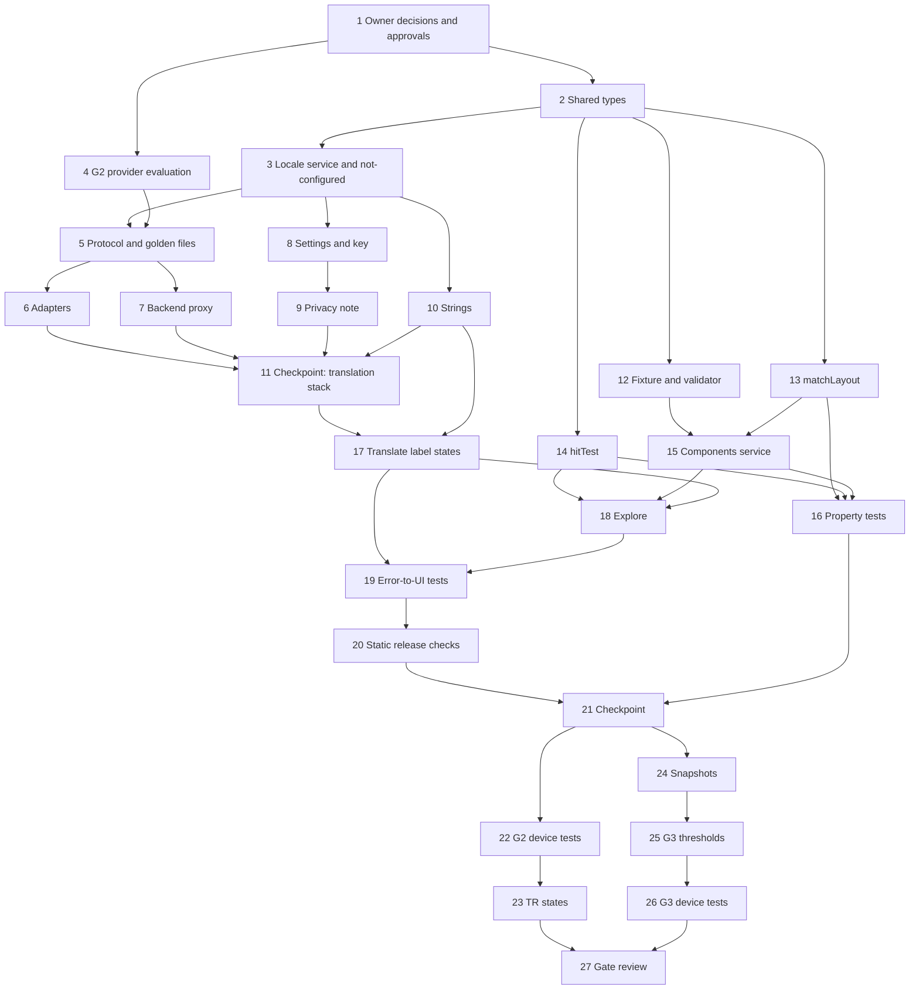

# Implementation Plan: translation-explore

Status: **draft.** Written from `requirements.md` and `design.md` (both draft). No task is started or complete. A task is checked off only after its done check ran and its output was recorded. Writing this plan completes no task.

## Overview

Order:
1. Owner decisions and approvals: the ML Kit translation binding (or local Kotlin module), fast-check, reference phone. DEFERRED by D-030: `expo-secure-store`, proxy hosting. Settled by D-029, D-031, D-032: TM-01 is the iPad image fixture, and there are no reviewers.
2. Pure TypeScript with fakes and no phone: shared types, the locale service and the not-configured adapter.
3. G2 provider evaluation (decides the route table, the pinned model and the constants).
4. Protocol, adapters, backend proxy.
5. Settings, OpenRouter key, privacy note, strings.
6. TM-01 fixture and validator, components, geometry `matchLayout` and `hitTest`, property tests.
7. ui: Translate label states, Explore, error-to-UI tests.
8. Static release checks.
9. Device tests for G2 and G3, then gate review.

Blockers:
- **Spec A merged:** `FrameRef`, `OcrResult`, `OcrLine`, the Overlay_Layer, geometry transforms and `placeLabels` must exist, and AT-G1-02 must pass on the phone before G2 and G3 device work.
- **Owner approvals:** the ML Kit translation binding or local module (OQ-2), fast-check (if spec A has not added it). DEFERRED (D-030): `expo-secure-store` (OQ-3) and proxy hosting (OQ-4).
- **TM-01 images (D-029, D-032):** the iPad image fixture is chosen. The final images and measured boxes block the measured fixture values and every DT-G3 test. Typed data with DRAFT boxes can be authored now (task 12.2).
- **Owner Q4:** reference phone not named or connected. Blocks every device task.
- **No reviewers (D-031, OQ-6):** this no longer blocks work. `hi` and `kn` strings and fixture explanations carry the status `unreviewed`, never `reviewed`. AT-G2-02 is the owner's own check with limits stated and no quality percentage. The README and demo must disclose the `unreviewed` status.
- **DEFERRED (D-030):** OpenRouter team key and a funded proxy. Until D-030 is reversed, a pair that fails the owner's check shows `TR_NOT_CONFIGURED`.
- **Recorded OCR snapshots:** block the snapshot-based tests and the `minAnchors`, `minScore` and rotation values.

Done check for every task, unless the task says more: `npm run verify` exits 0 and `npx expo-doctor` passes. Tasks in `backend/` also run that package's own test command, named in task 7.1. Report the commands, exit codes, files changed, test counts and device status, as the quality steering requires.

Never skip, weaken or re-snapshot a test to make it pass. Tests that need OCR output use recorded snapshots from `test-fixtures/`. Under R27.3 a test may change named fields of a snapshot, and must state which fields. Do not invent values for Named threshold constants: set them from G2 or G3 measurements and record them in `docs/DECISIONS.md` first.

Device tasks end with a PASSED, FAILED or NOT TESTED record in `docs/DEVICE-TESTS.md` (commit, variant, device, date). With no phone connected, the result is "device validation pending".

## Tasks

- [ ] 1. Record owner decisions and approvals before code
  - [ ] 1.1 Ask the owner to decide OQ-1 to OQ-10
    - Present each recommended default from requirements.md. Record the answers in DECISIONS.md, one entry each or one combined entry.
    - OQ-9 approved: no new error code, so no ARCHITECTURE.md §8 change. If the owner wants a new code, add the DECISIONS.md entry and the §8 row first.
    - OQ-10: confirm whether spec A owns the `TranslationProvider` interface, the not-configured adapter and `t(key)`. If not, task 3.1 adds them.
    - If the owner changes a default, update the affected requirement criteria and design sections before task 2 starts.
    - _Requirements: 3.7, 4.2, 4.3, 5.3, 8.5, 9.5, 13.4, 14.9, 21.2, 22.6, 23.6_
  - [ ] 1.2 Ask the owner to approve the dependencies and external services
    - One question per item, each naming the gate task that needs it: the ML Kit translation binding or local Expo Module (AT-G2-01), fast-check if not yet installed (property tests). DEFERRED (D-030, do not ask now): `expo-secure-store` (AT-G2-11), proxy host and OpenRouter team key with a credit limit (AT-G2-07).
    - For each package, check the official docs or repo for maintenance and SDK 58, RN 0.88 and New Architecture support, and cite the source. Install nothing in this task. Install happens in the task that first needs the package.
    - Record the approvals in DECISIONS.md.
    - _Requirements: 4.7, 5.3, 8.16, 27.4_
  - [ ] 1.3 Ask the owner for Q2, Q4 and Q5
    - Q2 is answered by D-029 (iPad image fixture). Q5 is removed by D-031 (no reviewers). Q4: the reference phone. Record the answer, or record that it is still open.
    - _Requirements: 3.4, 14.3, 14.9, 17.4, 17.5_
  - [ ] 1.4 Update the CAPABILITY-MAP.md status table
    - Only after the owner approves requirements and design, with the date. Generating a document is not approval.

- [x] 2. Add shared types and error codes
  - Files: `src/modules/shared/index.ts`, `src/modules/shared/__tests__/translation-types.test.ts`.
  - Add `TrErrorCode` (all eight codes), `MchErrorCode`, `CmpErrorCode`, the exhaustive `TR_ERROR_CODES`, `MCH_ERROR_CODES` and `CMP_ERROR_CODES` arrays, `SourceLocale`, `LanguagePair`, `Translation`, `TranslationOutcome`, `MachineFit`, `MachineStatus`, `MachineMatch`, `ComponentKind` and `LocatedComponent`, as in the design's shared section.
  - If spec A defined `TrErrorCode` with only `TR_NOT_CONFIGURED`, widen it without changing any spec A test.
  - Types and pure helpers only. No React or React Native imports.
  - Unit tests: each code array lists every member of its union, and a `MachineMatch` value of each status type-checks.
  - _Requirements: 1.2, 26.1_

- [x] 3. Add the locale service core and the not-configured adapter
  - [x] 3.1 Confirm or add the `TranslationProvider` interface, `notConfiguredProvider` and `t(key)`
    - Files: `src/modules/locale/translation.ts`, `t.ts`, `index.ts`, tests.
    - Skip this sub-task if spec A shipped them. If not, add them as in spec A's design. The not-configured adapter returns `TR_NOT_CONFIGURED` for every string and never calls the network.
    - _Requirements: 1.4, 1.6, 1.7, 9.1, 14.1_
  - [x] 3.2 Add the pure service helpers
    - Files: `src/modules/locale/plan.ts`, `cache.ts`, `batching.ts`, `collapse.ts`, `rate-gate.ts`, `route-table.ts`, `thresholds.ts`, and one test file per helper.
    - `planTranslation(lines, target, digitRunMin)` with the design's four rules in order, `splitBatches`, `collapseUniformFailure`, the memory cache keyed by source, target and exact text (successes only, oldest evicted past the cap), the rate gate, and `routeFor` with the key and proxy checks.
    - Take every threshold (`digitRunMin`, batch caps, cache cap, timeouts) as a parameter. `thresholds.ts` gets values only after task 4.
    - Unit tests on example inputs, using recorded OCR snapshots for `planTranslation` once they exist (until then, hand-built `OcrLine` values, re-run on snapshots in task 24.2).
    - _Requirements: 1.3, 1.8, 2.5, 5.1, 5.2, 5.3, 7.16, 10.1, 10.2, 10.6, 10.7, 10.9, 12.1, 12.3_
  - [x] 3.3 Add `createTranslationService` with fake adapters
    - Files: `src/modules/locale/service.ts`, `test-support/fakes.ts` (fake `HttpPort`, `KeyStore`, `SettingsStore`, `OnDeviceEngine`, `Clock`), tests.
    - Implements the ten `translate` steps from the design. Never throws. A rejecting adapter becomes `TR_PROVIDER_ERROR`. A timeout becomes `TR_TIMEOUT`. A closed rate gate returns `TR_RATE_LIMITED` with no call. `clearCache` is exposed.
    - Tests: one per step, order and count of outcomes, a random string absent from every fixture comes back from the fake provider and not from storage, and the service never reads the TM-01 fixture.
    - _Requirements: 1.1, 1.2, 1.3, 1.6, 1.7, 1.8, 1.9, 4.6, 5.14, 9.5, 10.9, 11.1, 11.2, 11.3, 12.3, 26.2, 26.7_
  - [x] 3.4 Update the boundary lint rule for `locale`
    - Files: `eslint.config.js`.
    - Remove `locale` from `NETWORK_FREE` and allow `fetch` only in `locale/adapters/*-route.ts` and the `HttpPort` file, by a per-file override. `components`, `geometry` and `ui` stay network-free. `locale` and `components` may not import each other. No new dependency.
    - Prove the rule: add a deliberate forbidden import (`locale` importing `components`), run `npm run lint`, record the failing output in `docs/kiro-evidence.md`, remove the import, and run `npm run lint` to exit 0.
    - _Requirements: 26.3, 26.7, 26.8, 26.9_

- [ ] 4. Run the G2 provider evaluation
  - Blocked on: task 1.2 (ML Kit binding approval, OpenRouter key), task 1.3 (Q4 phone for on-device latency). The owner rates the translations (D-031). Without the phone, report "device validation pending" and keep the task open.
  - [ ] 4.1 Check ML Kit translation bindings and build the on-device candidate
    - Check candidate bindings for SDK 58, RN 0.88 and New Architecture support, and cite sources. If none qualifies within the G2 time box, write a local Expo Module around ML Kit translation (as D-005 does for OCR) or route every pair to OpenRouter with a DECISIONS.md entry.
    - On approval, install with `npx expo install <pkg>`, then `npx expo install --check`, `npx expo-doctor`, and `npx expo prebuild --clean`. Change native settings only through `app.json` or config plugins.
    - _Requirements: 3.1, 3.2, 4.4, 4.7_
  - [ ] 4.2 Build the evaluation set and run the evaluation
    - Test set: all TM-01 label strings plus 30 general sign and label strings. Pairs: en→hi, en→kn, hi→en, hi→kn for on-device, and for OpenRouter on each pair where on-device fails.
    - Pin one OpenRouter model. Read real 403 bodies and record the `limit_source` values that mean a spent budget (DP-8). Confirm or remove `require_parameters` (DP-7).
    - The owner rates each pair (AT-G2-02, D-031), and the record states the limits of that check. No quality percentage is claimed. Use only `en`, `hi` and `kn` in gate tests. Other ML Kit languages are evaluation extras, not shipped (D-030). OpenRouter steps in this task are DEFERRED (D-030). Measure on-device latency on the phone.
    - _Requirements: 3.1, 3.2, 3.3, 3.4, 3.8, 3.10_
  - [ ] 4.3 Record the route table, the pinned model and the constants
    - One DECISIONS.md entry with: the result per D-007 criterion, the owner's own check per pair with its limits stated (no quality percentage, D-031), the route table (each pair `on-device` or `not-configured`; a pair that fails the check or latency is `not-configured` while OpenRouter is deferred, D-030), and the values of the on-device timeout and digit-sequence length. DEFERRED (D-030): the pinned model ID, cloud timeout, output length ratio, string and character caps, and per-IP rate limit.
    - If the owner's check fails for a Kannada pair, stop and ask the owner. Do not hide or drop the pair.
    - Present values to the owner before they are written to `thresholds.ts` and `route-table.ts`. Add the pinned-value and both-sides-of-threshold tests with them.
    - _Requirements: 3.5, 3.6, 3.7, 3.9, 4.5, 5.10, 5.13, 7.9, 7.14, 10.7, 27.6_

- [ ] 5. Add the shared translation protocol and its test data (DEFERRED by D-030: OpenRouter is not used for now)
  - [ ] 5.1 Write the golden file and the fixed test sets
    - Files: `test-fixtures/translation-protocol/protocol.golden.json`, `injection-set.json`, `output-check-cases.json`.
    - The golden file holds the prompt, the routing settings and the shared cases. The Injection set holds fixed strings with expected outcomes. These are data, readable by the owner and any later reviewer.
    - Blocked on: task 4.3 for the pinned model ID and the length ratio.
    - _Requirements: 5.12, 6.1, 27.7_
  - [ ] 5.2 Implement the `locale` protocol copy
    - Files: `src/modules/locale/protocol/prompt.ts`, `request.ts`, `output-check.ts`, `http-map.ts`, tests.
    - `TRANSLATION_PROMPT` states that strings are data and the reply is JSON only. `buildOpenRouterBody` puts recognized strings only in the user message as JSON. `ROUTING_SETTINGS` sets temperature 0, `data_collection: "deny"`, `zdr: true`. `checkOutput` returns each `OutputCheckFailure`. `mapOpenRouterReply` follows the design's table for user and team-upstream.
    - Tests against the golden file: no recognized text outside the data field, HTTPS only, every failure kind, every row of the status table, 403 with and without `limit_source`.
    - _Requirements: 5.4, 5.5, 5.6, 5.7, 5.8, 5.9, 5.11, 5.12, 6.4, 6.5, 6.6, 8.12, 8.13, 9.8_

- [ ] 6. Add the translation adapters
  - [ ] 6.1 Add the `HttpPort`
    - Files: `src/modules/locale/http-port.ts`, test.
    - Wraps global `fetch` with `AbortController`. Never rejects. Refuses a URL that is not `https://` or whose host is neither the configured proxy host nor `openrouter.ai`.
    - _Requirements: 5.11, 8.10_
  - [ ] 6.2 Add the team-route adapter (DEFERRED by D-030)
    - Files: `src/modules/locale/adapters/team-route.ts`, test with the fake `HttpPort`.
    - Sends only `{ texts, source, target }`. Maps 200, 429, 400, 413, 502, other 5xx, malformed bodies, timeout and offline as in the design. Validates reply count and non-empty text, and runs the output length check. Refuses a non-HTTPS proxy URL. Has no code path that reads the key store. The proxy URL comes from `EXPO_PUBLIC_OVERLAYKIT_PROXY_URL`, and unset means no team route.
    - _Requirements: 5.2, 5.3, 7.16, 7.17, 7.18, 8.10, 10.3, 10.5_
  - [ ] 6.3 Add the user-route adapter (DEFERRED by D-030)
    - Files: `src/modules/locale/adapters/user-route.ts`, test.
    - Built per key, with the fixed OpenRouter base URL. Sends only the prompt, the strings, the pinned model, the routing settings and the key as an authorization header. Maps replies with `mapOpenRouterReply(…, 'user')` and runs `checkOutput`. The key never reaches logs, errors or the cache. A 401 leaves the key in the store.
    - _Requirements: 5.1, 5.4, 5.5, 5.6, 5.7, 5.8, 5.9, 8.10, 8.11, 8.12, 8.13, 10.4, 10.5_
  - [ ] 6.4 Add the on-device adapter
    - Files: `src/modules/locale/adapters/on-device.ts` (the only ML Kit translation import, or the Kotlin module bridge), `subscribeOnDeviceStatus`, tests with the fake `OnDeviceEngine`.
    - Model not ready: download once per pair, with a second request waiting on the first, and report `downloading`. Download `OFFLINE` gives `TR_OFFLINE`, `FAILED` gives `TR_PROVIDER_ERROR`, engine `UNSUPPORTED` gives `TR_UNSUPPORTED_PAIR`. No network request for the text.
    - Blocked on: owner approval and task 4.1. If task 4.3 routes every pair to OpenRouter, mark this task not needed with the DECISIONS.md reference.
    - _Requirements: 4.1, 4.2, 4.3, 4.4, 9.7_
  - [ ] 6.5 Wire the route table and adapters into `getTranslationService`
    - Files: `src/modules/locale/index.ts`, `service.ts`, test.
    - Native adapter instances are the only singletons. Tests for the default wiring use fakes.
    - Blocked on: task 4.3 (route table values).
    - _Requirements: 1.4, 1.8, 1.9, 5.1, 5.2, 5.3_

- [ ] 7. Build the backend proxy (DEFERRED by D-030: ML Kit only for now)
  - [ ] 7.1 Scaffold the `backend/` package and the protocol copy
    - Files: `backend/package.json`, `backend/src/protocol/{prompt,request,output-check,http-map}.ts`, `backend/test/`.
    - Own `package.json` and own test command, with no import from `src/`. Any runtime dependency needs owner approval first (design assumes none).
    - The protocol copy runs the same `protocol.golden.json`, `injection-set.json` and `output-check-cases.json` cases as the `locale` copy. Both test files assert they read the same file.
    - _Requirements: 5.12, 7.15, 26.9, 27.7_
  - [ ] 7.2 Implement `handleTranslate` and the limits
    - Files: `backend/src/handler.ts`, `limits.ts`, `rate-limit.ts`, `openrouter.ts`, tests with a fake OpenRouter.
    - Order from the design: method and path, byte cap, validation (an extra body key is 400), per-IP limit, OpenRouter call with the team key, reply mapping, output check. 400, 413, 429 with `Retry-After`, 502 for 401, 402, 403 and other upstream errors, 200 with `translations` and `provider`.
    - Tests: each status code, no image field accepted, no login needed, and a marker string as text appears in no log call and no reply except the 200 body. The team key appears in no reply, header or log line.
    - Limits come from the task 4.3 values.
    - _Requirements: 7.1, 7.2, 7.3, 7.4, 7.5, 7.6, 7.7, 7.8, 7.9, 7.11, 7.12, 7.13, 7.14, 7.15, 7.18_
  - [ ] 7.3 Deploy the proxy and run the live checks
    - Blocked on: owner hosting decision (OQ-4) and a funded team key.
    - Deploy over HTTPS with the key only in the environment. Run the Injection set through the deployed proxy and through the user route on a real OpenRouter call. Fluent_Reviewers confirm no output adds text beyond a translation. Record the results and the hosting limits (in-memory rate limit per instance, DP-9) in DECISIONS.md.
    - If the proxy can't be deployed in time, apply the G2 stop condition: cloud pairs show `TR_NOT_CONFIGURED` for users with no key, and the README says so.
    - _Requirements: 5.12, 6.2, 6.3, 6.7, 7.10, 7.11_

- [ ] 8. Add Settings, target language and the OpenRouter key (key part DEFERRED by D-030; build the settings store and language setting only)
  - [x] 8.1 Add the settings store and `useLocaleSettings`
    - Files: `src/modules/locale/settings-store.ts`, `settings-file-adapter.ts` (the only file-system import in `locale`), tests with a fake file port.
    - `LocaleSettings` holds `targetLocale` (default `en`, OQ-1) and `privacyAcknowledged`. Atomic write through a temp file and rename. A missing or unparsable file returns defaults. The store holds no key and no image data.
    - Ask the owner before adding a file-system package if spec A has not.
    - _Requirements: 13.2, 13.3, 13.4, 13.6, 13.7, 15.5_
  - [ ] 8.2 Add the key store and the key service (DEFERRED by D-030)
    - Files: `src/modules/locale/key-store.ts`, `key-store-secure-adapter.ts` (the only secure-storage import), `key-check.ts`, `maskKey`, tests with fakes.
    - Install `expo-secure-store` with `npx expo install expo-secure-store` after approval (task 1.2), then `npx expo install --check` and `npx expo-doctor`.
    - `checkAndSave` calls `GET https://openrouter.ai/api/v1/key` first. Rejected, offline (OQ-8) and failed checks save nothing. A successful save and a removal call `clearCache`. `maskKey` shows at most the last four characters, and nothing of a key of four characters or fewer. If secure storage is unavailable, save nothing and report it (DP-6).
    - Search the sources for the key in any logging call and record the result.
    - _Requirements: 8.3, 8.4, 8.5, 8.6, 8.7, 8.8, 8.9, 8.10, 8.11, 8.16, 10.9_
  - [x] 8.3 Add the Settings screen and route
    - Files: `src/modules/ui/settings/SettingsScreen.tsx`, `LanguageSection.tsx`, `OpenRouterKeySection.tsx`, `useSettings.ts`, `src/modules/ui/index.ts`, `src/app/settings.tsx` (renders `<SettingsScreen />` only), a Settings control on the Camera_Screen, tests.
    - Language choice of English, Hindi and Kannada, each in its own script. Key section with paste field, Save, masked display and Remove, plus the plain note about OpenRouter. A link to the privacy note. The honest-limits text describes TM-01 as a first-party simulated machine when it is a printed panel or simulator. No voice settings.
    - Every touch target at least 48 × 48 dp, with accessibilityRole and accessibilityLabel in the UI language. Target language changes save through the store.
    - _Requirements: 8.1, 8.2, 8.8, 8.9, 13.1, 13.2, 13.7, 16.1, 16.2, 16.3, 16.4, 16.5, 16.6, 16.7, 17.10_

- [x] 9. Add the first-run privacy note
  - Files: `src/modules/ui/settings/PrivacyNote.tsx`, `src/modules/ui/translate/gate.ts`, tests.
  - Shown before any text is sent on first launch. It says images stay on the phone and recognized text may be sent. It names OpenRouter and the model provider when a cloud route is configured, and says text stays on the phone when every pair is on-device. Acknowledgement saves through the settings store. Until then, no `translate` call is made and every readable label is `failed` with "Translation not available". Settings can reopen the note.
  - Tests: no `translate` call before acknowledgement (fake service call count is 0), the call happens after, and the note text follows the route table.
  - _Requirements: 15.1, 15.2, 15.3, 15.4, 15.5, 15.6, 15.7, 15.8_

- [x] 10. Add the strings for this spec
  - Files: `src/modules/locale/strings/en.ts`, `hi.ts`, `kn.ts`, tests.
  - Add keys for: every `TR_*` marker, "Downloading language data", "Not a verified machine", "Move to show more of the panel", "Point the camera at the [component]" (with a placeholder), the key-rejected and no-credit texts, Settings, the privacy note, the key note, and the authored-explanation label. One key per sentence, with placeholders.
  - Each `hi` and `kn` value carries the status `unreviewed` (D-031), or a reviewer and date if one ever exists. No value is marked `reviewed` without both. A runtime lookup of a missing key returns the `en` value.
  - Tests: every key has all three locales, every `hi` and `kn` value has a status, a `reviewed` status without a reviewer and date fails the test, placeholders match across locales, and missing-key fallback. The test records the unreviewed count.
  - The README and demo script state that the `hi` and `kn` text is `unreviewed` (R14.9). Add that disclosure as part of this task or note it as open in the done report.
  - _Requirements: 9.1, 9.2, 9.4, 9.5, 9.6, 9.7, 8.14, 8.15, 14.1, 14.2, 14.3, 14.4, 14.5, 14.8, 14.9, 15.8, 20.6, 23.8_

- [ ] 11. Checkpoint: translation stack
  - Run `npm run verify`, `npx expo-doctor`, and the `backend/` test command, and record the output.
  - Run the read-only `vision-reviewer` agent, or the `vision-safety-review` skill, on the diff. Fix any BLOCKER or HIGH finding before task 12, and record the review in `docs/kiro-evidence.md`.
  - Ask the owner if questions came up.

- [ ] 12. Add the TM-01 fixture types and the validator
  - Files: `src/modules/components/fixture-types.ts`, `validate-fixture.ts`, `fixtures/tm-01.ts`, `index.ts`, tests.
  - `MachineFixtureB`, `FixtureIssue` and `FixtureRule` as in the design. The `review` field allows `'unreviewed'` (D-031). `validateFixture` is pure and reports every issue: too few anchors, missing locale, missing `review` field or a reviewer record with an empty reviewer or date (`'unreviewed'` is accepted), bad region (non-finite or zero-area quad), duplicate component id, bad threshold (`minAnchors` below 2, `minScore` outside range), empty anchor text, non-finite position.
  - Until task 12.2 lands, `tm-01.ts` exports a fixture that fails the validator on purpose (`review` field missing), so every machine is `none`. A test pins that behaviour. The file carries no `screens`, `workflows` or step text, and no content for any other machine.
  - Tests: a valid fixture passes (including one with `review` set to `'unreviewed'`), and one invalid fixture per rule fails with that rule. A test runs the validator on the bundled fixture and fails while the fixture is invalid.
  - Authoring the typed content is task 12.2. Replacing DRAFT boxes with measured values is task 12.1.
  - _Requirements: 17.1, 17.2, 17.3, 17.4, 17.5, 17.6, 17.7, 17.8, 17.9, 17.11, 17.12, 26.3_
  - [ ] 12.1 Author the real TM-01 content
    - Blocked on: the final TM-01 images (D-029, D-032), task 12.2, and snapshots for anchor positions.
    - Replace every DRAFT box and region from `test-fixtures/tm-01/FIXTURE.md` with values measured from the final image, in both the fixture data and FIXTURE.md, and remove the DRAFT marks. Complete the verification record. `minAnchors` and `minScore` stay placeholders until task 25.2 records them.
    - _Requirements: 17.2, 17.3, 17.4, 17.5, 17.13, 17.14, 22.2_
  - [ ] 12.2 Author the typed TM-01 fixture data from FIXTURE.md
    - Files: `src/modules/components/fixtures/tm-01.ts`, `src/modules/components/__tests__/tm-01-fixture.test.ts`.
    - Read `test-fixtures/tm-01/FIXTURE.md` sections 3 and 4. Type the anchors L01 to L09 (exact text, anchor flag, box) and the components C-SCREEN, C-CARD, C-COIN, C-NOTE, C-CANCEL, C-CONFIRM, C-HELP, C-TRAY (kind, label, region). Copy the strings exactly. Do not invent values. Every box and region keeps a DRAFT mark in the data (for example a `draft: true` field or a named constant) until task 12.1 measures it. `minAnchors` and `minScore` stay unset placeholders (G3 constants).
    - Component names and explanations, and the workflow-independent text, for `hi` and `kn` are authored from FIXTURE.md section 7 as `unreviewed` (D-031), with `review` set to `'unreviewed'` for both. Authoring them is open work; if left as TODO, the validator must fail on the missing text.
    - Tests: the anchor texts and component ids equal the FIXTURE.md lists, every box is marked DRAFT, no recognition assertion depends on a DRAFT box (R17.14), and the validator accepts `'unreviewed'`.
    - _Requirements: 17.2, 17.3, 17.5, 17.13, 17.14_

- [x] 13. Add `matchLayout` and `applyFit` to geometry
  - Files: `src/modules/geometry/layout-match.ts`, `similarity.ts`, `thresholds.ts` (rotation tolerance name only, value after task 25.2), `index.ts`, tests.
  - Closed-form similarity fit (centroids, then scale and rotation from the 2×2 cross-covariance). Score is `1 − min(1, rmsResidual / observedExtent)`. Non-finite observed points are ignored. `no-fit` when fewer than `minPoints` keys match, `scale ≤ 0`, a non-finite field, zero extent, or rotation beyond the tolerance. `minPoints` and the tolerance are parameters.
  - `applyFit` maps a Machine-space quad into Image space with the same corner order.
  - Unit tests with example anchor sets (exact fit, noisy fit, a wrong anchor, too few points, non-finite point, rotation beyond tolerance). Imports only `shared`, no React Native, no I/O.
  - _Requirements: 19.1, 19.2, 19.4, 19.5, 19.6, 19.7, 20.2, 26.4_

- [x] 14. Add `hitTest` to geometry
  - Files: `src/modules/geometry/hit-test.ts`, `thresholds.ts` (`HIT_MIN_TARGET_DP = 48` with its source), `index.ts`, tests.
  - Even-odd containment on the quad. Margin derived per item so each target is at least `minTargetDp` × `minTargetDp`. Inside beats margin. Among containing items a component beats a label (OQ-7), then the smaller area, then the smaller id. Within the margin and containing nothing: nearest edge distance, ties by kind then id. Non-finite point or `minTargetDp` returns `none`.
  - Unit tests for each priority rule, margin hits at 48 dp, ties, non-finite input, and the same result for the same input. Add DP-4 (margin derived from the 48 dp target) to the DECISIONS.md entry if the owner accepts it.
  - _Requirements: 21.1, 21.2, 21.3, 21.4, 21.5, 21.6, 21.7, 21.9, 25.5, 26.4_

- [x] 15. Add the components service
  - [x] 15.1 Add `identifyMachine`
    - Files: `src/modules/components/identify.ts`, `anchor-text.ts`, `thresholds.ts` (names only), tests.
    - Steps from the design: validator gate, script filter (Latin and Devanagari only), NFC, trim, whitespace and case normalization, deterministic tie-break between lines matching one anchor, `matchLayout`, then `verified`, `ambiguous` or `none`. `OCR_LOW_QUALITY` never gives `verified`. A single text never gives `verified`. No network, no translation. `minAnchors` and `minScore` come from the fixture.
    - Tests on recorded snapshots once they exist (TM-01, partial views, NEG-01 to NEG-10). Until then, tests use a test-built fixture and hand-built `OcrResult` values, and the snapshot tests wait for task 24.1.
    - _Requirements: 18.1, 18.2, 18.3, 18.4, 18.5, 18.6, 18.7, 18.8, 18.9, 18.10, 18.11, 18.12, 24.1_
  - [x] 15.2 Add `locateComponents`
    - Files: `src/modules/components/locate.ts`, tests.
    - For a `verified` match, map each region with `applyFit`. Omit non-finite results silently. A region entirely outside the frame goes to `notVisible` with `CMP_NOT_VISIBLE`. A non-`verified` match returns empty lists. Each located component carries the frameId of the `OcrResult`.
    - _Requirements: 20.1, 20.2, 20.3, 20.4, 20.8, 24.1_
  - [x] 15.3 Add `explain`, `componentName`, `listComponents` and `createMachineService`
    - Files: `src/modules/components/explain.ts`, `index.ts`, tests.
    - Authored text only, with no fallback to another locale and no generation. A missing id, locale or an empty string returns `EXPLANATION_MISSING`. The module does not import `locale`.
    - _Requirements: 11.3, 17.11, 22.2, 22.3, 26.3, 26.7_

- [ ] 16. Add the property tests
  - [x] 16.1 Install fast-check if not present
    - Skip if spec A installed it. Otherwise confirm owner approval (task 1.2), run `npm install -D fast-check` (dev-only), then `npx expo install --check` and `npx expo-doctor`. Record the decision in DECISIONS.md.
  - [ ] 16.2 Write the geometry property tests
    - Files: `src/modules/geometry/__tests__/layout-match.property.test.ts`, `hit-test.property.test.ts`. At least 100 runs each.
    - `matchLayout`: the score is unchanged under random uniform scale, translation and small rotation. Non-finite points never produce a non-finite score. Fewer than `minPoints` gives `no-fit`.
    - `hitTest`: a returned item contains the point or is the nearest within the margin, non-finite input returns `none`, and the same input gives the same output.
    - _Requirements: 19.3, 19.4, 19.5, 21.1, 21.3, 21.5, 21.6, 27.4_
  - [ ] 16.3 Write the identification and translation property tests
    - A random subset of fewer than `minAnchors` anchors never gives `verified`. For the service: output count and order equal input count and order for random texts and random adapter outcomes, and no call is made for a random cached text.
    - _Requirements: 1.3, 12.3, 18.2, 18.3, 27.4_

- [x] 17. Build the Translate label states in ui
  - [x] 17.1 Add the label model, reducer and error map
    - Files: `src/modules/ui/translate/label-model.ts`, `translation-reducer.ts`, `error-map.ts`, `thresholds.ts` (`OFFLINE_RETRY_INTERVAL_MS`, value from task 4.3), tests.
    - `LabelContent` and `translationReducer` as in the design. Actions with another `frameId`, or a `translation-settled` for another target, are ignored. A `translated` label with origin `provider` comes only from an `ok` outcome. `ok: false` sets every listed id to `failed` with that code. `TR_UI` is a total `Record`, so a missing code fails the type check.
    - Tests: every action type, a late result for a replaced frame, a settled result after a target change, retry, and one marker and one state per code.
    - _Requirements: 2.1, 2.2, 2.3, 2.4, 2.5, 2.6, 2.8, 9.10, 13.5, 26.10_
  - [x] 17.2 Add `useTranslation`
    - Files: `src/modules/ui/translate/useTranslation.ts`, `src/modules/ui/services.tsx` (adds `translation`, `settings`, `machines`), test with fake services.
    - On a new shown still: read settings, `planTranslation`, dispatch `result-applied`, one `translate` call per language pair, dispatch `translation-settled`. Re-plan on target change. Retry `TR_OFFLINE` labels every `OFFLINE_RETRY_INTERVAL_MS` and on foreground, using the request as the connectivity probe and adding no package. Enable retry after `retryAfterMs()`. Show "Downloading language data" while the on-device status is `downloading`.
    - Tests: one call per pair, no call when gated, no call for same-language or unsupported lines, auto-retry after offline.
    - _Requirements: 2.2, 4.2, 9.3, 9.5, 9.9, 10.1, 10.2, 12.1, 13.5, 15.6_
  - [x] 17.3 Render the label states
    - Files: `src/modules/ui/overlay/LabelView.tsx` (extended), `src/modules/ui/overlay/styles.ts`, tests.
    - Each state as text, or an icon with text. A failed label keeps the recognized text and shows its marker, with a retry control when the code calls for one. Translated text is plain text at 14 sp or larger with a contrast ratio of at least 4.5:1. Ellipsis on overflow, with a tap to show the full text. Roles and labels in the UI language, 48 dp targets. Never a link or a command.
    - Tests: render tests for each state, contrast of the colour pairs through `contrastRatio`, and accessibility props.
    - _Requirements: 2.7, 6.4, 6.5, 9.4, 9.6, 9.7, 14.6, 14.7, 25.1, 25.2, 25.3, 25.4, 25.5, 25.6_

- [x] 18. Build Explore in ui
  - [x] 18.1 Add the explore model
    - Files: `src/modules/ui/explore/explore-model.ts`, tests.
    - `toExploreView`: `verified` plus a component under the tap gives the authored explanation, `EXPLANATION_MISSING` gives the failed state with no other text. Everything else gives the label view with the note "Not a verified machine". No component name, function or guess on `ambiguous` or `none`. A label on a `verified` machine that is not inside a located component gives the label view and no component claim. A pending or failed label keeps its state with the note. `ambiguous` may add the hint.
    - Tests use negative-set snapshots once they exist (task 24.1). Until then, hand-built `MachineMatch` values.
    - _Requirements: 22.1, 22.3, 22.4, 22.7, 23.1, 23.2, 23.3, 23.4, 23.5, 23.6, 23.7_
  - [x] 18.2 Add `useExplore`, the panel and the component prompt
    - Files: `src/modules/ui/explore/useExplore.ts`, `ExplorePanel.tsx`, `ComponentPrompt.tsx`, `src/modules/ui/camera-screen/ModeSwitcher.tsx` (adds Explore), tests.
    - `identifyMachine` then `locateComponents` for the shown `OcrResult`. Items are mapped to View space through geometry on every render, with no coordinate math in `ui`. Taps go through `hitTest` against the shown frame's items only. The explanation shows within one tap, labelled as an authored explanation of TM-01. A newer still discards the match and the open explanation. `CMP_NOT_VISIBLE` shows "Point the camera at the [component]", and no highlight is drawn for a component that is not located. The reducer and screen hold no rule that decides verification.
    - Tests with fake services: verified tap, unverified tap, ambiguous tap, replaced frame, prompt text.
    - _Requirements: 20.6, 20.7, 21.8, 21.9, 22.1, 22.4, 22.5, 22.6, 22.7, 24.2, 24.3, 26.5, 26.6_

- [ ] 19. Add the error-to-UI tests
  - Files: `src/modules/ui/translate/__tests__/error-map.test.ts`, `src/modules/ui/explore/__tests__/error-map.test.ts`, tests in `locale` and `components`.
  - For each `TR_*` code, a test that `locale` produces it (a code path exists) and a test that `ui` maps it to its ARCHITECTURE.md §8 marker and state. Same for `MCH_NOT_VERIFIED`, `MCH_AMBIGUOUS` and `CMP_NOT_VISIBLE`, with `components` as the only producer. Add `TR_KEY_INVALID` and `TR_NO_CREDITS` texts, and the `PRIVACY_NOT_ACKNOWLEDGED` marker. Tests check both sides of every Named threshold constant that has a value by now.
  - Add the debug fault wrappers for timeout, 429, 5xx and unsupported pair (`locale/debug/fault-wrappers.ts`, `ui/debug/translation-faults.ts`) behind `__DEV__` with the marker `OVERLAYKIT_DEBUG_ONLY`, with dev-menu items and tests.
  - _Requirements: 9.1, 9.2, 9.4, 9.5, 9.6, 9.7, 9.10, 9.11, 9.12, 20.3, 24.1, 24.2, 24.3, 24.4, 26.1, 26.10, 27.1, 27.5, 27.6_

- [ ] 20. Run release and privacy static checks
  - [ ] 20.1 Search the release bundle
    - Run `npx expo export --platform android`. Search the output for the OpenRouter team key (none expected), the debug marker `OVERLAYKIT_DEBUG_ONLY` and the fault-hook names. Record the commands and results in `docs/build-log.md`.
    - _Requirements: 7.11, 9.12, 27.9_
  - [ ] 20.2 Check network calls, logging and packages
    - Search `src/modules/components`, `geometry` and `ui` for `fetch`, `XMLHttpRequest` and `WebSocket`. Search `locale` for translation tables and glossaries. Search for logging calls that carry recognized text, translations, image data or the key. Confirm no image types reach any network call, that `src/` does not import `backend/`, and that no web or auth package is present (Q8). Record the results.
    - _Requirements: 8.11, 10.5, 10.8, 11.1, 11.4, 26.9, 27.9_
  - [ ] 20.3 Inspect the merged Android manifest
    - After `npx expo prebuild --clean`, list the merged permissions and justify each in `docs/build-log.md`. This spec adds no permission beyond those of spec A (`CAMERA`, `INTERNET`).
    - _Requirements: 10.5_

- [ ] 21. Checkpoint: pure modules and ui
  - Run `npm run verify`, `npx expo-doctor`, and the `backend/` test command. Then run the debug build, `npx expo run:android --device` (B1), and the `vision-reviewer` agent on the diff.
  - Blocked on: owner Q4 for the build. Without a phone, report "device validation pending" and keep this task open.

- [ ] 22. Run the G2 device tests
  - Blocked on: owner Q4 (phone), task 21, task 6.5. Cloud-route items (task 7.3 and key checks) are DEFERRED by D-030. Hindi and Kannada script checks are done by the owner and recorded as `unreviewed` content (D-031). Use the `physical-device-qa` skill. Record PASSED, FAILED or NOT TESTED in `docs/DEVICE-TESTS.md`, with commit, variant, device and date. Timing tests run on a release build: `npx expo run:android --device --variant release` (B2).
  - [ ] 22.1 Run DT-G2-01 and DT-G2-04
    - Target `hi`, then `kn`, translating TM-01: correct script, no missing-glyph boxes, marks fully visible, largest system font size. Target `en` on CARD-EN: no translation request, text shown as-is.
    - _Requirements: 14.6, 14.7, 25.2, 28.1, 28.5_
  - [ ] 22.2 Run DT-G2-02 and DT-G2-03
    - Airplane mode on a cloud pair: original text with the "Offline" marker, and auto-retry when the network returns. Debug build with fault hooks: timeout, 429, 5xx and unsupported pair each show their state. Invalid key and a key with no credit show `TR_KEY_INVALID` and `TR_NO_CREDITS`. On-device model download and offline behaviour if any pair is on-device.
    - _Requirements: 4.2, 4.3, 8.14, 8.15, 9.2, 9.3, 9.4, 9.5, 9.6, 9.7, 28.2, 28.3, 28.4_
  - [ ] 22.3 Run DT-G2-05 and DT-G2-06
    - Both routes and the key check apply only once D-030 is reversed; for now read "both routes" as the on-device route.
    - Debug build with a network inspector: request bodies hold text only and no image data, on both routes, and the key goes only to `openrouter.ai`. Release build on Wi-Fi, 10 translations of TM-01: p50 of 2 s or less (proposed). Record the numbers.
    - _Requirements: 8.10, 10.3, 10.4, 10.5, 12.2, 28.6, 28.7, 28.13_
  - [ ] 22.4 Check first launch and the key on a fresh install (key checks DEFERRED by D-030)
    - Privacy note shown before any text is sent. Key saved masked, stored only in secure storage, and removable. Record the result against AT-G2-11.
    - _Requirements: 8.6, 8.7, 8.8, 8.9, 15.1, 28.13_

- [ ] 23. Reach the remaining TR states on the phone (QE-2)
  - DT-ERR-02 with the debug fault-injection hooks, covering `TR_NOT_CONFIGURED`, `TR_OFFLINE`, `TR_TIMEOUT`, `TR_RATE_LIMITED`, `TR_PROVIDER_ERROR`, `TR_UNSUPPORTED_PAIR`, `TR_KEY_INVALID` and `TR_NO_CREDITS`. Record each state reached.
  - Blocked on: owner Q4.
  - _Requirements: 9.11, 9.12, 27.10_

- [ ] 24. Export snapshots and run the snapshot tests
  - Blocked on: owner Q4, the final TM-01 images (D-029, D-032), and spec A's snapshot exporter.
  - [ ] 24.1 Export the recorded OCR snapshots
    - TM-01 at D30, D60, D100, A0 and A30, TM-01 partly out of frame, NEG-01 to NEG-10, and CARD-EN. Copy them into `test-fixtures/ocr-snapshots/` with manifest entries and the image review. Add the ground-truth anchor positions.
    - _Requirements: 18.10, 27.2_
  - [ ] 24.2 Re-run the pure tests on snapshots
    - Re-run `planTranslation` (task 3.2), `identifyMachine` (15.1), `locateComponents` (15.2) and `toExploreView` (18.1) on snapshots. State any changed fields under R27.3. Do not change an earlier test to make a snapshot pass.
    - _Requirements: 18.10, 20.1, 23.1, 27.2, 27.3_

- [ ] 25. Set the G3 thresholds from the snapshots
  - Blocked on: task 24.
  - [ ] 25.1 Measure and record `minAnchors`, `minScore`, the rotation tolerance
    - Tune on TM-01 captures at the distances and angles, then check no negative-set item reaches `verified`. If AT-G3-02 fails, raise the thresholds. If true matches then fall below 80%, stop and ask the owner. Present values to the owner and record them in DECISIONS.md before any G3 device measurement. Record DP-4 (the touch margin rule) if accepted.
    - _Requirements: 18.7, 19.7, 21.4, 28.8, 28.9_
  - [ ] 25.2 Write the values and the threshold tests
    - Set the values in the fixture and `geometry/thresholds.ts`. Add pinned-value tests and tests on both sides of each. Add the snapshot-based property checks.
    - _Requirements: 18.7, 19.7, 27.6_

- [ ] 26. Run the G3 device tests
  - Blocked on: owner Q4, the final TM-01 images, tasks 12.1 and 25. Q2 and Q5 no longer block (D-029, D-031). Record every DT result in `docs/DEVICE-TESTS.md`.
  - [ ] 26.1 Run DT-G3-01 and DT-G3-03
    - TM-01 at D30, D60, D100 and A0, A30, 20 attempts: `verified` in at least 95% (proposed). TM-01 partly out of frame: `ambiguous`.
    - _Requirements: 18.3, 18.4, 28.8, 28.10_
  - [ ] 26.2 Run DT-G3-02 (hard requirement)
    - NEG-01 to NEG-10, 3 attempts each: `verified` for none. A single `verified` fails AT-G3-02 and applies the G3 stop condition.
    - _Requirements: 18.10, 28.9_
  - [ ] 26.3 Run DT-G3-04 and DT-G3-05
    - TM-01, target `kn`, each component tapped: at least 90% of in-frame components located, at least 95% of taps correct, explanation in Kannada. NEG-01 with a label tapped: translation and "Not a verified machine", no component claim.
    - _Requirements: 20.5, 21.2, 22.1, 22.4, 23.1, 23.2, 28.11, 28.12_
  - [ ] 26.4 Reach every MCH and CMP state (QE-2)
    - DT-ERR-04: `MCH_NOT_VERIFIED`, `MCH_AMBIGUOUS` and `CMP_NOT_VISIBLE` each reached at least once.
    - _Requirements: 20.6, 24.5, 27.10_

- [ ] 27. G2 and G3 gate review
  - Report AT-G2-01 to AT-G2-11, AT-G3-01 to AT-G3-06, QE-1, QE-2 and QE-3 as PASSED, FAILED or pending, each with its evidence path in `docs/DEVICE-TESTS.md`, `docs/build-log.md`, `docs/DECISIONS.md` or the test output.
  - Run the `vision-reviewer` agent on the full spec diff. Apply the G2 and G3 stop and pivot conditions if any measurement fails.
  - Update the CAPABILITY-MAP.md status table and the `tasks/todo.md` items that are actually done.
  - _Requirements: 24.4, 24.5, 27.10, 28.1 to 28.13_

## Task Dependency Graph



```json
{
  "waves": [
    { "id": 0, "tasks": ["1.1", "1.2", "1.3"] },
    { "id": 1, "tasks": ["2"] },
    { "id": 2, "tasks": ["3.1", "4.1", "12", "13", "14"] },
    { "id": 3, "tasks": ["3.2", "3.4", "4.2", "15.1", "15.2", "16.1"] },
    { "id": 4, "tasks": ["3.3", "4.3", "15.3", "16.2", "16.3"] },
    { "id": 5, "tasks": ["5.1", "5.2", "8.1", "10"] },
    { "id": 6, "tasks": ["6.1", "6.2", "6.3", "6.4", "7.1", "8.2", "9"] },
    { "id": 7, "tasks": ["6.5", "7.2", "8.3"] },
    { "id": 8, "tasks": ["7.3", "11"] },
    { "id": 9, "tasks": ["17.1", "17.2", "17.3"] },
    { "id": 10, "tasks": ["18.1", "18.2"] },
    { "id": 11, "tasks": ["19", "20.1", "20.2", "20.3"] },
    { "id": 12, "tasks": ["21"] },
    { "id": 13, "tasks": ["22.1", "22.2", "22.3", "22.4", "24.1"] },
    { "id": 14, "tasks": ["23", "24.2", "25.1"] },
    { "id": 15, "tasks": ["25.2", "12.1"] },
    { "id": 16, "tasks": ["26.1", "26.2", "26.3", "26.4"] },
    { "id": 17, "tasks": ["27", "1.4"] }
  ]
}
```

Tasks 12 to 14 can run in parallel with tasks 3 to 11 once task 2 is done. Tasks 22 and 24 can run in parallel on the phone. Every task from 21 on needs the reference phone (owner Q4), and tasks 12.1 and 24 to 26 also need TM-01 (owner Q2).

## Notes

- This spec has no optional tasks. Every task, including the property tests, is required by the quality steering.
- No task is complete. Check one off only after its done check ran and its output was recorded, never because a document was generated.
- Owner approvals gate tasks 1, 4.1, 6.4, 7.1, 7.3, 8.1, 8.2, 16.1 and 25.1. Ask before installing or recording anything.
- Hindi and Kannada text (strings, fixture explanations) must not ship unreviewed (Q5).
- Device results without a `docs/DEVICE-TESTS.md` record count as "device validation pending".

