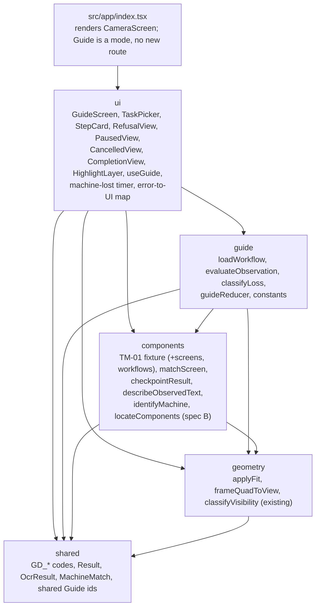
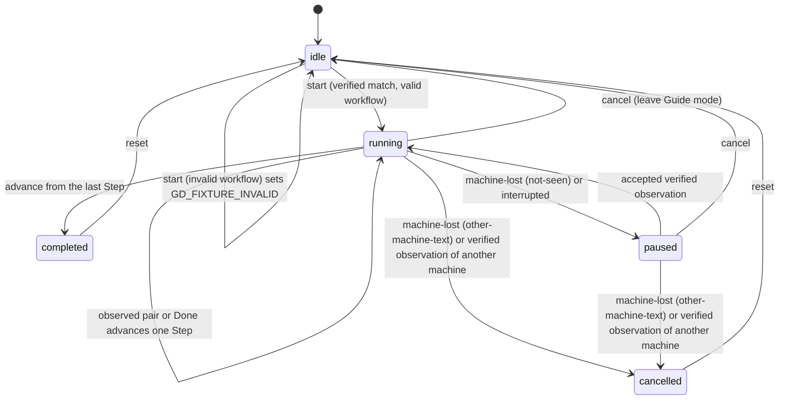

# Design Document: guided-ticket-workflow

Status: **draft, awaiting owner review.** Written from `requirements.md` (draft). Open questions OQ-1 to OQ-10 use their recommended defaults. D-029, D-031 and D-032 are applied: TM-01 is a printed panel plus screen images on an iPad, `hi` and `kn` text is `unreviewed`, and `test-fixtures/tm-01/FIXTURE.md` is the content source. No code exists for this design yet. Every statement about the phone is a plan: device validation pending.

## Overview

This design covers capability C in `docs/CAPABILITY-MAP.md` (§4.C and §5): Guide, the mode that walks a user through one task on the verified machine TM-01, one step at a time. It delivers gate G4 (AT-G4-01 to AT-G4-06 and AT-G4-08), the QE-1, QE-2 and QE-3 checks for the `GD_*` codes, and the device tests DT-G4-01 to DT-G4-04, DT-G4-06, DT-ERR-04 and DT-ERR-05. AT-G4-07 (voice, DT-G4-05) belongs to spec D.

**Guide path.** `ui` runs the same observation loop as Explore: each OcrResult goes to `components.identifyMachine` (spec B) and `components.matchScreen`. `components.checkpointResult` then compares the OcrResult with the current Step's Checkpoint. `guide.evaluateObservation` packs those evaluated values and the OcrResult's identity into a `GuideObservation`. `ui` feeds the observation to a pure reducer (`guideReducer`, D-019) through `useReducer`. The reducer decides everything about Step changes. `ui` only forwards events and draws the state.

A Step changes in exactly two ways, and each leaves a `TransitionProof`:

1. **observed:** two accepted, consecutive observations with different observation ids and different frameIds, both `verified` and both `met` for the current `text-visible` Checkpoint.
2. **done:** a `confirm-manual` event on a Step the fixture marks `manual`.

No timer, no machine-lost event, no retry, no back and no interruption can advance a Step. The reducer has no clock: every time value arrives inside an event.

**Refusal.** The reducer's `start` event carries the MachineMatch status and a Workflow loader result. Anything other than `verified` and a valid Workflow leaves the state `idle` with `GD_UNSUPPORTED`, or with `GD_FIXTURE_INVALID` for an invalid Workflow, and no Step exists to show (D-009).

**Highlight.** While `running`, `ui` calls `components.locateComponents` with the latest `verified` match, picks the current Step's target, maps it through `geometry`, and draws it with an outline and a text label. `CMP_NOT_VISIBLE` for the target gives the "Point the camera at the [component]" prompt and no Highlight.

**What specs A and B provide and this design extends.**

- Spec A: `FrameRef`, `OcrResult` (`frameId`, `capturedAtMs`, `qualityFlag`, lines with `script`), `Quad`, `Rect`, `classifyVisibility`, `frameQuadToView`, the Overlay_Layer and its lifetime rules (D-020), `MIN_TOUCH_TARGET_DP`, `MonotonicClock`, the `Result` type and the services context in `ui`.
- Spec B: `MachineMatch`, `MachineService` (`identifyMachine`, `locateComponents`, `componentName`), `MachineFixtureB` and `validateFixture`, `geometry.applyFit`, `t(key)`, the Settings route, the Explore mode.
- Spec D: the `speech` module and the Speak control. This design reserves a slot only.

**What doesn't exist yet:** the TM-01 `screens` and `workflows` content (to be authored from FIXTURE.md sections 5 to 7), the final Screen images and negative-set images, a Reference phone (Q4), any recorded OCR snapshot of a Screen image, a property-test library, and every module named below. Nothing here has run.

### Design decisions in this document

| ID | Decision | Reason |
| --- | --- | --- |
| DD-1 | `GuideState` holds the validated Workflow (`ValidatedWorkflow`), so the reducer needs no lookup and no fixture access. | Keeps the reducer a function of state and event only (R6.1). |
| DD-2 | Every time value is a field of an event (`atMs`). Observation order uses the frame's `capturedAtMs` as `seq`. | R6.3, R10.3. No clock import, no `Date.now`. |
| DD-3 | The reducer receives evaluated observations, never an OcrResult. `evaluateObservation` and `components.checkpointResult` are separate pure functions. | R6.6. The reducer's generators don't need OCR shapes. Property tests build observations from fields (R15.12). |
| DD-4 | Observation id is derived: `obs:<frameId>`. Dedup still checks the id and the frameId separately. | One frame can't give two ids, so ids stay unique without a counter or random source. Tests can still build an id/frameId mismatch by hand to exercise R8.2 and R8.3. |
| DD-5 | The reducer keeps the accepted observation ids and frameIds of the session in two arrays. They are cleared on `reset` and `cancel`. | R8.2, R8.3 need memory of accepted observations. At the capture rate of OQ-1 a session is a few hundred entries at most, so no cap is invented. See DP-2. |
| DD-6 | `interrupted` and `machine-lost` set `notBeforeSeq` (the event's `atMs`). Observations with `seq` at or below it are ignored. | R14.4: a frame captured before the interruption can't count after it. |
| DD-7 | The machine-lost cause (`not-seen` or `other-machine-text`) is computed by the pure guide function `classifyLoss`, not by `ui`. The `machine-lost` event carries it. | OQ-3. `ui` holds the timer only and no decision rule (R19.4). |
| DD-8 | The components module owns Screen/Workflow data types, the Screen matcher and Checkpoint result. The guide module owns the loader and the reducer. | OQ-9. `guide` imports `components`, `geometry`, `shared` only. |
| DD-9 | `GD_*` codes are defined in `shared`. Only `guide` produces them. | R16.1, R16.2. |
| DD-10 | The Speak_Slot is a `ReactNode` prop (`speakControl`) of the Step_Card, default `null`. | R17.2, R17.4. `ui` doesn't import `speech` in this spec. |
| DD-11 | The Guide mode is added to spec A's mode switcher by this spec, behind the same `MODES` constant. | CM-4, R5.11. |
| DD-12 | The reducer never throws. Unknown or impossible event and status pairs return the same state object. | R6.9. |

## Architecture

### Module map

Arrows mean "may import" (ARCHITECTURE.md §5). `capture`, `ocr`, `locale` and `speech` are used by `ui` as in specs A and B. `guide` doesn't import `locale`, `capture`, `ocr` or `speech`.



Rules this map enforces (R19, R6, R18):

- `guide` imports types from `components` and `geometry` and values from `shared`. It imports no React, React Native, `capture`, `ocr`, `locale`, `speech`, clock or random source, and it makes no network call.
- `guideReducer` and `evaluateObservation` import only `shared` and `type` imports from `components`. `loadWorkflow` imports the `MachineFixture` type from `components`. `guide` imports `geometry` only if a later change needs a type from it, and today needs none (R6.2 allows it, it doesn't require it).
- `components` and `guide` never import `ui`. Only `ui` wires `guide`, `components`, `geometry`, `ocr`, `capture` and `locale` together. No coordinate math in `ui`.
- No new route. `src/app/index.tsx` stays as spec A left it. Guide is a mode of the Camera_Screen.
- No new dependency in this design. The property-test library is a dev dependency that needs owner approval (see Flagged items and OQ-8).

### Guide status machine



`idle` after `cancel` carries no error and no proof. `GD_CHECKPOINT_NOT_SEEN` is an error flag inside `running`, not a status. `GD_MACHINE_LOST` is the error that goes with `paused`.

### Observation and step-advance flow

```mermaid
sequenceDiagram
  participant Cap as capture and ocr (spec A)
  participant UI as ui (useGuide)
  participant Cmp as components
  participant G as guide
  participant R as guideReducer
  Cap->>UI: OcrResult (frameId, capturedAtMs)
  UI->>Cmp: identifyMachine(ocr)
  Cmp-->>UI: MachineMatch
  UI->>Cmp: matchScreen(ocr), checkpointResult(ocr, step.checkpoint, screen)
  Cmp-->>UI: ScreenMatch, CheckpointResult
  UI->>Cmp: describeObservedText(ocr)
  Cmp-->>UI: readable and anchor line counts
  UI->>G: evaluateObservation(inputs)
  G-->>UI: GuideObservation (id, frameId, seq, machine, checkpoint, text counts)
  UI->>R: dispatch({ type: 'observation', observation })
  R-->>UI: next GuideState (stepIndex, proofs, error)
  UI->>UI: draw StepCard, HighlightLayer; reset machine-lost timer on a verified observation
```

`ui` only reads the current Step from the previous `GuideState` to choose which Checkpoint to evaluate. If a state change lands between evaluation and dispatch, the reducer still decides correctly, because the observation carries `forStepId` and the reducer treats a mismatch as ignored (see `GuideObservation`).

### File layout

```
src/modules/shared/index.ts              additions: GD_* codes
src/modules/components/
  fixture-types.ts (extended)            screens, workflows, performance and review records
  fixtures/tm-01.ts                      screens S01..S06 and workflow W1..W6 from FIXTURE.md; invalid until authored
  screen-match.ts, checkpoint.ts, observed-text.ts, thresholds.ts (additions), validate-fixture.ts (extended)
src/modules/guide/
  index.ts                               public API: types, loadWorkflow, evaluateObservation, classifyLoss,
                                         guideReducer, initialGuideState, constants
  types.ts, load-workflow.ts, evaluate.ts, loss.ts, reducer.ts, constants.ts
src/modules/ui/guide/
  GuideScreen.tsx, TaskPicker.tsx, StepCard.tsx, RefusalView.tsx, PausedView.tsx, CancelledView.tsx,
  CompletionView.tsx, CheckpointPrompt.tsx, HighlightLayer.tsx, SpeakSlot.tsx
  useGuide.ts, useMachineLostTimer.ts, highlight-model.ts, error-map.ts, debug/invalid-workflow-hook.ts (__DEV__ only)
test-fixtures/ocr-snapshots/              Screen image (S01..S06) and NEG-01..NEG-10 image captures (spec A export, once a phone exists)
```

## Components and Interfaces

Code blocks show each module's public surface as TypeScript declarations. Bodies are omitted.

### shared

```ts
// src/modules/shared/index.ts (additions; GD_* are produced only by guide)
export type GdErrorCode =
  | 'GD_UNSUPPORTED' | 'GD_MACHINE_LOST' | 'GD_MACHINE_CHANGED'
  | 'GD_CHECKPOINT_NOT_SEEN' | 'GD_FIXTURE_INVALID';
export declare const GD_ERROR_CODES: readonly GdErrorCode[];   // exhaustive QE-1 tests
```

The Guide types stay in `guide/index.ts`. `ui` imports them from there, so R19.9 needs no `shared` addition.

### components additions (screens, workflows, matcher)

```ts
// src/modules/components/index.ts (additions to spec B's exports)
import type { LocaleCode, OcrResult } from '../shared';

export type LocalizedText = Readonly<Record<LocaleCode, string>>;

export type ScreenDef = {
  readonly id: string;
  /** Texts that identify the Screen. Normalized like Anchors (spec B). At least one. */
  readonly identifyingTexts: readonly string[];
};

export type Checkpoint =
  | { readonly kind: 'text-visible'; readonly text: string; readonly screenId?: string }
  | { readonly kind: 'manual' };

export type StepDef = {
  readonly id: string;
  readonly targetComponentId: string;
  readonly instruction: LocalizedText;
  readonly expectedResult: LocalizedText;
  readonly checkpoint: Checkpoint;
};

export type WorkflowDef = {
  readonly id: string;
  readonly title: LocalizedText;
  readonly steps: readonly StepDef[];
  /** Who performed this workflow on TM-01, when, and how (R1.6). */
  readonly performed: {
    readonly by: string; readonly on: string; readonly method: 'on-site' | 'replica';
  };
  /** Review status of the hi and kn text of this workflow (R1.7, D-031). `authored` marks that no text was generated (R1.9). */
  readonly review: Readonly<Record<'hi' | 'kn', { readonly status: 'unreviewed' } | { readonly status: 'reviewed'; readonly reviewer: string; readonly reviewedOn: string }>>;
  readonly authored: true;
};

/** Spec B's MachineFixtureB widened (CM-1). identification and components are unchanged (R1.11). */
export type MachineFixture = MachineFixtureB & {
  readonly simulated: boolean;                 // true for TM-01: printed panel plus screen images (R1.10, D-029)
  readonly screens: readonly ScreenDef[];
  readonly workflows: readonly WorkflowDef[];
};

export type ScreenMatch =
  | { readonly kind: 'matched'; readonly screenId: string; readonly frameId: string }
  | { readonly kind: 'cannot-tell'; readonly frameId: string };

export type CheckpointResult = 'met' | 'not-met' | 'cannot-tell';

/** Pure, deterministic. cannot-tell when none, a tie, or OCR_LOW_QUALITY (R3.2). Never throws. */
export declare function matchScreen(ocr: OcrResult, fixture?: MachineFixture): ScreenMatch;

/**
 * met only if the checkpoint text is in a Latin or Devanagari line (normalized) and, when the checkpoint
 * names a screen, screen is matched with that id. cannot-tell when screen is cannot-tell or the OcrResult
 * is OCR_LOW_QUALITY. not-met otherwise. A manual checkpoint is always cannot-tell (R3.8, R3.9).
 */
export declare function checkpointResult(ocr: OcrResult, checkpoint: Checkpoint, screen: ScreenMatch): CheckpointResult;

/** Counts for loss classification. Readable = Latin or Devanagari lines. anchorLines = lines equal to a TM-01 Anchor. */
export type ObservedText = { readonly readableLines: number; readonly anchorLines: number };
export declare function describeObservedText(ocr: OcrResult, fixture?: MachineFixture): ObservedText;

export type ScreenIssueRule =
  | 'NO_SCREENS_FOR_CHECKPOINT' | 'EMPTY_SCREEN_TEXT' | 'DUPLICATE_SCREEN_ID';
```

**Matcher method.** `matchScreen` normalizes lines as `identifyMachine` does (NFC, trim, collapse whitespace, lower-case; Latin and Devanagari lines only). For each Screen it counts identifying texts found as exact normalized line equality. A Screen is a candidate when its count is at least `SCREEN_MIN_TEXTS`. The best candidate wins when its count exceeds the second best by at least `SCREEN_MARGIN`. Otherwise the result is `cannot-tell`. Both constants live in `components/thresholds.ts`, have no value until G4, and are recorded in `docs/DECISIONS.md` (R3.5). A test pins the values once set, and exercises both sides of each. Until then the module exports them as `undefined`-typed placeholders that make `matchScreen` return `cannot-tell` (safe direction), and a unit test fails if G4 evidence is claimed while they're unset.

`validateFixture` (spec B) is extended to report every issue in `screens` and `workflows` as well. It never throws. Workflow rules that need both the Workflow and the fixture belong to the guide loader (below), but the bundled fixture test runs both.

### guide

```ts
// src/modules/guide/index.ts
import type {
  Checkpoint, CheckpointResult, LocalizedText, MachineFixture, ObservedText, StepDef, WorkflowDef,
} from '../components';
import type { FrameId, GdErrorCode, MachineMatch, OcrResult, Result } from '../shared';

// ---- constants (D-019, ARCHITECTURE.md §8) ----
export declare const CONSECUTIVE_MATCHES_REQUIRED: 2;            // D-019, exact
export declare const MACHINE_LOST_TIMEOUT_MS: number;            // proposed 3000 (ARCHITECTURE.md §8); confirmed at G4
export declare const CHECKPOINT_NOT_SEEN_LIMIT: number;          // set at G4 (OQ-4)
export declare const LOSS_MIN_READABLE_LINES: number;            // set at G4 (OQ-3)
export declare const LOSS_MAX_ANCHOR_LINES: number;              // set at G4 (OQ-3)

// ---- workflow loader (R4) ----
export type ValidatedWorkflow = {
  readonly id: string;
  readonly machineId: 'TM-01';
  readonly title: LocalizedText;
  readonly steps: readonly StepDef[];                           // non-empty, unique ids
};
export type LoadError = { readonly code: 'GD_FIXTURE_INVALID'; readonly detail: string };  // detail: field path, debug and tests only
/** Pure. No I/O. Checks locales, review, performed record, component and screen references, checkpoints. */
export declare function loadWorkflow(fixture: MachineFixture, workflowId: string): Result<ValidatedWorkflow, LoadError>;
export declare function listWorkflows(fixture: MachineFixture): readonly {
  readonly id: string; readonly result: Result<ValidatedWorkflow, LoadError>;
}[];

// ---- observation (R6.6, R8.1) ----
export type GuideMachine =
  | { readonly status: 'verified'; readonly machineId: string }
  | { readonly status: 'ambiguous' }
  | { readonly status: 'none' };

export type GuideObservation = {
  readonly observationId: string;        // 'obs:' + frameId
  readonly frameId: FrameId;
  readonly seq: number;                  // OcrResult.capturedAtMs; strictly increasing when accepted
  readonly forStepId: string;            // the Step whose Checkpoint was evaluated
  readonly machine: GuideMachine;
  readonly checkpoint: CheckpointResult; // 'cannot-tell' for a manual Step
  readonly text: ObservedText;           // for loss classification only
};

/** Pure. Throws nothing. match.frameId must equal ocr.frameId, else machine is 'none' and checkpoint 'cannot-tell'. */
export declare function evaluateObservation(input: {
  readonly ocr: Pick<OcrResult, 'frameId' | 'capturedAtMs'>;
  readonly match: MachineMatch;
  readonly forStepId: string;
  readonly checkpoint: CheckpointResult;
  readonly text: ObservedText;
}): GuideObservation;

// ---- loss classification (R10, OQ-3) ----
export type LossCause = 'not-seen' | 'other-machine-text';
/** Observations since the last verified one, oldest first. Pure. See "Loss classification". */
export declare function classifyLoss(sinceVerified: readonly GuideObservation[]): LossCause;
```

`evaluateObservation` copies `frameId` and `capturedAtMs` from the OcrResult and takes the machine status from the MachineMatch. A MachineMatch whose `frameId` differs from the OcrResult's is not trusted: the observation reports `machine: none`, which can only pause or clear a streak (R8.8 spirit, D-020). `verified` maps to `{ status: 'verified', machineId: match.machineId }`.

#### Reducer state, events and proofs

```ts
// src/modules/guide/index.ts (continued)
export type GuideStatus = 'idle' | 'running' | 'paused' | 'cancelled' | 'completed';

/** The evidence that moved a Step. No image data, no OCR text (R11.9). */
export type TransitionProof =
  | {
      readonly kind: 'observed';
      readonly ordinal: number;                          // 1-based position in the proof list
      readonly fromStepId: string; readonly toStepId: string | null;   // null when advancing past the last Step
      readonly frameIds: readonly [FrameId, FrameId];    // distinct
      readonly observationIds: readonly [string, string];
    }
  | {
      readonly kind: 'done';
      readonly ordinal: number;
      readonly fromStepId: string; readonly toStepId: string | null;
      readonly atMs: number;                             // the Done event's own time value
    };

type AcceptedRef = { readonly observationId: string; readonly frameId: FrameId; readonly seq: number };

export type GuideState = {
  readonly status: GuideStatus;
  readonly workflow: ValidatedWorkflow | null;           // null while idle
  readonly stepIndex: number;                            // 0-based; the last index while completed; 0 while idle
  readonly streak: readonly AcceptedRef[];               // Consecutive-match record, length 0 or 1 between events
  readonly notSeenCount: number;                         // consecutive verified not-met observations
  readonly lastSeq: number | null;                       // seq of the last accepted observation
  readonly notBeforeSeq: number | null;                  // observations with seq <= this are ignored (DD-6)
  readonly acceptedObservationIds: readonly string[];
  readonly acceptedFrameIds: readonly FrameId[];
  readonly proofs: readonly TransitionProof[];           // append-only within a session
  readonly error: GdErrorCode | null;
};

export type StartMachine = 'verified' | 'ambiguous' | 'none';

export type GuideEvent =
  | { readonly type: 'start'; readonly machine: StartMachine;
      readonly workflow: Result<ValidatedWorkflow, LoadError>; readonly atMs: number }
  | { readonly type: 'observation'; readonly observation: GuideObservation }
  | { readonly type: 'confirm-manual'; readonly stepId: string; readonly atMs: number }
  | { readonly type: 'machine-lost'; readonly cause: LossCause; readonly atMs: number }
  | { readonly type: 'interrupted'; readonly atMs: number }
  | { readonly type: 'retry' }
  | { readonly type: 'step-back' }
  | { readonly type: 'cancel' }
  | { readonly type: 'reset' };

export declare const initialGuideState: GuideState;

/** Pure, total, deterministic, non-mutating. Returns the same object when an event changes nothing. */
export declare function guideReducer(state: GuideState, event: GuideEvent): GuideState;

/** Derived helpers for ui and tests. Pure. */
export declare function currentStep(state: GuideState): StepDef | null;
export declare function advanceCount(state: GuideState): number;     // equals proofs.length
```

`confirm-manual` carries the `stepId` the user saw when tapping Done. The reducer ignores it if that id isn't the current Step's id. This closes the double-tap case of R9.6 and a stale tap after an advance.

`idle` after `start` with a refusal keeps `workflow: null` and sets `error`. `initialGuideState` is `{ status: 'idle', workflow: null, stepIndex: 0, streak: [], notSeenCount: 0, lastSeq: null, notBeforeSeq: null, acceptedObservationIds: [], acceptedFrameIds: [], proofs: [], error: null }`.

#### Transition rules

Order of checks inside `guideReducer` for each event type. "Unchanged" means the same state object.

**`start`** (R5):
1. Status is not `idle`: unchanged.
2. `machine !== 'verified'`: `idle`, `error: GD_UNSUPPORTED`, no workflow.
3. `workflow` is `err`: `idle`, `error: GD_FIXTURE_INVALID`, no workflow.
4. Otherwise: `running`, `workflow` set, `stepIndex: 0`, everything else from `initialGuideState`, `notBeforeSeq: atMs` (frames captured before the start don't count).

**`observation`** (R7, R8, R10, R13):
1. Status not `running` or `paused`: unchanged (R8.7).
2. Reject, unchanged, when any of these holds: `observationId` is in `acceptedObservationIds`; `frameId` is in `acceptedFrameIds`; `seq` is not above `lastSeq` (when set); `seq` is not above `notBeforeSeq` (when set); `seq` is not finite; `forStepId` is not the current Step's id. A rejected observation touches nothing: no streak, no count, no list (R8.5).
3. Accept: append the id and frameId, set `lastSeq`. Then by case:
   - **Another machine** (`machine.status === 'verified'` and `machineId !== workflow.machineId`): `cancelled`, `error: GD_MACHINE_CHANGED`, streak and count cleared, proofs kept for the audit view (R10.8, R10.13).
   - **Paused:** a `verified` observation of this machine gives `running`, `error: null`, streak `[]`, count 0, same Step, and is not added to the streak (R10.6). Any other observation leaves the rest unchanged (R10.5).
   - **Running, machine not `verified`:** streak `[]`, Step unchanged, status unchanged, `notSeenCount` unchanged (R10.12, R13.11).
   - **Running, verified, current Checkpoint `manual`:** no change beyond the accept (R7.7).
   - **Running, verified, `text-visible`:**
     - `met`: `notSeenCount` 0. If `streak` already holds one entry, the pair is complete (its ids and frameIds differ by construction of step 2). Advance as below. Otherwise `streak` becomes the one entry.
     - `not-met`: streak `[]`, `notSeenCount + 1`. When the count reaches `CHECKPOINT_NOT_SEEN_LIMIT`, `error: GD_CHECKPOINT_NOT_SEEN` (R13.4).
     - `cannot-tell`: streak `[]`, `notSeenCount` unchanged (R7.3, R13.11).

**Advance** (one function, used by both paths): add one `TransitionProof` with `ordinal = proofs.length + 1`. If `stepIndex` is the last index, `status: completed` and `toStepId: null`; otherwise `stepIndex + 1`. Clear `streak`, `notSeenCount` and `error` (R7.8, R13.10). It runs at most once per event (R7.4).

**`confirm-manual`** (R9): ignored unless `status === 'running'`, the current Checkpoint is `manual` and `stepId` equals the current Step's id. Then advance with a `done` proof carrying `atMs`. The machine's presence isn't checked (R9.7).

**`machine-lost`**: ignored unless `status === 'running'`. Cause `not-seen`: `paused`, `error: GD_MACHINE_LOST`, streak `[]`, count 0, Step kept, `notBeforeSeq: atMs`. Cause `other-machine-text`: `cancelled`, `error: GD_MACHINE_CHANGED`. A `paused` workflow also takes `other-machine-text` to `cancelled` (the camera can move from the machine to another one while paused, DT-G4-04). A `paused` state ignores `not-seen`.

**`interrupted`** (R14): from `running`, same result as `machine-lost` with cause `not-seen`, and `notBeforeSeq: atMs`. Any other status: unchanged (R14.5).

**`retry`** (R13.6): only in `running`. Clears `error`, `streak`, `notSeenCount`. Same Step. In every other status: unchanged.

**`step-back`** (R13.7): only in `running` with `stepIndex > 0`. `stepIndex - 1`, clears `error`, `streak`, `notSeenCount`, appends no proof. The proof list keeps earlier proofs, so `proofs.length` still equals the number of advances. The accepted-id lists are kept, so frames already accepted can't be reused.

**`cancel`** (R14.7): `running` or `paused` gives `idle` with `initialGuideState` fields (no proofs, no error). Any other status: unchanged.

**`reset`** (R10.10): `cancelled`, `completed` or `idle` gives `initialGuideState`. `running` and `paused` ignore it. `ui` sends `cancel` first when it leaves a running workflow.

Every branch that doesn't list a result returns the same state object. The function has no `throw`, no default-case `never` throw (an exhaustive `switch` falls through to `return state`), no `Date`, no `Math.random`.

**Why `start` sets `notBeforeSeq`.** `ui` may hold OCR results from before the user opened the picker. Frames captured before the start event must not count toward the first Step. The same reason applies to `interrupted` and `machine-lost`.

**Why the not-seen count survives non-verified observations.** R13.11 counts only `verified` observations and resets on `met`. An ambiguous frame in between clears the streak (R10.12) but says nothing about whether the expected result was seen on a verified machine, so the count is neither reset nor incremented. Whether that is the right reading is DP-3.

#### Loss classification (OQ-3)

`classifyLoss(sinceVerified)` returns `other-machine-text` when, over the observations since the last `verified` one, the sum of `text.readableLines` is at least `LOSS_MIN_READABLE_LINES` and the sum of `text.anchorLines` is at most `LOSS_MAX_ANCHOR_LINES`. Otherwise it returns `not-seen`. Both constants are set at G4 from the NEG-01 to NEG-10 snapshots and recorded in `docs/DECISIONS.md`. This is the recommended default of OQ-3. Pointing away at a wall or the floor reads little text and gives `not-seen` (DT-G4-03). Pointing at NEG-01 reads text with no TM-01 Anchor and gives `other-machine-text` (DT-G4-04). If the owner rejects the default, the reducer still handles a `verified` observation of another machine id, and `classifyLoss` always returns `not-seen`. Under that choice DT-G4-04 can't pass as written (see OQ-3).

`ui` never reads these counts itself. It keeps the observations since the last verified one in a short array, calls `classifyLoss` when the timer fires, and forwards the cause.

#### Workflow loader

`loadWorkflow(fixture, id)` returns `err` with `GD_FIXTURE_INVALID` and the failing field path in `detail` for the first rule that fails, in this order (R4):

1. The workflow id is not in `fixture.workflows`.
2. `steps` is empty, or two Steps share an id (R4.8).
3. A required `LocalizedText` (workflow title, Step instruction, Step expected result) lacks `en`, `hi` or `kn`, or holds an empty or whitespace-only string (R4.2).
4. `review.hi` or `review.kn` is missing or has no `status`, or has status `reviewed` with an empty `reviewer` or `reviewedOn` (R4.3), or `authored` isn't `true` (R1.9). Status `unreviewed` is accepted (D-031).
5. `performed` lacks a non-empty `by`, `on` or a valid `method` (R4.4).
6. A Step's `targetComponentId` isn't in `fixture.components` (R4.5).
7. A `text-visible` Checkpoint has an empty `text` (R4.7), or names a `screenId` that isn't in `fixture.screens` (R4.6).

It doesn't read the clock, the network or storage. `listWorkflows` maps every fixture workflow through it, so `ui` can leave out the invalid ones and show "Step-by-step help isn't available" when none is valid (R4.9, R4.10). The unit test over the bundled fixture fails if any entry is `err` (R4.11). Until the workflow is authored from FIXTURE.md, `fixtures/tm-01.ts` holds no workflow, so `listWorkflows` returns an empty list and Guide shows that text. A unit test pins this.

#### Property-test generators (library pending approval)

Generators build `GuideObservation` values from fields and `ValidatedWorkflow` values from small combinators: 1 to 8 Steps, each `text-visible` or `manual`. Observation sequences draw from `met`, `not-met` and `cannot-tell` with `verified`, `ambiguous` and `none` machines, valid and duplicate ids, increasing and decreasing `seq`, and the non-observation events. They never invent OCR text. Where a case needs real OCR input, tests start from a Recorded OCR snapshot and change named fields (R15.12). The library choice and its Jest 30 compatibility check are owner-gated (see Flagged items).

### ui

```ts
// src/modules/ui/guide/useGuide.ts (internal to ui)
export type GuideViewModel =
  | { readonly kind: 'picker'; readonly workflows: readonly { readonly id: string; readonly title: string }[];
      readonly noneAvailable: boolean }
  | { readonly kind: 'refusal' }                                     // GD_UNSUPPORTED
  | { readonly kind: 'step'; readonly stepNumber: number; readonly stepCount: number; readonly workflowTitle: string;
      readonly instruction: string; readonly expectedResult: string; readonly showDone: boolean;
      readonly showBack: boolean; readonly checkpointNotSeen: boolean;
      readonly highlight: HighlightModel | null; readonly componentPrompt: string | null }
  | { readonly kind: 'paused' }                                      // GD_MACHINE_LOST
  | { readonly kind: 'cancelled' }                                   // GD_MACHINE_CHANGED
  | { readonly kind: 'completed'; readonly workflowTitle: string };

export type HighlightModel = {
  readonly frameId: FrameId;                    // frameId of the Located component (R12.3)
  readonly componentId: string;
  readonly viewQuad: Quad;                      // from geometry only (R12.2)
  readonly label: string;                       // component name in the UI language, authored
};
```

`useGuide` is the only ui hook that touches the guide module. It does this:

- Holds `GuideState` with `useReducer(guideReducer, initialGuideState)`. No state library (R19.7).
- On Guide open: reads the latest `MachineMatch` and the Workflow list (R5.1). If the match is `verified`, it shows the picker. Otherwise it dispatches `start` with that match status, the reducer sets `GD_UNSUPPORTED`, and the Refusal_State appears with no picker (R5.3, R5.4). When the user taps a Workflow it dispatches `start` with `machine: 'verified'` and that Workflow's loader result (R5.10).
- For each new OcrResult it computes `identifyMachine`, `matchScreen`, `checkpointResult`, `describeObservedText`, then `evaluateObservation`, then dispatches. It drops any result whose `frameId` isn't a frame it has shown or processed (R8.8). It never adds fields that decide a Step.
- Keeps the observations since the last verified one (bounded by the timeout window) for `classifyLoss`.
- Owns the machine-lost timer (`useMachineLostTimer`). The timer restarts whenever a `verified` observation is dispatched, stops while the app is in the background, and when it fires sends `{ type: 'machine-lost', cause: classifyLoss(sinceVerified), atMs: clock() }` once per quiet period. It never sends an event that advances (R10.2, R10.11, R14.8).
- Sends `interrupted` on `AppState` leaving `active` while `running`; sends `cancel` when the mode changes or Android back is pressed while `running` or `paused` (OQ-7, R14.7).
- Sends `confirm-manual` with the visible Step id on Done.
- In a debug build it logs each new proof without text (R11.8). `__DEV__` guards the call and the debug hook that loads an invalid Workflow (R16.8). The release bundle excludes both and a bundle search checks it.

**Highlight model.** `highlight-model.ts` calls `locateComponents(match, ocr)` for the latest `verified` match and its OcrResult. It looks for the current Step's `targetComponentId` in `located`. Found: `geometry.frameQuadToView` (spec A) with the current Cover transform gives `viewQuad`, and a non-finite quad gives `null` (R12.9). Found in `notVisible`: no Highlight and `componentPrompt = t('guide.pointCameraAt', { component: componentName(id, uiLocale) })` (R12.5). Highlight is `null` unless `status === 'running'` and the latest match is `verified` (R12.6, R12.7). Only the target is highlighted (R12.4). The previous Highlight is removed in the same render when `stepIndex` changes, because the model is recomputed from state on every render and keys on `stepIndex` and `frameId` (R12.10). It carries the `frameId` and goes with its still under spec A's overlay lifetime rules (R12.3).

**Highlight drawing.** An outline of `HIGHLIGHT_OUTLINE_DP` (reuses spec A's `OUTLINE_WIDTH_DP` unless the owner wants a heavier one) plus a text label, so it isn't colour alone. The outline colour and the label's background are chosen so the contrast is at least 3:1 against the still, using a two-tone outline (dark inner line, light outer line) so one of them contrasts on any background (R12.8). The label sits outside the quad, placed by `geometry.placeLabels` so it doesn't cover Checkpoint text that lies within the target (R12.11). The 3:1 contrast is checked on the device screenshots, not by a unit test.

**Step_Card.** One card per Step, bottom-anchored, scrollable. It shows the Workflow title, "Step n of N", the instruction, and, for `text-visible` Steps, the expected result as "Waiting to see: …". For `manual` Steps it shows Done (48 × 48 dp minimum, `accessibilityRole="button"`, localized `accessibilityLabel`) and never shows Done for `text-visible` Steps (R9.2, R9.3). Back appears from the second Step on (R13.8). When `error === 'GD_CHECKPOINT_NOT_SEEN'` it adds the prompt "Didn't see [expected result]. Check the machine.", Retry and Back (R13.5). Each new Step is announced with `AccessibilityInfo.announceForAccessibility` (R13.14). All text comes from the fixture or from `t(key)` string tables of spec A (the guide strings are added to `strings/{en,hi,kn}.ts` with the same review rule). Nothing goes through `locale` translation (R18.4, R18.5). Layout uses wrapping text, no fixed heights, and the same Devanagari and Kannada line-height factor as spec A (R13.15, R13.16).

**Speak_Slot** (`SpeakSlot.tsx`): `({ control }: { control?: ReactNode }) => control ?? null`. In this spec `control` is never passed. The slot reserves no space. Spec D passes a control from `ui` (R17).

**Mode switcher.** Spec A's `MODES` list gets `guide`, in the existing control. The Refusal_State's Translate and Explore buttons call the existing mode setter (R5.6).

**Capability text.** Wherever capabilities are listed (Settings, empty states) `t('guide.tm01Only')` says Guide supports TM-01 only. Highlights are described as marks drawn on the image, never as tracking or AR (R18.7, R18.8). The tampering note is `t('guide.tamperNote')` (R5.12).

**Observation capture source (OQ-1).** Under the recommended default `ui` runs a loop of automatic still captures and OCR, one at a time. The interval is a named constant `GUIDE_CAPTURE_INTERVAL_MS`, set at G4 and recorded in `docs/DECISIONS.md`. It has no value in this document. A live frame path, if spec A ships it, produces the same `OcrResult` and goes through the same functions.

## Data Models

The data types of this spec are defined inline where they are used, in "Components and Interfaces" above:

- **shared:** the `GD_*` error codes and the guide-related result types.
- **components additions:** `WorkflowDef`, the workflow steps and checkpoints, the screen definitions and the matcher result. `WorkflowDef.review` is `{ status: 'unreviewed' }` or `{ status: 'reviewed', reviewer, reviewedOn }` (D-031).
- **guide:** `GuideState`, `GuideEvent`, the transition proofs and the observation and `Seq` types used by the reducer.
- **ui:** the Guide view models and the highlight model.

Fixture content (workflow steps W1 to W6, screens S01 to S06) comes from `test-fixtures/tm-01/FIXTURE.md`. Box values stay DRAFT until measured.
## Error handling

Source of truth: `docs/ARCHITECTURE.md` §8. Every code maps to exactly one UI state (R16.3). `ui/guide/error-map.ts` holds the map as a total `Record<GdErrorCode | 'CMP_NOT_VISIBLE', GuideUiState>`, so a missing code is a type error. Each state shows text, or an icon with text, and exposes its state to Android accessibility services (QE-3, R16.9).

| Code | Produced by | Trigger in this design | UI state and text (UI language) | User action |
| --- | --- | --- | --- | --- |
| `GD_UNSUPPORTED` | guide reducer (`start`) | `start` with machine `ambiguous` or `none` | Refusal_State: "This machine isn't verified, so step-by-step help is off." No Step, no Highlight. | Translate or Explore |
| `GD_MACHINE_LOST` | guide reducer (`machine-lost` `not-seen`, `interrupted`) | No `verified` match for `MACHINE_LOST_TIMEOUT_MS`, or the app went to the background | Paused view: "Paused. Point the camera at the machine to continue." No Highlight. | Re-aim; resumes after a `verified` observation |
| `GD_MACHINE_CHANGED` | guide reducer (`observation` of another machine id, `machine-lost` `other-machine-text`) | Another machine identified, or readable text with no TM-01 Anchor (OQ-3) | Cancelled view: "Guide stopped. A different machine was found." and a Start again control. | Start again (`reset`) |
| `GD_CHECKPOINT_NOT_SEEN` | guide reducer (`observation`) | `CHECKPOINT_NOT_SEEN_LIMIT` consecutive verified `not-met` observations | Step_Card prompt: "Didn't see [expected result]. Check the machine." with Retry, and Back from the second Step. Never auto-skips. | Retry or Back |
| `GD_FIXTURE_INVALID` | guide `loadWorkflow` (and `start` with an invalid Workflow) | A Workflow fails a loader rule | That Workflow is left out of the picker. If none is valid: "Step-by-step help isn't available" with Translate and Explore. | Fix the fixture (developer) |
| `CMP_NOT_VISIBLE` | components `locateComponents` (spec B) | Target component not located in the frame | Prompt on the Step_Card: "Point the camera at the [component]". No Highlight. Step and state don't change. | Re-aim |

Rules:

- `guide` returns failures as `Result` values (`loadWorkflow`) or as `GuideState.error`. It throws nothing across the module boundary (R16.4).
- `GuideState.error` is a single field. `GD_MACHINE_LOST` and `GD_CHECKPOINT_NOT_SEEN` can't both be set: `machine-lost` and `interrupted` clear the streak and the count, but they don't carry `GD_CHECKPOINT_NOT_SEEN`, so `paused` replaces the error with `GD_MACHINE_LOST` and a later `running` has `error: null`.
- `CMP_NOT_VISIBLE` is not stored in `GuideState`. It's derived per render from `locateComponents` and doesn't affect the reducer.
- `GD_FIXTURE_INVALID` reaches the user only as an absence. The debug hook (`ui/guide/debug/invalid-workflow-hook.ts`, `__DEV__` only, marker `OVERLAYKIT_DEBUG_ONLY`) loads a broken Workflow so DT-ERR can reach the code on the phone (R16.7, R16.8).
- Messages are phrased as in §8 and stored in `strings/{en,hi,kn}.ts`. Hindi and Kannada versions are marked `unreviewed` and disclosed as such (D-031).

## Correctness Properties

The properties are checked with property-based tests (library pending owner approval, OQ-8) and example tests where noted. Generators follow "Property-test generators". Each property test records its seed and shrunk counterexample on failure (R15.11). A `Seq` below means a generated list of `GuideEvent` values for a generated `ValidatedWorkflow` `W`. `run(Seq)` folds `guideReducer` from `initialGuideState`.

### Property 1: A Step index rises by at most one per event

*For any* `W`, `Seq` and prefix, the `stepIndex` after an event is at most the `stepIndex` before it plus one, and `stepIndex` stays within `[0, W.steps.length − 1]`.

**Validates: Requirements 7.4, 15.2, 15.8**

### Property 2: Every advance has a cause

*For any* `Seq`, whenever `stepIndex` rises (or `status` becomes `completed` from the last Step), the event that did it was either an `observation` that was the second accepted entry of a streak, where the two observations had different ids and different frameIds, machine `verified`, `forStepId` equal to the earlier Step's id, checkpoint `met`, and no other accepted observation lay between them, or a `confirm-manual` on a `manual` Step in `running`.

**Validates: Requirements 7.1, 7.2, 7.6, 9.1, 15.3**

### Property 3: Transition proofs match advances

*For any* `Seq`, `proofs.length` equals the number of advances (the count of events for which Property 2's cause holds). Proofs have ordinals `1..n` in order. An `observed` proof holds two different frameIds, both in `acceptedFrameIds`. No other event type appends a proof.

**Validates: Requirements 11.1, 11.2, 11.3, 11.4, 11.5, 11.6, 15.4**

### Property 4: Duplicates and replays change nothing

*For any* `Seq` and any index `i` where event `i` is an `observation`, inserting a copy of that event right after it (same id and frame), or an older already-accepted observation anywhere after it, gives the same final state as the sequence without the insert. Applying one observation twice in a row equals applying it once.

**Validates: Requirements 8.2, 8.3, 8.4, 8.5, 8.6, 15.5**

### Property 5: Out-of-order observations are ignored

*For any* `Seq`, an observation whose `seq` is not above `lastSeq` or `notBeforeSeq` returns the identical state object and never changes the streak, the count, the Step or the lists.

**Validates: Requirements 8.4, 8.5, 14.4**

### Property 6: Non-observation events never advance

*For any* `Seq`, a `machine-lost`, `interrupted`, `retry`, `step-back`, `cancel` or `reset` event never increases `stepIndex`, never increases `proofs.length`, and never sets `status` to `completed`. Only `step-back` lowers `stepIndex`, by one.

**Validates: Requirements 10.4, 10.11, 13.9, 14.2, 15.6**

### Property 7: No timer, no advance

*For any* `Seq` containing no `observation` with checkpoint `met` and no `confirm-manual`, `stepIndex` never exceeds its value at the `start` and the status never becomes `completed`. Varying every `atMs` and every `seq` of such a sequence gives the same `stepIndex` trace.

**Validates: Requirements 10.11, 15.9, 18.3**

### Property 8: Only a verified match with a valid Workflow starts a run

*For any* `Seq` with no `start` event whose `machine` is `verified` and whose workflow is `ok`, the status stays `idle`. For any `start` with machine `ambiguous` or `none`, the result is `idle` with `GD_UNSUPPORTED` and `workflow: null`. For any `start` with an `err` workflow, the result is `idle` with `GD_FIXTURE_INVALID`.

**Validates: Requirements 5.2, 5.3, 5.7, 5.8, 15.7**

### Property 9: Completion only from the last Step

*For any* `Seq`, `status === 'completed'` implies the preceding advance left the last Step and `stepIndex === W.steps.length − 1`. `completed` and `cancelled` accept no observation, no `confirm-manual` and no `retry`.

**Validates: Requirements 7.5, 8.7, 9.5, 15.8**

### Property 10: Manual steps ignore observations and text steps ignore Done

*For any* `Seq` and any current Step, observations of every machine and checkpoint value don't advance a `manual` Step, and a `confirm-manual` doesn't advance a `text-visible` Step or a Step whose id differs from `stepId`. Two `confirm-manual` events for one Step advance once.

**Validates: Requirements 7.7, 9.1, 9.4, 9.6**

### Property 11: Pause and resume keep the Step

*For any* `Seq`, a `machine-lost` (`not-seen`) or `interrupted` from `running` yields `paused`, `GD_MACHINE_LOST`, an empty streak and the same `stepIndex`. A later accepted `verified` observation yields `running` with the same `stepIndex` and an empty streak, and that observation isn't counted toward the next advance (a single `met` after resume doesn't advance).

**Validates: Requirements 10.4, 10.5, 10.6, 14.2, 14.3, 14.4**

### Property 12: Another machine cancels

*For any* `Seq`, an accepted `verified` observation whose `machineId` differs from `W.machineId` while `running` or `paused` yields `cancelled` with `GD_MACHINE_CHANGED`. An accepted `ambiguous` or `none` observation never cancels.

**Validates: Requirements 10.8, 10.12, 10.13**

### Property 13: Checkpoint-not-seen never skips

*For any* `Seq`, `GD_CHECKPOINT_NOT_SEEN` appears only after `CHECKPOINT_NOT_SEEN_LIMIT` consecutive accepted `verified` `not-met` observations (with `cannot-tell` ignored and a `met` or advance resetting the count). `retry` and `step-back` clear it and change the Step by at most one backward and zero forward. Two consecutive `met` observations still advance while it is set.

**Validates: Requirements 13.4, 13.6, 13.7, 13.9, 13.10, 13.11**

### Property 14: Purity, totality and determinism

*For any* state reachable from `initialGuideState` and any event: the reducer returns without throwing, doesn't mutate its input (deep-frozen inputs in tests), and returns an equal state for equal inputs. Replaying a `Seq` gives an equal final state.

**Validates: Requirements 6.1, 6.2, 6.3, 6.4, 6.5, 6.9, 15.10**

### Property 15: Workflow loader rejects any single missing field

*For any* valid generated Workflow and any one required field removed or emptied (a locale of a title, instruction or expected result, a review status, a performed field, a component reference, a screen reference, a checkpoint text, all Steps), `loadWorkflow` returns `GD_FIXTURE_INVALID`. The valid Workflow loads `ok`.

**Validates: Requirements 4.2, 4.3, 4.4, 4.5, 4.6, 4.7, 4.8**

### Property 16: Screen matcher never guesses

*For any* Recorded OCR snapshot of a Screen image and any subset of its identifying lines removed: `matchScreen` is deterministic, a `cannot-tell` result never becomes `matched` by removing lines, `matched` names a Screen whose identifying texts are present, and a low-quality OcrResult is `cannot-tell`. `checkpointResult` is `met` only when the checkpoint text is present and, if a Screen is named, `matchScreen` is `matched` with that id.

**Validates: Requirements 3.2, 3.3, 3.6, 3.8, 3.9**

### Property 17: Loss classification is pure and monotone in the evidence

*For any* list of observations, `classifyLoss` returns the same cause for the same list. Raising the sum of `anchorLines` never changes `not-seen` into `other-machine-text`, and lowering it never changes `other-machine-text` into `not-seen`.

**Validates: Requirements 10.2, 10.8, 10.13**

## Testing Strategy

Test locations follow spec A: tests sit beside the code (`*.test.ts`). Jest runs through `npm test` (D-023). The reducer's tests run in the Node environment with no React Native import (R6.2).

**Inputs.** Every test that needs OCR output starts from a Recorded OCR snapshot in `test-fixtures/ocr-snapshots/`, and a derived case states the named fields it changed (R20.2, R20.3). No snapshot of a Screen image or of NEG-01 to NEG-10 exists yet, because there is no phone and the final images aren't made. Tests that need them are written against the loader and the reducer first, which take no OCR, and the matcher and observation tests wait for the first export (spec A). Property tests for the reducer need no OCR: they generate `GuideObservation` values from fields (R15.12).

**Unit tests (example-based).**

| Area | Cases | Requirements |
| --- | --- | --- |
| `loadWorkflow` | One valid Workflow, plus one invalid case per rule 1 to 7; the bundled fixture loads every Workflow `ok` | R4.2 to R4.8, R4.11 |
| `listWorkflows` | Empty fixture list gives an empty result and the "not available" view model | R4.9, R4.10 |
| `guideReducer` start | verified plus valid; ambiguous; none; invalid workflow; `start` while running ignored | R5.2, R5.3, R5.7, R5.8 |
| `guideReducer` observation | First `met` then second `met` advances once; `met` then `not-met` then `met` doesn't; same id twice; same frame twice; lower `seq`; wrong `forStepId`; next Step starts with empty streak | R7, R8 |
| manual Steps | Done advances once; Done on a `text-visible` Step ignored; double Done; Done while paused ignored | R9 |
| pause and cancel | machine-lost, resume without counting the resume observation, other machine id, `ambiguous` keeps the run, `reset` | R10 |
| proofs | Both kinds hold the right ids and time, none appended on no-ops, ordinals in order | R11 |
| not-seen | Count reaches the limit; `cannot-tell` ignored; Retry; Back; Back hidden on Step 1 (view model); advance clears it | R13 |
| interruption | `interrupted` pauses and sets `notBeforeSeq`; earlier frames ignored; ignored in `idle`, `completed`, `cancelled` | R14 |
| `classifyLoss` | Below and above `LOSS_MIN_READABLE_LINES`; at and above `LOSS_MAX_ANCHOR_LINES` | R10 (OQ-3) |
| `evaluateObservation` | Copies `frameId` and `capturedAtMs`; mismatched match frame gives `none`; manual Step gives `cannot-tell` | R6.6, R8.1 |
| `matchScreen`, `checkpointResult` | Matched, tie, none, low quality, named-screen mismatch, determinism | R3 |
| Constants | `CONSECUTIVE_MATCHES_REQUIRED === 2`; each Named constant's value pinned once set, with behaviour tests on both sides | R7.9, R20.5 |
| ui view models | Each `GuideState` maps to one `GuideViewModel`; Done only on `manual`; Back from Step 2; announcement on Step change; Speak_Slot renders nothing; no Highlight while not `running` or when match isn't `verified`; `CMP_NOT_VISIBLE` prompt | R12, R13, R16, R17 |
| `error-map` | The `Record` covers every `GD_ERROR_CODES` entry and `CMP_NOT_VISIBLE`; each maps to one state and text | R16.3, R16.5, R16.6 |
| `useMachineLostTimer` (fake clock) | Fires once after `MACHINE_LOST_TIMEOUT_MS` without a verified observation; restarts on a verified one; stopped in the background; never sends an advancing event | R10.2, R14.8 |
| Static | Lint boundary rule (Q4) for `guide`; a search for `locale`, `speech`, network, `Date`, `Math.random` and React imports in `guide`; a search for coordinate math in `ui/guide`; a search for the debug hook in the release bundle | R6.2, R17.3, R18.2, R19 |

**Property tests (fast-check candidate, owner approval needed).** One test per property above, 17 in all. Each runs the library's default number of runs unless a G4 decision sets another, and prints seed and counterexample on failure. The reducer properties use a `ValidatedWorkflow` generator (1 to 8 Steps, mixed Checkpoint kinds) and an event generator weighted toward duplicates, replays, out-of-order `seq` and each non-observation event. Until the owner approves the library, the example tests above run and the property tests are written but not installable. Nothing here claims the properties pass.

**No weakened tests.** No test is deleted, skipped, `.only`'d or re-snapshotted to go green (quality steering, R20.6). A reducer bug gets a failing test first (R20.7).

**Done checks.** Before any task is called done: `npm run typecheck`, `npm run lint`, `npm test`, `npx expo-doctor`, each reported with its exit code, plus files changed, tests added with pass/fail counts, device status and open risks (quality steering).

### Device tests

Every row is **device validation pending**: no Reference phone is connected (Q4), no final Screen image exists (D-029) and no TM-01 workflow is authored. Performance isn't part of this spec's device tests. Rows go in `docs/DEVICE-TESTS.md` as PASSED, FAILED or NOT TESTED with commit, variant, device and date. This design claims none.

| ID | AT / QE | Setup | Action | Expected | Status |
| --- | --- | --- | --- | --- | --- |
| DT-G4-01 | AT-G4-01 | NEG-01 to NEG-10 | Open Guide | Refusal_State with Translate and Explore on each; no Step | device validation pending |
| DT-G4-02 | AT-G4-02, AT-G4-03 | TM-01, target `kn` | Run the Workflow to the end | Each target highlighted on the correct component; each `text-visible` Step advances once after two sightings; each `manual` Step only on Done; completion text; debug log shows proofs without text | device validation pending |
| DT-G4-03 | AT-G4-04, QE-2 | Mid-workflow | Point away for longer than `MACHINE_LOST_TIMEOUT_MS`, then back | Paused view; resumes the same Step only after TM-01 is identified again | device validation pending |
| DT-G4-04 | AT-G4-05, QE-2 | Mid-workflow | Point at NEG-01 | Workflow cancelled (`GD_MACHINE_CHANGED`); depends on OQ-3 | device validation pending |
| DT-G4-06 | AT-G4-08 | Mid-workflow | Background the app 30 s, return | Paused at the same Step; resumes after re-identification; no Step skipped | device validation pending |
| DT-ERR-04 | QE-2 | TM-01, target component kept out of frame | Reach that Step | `CMP_NOT_VISIBLE` prompt, no Highlight | device validation pending |
| DT-ERR-05 | QE-2 | TM-01, a `text-visible` Step | Don't perform the action | `GD_CHECKPOINT_NOT_SEEN` after the limit; Step doesn't advance; Retry and Back work | device validation pending |
| DT-G4-FX | QE-2 | Debug build | Trigger the invalid-Workflow hook | `GD_FIXTURE_INVALID`: Workflow left out of the picker. Needs a row added to `docs/DEVICE-TESTS.md` (R16.7, R20.9) | device validation pending |
| DT-G4-05 | AT-G4-07 | Spec D | Speak control | Not in this spec | owned by spec D |

The new Screen image rows and the DT-G4-FX row must be added to `docs/DEVICE-TESTS.md` before G4 device testing starts (R20.9). Release behaviour is judged on a release build (R21). A release bundle search confirms the debug hook is absent.

## Open Questions

Carried over from `requirements.md`. Each is **pending owner decision**; this design uses the recommended default.

| ID | Question | Design default | Where it shows in this design |
| --- | --- | --- | --- |
| OQ-1 | Observations from stills or live frames | A loop of automatic still captures, interval `GUIDE_CAPTURE_INTERVAL_MS` set at G4. The reducer sees the same `GuideObservation` either way. | `useGuide` |
| OQ-2 | TM-01 form and Screen images (Q2) | Resolved by D-029: printed panel plus screen images on an iPad, swapped by hand. The final images and measured boxes are still needed for the matcher snapshots and every device test. | `fixtures/tm-01.ts`, Device tests |
| OQ-3 | What counts as "a different machine" | `classifyLoss`: readable text with no TM-01 Anchor gives `other-machine-text` and cancels. **Requirements 10.8 and 10.12 as written don't make DT-G4-04 pass, because NEG-01 returns `none`.** The owner must either accept this interpretation or change the DT-G4-04 expectation. | `machine-lost` event, `classifyLoss` |
| OQ-4 | When `GD_CHECKPOINT_NOT_SEEN` appears | A count of consecutive verified `not-met` observations, `CHECKPOINT_NOT_SEEN_LIMIT`. No time limit. | Reducer `observation` rule |
| OQ-5 | Component name for the prompts | `componentName` from spec B's fixture (reviewed in `en`, `hi`, `kn`). | `HighlightModel` |
| OQ-6 | Backgrounding | Pause at the same Step with `GD_MACHINE_LOST`, resume after a verified observation. No reset. | `interrupted` |
| OQ-7 | Leaving Guide mode | `cancel`, back to `idle`, restart at Step 1. | `useGuide` |
| OQ-8 | Property-test library | fast-check as a dev dependency, after owner approval and a cited Jest 30 and Node check. | Testing Strategy |
| OQ-9 | Where workflow types and loader live | Types and data in `components`, loader and reducer in `guide`. | DD-8 |
| OQ-10 | Docs with the old reviewer wording (D-031) | This design follows D-031. PRODUCT.md "verified" item 3 and ARCHITECTURE.md §10 need an update, as in spec 02 OQ-11. Until then the docs win on conflict. | Workflow loader, `WorkflowDef.review` |

### Open design points

- **DP-1: matcher thresholds have no values.** `SCREEN_MIN_TEXTS`, `SCREEN_MARGIN`, `LOSS_MIN_READABLE_LINES`, `LOSS_MAX_ANCHOR_LINES`, `CHECKPOINT_NOT_SEEN_LIMIT` and `GUIDE_CAPTURE_INTERVAL_MS` are set at G4 from recorded snapshots and logged in `docs/DECISIONS.md`. Until then the matcher returns `cannot-tell` (safe direction) and `classifyLoss` returns `not-seen`.
- **DP-2: unbounded accepted-id lists.** The reducer keeps every accepted id and frameId for the session (R8.2, R8.3). If a long session proves this too large on the phone, the alternative is to keep only ids with `seq` above a floor. That would change R8.2 and R8.3 and needs an owner decision.
- **DP-3: not-seen count and ambiguous frames.** This design leaves the count unchanged on `ambiguous` and `none` observations and clears the streak. R13.11 can also be read as resetting the count. The choice affects only how quickly `GD_CHECKPOINT_NOT_SEEN` appears.
- **DP-4: `forStepId` and `confirm-manual.stepId` are additions.** The requirements don't name them. They guard against a stale evaluation or tap landing on a later Step (R7.8, R9.6) and are small enough to drop if the owner prefers.
- **DP-5: `start` carries the loader result.** The reducer takes a `Result` instead of calling `loadWorkflow`, so it stays free of fixture access. `ui` calls `loadWorkflow` first.

## Flagged items for the owner

1. **New dependency, approval needed:** a property-test library (fast-check candidate) for AT-G4-03 and requirement 15. Compatibility with Jest 30 and `jest-expo` 58 must be checked and cited before `npx expo install` or `npm install -D`. Not installed by this design.
2. **No new runtime dependency, no new route, no new decision-gated library** (no state library, no UI kit).
3. **OQ-3 conflicts with DT-G4-04** as the requirements are written (see Open Questions).
4. **Blocked on:** Q4 (Reference phone) and the final TM-01 images (D-029, D-032). Without them there are no recorded snapshots and no device evidence. Hindi and Kannada content ships as `unreviewed` and is disclosed (D-031, OQ-10).
5. **Named constants without values** (DP-1) each need a `docs/DECISIONS.md` entry at G4. `CONSECUTIVE_MATCHES_REQUIRED = 2` is fixed by D-019 (status Proposed). D-019 and D-020 should be accepted before G4 relies on them.
6. **Doc updates this design implies:** new rows in `docs/DEVICE-TESTS.md` (Screen images, DT-G4-FX). PRODUCT.md "verified" item 3 and ARCHITECTURE.md §10 need a wording change for `unreviewed` (OQ-10, spec 02 OQ-11).

## Traceability

| Requirement | Design section |
| --- | --- |
| R1 Screen and workflow data | components additions (`MachineFixture`, `WorkflowDef`, `StepDef`, `Checkpoint`) |
| R2 Screen images on an iPad | Open design points DP-1, OQ-2; no hidden channel in "Module map" and Static tests |
| R3 Screen matcher | components additions, Properties 16; matcher method |
| R4 Workflow loader | guide (Workflow loader), Property 15, Unit tests |
| R5 Start and refusal | Transition rules (`start`), ui (`useGuide`), error table, Property 8 |
| R6 Reducer purity | Module map, DD-1 to DD-3, DD-12, Property 14 |
| R7 Two matching observations | Transition rules, Properties 1, 2 |
| R8 Duplicates and order | Transition rules, DD-4, DD-5, Properties 4, 5 |
| R9 Manual steps | Transition rules (`confirm-manual`), Step_Card, Property 10 |
| R10 Timer, pause, cancel | Transition rules, Loss classification, `useMachineLostTimer`, Properties 7, 11, 12, 17 |
| R11 Transition proof | Reducer state, Property 3 |
| R12 Highlight | ui (Highlight model and drawing), error table (`CMP_NOT_VISIBLE`) |
| R13 Step card and not-seen | ui (Step_Card), Transition rules, Property 13 |
| R14 Interruption | `interrupted` rule, `useGuide`, Properties 5, 6, 11 |
| R15 Property tests | Correctness Properties 1 to 17 |
| R16 Error states | Error handling table, `error-map`, Unit tests |
| R17 Speak slot | DD-10, ui (Speak_Slot) |
| R18 No hidden state, no generated steps | Module map, ui (Step_Card, capability text), Static tests |
| R19 Module boundaries | Module map, File layout, Static tests |
| R20 Tests and evidence | Testing Strategy |
| R21 G4 device acceptance | Device tests (all pending) |
