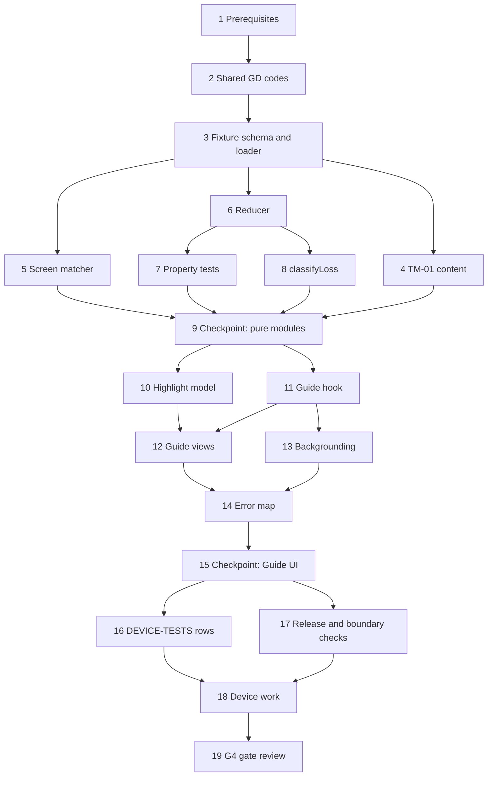

# Implementation Plan: guided-ticket-workflow

Status: **draft.** Written from `requirements.md` and `design.md`. No task is started or complete. A task is checked off only after its done check ran and its output was recorded.

## Overview

Order:
1. Prerequisites: spec 02 gate tasks AT-G3-01 and AT-G3-02 passing, owner decisions, fast-check approval. No Fluent_Reviewers (D-031): `hi` and `kn` content is `unreviewed`.
2. Pure TypeScript with no new package and no phone: shared `GD_*` codes, fixture schema, workflow loader, TM-01 content, screen matcher, the reducer with its transition proof, loss classification.
3. Property tests for the reducer (after fast-check approval).
4. Highlight model and the Guide UI slices: hook, views, backgrounding, hidden Speak slot, error-to-UI tests.
5. `docs/DEVICE-TESTS.md` row additions, then device tests on the Reference phone.
6. G4 gate review.

Blockers:
- **Spec 02 (translation-explore):** AT-G3-01 and AT-G3-02 must pass before task 2 starts. Guide extends spec B's `MachineFixture`, `identifyMachine`, `locateComponents` and `t(key)`.
- **fast-check approval:** blocks tasks 7 and 9.2 (R15).
- **TM-01 images (D-029, D-032):** the final base panel and Screen images S01 to S06 don't exist yet, and every box in `test-fixtures/tm-01/FIXTURE.md` is DRAFT. They block the snapshot-based tests and every device task. Task 4 content comes from FIXTURE.md and doesn't wait for them, but no test may rely on a DRAFT box.
- **Owner Q4:** Reference phone. Blocks every device task. Without it, report "device validation pending".
- **Recorded OCR snapshots** of the Screen images (S01 to S06) and the NEG-01 to NEG-10 images: block the snapshot-based tests and the G4 threshold values.

Done check for every task, unless the task says more: `npm run verify` exits 0. Report the commands run with exit codes, files changed, test counts, and device status, as the quality steering requires. Run `npx expo-doctor` at each checkpoint task.

Each task fits one focused session: one module or one UI slice, plus its tests. Never skip, weaken or re-snapshot a test to make it pass. Tests that need OCR output start from recorded snapshots in `test-fixtures/` and state which named fields they change (R20.2, R20.3). For a reducer bug fix, write the failing test first (R20.7).

Every Named threshold constant (R20.5) gets a pinned-value test and a behaviour test on both sides. Values the docs don't give stay unset until G4 and are recorded in `docs/DECISIONS.md` before use.

## Tasks

Lane P note (2026-11-19): ticks on 2, 3, 5, 6, 8 cover the code only. Their unit and property tests are deferred by owner: tests. Task 4 is parked (no authored hi/kn, expected results or performed record). Task 9 verify/doctor run, vision review not run.

- [ ] 1. Prerequisites
  - [ ] 1.1 Confirm spec 02 gate tasks AT-G3-01 and AT-G3-02 pass
    - Read `.kiro/specs/02-translation-explore/tasks.md` and the evidence it names. Both ATs must have a recorded PASSED result. If either is pending, stop and report which one. Do not start task 2.
    - Confirm the spec 02 exports this spec uses exist: `MachineFixtureB`, `validateFixture`, `identifyMachine`, `locateComponents`, `componentName`, `t(key)`, the mode switcher.
    - _Requirements: 1.11, 19.2_
  - [ ] 1.2 Ask the owner to decide OQ-1 to OQ-10
    - Present each recommended default from requirements.md. Record the answers in DECISIONS.md.
    - OQ-3 needs a clear answer: R10.8 and R10.12 as written leave DT-G4-04 unsatisfiable without the `classifyLoss` default.
    - If the owner changes a default, update the affected requirements and design sections before task 2 starts.
    - Ask whether a component name field exists in spec B's fixture (OQ-5).
    - _Requirements: 2.6, 10.13, 13.12, 14.3, 14.7, 21.8_
  - [ ] 1.3 Ask the owner to approve fast-check
    - If spec 01 task 9.1 already installed it, use that install and note it in DECISIONS.md. Otherwise check the official repo for maintenance and Jest 30 and `jest-expo` 58 compatibility, cite the source, and ask. On approval: `npm install -D fast-check` with the exact version npm resolves, `npx expo install --check`, `npx expo-doctor`.
    - _Requirements: 15.1, 20.1_
  - [ ] 1.4 Confirm the TM-01 form and the unreviewed status
    - Confirm that D-029 (printed panel plus screen images on an iPad) and D-031 (no reviewers, status `unreviewed`) are the basis for TM-01 content. Confirm OQ-10: the owner approves the separate update of PRODUCT.md "verified" item 3 and ARCHITECTURE.md §10 (spec 02 OQ-11).
    - _Requirements: 1.7, 2.1, 2.6_

- [x] 2. Add shared `GD_*` codes
  - Files: `src/modules/shared/index.ts`, `src/modules/shared/__tests__/gd-codes.test.ts`.
  - Add `GdErrorCode` and `GD_ERROR_CODES` for the five codes in ARCHITECTURE.md §8, unless spec A or B already defined them. No Guide state types go here: they stay in `guide/index.ts`.
  - Unit test: the list holds exactly the five codes, with no duplicates.
  - _Requirements: 16.1, 16.2, 19.9_

- [x] 3. Add the workflow fixture schema and validation (components)
  - [x] 3.1 Add the screen and workflow types and extend `validateFixture`
    - Files: `src/modules/components/fixture-types.ts`, `validate-fixture.ts`, `index.ts`, `__tests__/validate-fixture-screens.test.ts`.
    - Add `LocalizedText`, `ScreenDef`, `Checkpoint`, `StepDef`, `WorkflowDef`, the widened `MachineFixture` (with `simulated`, `screens`, `workflows`) and `ScreenIssueRule`. `identification` and `components` stay unchanged.
    - `validateFixture` reports `NO_SCREENS_FOR_CHECKPOINT`, `EMPTY_SCREEN_TEXT` and `DUPLICATE_SCREEN_ID`. It never throws.
    - Unit tests: one valid fixture and one invalid fixture per rule. Spec B's existing tests still pass unchanged.
    - _Requirements: 1.1, 1.2, 1.3, 1.4, 1.5, 1.6, 1.7, 1.9, 1.10, 1.11_
  - [x] 3.2 Add the Guide types and the workflow loader (`GD_FIXTURE_INVALID`)
    - Files: `src/modules/guide/types.ts`, `load-workflow.ts`, `index.ts` (`loadWorkflow`, `listWorkflows`, `ValidatedWorkflow`, `LoadError`), `__tests__/load-workflow.test.ts`.
    - Rules in the design's order: unknown id, empty or duplicate Steps, missing locale value, missing review status (`unreviewed` is accepted, D-031), performed record, unknown component, unknown screen, empty checkpoint text. The failing field path goes in `detail`.
    - Unit tests: one invalid fixture per rule, and a mutation test that removes each required field in turn from a valid workflow and expects `GD_FIXTURE_INVALID`. A test pins that the bundled fixture with no workflows gives an empty `listWorkflows` (no fast-check needed).
    - No network, clock or storage. The module imports only `components`, `geometry` and `shared` through `index.ts`.
    - _Requirements: 4.1, 4.2, 4.3, 4.4, 4.5, 4.6, 4.7, 4.8, 4.12, 4.13, 6.7, 16.1, 16.4, 19.1_

- [ ] 4. Author the TM-01 workflow content (en, hi, kn) _(dropped by owner: TM-01, D-043)_
  - Blocked on: tasks 1.4 and 3.1. Source: `test-fixtures/tm-01/FIXTURE.md` sections 5 to 7.
  - Files: `src/modules/components/fixtures/tm-01.ts`, `__tests__/tm-01-workflows.test.ts`.
  - Add `screens`, `workflows` and `simulated` for TM-01. Content comes from FIXTURE.md (workflow W1 to W6, screens S01 to S06, checkpoints), plus the `performed` record the owner supplies. Nothing is generated, inferred or machine-translated. Mark `authored: true`.
  - Mark every `hi` and `kn` title, instruction and Expected result `unreviewed` (D-031). Never write `reviewed`, and never write a placeholder reviewer. FIXTURE.md §7 lists the `hi` and `kn` text as TODO: if a value isn't authored, leave the workflow out of the fixture and report it.
  - Tests: the bundled fixture passes `validateFixture`, and `loadWorkflow` returns `ok` for every workflow (R4.11). Each Step's target exists in `components`. A test checks that the fixture has Steps W1 to W6 with the targets, Screens and Checkpoints of FIXTURE.md §5, and Screens S01 to S06 with the texts of §6 (R1.12, R1.13).
  - [ ] 4.1 Author the typed workflow fixture data from FIXTURE.md _(dropped by owner: TM-01, D-043)_
    - Files: `src/modules/components/fixtures/tm-01.ts`, `__tests__/tm-01-workflows.test.ts`.
    - Write the workflow "Buy a single-journey ticket" as typed data: Steps W1 to W6 (targets C-SCREEN, C-SCREEN, C-CONFIRM, C-CARD, C-SCREEN, C-TRAY), Screens S01 to S06 with their identifying texts, `text-visible` Checkpoints for W1, W2, W3, W4 and W6, and `manual` for W5. The `en` instruction of each Step is the FIXTURE.md text. The target component ids must exist in the fixture's components.
    - Add the `hi` and `kn` text with status `unreviewed`. Add no coordinates from a DRAFT box to any recognition assertion.
    - _Requirements: 1.1, 1.2, 1.3, 1.4, 1.5, 1.7, 1.12, 1.13_
  - _Requirements: 1.1, 1.2, 1.3, 1.4, 1.5, 1.6, 1.7, 1.8, 1.9, 1.10, 4.11, 18.6_

- [x] 5. Add the screen matcher and checkpoint result (components)
  - [x] 5.1 Add `matchScreen` and the thresholds file
    - Files: `src/modules/components/screen-match.ts`, `thresholds.ts` (`SCREEN_MIN_TEXTS`, `SCREEN_MARGIN`, unset until G4), `index.ts`, `__tests__/screen-match.test.ts`.
    - Same normalization as `identifyMachine`, Latin and Devanagari lines only. `cannot-tell` for none, a tie, `OCR_LOW_QUALITY`, or unset constants (safe direction). Deterministic, no network, no throw. OCR text is plain data (T8).
    - Unit tests start from recorded snapshots of the Screen images when they exist. Until then, tests use hand-built `OcrResult` values in `test-support/` labelled as synthetic, and say so. A test fails if G4 evidence is claimed while the constants are unset.
    - _Requirements: 3.1, 3.2, 3.3, 3.4, 3.5, 3.6, 3.7, 3.10, 20.1, 20.5_
  - [x] 5.2 Add `checkpointResult` and `describeObservedText`
    - Files: `src/modules/components/checkpoint.ts`, `observed-text.ts`, `index.ts`, tests.
    - `met` only when the checkpoint text is on a Latin or Devanagari line and, if a screen is named, `matchScreen` matched that id. `cannot-tell` for a `cannot-tell` screen, `OCR_LOW_QUALITY`, or a `manual` checkpoint. `not-met` otherwise. `describeObservedText` returns readable and anchor line counts.
    - Unit tests: each outcome, with named fields changed from a snapshot for partial and ambiguous cases.
    - _Requirements: 3.8, 3.9, 3.10, 20.1_

- [x] 6. Add the Guide reducer, observation evaluation and transition proof
  - [x] 6.1 Add constants, `GuideObservation` and `evaluateObservation`
    - Files: `src/modules/guide/constants.ts`, `evaluate.ts`, `index.ts`, `__tests__/constants.test.ts`, `__tests__/evaluate.test.ts`.
    - `CONSECUTIVE_MATCHES_REQUIRED = 2` (pinned). `MACHINE_LOST_TIMEOUT_MS` (proposed 3000, ARCHITECTURE.md §8), `CHECKPOINT_NOT_SEEN_LIMIT`, `LOSS_MIN_READABLE_LINES`, `LOSS_MAX_ANCHOR_LINES` stay unset or proposed until G4 and get a DECISIONS.md entry when set.
    - `evaluateObservation` builds `obs:<frameId>`, copies `frameId` and `capturedAtMs` (as `seq`), and reports `machine: none` when the MachineMatch frameId differs from the OcrResult's.
    - Unit tests: id derivation, frame mismatch, each machine status.
    - _Requirements: 6.6, 7.9, 8.1, 10.1, 13.12, 20.5_
  - [x] 6.2 Add `guideReducer`: start, observation, advance
    - Files: `src/modules/guide/reducer.ts`, `index.ts` (`GuideState`, `GuideEvent`, `TransitionProof`, `initialGuideState`, `guideReducer`, `currentStep`, `advanceCount`), `__tests__/reducer-start.test.ts`, `__tests__/reducer-observation.test.ts`.
    - Implement the design's check order for `start` and `observation`: dedup by id and frameId, `seq` against `lastSeq` and `notBeforeSeq`, `forStepId` mismatch, the streak of two, the not-seen count, the single `advance` function that appends one proof and moves to `completed` from the last Step. Rejected observations return the same state object.
    - Pure and total: no React, no clock, no random, no throw, no mutation.
    - Unit tests: `GD_UNSUPPORTED` and `GD_FIXTURE_INVALID` starts, two matching distinct observations advance once, one `met` does not, duplicates and replays, out-of-order, manual Step ignores observations, advance from the last Step completes.
    - Add a Node-environment test that imports the reducer without React Native.
    - _Requirements: 5.2, 5.3, 5.7, 5.8, 6.1, 6.2, 6.3, 6.4, 6.5, 6.8, 6.9, 7.1, 7.2, 7.3, 7.4, 7.5, 7.6, 7.7, 7.8, 8.2, 8.3, 8.4, 8.5, 8.6, 8.7, 11.1, 11.2, 11.4, 11.6, 11.9, 13.4, 13.10, 13.11_
  - [x] 6.3 Add the remaining reducer events and the transition proof checks
    - Files: `src/modules/guide/reducer.ts`, `__tests__/reducer-events.test.ts`, `__tests__/reducer-proof.test.ts`.
    - `confirm-manual` (matching `stepId`, manual Step only, `done` proof with `atMs`), `machine-lost` (`not-seen` pauses with `GD_MACHINE_LOST`, `other-machine-text` cancels with `GD_MACHINE_CHANGED`), `interrupted`, `retry`, `step-back`, `cancel`, `reset`, resume on a `verified` observation, cancel on a `verified` observation of another machine id.
    - Transition proof tests: `proofs.length` equals the advance count, ordinals run `1..n`, observed proofs hold two distinct frameIds both in `acceptedFrameIds`, `step-back` and `retry` append none, no proof holds image data or OCR text.
    - Unit tests: a pause then one `met` after resume does not advance (R10.6), `interrupted` sets `notBeforeSeq`, double Done advances once, no sequence of `machine-lost` events advances a Step.
    - _Requirements: 9.1, 9.4, 9.5, 9.6, 9.7, 10.3, 10.4, 10.5, 10.6, 10.8, 10.10, 10.11, 10.12, 11.1, 11.2, 11.3, 11.4, 11.5, 11.6, 11.7, 11.9, 13.6, 13.7, 13.9, 14.2, 14.4, 14.5, 14.7_

- [ ] 7. Write the reducer property tests
  - Blocked on: task 1.3 (fast-check approval) and task 6.3.
  - Files: `src/modules/guide/__tests__/*.property.test.ts`, `src/modules/guide/test-support/arbitraries.ts`.
  - Generators build `ValidatedWorkflow` (1 to 8 Steps, `text-visible` or `manual`) and `GuideObservation` values from fields. They never invent OCR text. Where OCR input is needed, start from a snapshot and state the changed fields.
  - Write design Properties 1 to 11 and the rest of the design's list, at least 100 runs each. Cover: index rises by at most one, every advance has a cause, proofs match advances, duplicates and replays change nothing, out-of-order ignored, non-observation events never advance, no timer advance (varying every `atMs` and `seq` gives the same trace), only a verified match starts a run, completion only from the last Step, manual versus text Steps, pause and resume keep the Step, determinism on replay.
  - Each test records its seed and shrunk counterexample on failure. No test is skipped or weakened.
  - _Requirements: 6.4, 7.4, 8.6, 10.11, 11.5, 14.4, 15.1, 15.2, 15.3, 15.4, 15.5, 15.6, 15.7, 15.8, 15.9, 15.10, 15.11, 15.12_

- [x] 8. Add loss classification
  - Files: `src/modules/guide/loss.ts`, `index.ts`, `__tests__/loss.test.ts`.
  - `classifyLoss(sinceVerified)` returns `other-machine-text` when summed readable lines reach `LOSS_MIN_READABLE_LINES` and summed anchor lines stay at or below `LOSS_MAX_ANCHOR_LINES`, else `not-seen`. One place defines "a different machine" (R10.13). If the owner rejected the OQ-3 default in task 1.2, return `not-seen` always and say that DT-G4-04 cannot pass as written.
  - Unit tests on both sides of each constant. Constants stay unset until G4 snapshots exist: with unset values the function returns `not-seen`. Snapshot-based cases (NEG-01 to NEG-10, blank, wall) are added in task 18.2.
  - _Requirements: 10.2, 10.8, 10.12, 10.13, 20.5_

- [ ] 9. Checkpoint: pure Guide modules
  - Run `npm run verify` and `npx expo-doctor`, and record the output.
  - Run the read-only `vision-reviewer` agent, or the `vision-safety-review` skill, on the diff. Fix any BLOCKER or HIGH finding before task 10 and record the review in `docs/kiro-evidence.md`.
  - Check by source search that `guide` imports no React, React Native, `capture`, `ocr`, `locale`, `speech`, network or clock. Ask the owner if questions came up.
  - _Requirements: 6.2, 6.7, 18.1, 18.2, 18.4, 19.1_

- [x] 10. Add the highlight model (ui)
  - Files: `src/modules/ui/guide/highlight-model.ts`, `HighlightLayer.tsx`, `__tests__/highlight-model.test.ts`.
  - The model calls `locateComponents` with the latest `verified` match and its OcrResult, finds the current Step's target, and gets `viewQuad` from `geometry.frameQuadToView` with the current Cover transform. No coordinate math in `ui`.
  - `null` unless the status is `running` and the latest match is `verified`; `null` for a non-finite quad; `CMP_NOT_VISIBLE` gives no Highlight and the prompt `t('guide.pointCameraAt', { component })`. Only the target is highlighted. The model carries the `frameId` and is recomputed per render, so the previous Highlight goes in the same render as a Step change.
  - `HighlightLayer`: two-tone outline plus a text label, label placed by `geometry.placeLabels` so it does not cover Checkpoint text inside the target. Described as a 2D mark on the image, never tracking or AR.
  - Tests start from recorded snapshots (spec B's TM-01 snapshots): each status, `ambiguous` and `none` matches, `CMP_NOT_VISIBLE`, non-finite quad, Step change. A source search finds no coordinate math in `ui/guide`.
  - Contrast of 3:1 is checked on device screenshots in task 18.3, not here.
  - _Requirements: 12.1, 12.2, 12.3, 12.4, 12.5, 12.6, 12.7, 12.8, 12.9, 12.10, 12.11, 16.6, 18.8, 19.5_

- [x] 11. Add the Guide hook
  - [x] 11.1 Add `useGuide` and the observation loop
    - Files: `src/modules/ui/guide/useGuide.ts`, `__tests__/useGuide.test.tsx` (fake services from spec A and B `test-support/`).
    - `useReducer(guideReducer, initialGuideState)`. On open: a `verified` match shows the picker, otherwise dispatch `start` so the reducer sets `GD_UNSUPPORTED`. Picker selection dispatches `start` with that Workflow's loader result. Per OcrResult: `identifyMachine`, `matchScreen`, `checkpointResult`, `describeObservedText`, `evaluateObservation`, dispatch. Drop any result whose `frameId` was never shown or processed. `GUIDE_CAPTURE_INTERVAL_MS` stays an unset named constant until G4 (OQ-1).
    - No decision rule in `ui`: no `verified`, `met` or advance logic (R19.4).
    - Tests: the dispatched event sequence for a fake observation stream, a stale frame dropped, `invalid` workflows left out of the picker.
    - _Requirements: 4.9, 5.1, 5.9, 5.10, 8.8, 18.3, 19.3, 19.4, 19.7_
  - [x] 11.2 Add the machine-lost timer and loss classification wiring
    - Files: `src/modules/ui/guide/useMachineLostTimer.ts`, test with fake timers.
    - The timer restarts on each dispatched `verified` observation, stops in the background, and on firing sends `{ type: 'machine-lost', cause: classifyLoss(sinceVerified), atMs }` once per quiet period. `ui` keeps the observations since the last verified one in a bounded array and reads none of their counts.
    - Tests: fires once at `MACHINE_LOST_TIMEOUT_MS` (value injected by the test until G4), restarts on `verified`, no event while backgrounded, never an event that advances.
    - _Requirements: 10.1, 10.2, 10.3, 10.11, 14.8, 18.3_

- [x] 12. Add the Guide views
  - [x] 12.1 Add the task picker, refusal view and mode switcher entry
    - Files: `src/modules/ui/guide/GuideScreen.tsx`, `TaskPicker.tsx`, `RefusalView.tsx`, `src/modules/ui/camera-screen/ModeSwitcher.tsx` (add `guide` to `MODES`), `strings/{en,hi,kn}.ts` (new guide keys), tests.
    - Picker lists valid Workflow titles in the UI language. With none valid, show "Step-by-step help isn't available" with Translate and Explore. The Refusal_State shows the `GD_UNSUPPORTED` text, Translate and Explore buttons that switch mode, and no Step and no Highlight. Show the tamper note and the "TM-01 only" capability text.
    - Render tests: touch targets of at least 48 dp, `accessibilityRole` and localized `accessibilityLabel`, each state shown as text. New `hi` and `kn` strings are marked `unreviewed` (D-031), and the README and demo script say so (R1.14).
    - _Requirements: 4.9, 4.10, 5.4, 5.5, 5.6, 5.9, 5.11, 5.12, 16.9, 18.7_
  - [x] 12.2 Add the step card, Done and the Speak slot
    - Files: `src/modules/ui/guide/StepCard.tsx`, `SpeakSlot.tsx`, tests.
    - Shows the Workflow title, "Step n of N", the fixture instruction, and "Waiting to see: …" with the Expected result for `text-visible` Steps. Done appears only on `manual` Steps and sends `confirm-manual` with the visible Step id. Back appears from the second Step. Each new Step is announced with `AccessibilityInfo.announceForAccessibility`. Layout wraps, no fixed heights, uses spec A's Devanagari and Kannada line-height factor.
    - `SpeakSlot = ({ control }) => control ?? null`. `ui` does not import `speech`. No microphone permission, no speech dependency.
    - Tests: Done absent for `text-visible`, present with a 48 dp target for `manual`, slot renders nothing and takes no space, a source search finds no `speech` import, no text passes through `locale` translation.
    - _Requirements: 9.2, 9.3, 13.1, 13.2, 13.3, 13.8, 13.14, 13.15, 13.16, 17.1, 17.2, 17.3, 17.4, 17.5, 18.4, 18.5_
  - [x] 12.3 Add the checkpoint-not-seen prompt, paused, cancelled and completion views
    - Files: `src/modules/ui/guide/CheckpointPrompt.tsx`, `PausedView.tsx`, `CancelledView.tsx`, `CompletionView.tsx`, tests.
    - `GD_CHECKPOINT_NOT_SEEN`: "Didn't see [expected result]. Check the machine." with Retry and Back (no Back on the first Step). Retry sends `retry`, Back sends `step-back`; neither advances. Paused view: "Paused. Point the camera at the machine to continue." with no Highlight. Cancelled view: "Guide stopped. A different machine was found." with a start-again control that sends `reset`. Completion view: completion text and a control back to the picker.
    - Tests: each view's text and controls, no Highlight in paused, cancelled, idle and completed, Retry and Back dispatch the right events.
    - _Requirements: 10.7, 10.9, 10.10, 12.6, 13.5, 13.6, 13.7, 13.8, 13.13, 13.14_

- [x] 13. Handle backgrounding and leaving Guide
  - Files: `src/modules/ui/guide/useGuide.ts` (AppState and back handling), `__tests__/useGuide-lifecycle.test.tsx`.
  - `AppState` leaving `active` while `running` sends `interrupted`. Any other status is left alone. On return: drop the still and Highlight under spec A's lifetime rules, show the paused view, show no Highlight until a new `verified` MachineMatch, and resume only through the reducer (OQ-6). Switching mode or Android back while `running` or `paused` sends `cancel` (OQ-7).
  - Property check (after task 7): an `interrupted` event never advances a Step.
  - Tests: interrupted then a stale pre-interruption observation is ignored, return shows paused, cancel returns to `idle` with no proof, timer stopped while backgrounded.
  - _Requirements: 14.1, 14.2, 14.3, 14.4, 14.5, 14.6, 14.7, 14.8_

- [x] 14. Add the error-to-UI map and the `GD_*` tests
  - Files: `src/modules/ui/guide/error-map.ts`, `debug/invalid-workflow-hook.ts` (`__DEV__` only, marker `OVERLAYKIT_DEBUG_ONLY`), `__tests__/error-map.test.ts`, `__tests__/gd-production.test.ts`.
  - `error-map.ts` is a total `Record<GdErrorCode | 'CMP_NOT_VISIBLE', GuideUiState>`, so a missing code is a type error. Each state has a text and an accessibility state. The debug hook loads a broken Workflow so `GD_FIXTURE_INVALID` can be reached on the phone.
  - QE-1 tests for each of the five `GD_*` codes: one test that `guide` produces it (reducer or loader) and one that `ui` maps it to its state. One test for the `CMP_NOT_VISIBLE` prompt in the Guide_Screen. Loop over `GD_ERROR_CODES` so a new code fails the test until it is mapped. The release bundle check for the debug hook runs in task 17.
  - _Requirements: 4.9, 16.1, 16.3, 16.4, 16.5, 16.6, 16.8, 16.9, 20.4_

- [ ] 15. Checkpoint: Guide UI
  - Run `npm run verify` and `npx expo-doctor`, and record the output.
  - Run `npx expo prebuild --clean` only if `app.json` changed, then the debug build `npx expo run:android --device`. Without a connected phone, report "device validation pending" and keep this task open.
  - Run the `vision-reviewer` agent on the diff. Fix BLOCKER and HIGH findings and record the review in `docs/kiro-evidence.md`.
  - Ask the owner if questions came up.

- [x] 16. Add the DEVICE-TESTS.md rows for Guide
  - Files: `docs/DEVICE-TESTS.md` only.
  - Add one row per Screen image (S01 to S06) and per negative-set image (NEG-01 to NEG-10) under Physical fixtures, with its id, if the existing rows don't cover them. Add or confirm rows for DT-G4-01 to DT-G4-04, DT-G4-06, DT-ERR-04 and DT-ERR-05, plus a `GD_FIXTURE_INVALID` debug-hook row. Every new row starts as NOT TESTED. Add no PASSED result.
  - Do this before any G4 device testing starts.
  - _Requirements: 2.8, 20.8, 20.9_

- [x] 17. Run the release bundle and boundary checks
  - [x] 17.1 Search the release bundle for debug code
    - Run `npx expo export --platform android`. Search the output for `OVERLAYKIT_DEBUG_ONLY`, the invalid-workflow hook name, and Transition proof logging. Record the command and result (no matches) in `docs/build-log.md`.
    - _Requirements: 11.8, 16.8_
  - [x] 17.2 Check for hidden state channels and forbidden imports
    - Source search of `guide`, `components` and `ui/guide` for `fetch`, `XMLHttpRequest`, `WebSocket`, deep-link handlers, shared-storage reads, Bluetooth, `Date.now`, `Math.random`, and any `locale` or `speech` import. Check no timer moves a Step and `ui` imports no `backend/`. Record the results.
    - Confirm the Android manifest gains no microphone permission after `npx expo prebuild --clean`.
    - _Requirements: 2.5, 17.5, 18.1, 18.2, 18.3, 18.4, 19.1, 19.8_

- [ ] 18. Device work on the Reference phone
  - Blocked on: owner Q4, the final TM-01 images, tasks 4, 15 and 16. Use the `physical-device-qa` skill. Record PASSED, FAILED or NOT TESTED in `docs/DEVICE-TESTS.md` with commit, variant, device and date. Never claim a result for a test that was not run. Without the phone, report "device validation pending".
  - [ ] 18.1 Show the Screen images on the iPad and export recorded snapshots
    - Show the Screen images S01 to S06 on the iPad (full brightness, auto-lock off, swapped by hand, nothing shared with the app) and print the panel at real size, per D-029 and FIXTURE.md §2 and §9. Export snapshots of each Screen image and each NEG-01 to NEG-10 image through spec A's exporter into `test-fixtures/ocr-snapshots/` with manifest entries and the image review.
    - _Requirements: 2.1, 2.2, 2.3, 2.4, 2.7, 20.2_
  - [ ] 18.2 Set the G4 thresholds and add the snapshot-based tests
    - Measure `SCREEN_MIN_TEXTS`, `SCREEN_MARGIN`, `LOSS_MIN_READABLE_LINES`, `LOSS_MAX_ANCHOR_LINES`, `CHECKPOINT_NOT_SEEN_LIMIT`, `MACHINE_LOST_TIMEOUT_MS` and `GUIDE_CAPTURE_INTERVAL_MS` from the snapshots and early runs. Present the values to the owner and record them in DECISIONS.md before any value is committed.
    - Add the pinned-value and both-sides tests. Re-run the matcher and `classifyLoss` tests on the recorded snapshots (NEG-01 to NEG-10, blank, wall) and add a snapshot case for each `GD_*` path.
    - _Requirements: 3.5, 10.1, 10.2, 10.13, 13.12, 20.2, 20.5_
  - [ ] 18.3 Run DT-G4-01 and DT-G4-02
    - DT-G4-01: Guide opened on NEG-01 to NEG-10 shows the Refusal_State and no Step. DT-G4-02: TM-01, target `kn`, workflow run to the end, correct highlight per Step, one advance per `text-visible` Step, Done only for `manual` Steps. Record the debug-log Transition proofs, the 3:1 highlight contrast on screenshots, and the Devanagari and Kannada rendering at the largest system font size.
    - _Requirements: 21.1, 21.2, 21.8, 12.8, 11.8, 13.15, 13.16_
  - [ ] 18.4 Run DT-G4-03, DT-G4-04 and DT-G4-06
    - DT-G4-03: point away mid-workflow, paused, resumes the same Step only after TM-01 is identified. DT-G4-04: point at NEG-01 mid-workflow, workflow cancelled. DT-G4-06: background 30 s, return, same Step or safe reset, no skipped Step. If OQ-3 was rejected, record DT-G4-04 as FAILED or NOT TESTED with the reason.
    - _Requirements: 21.3, 21.4, 21.5, 14.3, 14.6_
  - [ ] 18.5 Reach the remaining error states (QE-2)
    - DT-ERR-04: keep the target out of frame, `CMP_NOT_VISIBLE` prompt and no Highlight. DT-ERR-05: skip the action on a `text-visible` Step, `GD_CHECKPOINT_NOT_SEEN`, no advance. `GD_FIXTURE_INVALID` through the debug hook. Check QE-3: each state is announced by TalkBack.
    - _Requirements: 16.7, 16.9, 21.6, 21.7_

- [ ] 19. G4 gate review
  - Report AT-G4-01 to AT-G4-06 and AT-G4-08, and QE-1, QE-2 and QE-3 for the `GD_*` codes, as PASSED, FAILED or pending, each with its evidence path in `docs/DEVICE-TESTS.md`, `docs/build-log.md` or test output. AT-G4-07 belongs to spec D.
  - Run the `vision-reviewer` agent on the full spec diff. Block release if any Step was shown for a machine that is not `verified` (G4 stop condition). Update the CAPABILITY-MAP.md status table and the `tasks/todo.md` G4 items that are actually done. Say first-party simulated machine in every submission text (TM-01 is a printed panel plus iPad images, D-029), and say the `hi` and `kn` text is `unreviewed` in the README and demo (D-031).
  - _Requirements: 16.7, 18.7, 20.8, 21.1, 21.2, 21.3, 21.4, 21.5, 21.6, 21.7, 21.9_

## Task Dependency Graph



```json
{
  "waves": [
    { "id": 0, "tasks": ["1.1", "1.2", "1.3", "1.4"] },
    { "id": 1, "tasks": ["2"] },
    { "id": 2, "tasks": ["3.1"] },
    { "id": 3, "tasks": ["3.2", "5.1"] },
    { "id": 4, "tasks": ["4", "5.2", "6.1"] },
    { "id": 5, "tasks": ["6.2"] },
    { "id": 6, "tasks": ["6.3"] },
    { "id": 7, "tasks": ["7", "8"] },
    { "id": 8, "tasks": ["9"] },
    { "id": 9, "tasks": ["10", "11.1"] },
    { "id": 10, "tasks": ["11.2", "12.1", "12.2"] },
    { "id": 11, "tasks": ["12.3", "13"] },
    { "id": 12, "tasks": ["14"] },
    { "id": 13, "tasks": ["15"] },
    { "id": 14, "tasks": ["16", "17.1", "17.2"] },
    { "id": 15, "tasks": ["18.1"] },
    { "id": 16, "tasks": ["18.2"] },
    { "id": 17, "tasks": ["18.3", "18.4", "18.5"] },
    { "id": 18, "tasks": ["19"] }
  ]
}
```

Tasks 7 and 8 can run in parallel after task 6.3. Task 4 needs the authored `hi` and `kn` text and can slip without blocking tasks 5 to 8, which use synthetic fixtures. Every task from 18 on needs the Reference phone (owner Q4).

## Notes

- Every task is required. The property tests (task 7) are required by the quality steering and wait only on fast-check approval.
- No task is complete. Check one off only after its done check ran and its output was recorded, never because a document was generated.
- Owner approvals gate tasks 1.2, 1.3, 1.4, 4 and 18.2. Ask before installing or recording anything.
- Device results without a `docs/DEVICE-TESTS.md` record count as "device validation pending".
- AT-G4-07 (voice) and the real Speak control belong to spec D. This spec ships only the empty Speak slot.
