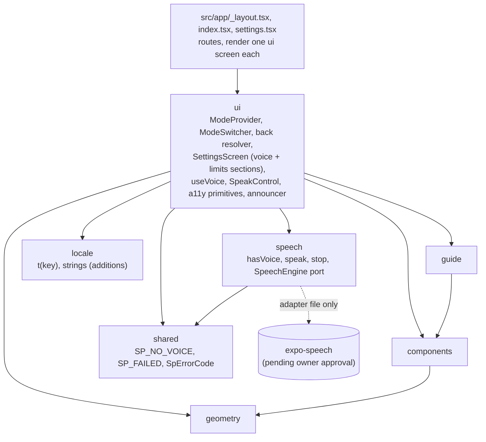
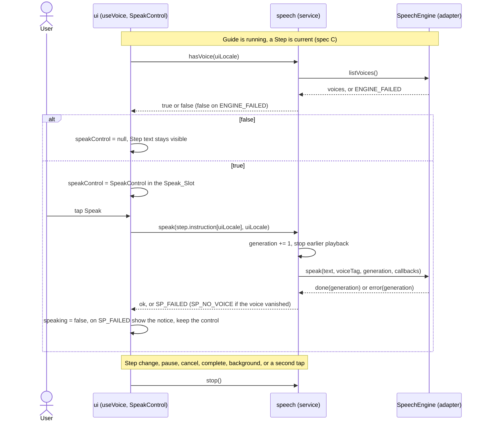
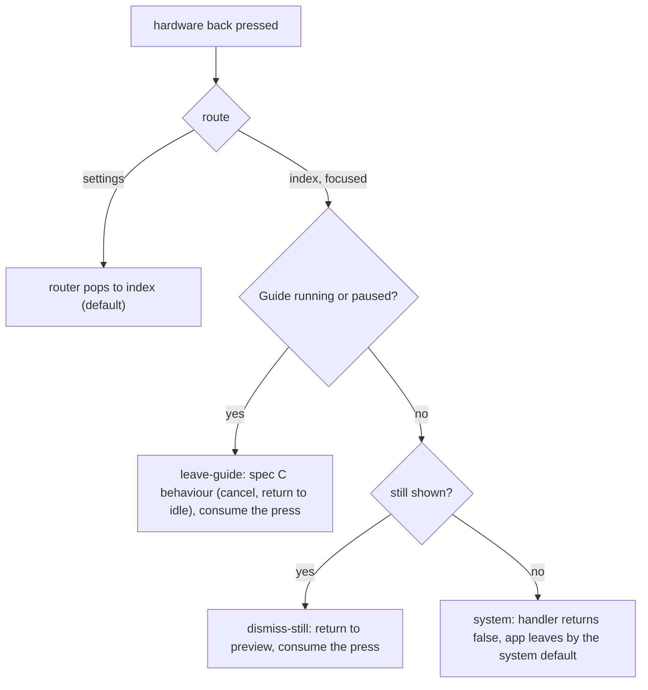
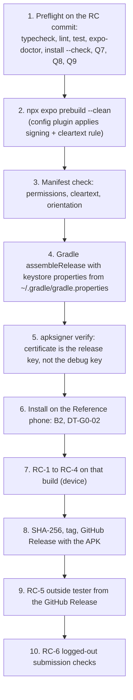
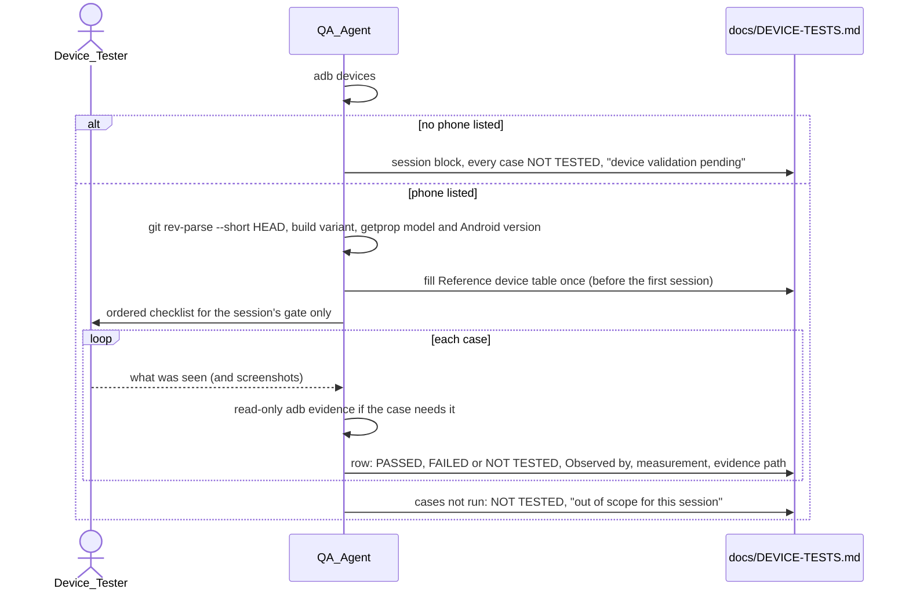

# Design Document: native-experience-and-release

Status: **draft, awaiting owner review.** Written from `requirements.md` (draft). Open questions OQ-1 to OQ-9 use their recommended defaults. No code for this design exists yet. Every statement about the phone is a plan: **device validation pending** (no phone connected, owner Q4 deferred by D-031, so every device and release item stays "device validation pending").

## Overview

This design covers capability D in `docs/CAPABILITY-MAP.md` (§4.D and §5). It delivers AT-G4-07 (voice), build gate B2, the release checks RC-1 to RC-6, QE-1 and QE-2 for `SP_NO_VOICE` and `SP_FAILED`, the device tests DT-ERR-01 to DT-ERR-05, DT-RC-01 and DT-RC-02, and the physical-device protocol PD-01 to PD-09.

It has five parts:

1. **Navigation.** One index route (Camera_Screen with the Translate / Explore / Guide switcher) and one Settings route. Android back resolves through one pure function. The orientation is portrait, set in `app.json`.
2. **Speech.** A new `speech` module (`hasVoice`, `speak`, `stop`) over a `SpeechEngine` interface. The only vendor file is an `expo-speech` adapter. `ui` passes a Speak control into spec C's `speakControl` slot, and only when `hasVoice` is true.
3. **Accessibility.** One set of `ui` primitives (accessible button with a 48 dp target, an announcer with dedupe, a reduce-motion hook, a contrast function) and tests that walk rendered trees.
4. **QA record process.** How the QA_Agent and the Device_Tester fill `docs/DEVICE-TESTS.md`, and how every `ARCHITECTURE.md` §8 code is tied to a unit test and a device record.
5. **Release.** A local Gradle build signed with a keystore outside git, a checksum, a GitHub Release, a README that is generated from a claims ledger, a LICENSE, the static checks Q7 to Q9, the demo script, the Devpost text and the evidence log.

**What spec A, B and C provide and this design extends.**

- Spec A: Camera_Screen, `MODES` and the mode switcher, Overlay_Layer, `MIN_TOUCH_TARGET_DP` (48), `LABEL_FONT_SIZE_SP` (14), `MonotonicClock`, `Result`, the `ui/services.tsx` context, `ui/debug/fault-injection.ts` and its `__DEV__` dev-menu items.
- Spec B: `t(key)`, `useLocaleSettings`, `SettingsScreen` with `LanguageSection`, `OpenRouterKeySection` and `PrivacyNote`, the route table (which says whether translation is on-device, cloud or not configured), and `contrastRatio` for label colours (B's UI style constants).
- Spec C: `GuideState`, the Step_Card with `speakControl?: ReactNode` (default `null`, C DD-10), Guide announcements (C R13.14) and leaving-Guide behaviour (C OQ-7).

**What doesn't exist yet:** the `speech` module, `expo-speech` (not approved, not installed), the Reference phone, a keystore, a LICENSE, a README beyond the template, the demo script, the Devpost text, `docs/kiro-evidence.md` and every recorded device result. Nothing in this design changes an existing A, B or C test.

**Dependency flag (owner approval needed before any install).** `expo-speech` is a candidate (D-014, OQ-1). Gate task: AT-G4-07. No `package.json` change happens until the owner approves. After approval the agent checks the official Expo docs for SDK 58 and React Native 0.88 New Architecture support, cites the page, runs `npx expo install expo-speech`, then `npx expo install --check` and `npx expo-doctor`. If the check fails, the fallback (a Kotlin adapter around Android `TextToSpeech`) needs a new `docs/DECISIONS.md` entry. This design uses no other new package. The signing and cleartext steps use a local config plugin built on `expo/config-plugins`, which ships with Expo (DP-3).

### Design decisions in this document

| ID | Decision | Reason |
| --- | --- | --- |
| DD-1 | `speech` is defined by a `SpeechEngine` port. `createSpeechService(engine)` holds all logic (voice match, one-playback rule, error mapping). The `expo-speech` adapter holds none. | R4.3, R4.4. Tests use a fake engine. Swapping the vendor changes one file and adds a decision entry. |
| DD-2 | `speak` returns a promise that settles when playback ends: `ok` on natural end or on `stop()`, `SP_FAILED` on an engine error, `SP_NO_VOICE` before any engine call when no voice exists. | R4.6 to R4.10. `ui` derives the "speaking" state from the pending promise and needs no engine events. |
| DD-3 | Every `speak` call gets a generation number. Engine callbacks carry it and a callback from an older generation is ignored. | R4.9. A late `done` or `error` from a stopped utterance must not end or fail the new one. |
| DD-4 | `hasVoice` reads the engine's voice list on every call. Nothing is cached in `speech`. `ui` re-checks when the Step_Card appears, when Settings appears and when the app returns to the foreground. | R4.5, R5.11, OQ-2. No polling. |
| DD-5 | The Speak control text comes only from the Guide state's current Step instruction in the UI language, read through spec C's view model. | R5.4. `speech` never sees a key, a fixture or a translation provider. |
| DD-6 | Back handling is one pure function `resolveBack(ctx)` returning `'leave-guide' \| 'dismiss-still' \| 'system'`. A thin hook registers it with `BackHandler` only while the Camera_Screen is focused. Settings relies on the router's own pop. | R3.2 to R3.5. The order is testable without a device. |
| DD-7 | Mode state lives in a `ModeProvider` mounted by the root layout, not in the Camera_Screen. | R1.9. The mode survives the Camera_Screen unmounting while Settings is open. |
| DD-8 | Accessibility is enforced by shared primitives (`A11yButton`, `useAnnouncer`, `useReduceMotion`, `contrastRatio`) plus tests that traverse rendered trees. No hand-written audit list. | R6. New touchables cannot skip the rule without failing a test. |
| DD-9 | One announcer owns all `announceForAccessibility` calls. Spec C's Step announcement is routed through it. | R7.4. Two callers would announce a step twice. Flagged as DP-5. |
| DD-10 | Release signing is configured by a local config plugin that reads Gradle properties from the user's `~/.gradle/gradle.properties`. The keystore path and passwords never enter the repository. | R12.3 to R12.5, stack steering ("never edit `android/`"). DP-3. |
| DD-11 | README, video script and Devpost text draw their capability statements from one **claims ledger** (`docs/release-claims.md`). A row is usable in public text only when its evidence is a PASSED record or a code or doc fact. | R13.14, R13.16, R18.4, R19.9, R20.7. |
| DD-12 | Debug-only hooks (the `SP_FAILED` hook added here, plus A and B hooks) are reached only through `__DEV__ ? require(...) : null` and carry the marker `OVERLAYKIT_DEBUG_ONLY`. A release check searches the release bundle for the marker. | R10.6, R12.7. Same pattern as B DD-12. |
| DD-13 | The device-record table (QE-2) is maintained by hand in `docs/DEVICE-TESTS.md`. A unit test covers only the unit-test side (QE-1). | R10.7. Device facts can't be computed. The unit side can. |

## Architecture

### Module map

Arrows mean "may import" (ARCHITECTURE.md §5). `capture`, `ocr`, `geometry`, `components`, `guide` and `locale` are not changed by this spec except for string additions in `locale`. `speech` imports only `shared`. Dotted arrows are vendor libraries, each used by one adapter file.



Rules this map enforces:

- `speech` does not import `locale`, `guide` or `ui`. It receives a text and a locale code and returns a `Result`.
- `ui` is the only place where `speech` and `guide` meet (R5.3, R5.4).
- Vendor types (`expo-speech` `Voice`, option objects, callbacks) never leave `speech/adapters/expo-speech-engine.ts`.
- `speech` has no `fetch`, no microphone API, no permission request (R4.11, R4.12). A source search in the test suite checks the module directory for `fetch`, `XMLHttpRequest`, `RECORD_AUDIO` and `Audio.` (see Testing strategy).
- The module-boundary lint rule (Q4) is not in place yet (requirements, Dependencies). R4.2 therefore has a unit test that reads each `speech/**/*.ts` import list, until Q4 exists.

### Speak flow



### Back resolution



Guide beats the still because Guide runs on stills and the user wants to leave Guide first (R3.5). The hook is registered with `useFocusEffect`, so it is not active while Settings is on top (R3.2).

### Release pipeline



A failed step stops the pipeline and is recorded in `docs/build-log.md` with its cause before a retry (R12.11, R16.7). Any code change after step 7 repeats the steps the change can affect (R17.10).

### Composition and test seams

- `ui/services.tsx` (spec A) gains `speech: SpeechService`. The default is built once from `createSpeechService(createExpoSpeechEngine())`. Tests render with a fake engine from `test-support/`.
- `ui/a11y/AccessibilityPort` wraps `AccessibilityInfo` (`announceForAccessibility`, `isReduceMotionEnabled`, `addEventListener('reduceMotionChanged')`). Tests pass a fake.
- `ui/nav/BackPort` wraps `BackHandler.addEventListener`. Tests pass a fake that records the registered handler and calls it.
- `ui/app-state/AppStatePort` wraps `AppState` for foreground and background events. Tests drive it.
- No state library is added. `ModeProvider` is a React context with `useState`.

### File layout

```
app.json                                    orientation "portrait", plugins list (additions)
plugins/with-release-signing.js             local config plugin (signing + cleartext check), no new package
src/app/_layout.tsx                         Stack + <ModeProvider>; a layout file, not a route
src/app/index.tsx, settings.tsx             unchanged: render one ui screen each
src/modules/shared/index.ts                 additions: SpErrorCode, SP_ERROR_CODES
src/modules/speech/
  index.ts, service.ts, locale-match.ts, types.ts
  adapters/expo-speech-engine.ts            the only vendor file (after OQ-1)
  debug/fault-engine.ts                     __DEV__ only, forces SP_FAILED
src/modules/locale/strings/{en,hi,kn}.ts    additions below
src/modules/ui/
  nav/ModeProvider.tsx, mode.ts, back.ts, useBackHandler.ts, route-list.ts
  settings/VoiceSection.tsx, HonestLimitsSection.tsx, PrivacyNoteLink.tsx   (extend spec B's SettingsScreen)
  guide/SpeakControl.tsx, useVoice.ts, speak-model.ts                        (fills spec C's Speak_Slot)
  a11y/A11yButton.tsx, useAnnouncer.ts, useReduceMotion.ts, contrast.ts, colors.ts, ports.ts
  debug/speech-faults.ts                    __DEV__ only
test-support/                               fakes: SpeechEngine, AccessibilityPort, BackPort, AppStatePort
docs/release-claims.md                      claims ledger (DD-11)
docs/demo-script.md, docs/devpost.md, docs/kiro-evidence.md
README.md, LICENSE
scripts/check-release-text.mjs              report-only phrase search (R13, R18, R19, R20)
scripts/release-preflight.ps1               steps 1 to 5 of the pipeline, read-only except the build
```

No folder or file inside a module is named after another module. Nothing here edits `android/` or `ios/` (R3.7).

## Components and Interfaces

Code blocks show public surfaces as TypeScript declarations. Bodies are omitted.

### shared

```ts
// src/modules/shared/index.ts (additions)
export type SpErrorCode = 'SP_NO_VOICE' | 'SP_FAILED';
export declare const SP_ERROR_CODES: readonly SpErrorCode[];   // exhaustive QE-1 tests (R4.14)
```

Only `speech` produces these codes. `LocaleCode` (`'en' | 'hi' | 'kn'`) and `Result` already exist from spec A.

### speech

```ts
// src/modules/speech/index.ts
import type { LocaleCode, Result, SpErrorCode } from '../shared';

export interface SpeechService {
  /** True when the engine lists at least one voice for the locale right now. False on any engine failure. Never throws. */
  hasVoice(locale: LocaleCode): Promise<boolean>;
  /**
   * Reads `text` aloud with a voice for `locale`. Settles when playback ends.
   *  - ok:true     playback finished, or was ended by stop() or by a newer speak()
   *  - SP_NO_VOICE no voice for the locale (the engine is not asked to speak)
   *  - SP_FAILED   the engine reported an error, or refused to start
   * Stops any earlier playback first. Speaks `text` exactly as given. Never throws.
   */
  speak(text: string, locale: LocaleCode): Promise<Result<void, SpErrorCode>>;
  /** Stops playback in progress. Safe to call when nothing plays. Never throws. */
  stop(): void;
}
export declare function createSpeechService(engine: SpeechEngine): SpeechService;
export declare function getSpeechService(): SpeechService;       // wraps the native adapter instance
```

```ts
// src/modules/speech/types.ts (internal port; vendor types stop at the adapter)
export type EngineVoice = { readonly id: string; readonly languageTag: string };   // e.g. 'hi-IN'
export type UtteranceHandlers = {
  readonly onDone: () => void;
  readonly onError: () => void;
};
export interface SpeechEngine {
  listVoices(): Promise<Result<readonly EngineVoice[], 'ENGINE_FAILED'>>;
  /** Starts playback and returns at once. Handlers fire at most once. A synchronous refusal returns ENGINE_FAILED. */
  start(text: string, voice: EngineVoice, handlers: UtteranceHandlers): Result<void, 'ENGINE_FAILED'>;
  stop(): void;
}
```

**`createSpeechService` behaviour.**

1. `hasVoice(locale)`: call `engine.listVoices()`. On `ENGINE_FAILED`, return `false`. Otherwise return whether `pickVoice(voices, locale)` is not `null`.
2. `pickVoice(voices, locale)` (pure, `locale-match.ts`): the first voice whose `languageTag` primary subtag equals the locale code, compared case-insensitively and with `_` treated as `-`. `en` matches `en-US` and `en-IN`. `hi` matches `hi-IN`. `kn` matches `kn-IN`. Voices are sorted by `id` first, so the choice is deterministic. No region preference is invented.
3. `speak(text, locale)`:
   - Take `gen = ++generation`. If a playback is active, call `engine.stop()` and settle that earlier promise with `ok` (DD-3).
   - `listVoices()`, then `pickVoice`. No voice (or `ENGINE_FAILED`) gives `SP_NO_VOICE` (R4.6). `ENGINE_FAILED` is treated as "no voice" because the control would be hidden in the same situation. A failure while starting playback is a different case, below.
   - If `gen !== generation` after the await, a newer call exists. Settle `ok` without starting anything.
   - `engine.start(text, voice, handlers)`. A synchronous `ENGINE_FAILED` gives `SP_FAILED` (R4.7). Otherwise the promise stays pending until `onDone` (`ok`) or `onError` (`SP_FAILED`), each applied only if its `gen` is still the current one.
4. `stop()`: `engine.stop()`, increment `generation`, settle the active promise with `ok` (R4.8). It makes no engine call when nothing is active, except `engine.stop()`, which the port allows at any time.
5. Every path is wrapped so that an engine that throws despite its contract becomes `SP_FAILED` (R4.10). No error crosses the module boundary.
6. The service does not read, generate, trim, translate or truncate `text` (R4.13). An empty string is passed through. `ui` never sends one (DD-5).

**Adapter (after OQ-1).** `adapters/expo-speech-engine.ts` maps `expo-speech` calls to `SpeechEngine`. The exact method and field names (voice listing, per-utterance `onDone` and `onError`, `stop`) are taken from the official Expo docs for SDK 58 at install time and cited in the install note. This design does not assume them. The adapter requests no permission and adds no manifest entry. If `expo install` adds one, R15.5 applies (Q9 finding). Whether the voice list includes voices that are listed but not downloaded is unknown. DT-G4-05 and PD-07 check it (DP-2).

**Debug fault engine.** `speech/debug/fault-engine.ts` wraps a `SpeechEngine` and makes the next `start` call report `onError`. It is reached only through `ui/debug/speech-faults.ts` behind `__DEV__`, with a dev-menu item "Force SP_FAILED" (DT-ERR-02). It carries `OVERLAYKIT_DEBUG_ONLY`.

### ui: navigation

```ts
// src/modules/ui/nav/mode.ts
export type Mode = 'translate' | 'explore' | 'guide';
export declare const MODES: readonly Mode[];                // spec A/C constant; exactly these three (R1.2)
// src/modules/ui/nav/route-list.ts
export declare const ROUTES: readonly ['index', 'settings'];   // the two route names (R1.6)

// src/modules/ui/nav/back.ts (pure)
export type BackContext = {
  readonly route: 'index' | 'settings';
  readonly guideStatus: 'idle' | 'running' | 'paused' | 'cancelled' | 'completed';
  readonly stillShown: boolean;
};
export type BackAction = 'leave-guide' | 'dismiss-still' | 'system';
/** Total. Order: running or paused Guide, then a shown still, then system. 'settings' is always 'system' (the router pops). */
export declare function resolveBack(ctx: BackContext): BackAction;
```

`ModeProvider` exposes `{ mode, setMode }` and starts at `translate`. The Mode_Switcher renders `MODES` as three `A11yButton`s with a text label and an icon, and the selected one shows a "selected" text marker plus `accessibilityState.selected` (R1.4). It sits in a bottom bar with the safe-area bottom inset applied (R1.3, R8.7).

`useBackHandler` registers `resolveBack` through `BackPort` inside `useFocusEffect`. For `leave-guide` it dispatches spec C's cancel path (C OQ-7 default) and returns `true`. For `dismiss-still` it calls the Camera_Screen's dismiss function and returns `true`. For `system` it returns `false`.

**Orientation.** `app.json` gets `"orientation": "portrait"`. Expo generates the Android manifest entry on prebuild, so no native file is edited (R3.1, R3.7). A config test reads `app.json` and fails on any other value.

**Route files.** A test lists `src/app/**` and fails if the route set differs from `ROUTES` (ignoring `_layout.tsx`), or if any `.web.tsx`, `+html.tsx` or `+api.ts` exists (R1.5 to R1.8). A route file's body must be a single `ui` screen render. The test checks that each route file has no `use*` hook call and no `useState` import.

### ui: Settings additions

The SettingsScreen from spec B keeps its Language and OpenRouter key sections unchanged (R2.1). This spec adds three sections, in this order, below them (the OpenRouter section stays but is deferred under D-030):

- **VoiceSection.** Calls `hasVoice` for each of `en`, `hi`, `kn` when the section appears and on foreground return (DD-4). Each row shows the language name (data, not translated, as in B), and either "Voice available" or "No voice installed" plus the install note `settings.voice.install` for that row (R2.2, R2.3, `SP_NO_VOICE`). The row is plain text with no button, because the app cannot open the system voice settings without an API this design doesn't use.
- **PrivacyNoteLink.** An `A11yButton` "Read the privacy note" that opens spec B's `PrivacyNote` view (R2.4). It shows the same text. It does not reset the acknowledgement.
- **HonestLimitsSection.** Four statements from `t(key)` (R2.5 to R2.8). The translation-limits statement is `settings.limits.translate.ondevice` (ML Kit on the phone, first use of a pair needs a network to download its model of about 30 MB, D-030). The cloud variant `settings.limits.translate.cloud` is kept for the deferred proxy and OpenRouter routes and is not shown while they are deferred. A pair that fails G2 shows `TR_NOT_CONFIGURED` on the label, not in this section (OQ-8). A fifth statement, `settings.limits.unreviewed`, says the Hindi and Kannada text is unreviewed by fluent speakers (D-031, R2.12). The Kannada, TM-01 and 2D statements are fixed text.

No login, account, analytics or tracking control exists. A test asserts the rendered Settings tree contains no such control (R2.9).

### ui: Speak control

```ts
// src/modules/ui/guide/useVoice.ts
export type VoiceStatus = 'unknown' | 'available' | 'unavailable';
/** Calls hasVoice on mount, on foreground return and when `recheckKey` changes. Never polls. Never throws. */
export declare function useVoice(locale: LocaleCode, recheckKey: unknown): VoiceStatus;

// src/modules/ui/guide/speak-model.ts (pure)
export type SpeakState = { readonly speaking: boolean; readonly notice: 'none' | 'speak-failed' };
export type SpeakEvent =
  | { readonly kind: 'tap' }                                  // starts or stops
  | { readonly kind: 'settled'; readonly result: 'ok' | 'SP_FAILED' | 'SP_NO_VOICE' }
  | { readonly kind: 'halt' };                                // step change, pause, cancel, complete, background
export declare function speakReducer(s: SpeakState, e: SpeakEvent): SpeakState;
```

`SpeakControl` renders only when `useVoice` is `available`. The Step_Card receives it through `speakControl` (C DD-10). When `useVoice` is `unknown` or `unavailable`, `speakControl` is `null`, so the slot renders nothing and the Step text is unaffected (R5.1, R5.2).

Effects in `useGuideSpeech` (a hook in `ui/guide/`):

- **tap, not speaking:** `speak(step.instruction[uiLocale], uiLocale)`, set `speaking`. **tap, speaking:** `stop()` (R5.8).
- **step id changes, status leaves `running`, `AppState` is not `active`:** `stop()` and send `halt` (R5.6, R5.7).
- **settled `SP_FAILED`:** `notice = 'speak-failed'`, the control stays (R5.5). The notice is the `speech.failed` string, shown near the control, and cleared on the next tap or `halt`.
- **settled `SP_NO_VOICE`** (voice removed between check and tap): re-run `useVoice`, which then hides the control (R5.11).
- The hook sends nothing to the guide reducer, so Speak cannot advance a Step (R5.10).

The control is an `A11yButton` with role `button`, a label from `t('guide.speak')`, and a stop label while speaking.

### ui: accessibility design

```ts
// src/modules/ui/a11y/
export type A11yButtonProps = {
  readonly role: 'button' | 'link' | 'tab' | 'radio';
  readonly labelKey: StringKey;                 // an accessibilityLabel is always required, from t(key)
  readonly labelArgs?: Readonly<Record<string, string>>;
  readonly onPress: () => void;
  readonly selected?: boolean;
  readonly disabled?: boolean;
  readonly children: ReactNode;
};
export declare function A11yButton(p: A11yButtonProps): JSX.Element;   // minWidth and minHeight = MIN_TOUCH_TARGET_DP

export interface AccessibilityPort {
  announce(text: string): void;                                   // AccessibilityInfo.announceForAccessibility
  isReduceMotionEnabled(): Promise<boolean>;
  onReduceMotionChanged(cb: (enabled: boolean) => void): () => void;   // returns unsubscribe
}
export declare function useAnnouncer(): { announce(key: AnnounceKey, text: string): void };
export declare function useReduceMotion(): boolean;

export declare function contrastRatio(foregroundHex: string, backgroundHex: string): number;   // WCAG relative luminance
export declare const COLOR_PAIRS: Readonly<Record<string, { readonly fg: string; readonly bg: string }>>;
```

**Touchables (R6.1, R6.3).** `A11yButton` is the only way `ui` makes a pressable. It requires a `labelKey`, applies `accessibilityRole`, `accessibilityLabel` (resolved in the UI language), `accessibilityState` and a minimum size of `MIN_TOUCH_TARGET_DP` in both directions. A lint rule (a restricted-syntax rule in the existing lint config, part of Q2) forbids `Pressable`, `TouchableOpacity` and `onPress` props outside `ui/a11y/A11yButton.tsx` and spec A's overlay label view. The overlay label view is the one exception: it exposes the label text as its `accessibilityLabel` and a 48 dp target through `labelBoxSize` (spec A), and the render test covers it (R6.2).

**Font scaling (R6.4, R6.5).** No `allowFontScaling={false}` and no `maxFontSizeMultiplier` below the system value anywhere in `src/` (searched by test). The Camera_Screen, Step_Card and Settings_Screen have no fixed height on text containers. The Settings screen scrolls. The Step_Card scrolls its body when taller than the space above the Mode_Switcher, with the Speak, Done and Back controls pinned outside the scrolled part so they stay reachable. The largest-font check is a device step (DT-A11Y-03 proposed, DP-4).

**Whole-sentence keys (R6.6, R6.7).** Views call `t(key, args)` with placeholders. A lint rule forbids string literals as JSX children in `src/modules/ui/**` and in `src/app/**`, except inside `__DEV__` debug files. A key-coverage test checks that every key referenced in `ui` exists in `en`, `hi` and `kn`.

**Announcements (R7.1 to R7.4).** `useAnnouncer.announce(key, text)` keeps the last announced `key`. A call with the same `key` as the previous one is dropped, so one transition announces once. Keys are `mode:<mode>`, `step:<workflowId>:<stepId>:<enteredSeq>` (the entered sequence number comes from the guide state, so going back and forth to the same step announces again, which is a new transition), and `guide:<status>:<seq>` for pause, cancel and complete. Mode changes announce the mode name. Step changes announce the Step instruction in the UI language. Spec C's `useGuide` calls `announce` through this hook rather than calling `AccessibilityInfo` itself (DD-9, DP-5).

**Reduced motion (R7.5, R7.6).** `useReduceMotion` reads `isReduceMotionEnabled()` on mount and subscribes to changes. While `true`, the Guide Highlight and any other emphasis render as a static outline. While `false`, the animation is allowed, and its only animated property is the outline's opacity or thickness. The hook returns `false` until the first read, which means a user with reduce-motion on may see one frame of motion. To avoid it, the highlight starts static and animates only after the first read returns `false`.

**State not by colour alone (R7.7).** Label states already show text or icon plus text (spec A, B). This spec adds a test that renders every state and asserts each has a text child.

**Legibility (R8).**

- `colors.ts` holds `COLOR_PAIRS` for overlay text on backing, camera bar text on bar, Step_Card text, Speak control and the label-state markers. A unit test asserts `contrastRatio(fg, bg) ≥ 4.5` for each pair (R8.1; 4.5 comes from native-ux steering). The translucent camera bars are tested against their worst-case backing (white text on the bar colour at its alpha over a white background), computed by `contrastRatio` on the composited colour. If that composite is under 4.5, the bar alpha is raised (a layout choice, not a gate change).
- Font size for overlay text stays `LABEL_FONT_SIZE_SP` (14, scaled). Truncation with tap-to-expand is spec A's behaviour (R8.2).
- No custom font is bundled. A test searches `src/` and `app.json` for `fontFamily` and `expo-font` and fails on a Latin-only font (R8.4).
- Missing-glyph boxes and clipped marks (R8.6) can only be seen on a phone. They are device checks (DT-G2-01, PD-07). Layout tests use the longest `hi` and `kn` strings to check that no container has a fixed height (R8.5).
- Safe-area insets: every screen wraps content with `react-native-safe-area-context` (already in the template) and the Mode_Switcher uses the bottom inset (R8.7). The bright-light result (R8.8) is DT-A11Y-04 (proposed).

### QA record process

The QA_Agent follows `.kiro/skills/physical-device-qa/SKILL.md`. The process adds no tool. The agent has `adb` read commands only, cannot see the screen, and records what it is told.



**Rules the agent applies when writing a row (R9).**

- A row says PASSED only with a named observer and, where the case defines one, a measurement or an evidence file under `docs/device-results/<date>/`.
- A partial pass (two of three attempts) is FAILED (R9.10). A case that was not run is NOT TESTED, never "assumed fine".
- A row records `adb` output only as what the command printed, quoted with the command. The agent does not paraphrase a command it did not run (R9.5, R9.6).
- Performance rows come from a release build only. A debug-build row for a performance case is NOT TESTED with the reason "debug build" (R9.7).
- Emulator and unit-test results go in the build log, not in DEVICE-TESTS.md (R9.8).
- A threshold in a case is copied from QUALITY-GATES.md and marked *(proposed)* until the G1 baseline decision exists. PD-09 battery drop and temperature are recorded as measurements with the column header "Measurement (no limit defined)" (R11.10).
- The phrase "device validated" or "works on device" is not used for any item without a PASSED row (R9.11). The README and Devpost text link to rows instead.

**Session template.** The one in `docs/DEVICE-TESTS.md` ("Result log") is used unchanged. The Reference device table is filled before the first session (R9.1).

**PD-09 commands** (recorded at 0, 5 and 10 minutes on a release build, R11.9):

```powershell
adb shell dumpsys battery
adb shell dumpsys meminfo com.overlaykit.app
adb shell dumpsys thermalservice
```

The package name is read from `app.json` first, not assumed. The PD-09 freeze-frame latency is compared with AT-G1-05 *(proposed, p50 ≤ 1.5 s, p95 ≤ 3 s)*.

**QE-1 / QE-2 coverage table (R10.7).** A table in `docs/DEVICE-TESTS.md`, section "Error-state coverage", has one row per `ARCHITECTURE.md` §8 code: owner module, unit-test file and name, device test ID. Its initial content is in "Error mapping" below. A unit test (`error-coverage.test.ts`) imports the exported `*_ERROR_CODES` arrays from `shared` and a typed `ERROR_UNIT_COVERAGE` map in `test-support/`, and fails if a code has no entry, or an entry names a test file that doesn't exist.

**Debug hooks (R10.2, R10.6).** DT-ERR-02 needs hooks for `CAM_CAPTURE_FAILED`, `OCR_ENGINE_UNAVAILABLE` (spec A), `TR_UNSUPPORTED_PAIR` (spec B) and `SP_FAILED` (this spec). This spec adds only the last. A unit test lists the dev-menu items registered in a `__DEV__` build and checks each of the four codes has one. A release-bundle check searches for the marker `OVERLAYKIT_DEBUG_ONLY` and for each hook's file name, and expects no match.

### Release pipeline design

**Signing (R12.1 to R12.5).** Expo prebuild generates `android/app/build.gradle` with a release build type that, by default, signs with the debug keystore. A release signed that way would pass "installs and launches" and still be wrong. The design prevents it:

- `plugins/with-release-signing.js` is a local config plugin (registered in `app.json` `plugins`). It uses `expo/config-plugins` (`withAppBuildGradle`) to add a `signingConfigs.release` block that reads four Gradle properties: `OVERLAYKIT_STORE_FILE`, `OVERLAYKIT_STORE_PASSWORD`, `OVERLAYKIT_KEY_ALIAS`, `OVERLAYKIT_KEY_PASSWORD`, and points the release build type at it. If the properties are absent, the plugin leaves the debug signing in place, so a fresh clone can still build.
- The owner puts the four properties in `%USERPROFILE%\.gradle\gradle.properties`, outside the repository. The agent never reads, prints or logs that file or the passwords (OQ-5). The keystore file lives outside the repository too, and `.gitignore` gets `*.jks` and `*.keystore` as a second line of defence (R12.3).
- `scripts/release-preflight.ps1` runs `apksigner verify --print-certs` on the built APK and fails if the certificate subject is the Android debug certificate or the signer digest equals the debug one. It prints the certificate SHA-256 digest only, never a password.
- The keystore's backup location is recorded by the owner, outside the repository, before the RC commit (R12.5). The build log records only "backup confirmed by owner on <date>".
- A history search (`git log --all --diff-filter=A --name-only` for `*.jks`, `*.keystore`, `gradle.properties` with the property names) runs at RC-6 and expects nothing (R12.4).

**Build commands (R12.1, R12.2).** Same as `DEVICE-TESTS.md` setup, with the JDK from Android Studio's `jbr`:

```powershell
$env:JAVA_HOME = "C:\Program Files\Android\Android Studio\jbr"
npx expo prebuild --clean
npx expo run:android --device --variant release     # install and run on the phone (B2)
cd android; .\gradlew assembleRelease               # produce the APK file
```

The standard Gradle output location is `android/app/build/outputs/apk/release/`. The first release build in `docs/build-log.md` stopped before producing an APK, so the actual path and file name are confirmed on the first successful build and recorded (R12.11). `--variant release` is already marked "confirm flag with --help in G0" in DEVICE-TESTS.md. No `eas`, no `eas.json` (R12.2). The pipeline is idempotent: `prebuild --clean` regenerates `android/` each time, so no hand edit can leak into a release.

**Manifest checks, Q9 (R15).** After prebuild, `release-preflight.ps1` reads the merged release manifest (`android/app/build/intermediates/merged_manifests/release/`, confirmed on the first build) and prints every `uses-permission`, the `usesCleartextTraffic` value and the `screenOrientation`. The expected set is `CAMERA`, `INTERNET` and the permissions Expo and React Native core require. Each is listed in the build log with its reason. The script fails on `RECORD_AUDIO`, any `*LOCATION*`, and any storage permission, which are R15.4 findings. A permission that appears after `expo-speech` is installed is recorded as a Q9 finding (R15.5). Cleartext is expected to be off in release (Android default for the target SDK). If the merged manifest says it is on, the local plugin sets it off. The `app.json` field name for this is checked against SDK 58 docs before use, and no `expo-build-properties` package is added without owner approval (R15.6).

**Static gates at the RC commit (R14.8, R14.9, R16).** `release-preflight.ps1` runs, in order, and prints each command with its exit code:

| Step | Command | Gate |
| --- | --- | --- |
| 1 | `npm run typecheck` | Q1 |
| 2 | `npm run lint` | Q2, Q4 |
| 3 | `npx expo-doctor` | Q3 |
| 4 | `npm test` | Q5 and QE-1, QE-3 |
| 5 | `npx expo install --check` | Q6 |
| 6 | search `src/` and the output of `npx expo export --platform android` for key patterns | Q7 |
| 7 | search `package.json` and `src/` for web-only and auth packages | Q8 |
| 8 | manifest inspection (above) | Q9 |

A non-zero exit stops the script and the failure goes into the build log with its cause (R16.2, R16.7). The key patterns for step 6 come from spec B's Q7 definition (OpenRouter key prefix, the proxy URL's secret parameter names). This spec adds no new pattern. No test is skipped, weakened or re-snapshotted to get a step green (R16.6).

**GitHub Release (R12.8 to R12.10).**

1. Tag the RC commit. The tag name is the owner's choice.
2. Rename the APK to `overlaykit-<tag>-<shortHash>.apk`.
3. `Get-FileHash -Algorithm SHA256` on that file. Put the commit hash and the digest in the release notes, plus the RC-5 install steps link.
4. Attach the APK with the GitHub web UI or `gh release create` if the owner has the GitHub CLI. The CLI is not assumed to be installed.
5. Download the asset while logged out and compare its digest (RC-5 and RC-6 prerequisite). No login and no payment is needed for the download (R12.10).

**README structure (R13).** `README.md` has these sections, in this order. Every capability sentence in a section is a row of `docs/release-claims.md` (DD-11).

| Section | Content | Source rule |
| --- | --- | --- |
| What it is | One paragraph, three modes: Translate, Explore, Guide | R13.1 |
| What works and what doesn't | Android only (Reference phone model and Android version); languages English, Hindi, Kannada; camera reads English and Hindi only, Kannada is target, UI, content and voice; overlays are 2D labels on text in the image (not world tracking, SLAM, ARCore, ARKit); iOS not built or validated | R13.2, R13.4, R13.5, R13.7 |
| Translate limits | ML Kit on-device only (D-030). First use of a language pair needs a network to download its model (about 30 MB). Per pair: the real result from spec B's G2 record. Until that exists: "translation routes not yet decided" (OQ-8). `TR_NOT_CONFIGURED` ("Translation not available") for a pair that fails G2. OpenRouter and the proxy are deferred | R13.6 |
| Privacy | No image leaves the phone. Translation runs on the phone. The network is used only to download language models. No account, analytics or ads | R13.8 |
| Guide and TM-01 | TM-01 is a first-party simulated machine: images shown on an iPad, with a printed panel as fallback (D-029). Guide works only when TM-01 is identified as verified. To test it, judges display the images from `test-fixtures/tm-01` on a tablet or screen (full brightness, auto-lock off), or print them at real size. The artwork is AI-generated and all text on it is ours (D-032). Hindi and Kannada text is unreviewed by fluent speakers (D-031) | R13.3, R13.17, R13.18 |
| Speak | Offered only when the device has a voice for the language | R13.9 |
| Install | Download the APK from the GitHub Release, allow install from that source, minimum Android version recorded for the Reference phone, checksum, first-run steps | R13.10 |
| Test it with TM-01 | Where the panel and screen images are in `test-fixtures/tm-01`, how to display them on a tablet or screen or print at real size (scale instruction), how to run S1 | R13.11 |
| Build and test | The commands in R13.12, each one run by the team, and the Windows JDK note | R13.12 |
| Device status | A table of DT, PD and RC IDs: PASSED with a link to the row in `docs/DEVICE-TESTS.md`, or "device validation pending" | R13.13, R13.16 |
| License | One line naming the license | R14.1 |

The README contains no secret, no key and no token. It states no accuracy, latency or support figure that has no recorded measurement (R13.14, R13.15). Measured numbers are copied from DEVICE-TESTS.md with the row link.

**Claims ledger (DD-11).** `docs/release-claims.md` is a table: claim id, claim text, kind (`device`, `code`, `doc`), evidence (DT or PD ID and session date, a test name, or a DECISIONS.md ID), status (`PASSED`, `pending`, `not true`), and the places it is used (README, video, Devpost, in-app). Only `PASSED`, `code` or `doc` rows with evidence may be used in public text. A `pending` capability is written as "device validation pending" or omitted (R20.8). `scripts/check-release-text.mjs` searches `README.md`, `docs/demo-script.md`, `docs/devpost.md` and the `en` strings for `AR`, `world`, `ARCore`, `ARKit`, `iOS`, `real machine`, `supports Kannada`, `SLAM`, `accurate`, `%`, `reviewed` and `verified by a fluent speaker` and prints each hit with file and line. It is report-only. A `reviewed` or `verified by a fluent speaker` hit is a finding unless a recorded reviewer and date back it (D-031, R20.9). A human confirms each other hit is a limit statement or a recorded number and records the check date in the build log.

**LICENSE and repository hygiene (R14).** After owner Q9 and OQ-4 are answered, `LICENSE` holds the unmodified standard text of the chosen license with the owner's copyright holder and year, so that GitHub's license detection recognises it. The proposed default is MIT (D-021). `package.json` `license` gets the matching SPDX id. Checks:

- `git check-ignore -v .kiro` and `git check-ignore -v .kiro/specs` print nothing (R14.6).
- `git ls-files .kiro` lists specs, hooks and steering (R14.5).
- The Devpost text and README say the app started from the `create-expo-app` template for SDK 58 (R14.11).
- All fixtures under `test-fixtures/` and the TM-01 cards are self-authored. The owner confirms this once, and the build log records it (R14.10).
- The repository About section shows the license, checked logged out at RC-6 (R14.3).

**Demo video and Devpost text (R18, R19).**

- `docs/demo-script.md` is a table: shot number, seconds from start, what is on screen, voice-over, capability claim id, DT or PD ID, status. Total running time is a recorded sum and must be under 180 s (R18.1, R18.8). A shot whose claim row is not `PASSED` is removed or replaced by an honest state (for example `TR_NOT_CONFIGURED` as it appears, R18.9). The TM-01 label "first-party simulated ticket machine" is on screen when TM-01 is a printed panel or simulator (R18.5).
- The video is recorded on the Reference phone, with no third-party music or trademark. It shows TM-01 as images on an iPad. The owner uploads it to YouTube as public. The link is checked logged out (R18.2, R18.6).
- `docs/devpost.md` holds the description (English), the category (Frankenstein), the Kiro write-up, and the three links. Each Kiro feature named in it has an entry in `docs/kiro-evidence.md` (R19.4). The text states the TM-01 form and the Translate limits exactly as the README does (R19.11). It also says the Hindi and Kannada text is unreviewed and discloses the AI-generated artwork with our own text (R19.13).
- `docs/kiro-evidence.md` is append-only. An entry has: date, spec or task, prompt (or its summary), files changed, hook output (including any real failure and its fix), tests run with pass and fail counts, and the device result or "device validation pending" (R19.5 to R19.7). It records nothing for a hook that is disabled, an MCP server that is not configured, a Power that is not installed or an agent that never ran (R19.8).
- Submission deadline: 4 Dec 2026, 2:00 pm PT, internal target 3 Dec. `kiroween.devpost.com/rules` is re-read at the start of release work and before submitting, and the dates are recorded in the build log (R19.12, OQ-9).

**RC execution (R17).** Each RC check has an owner, a build, a record location and an exit condition.

| Check | Build and place | Executor | Record | Passes when |
| --- | --- | --- | --- | --- |
| RC-1 | Release, fresh install, Reference phone | Device_Tester | DT-RC-01 row | S1 passes three times in a row |
| RC-2 | Release, Reference phone | Device_Tester | DT-RC-02 row | S1-N passes on at least 3 negative machines |
| RC-3 | RC commit, host | `release-preflight.ps1` plus QA_Agent | `docs/build-log.md` (commit hash, each command, exit code) | Q1 to Q9, B1, B2, QE-1, QE-3 pass, QE-2 table complete or its gaps listed |
| RC-4 | Release, airplane mode | Device_Tester | DT-RC-02 row (airplane part) | G1, G3 and G4 behaviour passes. Translate shows the offline or failed state for a pair whose ML Kit model is not yet downloaded (D-030) |
| RC-5 | GitHub Release APK, outside tester's phone | Outside tester | row with their phone model and Android version | They complete S1 from the README alone |
| RC-6 | Logged-out browser | Owner | build-log checklist | Public repo, license in About, `.kiro` at root, no secrets, video under 3 minutes and shows a real phone |

Any check that is FAILED or NOT TESTED keeps the RC open and is listed in the build log (R17.8). A Guide step shown for a machine that isn't `verified` blocks release regardless of other results (R17.9, QUALITY-GATES G4 stop condition). After a code change following RC-1, the executor re-runs the checks the change can touch (R17.10): a change in `speech` or `ui` affects RC-1, RC-2 and RC-4. A change in `app.json`, the plugin or dependencies affects every check.

## Data Models

### String keys added by this spec

English values are proposals for owner review. `hi` and `kn` hold team drafts marked `unreviewed`. No reviewer is named (D-031), so they stay `unreviewed`, are shown with that limit stated in Settings and the README, and are never called reviewed. If a Fluent_Reviewer and date are recorded later, the mark is replaced by them.

| Key | English proposal | Used by |
| --- | --- | --- |
| `nav.mode.translate`, `nav.mode.explore`, `nav.mode.guide` | "Translate", "Explore", "Guide" | R1.2 |
| `nav.mode.selected` | "Selected" | R1.4 |
| `nav.announce.mode` | "{mode} mode" | R7.1 |
| `nav.settings` | "Settings" | R1.9 |
| `settings.voice.title` | "Voice" | R2.2 |
| `settings.voice.available` | "Voice available" | R2.2 |
| `settings.voice.none` | "No voice installed" | R2.3 |
| `settings.voice.install` | "Install a voice for this language in your phone's system settings." | R2.3 |
| `settings.privacy.read` | "Read the privacy note" | R2.4 |
| `settings.limits.title` | "What this app can't do" | R2.5 |
| `settings.limits.kannada` | "It can't read Kannada text in the camera image. Kannada works as a language for the app, for translations and for voice." | R2.5 |
| `settings.limits.guide` | "Step-by-step help works only for the verified machine TM-01." | R2.6 |
| `settings.limits.translate.cloud` | "Translating recognized text needs a network, and either a deployed proxy or your own OpenRouter key." (kept for the deferred routes, not shown, D-030) | R2.7 |
| `settings.limits.translate.ondevice` | "Translation runs on this phone. The first time you use a language pair, it needs a network to download its model (about 30 MB)." | R2.7 |
| `settings.limits.unreviewed` | "The Hindi and Kannada text in this app has not been reviewed by fluent speakers." | R2.12 |
| `settings.limits.overlay` | "Labels are flat 2D boxes placed on text in the image. They don't track the machine in 3D." | R2.8 |
| `guide.speak` | "Read step aloud" | R5.9 |
| `guide.speak.stop` | "Stop reading" | R5.8 |
| `speech.failed` | "Couldn't read this step aloud. The text is still shown." | R5.5 |
| `announce.guide.paused`, `.cancelled`, `.completed` | "Guide paused", "Guide cancelled", "Guide complete" | R7.3 |

Guide Step announcements use the Step's own `instruction[locale]` text from the fixture (R7.2), and the `speech.failed` text is not a translation of anything. Nothing here goes through `locale` translation.

### Named constants

| Constant | Value | Source |
| --- | --- | --- |
| `MIN_TOUCH_TARGET_DP` | 48 | native-ux steering, spec A |
| `LABEL_FONT_SIZE_SP` | 14 | native-ux steering, spec A |
| `MIN_CONTRAST_RATIO` | 4.5 | native-ux steering (WCAG AA) |
| `PORTRAIT_ONLY` | `"portrait"` | PRODUCT.md ("Not built": landscape) |

This spec defines no speech-start-time, battery, temperature or touch-count threshold. The docs give none, so none is invented (requirements, "Thresholds"). AT-G1-05 (p50 ≤ 1.5 s, p95 ≤ 3 s) is *(proposed)* and is only referenced by PD-09, not changed.

## Error Handling

### Error mapping (ARCHITECTURE.md §8)

This spec owns `SP_NO_VOICE` and `SP_FAILED`. The other codes belong to specs A, B and C. The table is the initial content of the "Error-state coverage" table in `docs/DEVICE-TESTS.md` (R10.7, QE-1, QE-2). The unit-test column names the owner spec because the test files don't exist yet. The device column uses only IDs that exist in DEVICE-TESTS.md or the skill, or says "none".

| Code | Produced by | UI state (§8) | Unit test (QE-1) | Device record (QE-2) |
| --- | --- | --- | --- | --- |
| `SP_NO_VOICE` | speech | Speak control hidden, note in Settings | this spec: `speech/service.test`, `ui/speak-model.test`, VoiceSection render test | DT-G4-05, PD-07 |
| `SP_FAILED` | speech | Short notice, text stays, control stays | this spec: same files | DT-ERR-02 (debug hook) |
| `CAM_PERMISSION_DENIED`, `CAM_PERMISSION_BLOCKED` | capture | Explanation plus "Allow camera" or "Open settings" | spec A | DT-G1-01, PD-01 |
| `CAM_UNAVAILABLE` | capture | "Camera unavailable", Retry | spec A | DT-ERR-01, PD-05 |
| `CAM_CAPTURE_FAILED` | capture | Short error, preview kept | spec A | DT-ERR-02 (debug hook) |
| `OCR_ENGINE_UNAVAILABLE` | ocr | Text reading unavailable, modes disabled | spec A | DT-ERR-02 (debug hook) |
| `OCR_NO_TEXT` | ocr | "No text found" hint | spec A | DT-G1-08 |
| `OCR_LOW_QUALITY` | ocr | Same hint, results dimmed | spec A | DT-ERR-03, PD-03 |
| `OCR_UNSUPPORTED_SCRIPT` | ocr | Per-region marker | spec A | DT-G1-07 |
| `TR_NOT_CONFIGURED` | locale | Original text, "Translation not available" | spec B | **none yet** (gap G-1) |
| `TR_OFFLINE` | locale | Original text, "Offline" | spec B | DT-G2-02, RC-4 |
| `TR_TIMEOUT`, `TR_RATE_LIMITED`, `TR_PROVIDER_ERROR` | locale | "Timed out", "Busy", "Translation failed" | spec B | DT-G2-03 (debug hook) |
| `TR_UNSUPPORTED_PAIR` | locale | "Can't translate this language" | spec B | DT-ERR-02 (debug hook) |
| `TR_KEY_INVALID`, `TR_NO_CREDITS` | locale | Key message, check Settings | spec B | DEFERRED with the OpenRouter key section (D-030); no device record needed until it ships |
| `MCH_NOT_VERIFIED` | components | Translation plus "Not a verified machine" | spec B | DT-G3-05, DT-G4-01 |
| `MCH_AMBIGUOUS` | components | Same | spec B | DT-G3-03 |
| `CMP_NOT_VISIBLE` | components | "Point the camera at the [component]" | spec B, C | DT-ERR-04 |
| `GD_UNSUPPORTED` | guide | Guide refused | spec C | DT-G4-01 |
| `GD_MACHINE_LOST` | guide | Paused | spec C | DT-G4-03, PD-06 |
| `GD_MACHINE_CHANGED` | guide | Cancelled | spec C | DT-G4-04 |
| `GD_CHECKPOINT_NOT_SEEN` | guide | "Didn't see [expected result]" | spec C | DT-ERR-05 |
| `GD_FIXTURE_INVALID` | guide | Workflow not offered | spec C | **none yet** (gap G-3) |

**Gaps.** G-1 (`TR_NOT_CONFIGURED`): reached on the phone whenever no route exists, so any Translate run without a key and proxy reaches it. A DT row that says so is proposed (OQ-7). G-2 (`TR_KEY_INVALID`, `TR_NO_CREDITS`): spec B's save step rejects a bad key before saving, so a phone reaches these only through a revoked key or a debug hook. G-3 (`GD_FIXTURE_INVALID`): the bundled fixture is validated by a unit test, so the state can't appear in a release. Per R10.8, a code with no DT or PD record by RC-3 is listed as "not device-verified" in the RC-3 record and in the README limits. This design does not mark a gap closed.

### Failure behaviour in this spec

| Situation | Behaviour |
| --- | --- |
| Engine voice list fails | `hasVoice` is `false`, the control is hidden, no notice. |
| Voice removed after the check, before the tap | `speak` returns `SP_NO_VOICE`, `ui` re-checks and hides the control. |
| Playback error | `SP_FAILED`, notice shown, control stays, Step text visible. |
| App backgrounded while speaking | `stop()`. The control shows "not speaking" on return. |
| `speak` called twice quickly | Earlier call settles `ok`, only the later one plays (DD-3). |
| Settings opened during speech | Guide status is unchanged, but the Camera_Screen loses focus, so `ui` calls `stop()` on blur. |
| Reduce-motion read fails | Treated as `true` (static outline), the safe direction. |
| Signing properties missing | Plugin keeps debug signing. `release-preflight.ps1` fails the signer check, so the APK is never released by mistake. |
| Gradle build produces no APK | Cause and fix go in the build log before the retry (R12.11). |

## Correctness Properties

Properties marked **PBT** use the property-test library chosen in G0 (D-xxx pending). Properties marked **example** are fixed-input tests. Device-only facts are listed in Device Tests, not here.

### Property 1: For any locale and any voice list with no matching voice, `speak` returns `SP_NO_VOICE` and the engine's `start` is never called

For any locale and any voice list with no matching voice, `speak` returns `SP_NO_VOICE` and the engine's `start` is never called.

Kind: PBT (random voice lists).

**Validates: Requirements 4.6**

### Property 2: For any sequence of `speak`, `stop` and engine callbacks (including late and duplicated callbacks), the engine has at most one active utterance, a callback from an older generation changes nothing, and every `speak` promise settles exactly once

For any sequence of `speak`, `stop` and engine callbacks (including late and duplicated callbacks), the engine has at most one active utterance, a callback from an older generation changes nothing, and every `speak` promise settles exactly once.

Kind: PBT (random event sequences).

**Validates: Requirements 4.8, 4.9**

### Property 3: `speak` and `hasVoice` never throw and never reject, for any engine whose methods throw or reject

`speak` and `hasVoice` never throw and never reject, for any engine whose methods throw or reject. Engine failures map only to `SP_NO_VOICE` or `SP_FAILED`.

Kind: PBT over fault patterns.

**Validates: Requirements 4.10**

### Property 4: The text passed to `engine

The text passed to `engine.start` equals the text passed to `speak`, for any string.

Kind: PBT.

**Validates: Requirements 4.13**

### Property 5: `pickVoice` is deterministic

`pickVoice` is deterministic. It returns a voice whose primary subtag equals the locale, or `null`, for any voice list and any case or `_`/`-` variant.

Kind: PBT.

**Validates: Requirements 4.5**

### Property 6: The speak reducer: a `halt` event always yields `speaking: false`

The speak reducer: a `halt` event always yields `speaking: false`. A `tap` while speaking never starts a second playback. A `settled` event never changes the Guide state (the reducer has no Guide input).

Kind: PBT.

**Validates: Requirements 5.6, 5.7, 5.8, 5.10**

### Property 7: For any random Guide event sequence driven through `useGuideSpeech` with a fake speech service, `stop()` is called at every step change, every exit from `running` and every background event

For any random Guide event sequence driven through `useGuideSpeech` with a fake speech service, `stop()` is called at every step change, every exit from `running` and every background event.

Kind: PBT.

**Validates: Requirements 5.6, 5.7**

### Property 8: `resolveBack` is total

`resolveBack` is total. It returns `leave-guide` iff the route is `index` and Guide is `running` or `paused`; else `dismiss-still` iff a still is shown; else `system`. For `settings` it is always `system`.

Kind: PBT over the full context space.

**Validates: Requirements 3.2, 3.3, 3.4, 3.5**

### Property 9: The route list of `src/app` equals `ROUTES` and contains no web file

The route list of `src/app` equals `ROUTES` and contains no web file.

Kind: example.

**Validates: Requirements 1.6, 1.7, 1.8**

### Property 10: `app

`app.json` `orientation` is `"portrait"`.

Kind: example.

**Validates: Requirements 3.1**

### Property 11: The announcer: for any sequence of transitions with arbitrary repeats of the last key, each distinct consecutive key is announced once, in order

The announcer: for any sequence of transitions with arbitrary repeats of the last key, each distinct consecutive key is announced once, in order.

Kind: PBT.

**Validates: Requirements 7.4**

### Property 12: Every colour pair in `COLOR_PAIRS` has `contrastRatio ≥ 4

Every colour pair in `COLOR_PAIRS` has `contrastRatio ≥ 4.5`. `contrastRatio` is symmetric and between 1 and 21 for any two hex colours.

Kind: example plus PBT on the function.

**Validates: Requirements 8.1**

### Property 13: Every pressable in every rendered screen state has a role, a non-empty label in the current locale, and a size of at least 48 × 48 dp

Every pressable in every rendered screen state has a role, a non-empty label in the current locale, and a size of at least 48 × 48 dp.

Kind: example per screen and state.

**Validates: Requirements 6.1, 6.3, 5.9**

### Property 14: Every key used by `ui` exists in `en`, `hi` and `kn`

Every key used by `ui` exists in `en`, `hi` and `kn`. No JSX literal text exists in `ui` or `src/app`.

Kind: example (key coverage plus lint).

**Validates: Requirements 2.10, 6.6, 6.7**

### Property 15: Every code in the `shared` `*_ERROR_CODES` arrays has an `ERROR_UNIT_COVERAGE` entry naming an existing test file

Every code in the `shared` `*_ERROR_CODES` arrays has an `ERROR_UNIT_COVERAGE` entry naming an existing test file.

Kind: example.

**Validates: Requirements 16.4, 10.7**

### Property 16: Each label in a rendered overlay is in exactly one of translated, pending, failed, unsupported, and shows a text child

Each label in a rendered overlay is in exactly one of translated, pending, failed, unsupported, and shows a text child.

Kind: PBT over label lists (spec A and B generators).

**Validates: Requirements 7.7, 16.5**

### Property 17: The Settings tree contains no login, account, analytics or tracking control

The Settings tree contains no login, account, analytics or tracking control.

Kind: example.

**Validates: Requirements 2.9**

### Property 18: Release invariants on the repo: `*

Release invariants on the repo: `*.jks` and `*.keystore` ignored, `.kiro` not ignored, no tracked file matches a signing-property pattern, no `eas.json`, no web-only or auth dependency.

Kind: example (script).

**Validates: Requirements 12.2, 12.3, 12.4, 14.6, 14.9**

### Property 19: The merged release manifest's permission set is a subset of the approved list (`CAMERA`, `INTERNET`, Expo and RN core), and has none of `RECORD_AUDIO`, location or storage

The merged release manifest's permission set is a subset of the approved list (`CAMERA`, `INTERNET`, Expo and RN core), and has none of `RECORD_AUDIO`, location or storage.

Kind: example (script on the manifest).

**Validates: Requirements 15.2, 15.4**

### Property 20: The release bundle contains neither the marker `OVERLAYKIT_DEBUG_ONLY` nor a debug hook file name

The release bundle contains neither the marker `OVERLAYKIT_DEBUG_ONLY` nor a debug hook file name.

Kind: example (script on the bundle).

**Validates: Requirements 10.6, 12.7**


P2 and P7 are the highest-risk properties: a stale callback or a missed `stop()` is a real user-facing bug (the voice keeps reading an old step). The generators produce event sequences with arbitrary interleaving, which is the kind of input a hand-written example would miss. No property here changes a gate threshold.

## Testing Strategy

Tests run on Windows with the runner from G0 (`npm test`). Inputs for any test that needs OCR data are recorded snapshots (quality steering). Nothing here is skipped, weakened or re-snapshotted to pass.

| Layer | What | Tool |
| --- | --- | --- |
| Unit | `speech` service with a fake engine, `pickVoice`, `resolveBack`, `speakReducer`, announcer dedupe, `contrastRatio`, `COLOR_PAIRS`, string key coverage, error-coverage map | `npm test` |
| Property | P1 to P8, P11, P12 (function), P16 | property-test library from G0 |
| Component | ModeSwitcher, Settings sections (voice, limits, privacy link), SpeakControl and `useGuideSpeech`, A11yButton, every-screen pressable walk, reduce-motion switch, mocked `AccessibilityPort`, `BackPort`, `AppStatePort` | `npm test` with the React Native render library from G0 |
| Config and static | P9, P10, P14 (lint part), P17, P18 | tests that read `app.json`, `src/app`, `.gitignore`, `package.json` |
| Release scripts | P19, P20, Q7 to Q9, signer check | `scripts/release-preflight.ps1` on the host. Output pasted into `docs/build-log.md` |
| Boundary | `speech` imports only `shared` (and its own adapter), no `fetch`, no microphone API | unit test reading file imports until Q4 exists |
| Device | PD, DT and RC cases | Device_Tester on the Reference phone. Result rows in `docs/DEVICE-TESTS.md` |

**Test-first.** For any bug found in this area, the failing test is written before the fix (quality steering).

**Before calling any task done:** `npm run typecheck`, `npm run lint`, `npm test`, `npx expo-doctor`, then report the commands with exit codes, files changed, tests added with counts, device status, and failures. The task list for this spec repeats that report format.

**What unit tests cannot show.** They don't show that Speak is audible, that Hindi or Kannada glyphs render, that TalkBack reads the right thing, that back behaves on the phone, or that the APK installs. Those are device checks and stay "device validation pending" until a PASSED row exists.

## Device Tests

All rows are **device validation pending**. No phone has been connected, and owner Q4 (Reference phone) is unanswered. IDs marked *(proposed)* don't exist in `docs/DEVICE-TESTS.md` yet and are added there as definitions only, with no result (OQ-7). This spec doesn't edit that file.

| ID | Covers | Build | Status |
| --- | --- | --- | --- |
| DT-G0-02 | B2: release build launches, no dev menu (R12.6) | Release | device validation pending |
| DT-G4-05 | AT-G4-07, Speak with and without a Kannada voice (R4, R5) | Debug or release | device validation pending |
| DT-ERR-01 | `CAM_UNAVAILABLE` (R10.1) | Debug | device validation pending |
| DT-ERR-02 | `CAM_CAPTURE_FAILED`, `OCR_ENGINE_UNAVAILABLE`, `TR_UNSUPPORTED_PAIR`, `SP_FAILED` via hooks (R10.2) | Debug | device validation pending |
| DT-ERR-03 | `OCR_LOW_QUALITY` under L3 (R10.3) | Debug | device validation pending |
| DT-ERR-04 | `CMP_NOT_VISIBLE` in Guide (R10.4) | Debug | device validation pending |
| DT-ERR-05 | `GD_CHECKPOINT_NOT_SEEN` (R10.5) | Debug | device validation pending |
| PD-01 | Camera permission states (R11.1) | Debug | device validation pending |
| PD-02 | Focus and blur (R11.2) | Debug | device validation pending |
| PD-03 | Dim light (R11.3) | Debug | device validation pending |
| PD-04 | Rotated phone, portrait lock, no mirroring (R3.6, R11.4) | Debug | device validation pending |
| PD-05 | Camera interruption and backgrounding (R11.5) | Debug | device validation pending |
| PD-06 | Stale overlays, `GD_MACHINE_LOST` (R11.6) | Debug | device validation pending |
| PD-07 | Hindi and Kannada rendering, Speak only with a voice (R2, R8.6, R11.7) | Debug | device validation pending |
| PD-08 | Fixture independence, two-observation rule (R11.8) | Debug | device validation pending |
| PD-09 | Battery, memory, thermal, latency, no pass limit for battery or temperature (R11.9, R11.10) | Release | device validation pending |
| DT-RC-01 | RC-1, S1 three times from a fresh install (R17.1) | Release | device validation pending |
| DT-RC-02 | RC-2 and RC-4, S1-N and airplane mode (R17.2, R17.3) | Release | device validation pending |
| RC-5 | Outside tester installs from the GitHub Release (R17.5) | Release APK | device validation pending |
| DT-A11Y-01 *(proposed)* | TalkBack announcements for mode and Step changes (R7.1 to R7.3) | Debug | device validation pending |
| DT-A11Y-02 *(proposed)* | Reduce motion on, static highlight (R7.5, R7.6) | Debug | device validation pending |
| DT-A11Y-03 *(proposed)* | Largest system font: Camera_Screen, Step_Card, Settings (R6.5) | Debug | device validation pending |
| DT-A11Y-04 *(proposed)* | L1 legibility of overlays and controls (R8.8) | Debug | device validation pending |

RC-3 and RC-6 are host and browser checks, not device tests. They are recorded in `docs/build-log.md`.

## Open design points

These are choices this design made that no document settles. Each needs the owner's confirmation or a later decision entry.

- **DP-1: `speak` settles at the end of playback.** Chosen so `ui` needs no engine events. The alternative (resolve at start, and add an `onEnd` callback) adds an interface member for no extra safety. Revisit only if `expo-speech` can't report completion reliably.
- **DP-2: voice list fidelity.** Whether `listVoices` includes voices that are listed but not downloaded is unknown until the adapter runs on the Reference phone. If it does, `hasVoice` could return true for an unusable voice and `speak` would return `SP_FAILED`. DT-G4-05 and PD-07 decide whether the adapter needs a filter. A filter would be a change to one adapter file.
- **DP-3: signing through a local config plugin.** Chosen over editing `android/` (forbidden) and over an init script in `~/.gradle/init.d` (not reproducible from the repository). It adds one repo file and no package. The owner should confirm. The same plugin is the place for the cleartext rule if the merged manifest needs it.
- **DP-4: DT-A11Y IDs.** The requirements say native-ux needs TalkBack, reduced motion, largest-font and L1 checks that have no DT ID. This design proposes four (OQ-7).
- **DP-5: one announcer.** Spec C announces each new Step itself (C R13.14). This spec's R7.2 says the same. The design routes both through `useAnnouncer` so a Step is announced once. If spec C's code is written first, its call site changes to the hook. The announcer also needs the entered-step sequence from C's `GuideState`, which exists as a sequence field per C's accepted observations. If C has no suitable counter, the key falls back to `stepId` plus status, and revisiting a step is not re-announced.
- **DP-6: back in Guide.** `leave-guide` cancels the workflow and returns to `idle`, following C's recommended default (OQ-3). A user who presses back by accident loses progress. A confirm dialog is not designed, because the docs don't ask for one.
- **DP-7: Speak on a blurred locale mismatch.** The Speak text is the Step instruction in the UI language, and the voice is for the UI language. If the owner later wants Speak in the target language when it differs from the UI language, that needs a spec change (today the UI language equals the target language, spec B OQ-1).
- **DP-8: README before G2.** The Translate section can't be final before spec B's G2 record (OQ-8). The README task is split in two: structure now, Translate limits after G2.

## Open questions carried over

These are the requirements' open questions, with their effect on this design. Each uses its recommended default until decided.

| ID | Question | Default used here | Design sections affected |
| --- | --- | --- | --- |
| OQ-1 | Approve `expo-speech` for AT-G4-07? Needs the SDK 58 / RN 0.88 New Architecture compatibility check and a cited source first. | Approve after the check. Fallback is a Kotlin `TextToSpeech` adapter (new decision). | Overview (dependency flag), speech adapter, file layout |
| OQ-2 | How often to re-check voices? | Step_Card shown, Settings shown, app foreground. No polling. | DD-4, `useVoice` |
| OQ-3 | Back during Guide? | Cancel and return to `idle` (spec C OQ-7). | DD-6, `resolveBack`, DP-6 |
| OQ-4 | License and holder? | MIT, owner confirms holder (D-021). | LICENSE section |
| OQ-5 | Keystore backup location? | Owner creates it outside the repo, passwords in the owner's password manager. The agent never reads them. | Signing |
| OQ-6 | Reference phone and outside tester? | Owner names both. Until then everything device-side is pending. | Device Tests, RC execution |
| OQ-7 | DT IDs for accessibility and bright light? | Add DT-A11Y-01 to 04 as definitions only. | Device Tests, DP-4 |
| OQ-8 | README Translate wording before G2? | "Translation routes not yet decided" until spec B's G2 record exists, then ML Kit on-device wording (D-030). | README structure, Settings limits variants |
| OQ-9 | Submission date and rules re-check? | Re-read the rules page at the start of release work and before submitting. Target 3 Dec. | Devpost section |

**Flagged for owner approval:** `expo-speech` (new dependency, OQ-1). The LICENSE choice and holder (OQ-4). The keystore and its backup (OQ-5). The signing config plugin (DP-3). The new `docs/release-claims.md`, `docs/demo-script.md`, `docs/devpost.md`, `scripts/check-release-text.mjs` and `scripts/release-preflight.ps1` files, which are new artefacts outside the module tree. No threshold is invented. No other package is added.

## Traceability

| Requirement | Design sections | Tests and records |
| --- | --- | --- |
| R1 Camera-first index and switcher | DD-7, Back resolution, ui: navigation, file layout | P9, ModeSwitcher component tests, DT-RC-01 |
| R2 Settings completed | ui: Settings additions, String keys | P14, P17, Settings render tests, PD-07 |
| R3 Back and portrait | DD-6, Back resolution, ui: navigation | P8, P10, back component tests, PD-04 |
| R4 Speech module | DD-1 to DD-4, shared, speech, Speak flow | P1 to P5, source search, DT-G4-05, DT-ERR-02 |
| R5 Speak control | DD-5, ui: Speak control | P6, P7, P13, DT-G4-05 |
| R6 Accessibility roles, labels, targets | DD-8, ui: accessibility design | P13, P14, DT-A11Y-03 *(proposed)*, PD-07 |
| R7 Announcements and reduced motion | DD-9, accessibility design | P11, P16, DT-A11Y-01 and 02 *(proposed)* |
| R8 Legibility and scripts | accessibility design (Legibility), Named constants | P12, layout tests, DT-G2-01, PD-07, DT-A11Y-04 *(proposed)* |
| R9 QA protocol and records | QA record process | Review of DEVICE-TESTS.md rows against the template |
| R10 DT-ERR coverage | DD-12, DD-13, Error mapping, QA record process (debug hooks) | P15, P20, DT-ERR-01 to 05 |
| R11 PD-01 to PD-09 | QA record process, Device Tests | PD rows |
| R12 Release build and APK | DD-10, Release pipeline design | P18, P20, signer check, DT-G0-02, B2 |
| R13 README | README structure, claims ledger | `check-release-text.mjs` report, checklist review, RC-5 |
| R14 LICENSE and hygiene | LICENSE and repository hygiene, static gates | P18, Q7, Q8, RC-6 |
| R15 Manifest permissions | Manifest checks (Q9) | P19, build-log permission list |
| R16 Static and unit gates | Static gates at the RC commit, Testing Strategy | P15, P16, build-log command records |
| R17 RC-1 to RC-6 | RC execution | DT-RC-01, DT-RC-02, RC-5, RC-6 records |
| R18 Demo video | Demo video and Devpost text | demo-script table review, RC-6 |
| R19 Devpost and Kiro evidence | Demo video and Devpost text, evidence log | Evidence-log review, logged-out link check |
| R20 Truthful wording | DD-11, claims ledger, README structure | `check-release-text.mjs` report, claims review, `vision-reviewer` on the final diff (read-only) |
