# Implementation Plan: native-experience-and-release

Status: **draft.** Written from `requirements.md` and `design.md` (both draft). No task is started or complete. A task is checked off only after its done check ran and its output was recorded.

## Overview

Order:
1. Prerequisites that need the owner: `expo-speech` approval, the LICENSE choice, the keystore.
2. Pure TypeScript and unit-tested code: the `speech` module, the Speak control, navigation, Settings completion, back handling, portrait lock, the shared announcer and the accessibility pass.
3. Records and config: DT-A11Y definitions in `DEVICE-TESTS.md`, the signing config plugin, the static gate scripts (Q1 to Q9).
4. Release text: README, claims ledger, demo script, Devpost text and the `check-release-text` script.
5. Phone work: DT-ERR, PD-01 to PD-09, the release build, the signed APK, the GitHub Release, RC-1 to RC-6.
6. Submission: demo video, Devpost, kiro-evidence entries, final checkpoint.

Blockers:
- **Owner Q4 (Reference phone, deferred by D-031) and OQ-6 (outside tester):** block every device task and RC-1 to RC-5. Without a phone, report "device validation pending" and keep the task open.
- **OQ-1 (`expo-speech` approval):** blocks tasks 2.2 onward that need the adapter and install.
- **OQ-4 / Q9 (LICENSE):** blocks task 1.2 and RC-6.
- **OQ-5 (keystore):** blocks tasks 8 and 16.
- **Spec B (Settings route, `t(key)`, G2 routing result):** blocks tasks 4, 5 and 10 (README Translate wording, OQ-8).
- **Spec C (Guide, Step_Card, Speak_Slot):** blocks task 3 and the S1 runs.
- **Owner Q2 (TM-01 form, answered by D-029), Q5 (reviewers, removed by D-031), Q6 (submission target):** see the tasks below. No task waits for a reviewer.

Done check for every code task, unless the task says more: `npm run verify` exits 0 and `npx expo-doctor` passes. The PostTaskExec hook also runs `npm run verify`. Device and release tasks end with a `docs/DEVICE-TESTS.md` record (commit, variant, device, date, PASSED, FAILED or NOT TESTED) or the words "device validation pending". Report the commands, exit codes, files changed, test counts and device status, as the quality steering requires.

Never skip, weaken or re-snapshot a test to make it pass. Never claim a gate passed or "works on device" without a record. Never change a gate threshold without a `docs/DECISIONS.md` entry. Never edit `android/` or `ios/` by hand. No EAS.

## Tasks

- [ ] 1. Prerequisites that need the owner
  - [ ] 1.1 Get approval for `expo-speech`
    - Ask the owner, naming gate task AT-G4-07. Check the official Expo docs for SDK 58 and React Native 0.88 New Architecture support and cite the page. Record the approval and the source in `docs/DECISIONS.md`. Do not install yet.
    - Also ask the owner to decide OQ-2, OQ-3, OQ-7, OQ-8 and OQ-9 (recommended defaults in requirements.md) and record the answers.
    - Done check: the DECISIONS.md entry exists. No `package.json` change.
    - _Requirements: 4.3, 4.11, 15.5, 16.8_
  - [ ] 1.2 Get the LICENSE choice and copyright holder (OQ-4, Q9)
    - Present MIT with the team as holder (D-021). Record the owner's answer in DECISIONS.md, moving D-021 out of Proposed.
    - Done check: the answer is recorded. The LICENSE file itself is task 11.1.
    - _Requirements: 14.1, 14.2_
  - [ ] 1.3 Get the keystore plan (OQ-5)
    - The owner creates the keystore locally, outside the repository, and stores the passwords in a password manager. The agent never reads or prints them. Record only the backup location type (not the secret) in `docs/build-log.md`.
    - Confirm `*.jks` is gitignored with `git check-ignore -v release.jks`.
    - _Requirements: 12.3, 12.4, 12.5_
  - [ ] 1.4 Name the Reference phone and the outside tester (Q4, OQ-6)
    - Q4 is deferred (D-031) and no Fluent_Reviewer is named. Fill the Reference device table in `docs/DEVICE-TESTS.md` once the phone is named. Until then write "device validation pending".
    - _Requirements: 9.1, 9.4, 17.5_

- [ ] 2. Build the speech module
  - [ ] 2.1 Add shared error codes and the speech service with a fake engine
    - Files: `src/modules/shared/index.ts` (`SpErrorCode`, `SP_ERROR_CODES`), `src/modules/speech/{index,service,locale-match,types}.ts`, `test-support/fake-speech-engine.ts`, tests in `src/modules/speech/__tests__/`.
    - `createSpeechService(engine)`: `hasVoice`, `speak`, `stop`, generation numbers, one playback at a time, `SP_NO_VOICE` before any engine call, `SP_FAILED` on engine error or throw. `pickVoice` is pure and deterministic. No vendor import.
    - Unit tests (QE-1 for `SP_NO_VOICE` and `SP_FAILED`): voice match for `en`, `hi`, `kn`; second `speak` stops the first; late callbacks from an older generation are ignored; engine that throws; `stop()` with nothing playing; text passed unchanged.
    - Source-search test: no `fetch`, `XMLHttpRequest`, `RECORD_AUDIO` or `Audio.` in `src/modules/speech/`, and each file imports only `shared` or its own module files.
    - _Requirements: 4.1, 4.2, 4.3, 4.5, 4.6, 4.7, 4.8, 4.9, 4.10, 4.11, 4.12, 4.13, 4.14_
  - [ ] 2.2 Install `expo-speech` and add the adapter
    - Blocked on: task 1.1.
    - Run `npx expo install expo-speech`, then `npx expo install --check` and `npx expo-doctor`. Add `src/modules/speech/adapters/expo-speech-engine.ts` as the only vendor file. Take method names from the cited SDK 58 docs. Wire `getSpeechService()`.
    - Run `npx expo prebuild --clean` and list the merged permissions. Any new permission is a Q9 finding (task 9.4).
    - If the check fails, stop and record the failure. The Kotlin `TextToSpeech` fallback needs a new DECISIONS.md entry first.
    - _Requirements: 4.4, 15.5, 16.8_
  - [ ] 2.3 Add the debug fault engine for `SP_FAILED`
    - Files: `src/modules/speech/debug/fault-engine.ts`, `src/modules/ui/debug/speech-faults.ts`, tests. Reached only through `__DEV__ ? require(...) : null`, with the `OVERLAYKIT_DEBUG_ONLY` marker and a dev-menu item "Force SP_FAILED".
    - Unit test: the fault engine makes the next `start` report an error, and the hook is absent when `__DEV__` is false.
    - _Requirements: 10.2, 10.6_

- [ ] 3. Add the Speak control to the Guide step card
  - [ ] 3.1 Add `useVoice`, `speakReducer` and tests
    - Files: `src/modules/ui/guide/{useVoice,speak-model}.ts`, `AppStatePort`, tests with a fake speech service.
    - `useVoice` checks on mount, on foreground return and when `recheckKey` changes. No polling. `speakReducer` is pure: tap, settled, halt.
    - Unit tests for each reducer transition, and for the hook (voice appears or disappears at the next re-check).
    - Blocked on: spec C Step_Card and `useGuide`.
    - _Requirements: 5.1, 5.2, 5.5, 5.8, 5.11_
  - [ ] 3.2 Add `SpeakControl` and `useGuideSpeech` in the Speak_Slot
    - Files: `src/modules/ui/guide/{SpeakControl.tsx,useGuideSpeech.ts}`, `locale/strings/{en,hi,kn}.ts` (`guide.speak`, `guide.speak.stop`, `speech.failed`), tests.
    - Pass the current step's instruction in the UI language to `speak`, and nothing else. Call `stop()` on step change, pause, cancel, complete, background and second tap. `SP_FAILED` shows a notice and keeps the control. The control never dispatches to the guide reducer.
    - Component tests with a fake speech module: hidden without a voice, text source, stop on each halt event, notice on failure, 48 dp target, role and label, no step advance.
    - Device: DT-G4-05 with and without a Kannada voice (AT-G4-07). Device validation pending.
    - _Requirements: 5.1, 5.2, 5.3, 5.4, 5.5, 5.6, 5.7, 5.8, 5.9, 5.10, 5.11, 6.1, 6.3_

- [ ] 4. Complete navigation, Settings, back handling and the portrait lock
  - [ ] 4.1 Add `ModeProvider`, the Mode_Switcher and the route-list tests
    - Files: `src/app/_layout.tsx`, `src/modules/ui/nav/{ModeProvider.tsx,mode.ts,route-list.ts}`, tests.
    - Mode state lives in the provider so it survives Settings. Three modes, selected marker as text plus icon, bottom bar with the safe-area inset.
    - Tests: exactly three modes, mode survives opening and closing Settings, route set equals `ROUTES`, no `.web.tsx`, `+html.tsx` or `+api.ts`, route files contain no hooks or `useState`.
    - _Requirements: 1.1, 1.2, 1.3, 1.4, 1.5, 1.6, 1.7, 1.8, 1.9, 8.7_
  - [ ] 4.2 Add `resolveBack` and `useBackHandler`
    - Files: `src/modules/ui/nav/{back.ts,useBackHandler.ts}`, `BackPort`, `test-support/fake-back-port.ts`, tests.
    - Pure `resolveBack`: running or paused Guide first (spec C leave behaviour), then a shown still, then system. Settings uses the router pop. Registered with `useFocusEffect`.
    - Table test over every `BackContext` combination, and a hook test that the handler is not registered while Settings is on top.
    - Device: PD-04 for back and rotation. Device validation pending.
    - _Requirements: 3.2, 3.3, 3.4, 3.5_
  - [ ] 4.3 Lock portrait through `app.json`
    - Set `"orientation": "portrait"` in `app.json`. Add a config test that reads `app.json` and fails on any other value, and that `android/` and `ios/` stay gitignored.
    - _Requirements: 3.1, 3.6, 3.7_
  - [ ] 4.4 Add the Settings voice, privacy-note and honest-limits sections
    - Files: `src/modules/ui/settings/{VoiceSection,PrivacyNoteLink,HonestLimitsSection}.tsx`, `locale/strings/{en,hi,kn}.ts` (`settings.voice.*`, `settings.limits.*`), tests.
    - Spec B's language and OpenRouter sections stay unchanged. Voice section re-checks on appear and foreground return. Limits section shows the ML Kit on-device translation statement, including the first-use model download of about 30 MB (D-030, OQ-8), and a statement that the Hindi and Kannada text is unreviewed (D-031). No login, account, analytics or tracking control.
    - Tests: render each section, key coverage in `en`, `hi`, `kn`, no forbidden controls, longest `hi` and `kn` strings with no fixed heights.
    - The `hi` and `kn` strings are marked `unreviewed` (D-031). Nothing is called reviewed.
    - Device: PD-07. Device validation pending.
    - _Requirements: 2.1, 2.2, 2.3, 2.4, 2.5, 2.6, 2.7, 2.8, 2.9, 2.10, 2.11, 2.12, 8.5_

- [ ] 5. Add the shared announcer
  - Files: `src/modules/ui/a11y/{ports.ts,useAnnouncer.ts}`, `test-support/fake-accessibility-port.ts`, tests.
  - One announcer owns every `announceForAccessibility` call, with dedupe by key (`mode:<mode>`, `step:<workflowId>:<stepId>:<enteredSeq>`, `guide:<status>:<seq>`). Route spec C's Step announcement through it (DP-5) and record the change in spec C's task notes without editing its tests.
  - Tests with a fake port: mode change announces the mode name, new step announces the instruction, pause, cancel and complete announce, the same transition announces once, going back to a step announces again.
  - Device: TalkBack run (DT-A11Y-01). Device validation pending.
  - _Requirements: 7.1, 7.2, 7.3, 7.4_

- [ ] 6. Run the accessibility pass
  - [ ] 6.1 Add `A11yButton`, the lint rules and the label tests
    - Files: `src/modules/ui/a11y/A11yButton.tsx`, `eslint.config.js`, tests. Replace raw touchables in `ui`.
    - Lint: forbid `Pressable`, `TouchableOpacity` and `onPress` outside `A11yButton` and the overlay label view, and forbid string literals as JSX children in `ui` and `src/app` (except `__DEV__` debug files). Prove each rule fails on a deliberate violation, record the output in `docs/kiro-evidence.md`, then remove the violation.
    - Tests: render every screen, query all touchables for role, label in the UI language and a 48 dp minimum. Overlay label text is exposed to the accessibility service. Key-coverage test across `en`, `hi`, `kn`.
    - _Requirements: 2.11, 6.1, 6.2, 6.3, 6.6, 6.7_
  - [ ] 6.2 Add font-scaling, reduced-motion and contrast checks
    - Files: `src/modules/ui/a11y/{useReduceMotion.ts,contrast.ts,colors.ts}`, tests.
    - Search test: no `allowFontScaling={false}`, no low `maxFontSizeMultiplier`, no `fontFamily` or `expo-font` in `src/` or `app.json`. `useReduceMotion` starts static and animates only after the first read returns false, and reacts to changes without restart. `contrastRatio` test over `COLOR_PAIRS` at 4.5:1 or more, including translucent bars on a white worst case. Step_Card scrolls its body, with Speak, Done and Back pinned outside.
    - Test that every label state renders a text child, not colour alone.
    - Device: DT-A11Y-02 to DT-A11Y-04. Device validation pending.
    - _Requirements: 6.4, 6.5, 7.5, 7.6, 7.7, 8.1, 8.2, 8.3, 8.4, 8.5, 8.7_

- [ ] 7. Add DEVICE-TESTS.md definitions (DT-A11Y)
  - Files: `docs/DEVICE-TESTS.md` only.
  - Add DT-A11Y-01 (TalkBack announcements), DT-A11Y-02 (reduce motion), DT-A11Y-03 (largest font size on Camera_Screen, Step_Card, Settings), DT-A11Y-04 (condition L1 bright-light legibility). Definitions and steps only, no results. Add the QE-2 table: each ARCHITECTURE.md §8 code, its unit test (QE-1) and the DT or PD ID that reaches it. Status for all: NOT TESTED.
  - Requires the OQ-7 decision from task 1.1. A change to `docs/DEVICE-TESTS.md` thresholds needs a DECISIONS.md entry.
  - Done check: every §8 code has a row. No device result is written.
  - _Requirements: 7.5, 8.8, 9.9, 10.7_

- [ ] 8. Add the release signing config plugin
  - Files: `plugins/with-release-signing.js`, `app.json` (plugins list), `.gitignore` check, `src/__tests__/release-config.test.ts`.
  - Local plugin on `expo/config-plugins`, no new package. It reads keystore path and passwords from `~/.gradle/gradle.properties`, writes nothing secret to the repo, and fails the release build if the properties are missing. It keeps cleartext traffic off.
  - Tests on the plugin function with a fake config: signing block present, no secret literals, cleartext disabled. Search the repository and its history for `.jks` and `storePassword`, and record the result.
  - Run `npx expo prebuild --clean` and record the signing and manifest result in `docs/build-log.md`.
  - Blocked on: task 1.3 for a real build.
  - _Requirements: 3.7, 12.1, 12.2, 12.3, 12.4, 15.6_

- [ ] 9. Add the static gate scripts (Q1 to Q9)
  - [ ] 9.1 Add the gate scripts and wire `npm run verify`
    - Files: `scripts/gates/*.mjs` (or `.ps1`), `package.json` scripts (no new dependency), tests for the script logic.
    - Q7: key-pattern search of `src/` and the `npx expo export --platform android` output. Q8: no web-only or login package in `package.json` and `src/`. Q4: boundary lint passes. Q1 to Q3, Q5, Q6: wrap the existing typecheck, lint and test checks as defined in `docs/QUALITY-GATES.md`.
    - Prove Q7 and Q8 each fail on a planted violation and pass after removal. Record the outputs.
    - _Requirements: 14.8, 14.9, 16.1, 16.2, 4.2_
  - [ ] 9.2 Check the release bundle for debug hooks
    - Search the `expo export` output for `OVERLAYKIT_DEBUG_ONLY` and the hook names. Record the command and "no matches" in `docs/build-log.md`.
    - _Requirements: 10.6, 12.7_
  - [ ] 9.3 Check ignore rules and hygiene
    - `git check-ignore -v .kiro` returns nothing. `*.jks` is ignored. Only self-authored fixtures exist. Record the output.
    - _Requirements: 14.5, 14.6, 14.7, 14.10_
  - [ ] 9.4 Inspect the merged manifest (Q9)
    - After `npx expo prebuild --clean`, list the merged permissions. Only `CAMERA`, `INTERNET` and Expo/RN core permissions. Justify each in `docs/build-log.md`. Any `RECORD_AUDIO`, location or storage permission, or one added by `expo-speech`, is a finding that needs a fix or an owner-approved DECISIONS.md entry.
    - _Requirements: 15.1, 15.2, 15.3, 15.4, 15.5, 15.6_

- [ ] 10. Write the README
  - Files: `README.md`.
  - Cover the three modes, Android-only scope, English/Hindi/Kannada, TM-01 as a first-party simulated machine shown as images on an iPad (how judges display the images from `test-fixtures/tm-01` or print them), AI-generated artwork with our own text (D-032), Hindi and Kannada text unreviewed (D-031), iOS not built, camera reads English and Hindi only, ML Kit on-device translation with a network needed on first use of a pair to download its model of about 30 MB (D-030), OpenRouter and the proxy deferred, `TR_NOT_CONFIGURED` only for a pair that fails G2, 2D overlays (no world tracking, SLAM, ARCore, ARKit), no image leaves the phone, Speak only with a voice, APK install steps and Android version, TM-01 print steps with real size, build and test commands that were actually run, PASSED and pending device tests with a link to `docs/DEVICE-TESTS.md`.
  - The Translate section waits for spec B's G2 result (OQ-8). Until then it says "translation routes not yet decided". Every capability without a PASSED record is labelled "device validation pending". No secret, key or token. Release URL is added in task 17.
  - Draw each capability statement from the claims ledger (task 12.1).
  - Done check: `npm run verify` exits 0, and the checklist review of each statement against DEVICE-TESTS.md, DECISIONS.md and the code is recorded in `docs/build-log.md`.
  - _Requirements: 13.1 to 13.18, 14.11, 20.1 to 20.8_

- [ ] 11. Add the LICENSE and repository files
  - [ ] 11.1 Add LICENSE
    - Blocked on: task 1.2. Add `LICENSE` in a form GitHub detects, with the owner's copyright holder.
    - Done check: file exists, text matches the chosen license. The logged-out About check is RC-6 (task 19).
    - _Requirements: 14.1, 14.2, 14.3_
  - [ ] 11.2 Confirm the repository is public-ready
    - Confirm `.kiro` is committed with real specs, hooks and steering, and nothing in `.gitignore` hides it. Public visibility is set and checked in task 17.
    - _Requirements: 14.4, 14.5, 14.6, 14.7_

- [ ] 12. Write the release-claims, demo-script and Devpost documents
  - [ ] 12.1 Create the claims ledger
    - Files: `docs/release-claims.md`.
    - One row per public capability claim, with its evidence (a PASSED DT or PD ID, or a code or doc fact) and its status. Rows without a PASSED record are marked "device validation pending" and are not usable in public text.
    - _Requirements: 13.14, 13.16, 18.4, 20.7, 20.8_
  - [ ] 12.2 Write the demo script
    - Files: `docs/demo-script.md`.
    - Under 3 minutes. A table lists each shown capability with its DT or PD ID. Label TM-01 as a first-party simulated machine shown as images on an iPad. Show `TR_NOT_CONFIGURED` as it appears if a pair fails G2. No third-party trademark or music, no iOS, real-machine, Kannada-camera or world-tracking claim.
    - _Requirements: 18.1, 18.4, 18.5, 18.6, 18.7, 18.8, 18.9_
  - [ ] 12.3 Write the Devpost text
    - Files: `docs/devpost.md`.
    - English description, category Frankenstein, Kiro write-up listing only features in the evidence log, TM-01 form (images on an iPad), Translate limits, a statement that Hindi and Kannada text is unreviewed (D-031), disclosure of the AI-generated artwork with our own text (D-032), disclosure that the app started from the `create-expo-app` SDK 58 template, and placeholders for the repository, release and video links.
    - _Requirements: 14.11, 19.1, 19.2, 19.3, 19.4, 19.8, 19.9, 19.11, 19.13, 20.1 to 20.8_
  - [ ] 12.4 Add `check-release-text` and its test
    - Files: `scripts/check-release-text.mjs`, tests.
    - Report-only search of the README, demo script, Devpost text and `ui` strings for the phrases "AR", "world", "ARCore", "ARKit", "iOS", "real machine", "supports Kannada", "reviewed", "verified by a fluent speaker", and for secret patterns. Prints each match with file and line, and exits non-zero on a match that is not an allowed negation. "reviewed" and "verified by a fluent speaker" are findings unless a recorded reviewer and date back them (D-031). Test with planted bad text and clean text.
    - Done check: `npm run verify` exits 0, and the script run on the three documents is recorded in `docs/build-log.md`.
    - _Requirements: 13.14, 13.15, 18.7, 19.9, 20.1, 20.2, 20.3, 20.9_

- [ ] 13. Checkpoint: code and docs before device work
  - Run `npm run verify`, `npx expo-doctor`, `npx expo install --check` and the gate scripts from task 9. Run the vision-reviewer agent on the diff for tasks 2 to 12. Record the results and any open risks in `docs/build-log.md`.
  - Confirm each ARCHITECTURE.md §8 code has a unit test (QE-1) and each label state is exactly one of translated, pending, failed or unsupported (QE-3).
  - Device: not applicable yet. Say "device validation pending".
  - _Requirements: 16.1, 16.2, 16.4, 16.5, 16.6, 16.7, 16.8_

- [ ] 14. Run the error-state device tests (DT-ERR)
  - Blocked on: owner Q4, a debug build (`npx expo run:android --device`, B1), and spec A to C features. Use the `physical-device-qa` skill. The QA_Agent records only what the Device_Tester reports, and `adb` output only as shown. If `adb devices` lists no phone, record NOT TESTED and "device validation pending".
  - [ ] 14.1 Run DT-ERR-01 and DT-ERR-02
    - Camera held by another app (`CAM_UNAVAILABLE` with Retry), then debug hooks for `CAM_CAPTURE_FAILED`, `OCR_ENGINE_UNAVAILABLE`, `TR_UNSUPPORTED_PAIR` and `SP_FAILED`.
    - _Requirements: 10.1, 10.2_
  - [ ] 14.2 Run DT-ERR-03, DT-ERR-04 and DT-ERR-05
    - `OCR_LOW_QUALITY` under L3, `CMP_NOT_VISIBLE` with the target out of frame, `GD_CHECKPOINT_NOT_SEEN` with no step advance.
    - _Requirements: 10.3, 10.4, 10.5_
  - [ ] 14.3 Fill the QE-2 table
    - Update the table from task 7 with each code's DT or PD result. Any code without a record is listed as not device-verified, for the RC-3 record and the README limits.
    - _Requirements: 10.7, 10.8_

- [ ] 15. Run the physical QA protocol (PD-01 to PD-09)
  - Blocked on: owner Q4. Each session records date, `git rev-parse --short HEAD`, variant, phone model and Android version, tester and conditions. A partly passed case is FAILED. Run only the cases the session needs, and record the rest as NOT TESTED with "out of scope for this session". Screenshots go in `docs/device-results/<date>/`.
  - [ ] 15.1 Run PD-01 to PD-04
    - Camera permission paths and revoke in background, focus and blur, dim light, rotated phone.
    - _Requirements: 11.1, 11.2, 11.3, 11.4, 9.2, 9.3, 9.9, 9.10_
  - [ ] 15.2 Run PD-05 to PD-08
    - Camera interruption and backgrounding, stale overlays (D-020, `GD_MACHINE_LOST`), Hindi and Kannada rendering and Speak only where a voice exists, fixture independence (two consecutive observations, D-019).
    - _Requirements: 11.5, 11.6, 11.7, 11.8, 5.1, 5.2_
  - [ ] 15.3 Run PD-09 on a Release build
    - Record `adb shell dumpsys battery`, `dumpsys meminfo com.overlaykit.app` and `dumpsys thermalservice` at 0, 5 and 10 minutes, and freeze-frame latency against AT-G1-05. Battery drop and temperature are measurements with no pass limit. Performance counts only on a Release build.
    - Blocked on: task 16.
    - _Requirements: 9.7, 11.9, 11.10_
  - [ ] 15.4 Run DT-A11Y-01 to DT-A11Y-04 and DT-G4-05
    - TalkBack, reduce motion, largest font size, L1 bright light, Speak with and without a Kannada voice. Record each as PASSED, FAILED or NOT TESTED.
    - _Requirements: 5.1, 5.2, 6.5, 7.1, 7.2, 7.5, 8.6, 8.8_

- [ ] 16. Build the release and the signed APK
  - [ ] 16.1 Run the preflight and build
    - Blocked on: tasks 1.3, 8 and 9. Write `scripts/release-preflight.ps1` for steps 1 to 5 of the design's pipeline. Run `npx expo prebuild --clean`, check the manifest (permissions, cleartext, orientation), build with Gradle `assembleRelease` (or `npx expo run:android --variant release`) using keystore properties from `~/.gradle/gradle.properties`, then `apksigner verify`. Confirm the certificate is the release key, not the debug key.
    - If the first release build produces no APK (see `docs/build-log.md`), record the cause and the fix before the retry.
    - Done check: `npm run verify` exits 0 and the build output is in `docs/build-log.md`. No EAS.
    - _Requirements: 12.1, 12.2, 12.3, 12.4, 12.7, 12.11, 15.1, 16.1, 16.7_
  - [ ] 16.2 Install on the phone and run B2 and DT-G0-02
    - Install the Release_APK. It must launch with no dev menu and no red box. Record B2 and DT-G0-02 in `docs/DEVICE-TESTS.md`, or "device validation pending".
    - _Requirements: 12.6, 12.7, 16.1_

- [ ] 17. Publish the GitHub Release
  - Blocked on: task 16.2 PASSED and owner approval to publish. Pushing and publishing are hard to reverse, so ask the owner first.
  - Compute the SHA-256 of the APK. Tag the RC commit. Create the GitHub Release with the APK, the commit hash and the checksum in the notes. Make the repository public. Add the release URL to the README.
  - Done check: the release downloads without login or payment, checked logged out, and the checksum matches. Record the URL and the check in `docs/build-log.md`.
  - _Requirements: 12.8, 12.9, 12.10, 14.4, 13.10_

- [ ] 18. Run the release candidate checks RC-1 to RC-5 on the phone
  - Blocked on: owner Q4, owner Q2 (TM-01 form), tasks 16 and 17. Any code change after RC-1 repeats the affected checks on the new commit.
  - [ ] 18.1 RC-1 and RC-2
    - Fresh install of the Release build, S1 three times in a row (DT-RC-01), S1-N on at least 3 negative-set machines (DT-RC-02). Any Guide step shown for a non-`verified` machine blocks the release.
    - _Requirements: 17.1, 17.2, 17.9, 17.10_
  - [ ] 18.2 RC-3
    - Record `npm run typecheck`, `npm run lint`, `npm test`, `npx expo-doctor`, `npx expo install --check`, Q7 to Q9 and the QE-1 to QE-3 results with exit codes against the RC commit hash in `docs/build-log.md`. List any code without a device record as not device-verified.
    - _Requirements: 10.8, 16.1, 16.2, 16.3, 16.4, 16.5, 17.4_
  - [ ] 18.3 RC-4
    - Airplane mode on the Release build: the G1, G3 and G4 behaviours pass, and Translate shows the offline or failed state for a language pair whose ML Kit model is not yet downloaded (D-030).
    - _Requirements: 17.3_
  - [ ] 18.4 RC-5
    - An outside tester installs the APK from the GitHub Release on their own Android phone, follows the README and completes S1. Record their phone model, Android version and result.
    - _Requirements: 17.5, 17.6_
  - [ ] 18.5 Record the open checks
    - Any RC item that is FAILED or NOT TESTED keeps the release candidate unmarked, and is listed in the Build_Log.
    - _Requirements: 17.8_

- [ ] 19. Run RC-6 submission checks while logged out
  - Re-check `kiroween.devpost.com/rules` and record the check date in `docs/build-log.md` (OQ-9).
  - Logged out, confirm: the repository is public, About shows the detected license, `.kiro` is at the root, no secrets (Q7), the release downloads, and the video link plays. Run `scripts/check-release-text.mjs` on the final README, script and Devpost text.
  - Blocked on: tasks 11.1, 17 and 20. Record each check as PASSED, FAILED or NOT TESTED. Not a device test.
  - _Requirements: 14.3, 14.4, 14.5, 14.8, 17.7, 19.12_

- [ ] 20. Record the demo video
  - Blocked on: PASSED records for every capability in `docs/demo-script.md`, and the owner's availability.
  - Record on a real phone, under 3 minutes, following the script. Upload to YouTube as public. Remove or replace any capability that has no PASSED record. Check the link logged out. Record the URL and the length in `docs/build-log.md`.
  - Done check: the script's capability table matches `docs/DEVICE-TESTS.md`, and `scripts/check-release-text.mjs` passes on the script.
  - _Requirements: 18.1, 18.2, 18.3, 18.4, 18.5, 18.6, 18.7, 18.8, 18.9_

- [ ] 21. Submit to Devpost
  - Blocked on: tasks 17, 19 and 20, and owner approval to submit. The internal target is 3 Dec 2026, the deadline is 4 Dec 2026, 2:00 pm Pacific (re-check the rules page, OQ-9).
  - Fill `docs/devpost.md` links (repository, GitHub Release, video), run `scripts/check-release-text.mjs`, check each claim against the evidence log and `docs/DEVICE-TESTS.md`, then paste into Devpost. Check the submitted page while logged out.
  - _Requirements: 19.1, 19.2, 19.3, 19.4, 19.9, 19.10, 19.11, 19.12_

- [ ] 22. Add the Kiro evidence entries
  - Files: `docs/kiro-evidence.md`.
  - Dated entries for this spec: task or spec, prompt, files changed, result. Include the lint-rule failure proofs (tasks 6.1, 9.1), at least one real hook failure and its fix if one happened, the test and property-test results, and the device result or "device validation pending". Claim no disabled hook, unconfigured MCP server, uninstalled Power or agent that was not run.
  - Done check: every Kiro feature named in `docs/devpost.md` has an entry.
  - _Requirements: 19.4, 19.5, 19.6, 19.7, 19.8_

- [ ] 23. Final checkpoint
  - Run `npm run verify`, `npx expo-doctor` and `npx expo install --check` on the final commit. Run the vision-reviewer agent on the full spec diff.
  - Report AT-G4-07, B2, RC-1 to RC-6, QE-1 to QE-3, DT-ERR-01 to DT-ERR-05, DT-A11Y-01 to DT-A11Y-04 and PD-01 to PD-09 as PASSED, FAILED or pending, each with its evidence path. Apply the G4 stop condition if any Guide step was shown for a non-`verified` machine.
  - Update the CAPABILITY-MAP.md status table and the `tasks/todo.md` items that are actually done. Do not mark the release candidate passed while any check is FAILED or NOT TESTED.
  - Device: "device validation pending" for anything without a record.
  - _Requirements: 9.11, 16.1, 16.7, 17.4, 17.8, 17.9, 20.7, 20.8_

## Task Dependency Graph

```mermaid
flowchart TD
  T1[1 Prerequisites] --> T2[2 Speech module]
  T2 --> T3[3 Speak control]
  T1 --> T4[4 Navigation and Settings]
  T4 --> T5[5 Announcer]
  T3 --> T5
  T5 --> T6[6 Accessibility pass]
  T6 --> T7[7 DEVICE-TESTS DT-A11Y]
  T1 --> T8[8 Signing plugin]
  T2 --> T9[9 Static gates]
  T8 --> T9
  T9 --> T10[10 README]
  T1 --> T11[11 LICENSE]
  T10 --> T12[12 Claims, script, Devpost, check script]
  T7 --> T13[13 Checkpoint]
  T12 --> T13
  T13 --> T14[14 DT-ERR]
  T13 --> T16[16 Release build]
  T14 --> T15[15 PD-01 to PD-09]
  T16 --> T15
  T16 --> T17[17 GitHub Release]
  T17 --> T18[18 RC-1 to RC-5]
  T15 --> T18
  T18 --> T20[20 Demo video]
  T20 --> T19[19 RC-6]
  T11 --> T19
  T19 --> T21[21 Devpost]
  T18 --> T22[22 Kiro evidence]
  T21 --> T23[23 Final checkpoint]
  T22 --> T23
```


```json
{
  "waves": [
    { "id": 0, "tasks": ["1"] },
    { "id": 1, "tasks": ["2", "4", "8", "11"] },
    { "id": 2, "tasks": ["3", "9"] },
    { "id": 3, "tasks": ["5", "10"] },
    { "id": 4, "tasks": ["6", "12"] },
    { "id": 5, "tasks": ["7"] },
    { "id": 6, "tasks": ["13"] },
    { "id": 7, "tasks": ["14", "16"] },
    { "id": 8, "tasks": ["15", "17"] },
    { "id": 9, "tasks": ["18"] },
    { "id": 10, "tasks": ["20", "22"] },
    { "id": 11, "tasks": ["19"] },
    { "id": 12, "tasks": ["21"] },
    { "id": 13, "tasks": ["23"] }
  ]
}
```
Tasks are grouped by their top-level number. Each wave lists tasks whose dependencies are all in earlier waves. Every task from 14 on needs the reference phone (owner Q4, deferred), so it stays "device validation pending" until then.

## Notes

- This spec has no optional tasks. Every task is required by the quality and release rules.
- No task is complete. Check one off only after its done check ran and its output was recorded, never because a document was generated.
- Owner approvals gate task 1 (`expo-speech`, LICENSE holder, keystore). Ask before installing anything.
- Hindi and Kannada text is `unreviewed` (D-031). README, Settings and Devpost text must say so, and no text may call it reviewed.
- Translation is ML Kit on-device only for now (D-030). Cloud wording in the release text waits for spec 02's route table.
- Device results without a `docs/DEVICE-TESTS.md` record count as "device validation pending".