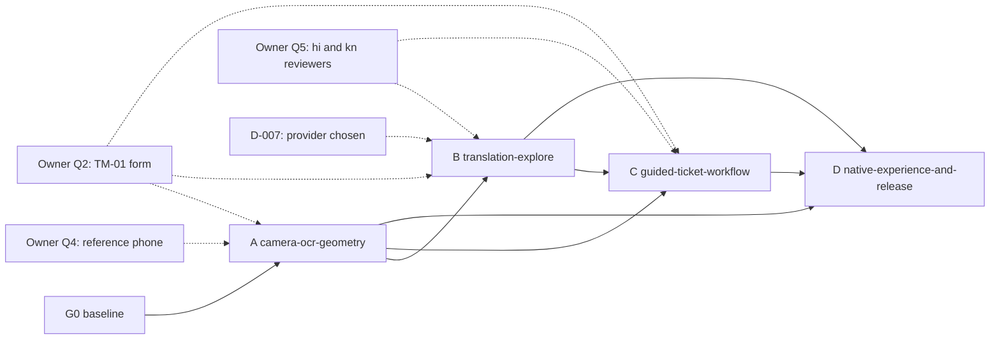

# OverlayKit: capability map

Status: **draft, updated 2026-11-18.** All four specs now have requirements, design and tasks under `.kiro/specs/01-` to `04-`. Run them in numeric order.
Sources: [PRODUCT.md](PRODUCT.md), [ARCHITECTURE.md](ARCHITECTURE.md), [DECISIONS.md](DECISIONS.md), [QUALITY-GATES.md](QUALITY-GATES.md), [DEVICE-TESTS.md](DEVICE-TESTS.md), [../tasks/plan.md](../tasks/plan.md). If this map disagrees with them, they win. Flag the conflict instead of picking one.

This map splits the product into four capabilities. Each capability is one Kiro Feature Spec with its own `requirements.md`, `design.md` and `tasks.md`. For each spec it lists the modules it owns, what it hands to later specs, the error codes it produces, its gates, and what must be decided before it starts.

These four spec names replace the starter names in the master playbook (`camera-and-geometry`, `translate-and-explain`, and so on), in line with D-022.

## Updates since 2026-11-17

These decisions in [DECISIONS.md](DECISIONS.md) change the text below. Where they conflict, the decisions win.

- **D-029, D-032:** TM-01 is a printed panel plus screen images, shown on an iPad as a passive display. Art may be AI-generated, with our own text added. Ground truth: `test-fixtures/tm-01/FIXTURE.md`. Wherever this map says "printed screen cards", read "screen images".
- **D-030:** translation is ML Kit on-device only for now. The `backend/` proxy, the OpenRouter route and the user-key Settings section in spec B are deferred. A pair that fails G2 shows `TR_NOT_CONFIGURED`.
- **D-031:** no Hindi or Kannada reviewers. Content is marked `unreviewed` and disclosed. Wherever this map says "reviewers", "reviewed" or owner Q5, read "unreviewed (D-031)".
- **Q4:** the reference phone is connected later. Every device result stays "device validation pending" until then.
- **Spec folders:** the specs are `01-camera-ocr-geometry`, `02-translation-explore`, `03-guided-ticket-workflow` and `04-native-experience-and-release`.
## 1. Spec rules

1. Specs are written in dependency order: A, B, C, D. A spec's requirements are approved before its design is written, and its design before its tasks. No code is written for a spec before its tasks are approved.
2. Each requirement cites its source: a product rule (P1 to P8), a decision (D-xxx), or a gate test (AT-xx, DT-xx). A requirement without a source is new scope. It needs owner approval or gets removed.
3. Acceptance criteria use EARS:
   - `WHEN <trigger>, THE SYSTEM SHALL <response>`
   - `IF <unwanted condition>, THEN THE SYSTEM SHALL <response>`
   - `WHILE <state>, THE SYSTEM SHALL <response>`
   - `WHERE <optional feature is present>, THE SYSTEM SHALL <response>`
4. Every error or unknown case has its own criterion naming the error code (ARCHITECTURE.md §8) and the UI state it maps to. A spec that needs a new code adds it to §8 through a DECISIONS.md entry.
5. Contracts between modules are typed in `shared` or in the owning module's `index.ts`. Failures are `Result` values. Nothing throws across a module boundary.
6. A task fits in one focused session: one module or one UI slice plus its tests, ending with `npm run verify` at exit 0. A task that needs the phone ends with a DEVICE-TESTS.md record, or says "device validation pending".
7. Writing or generating a spec completes no task. A task is checked off only after its verification ran and the output was recorded.
8. A spec never weakens a gate threshold. Changing a threshold needs a DECISIONS.md entry.

## 2. Capabilities

| ID | Spec | Delivers | Gates | Workflow | Why this workflow |
| --- | --- | --- | --- | --- | --- |
| A | `camera-ocr-geometry` | Real back-camera preview and still capture, on-device OCR into text quads, image-to-preview mapping, overlay placement, stale-overlay handling | G1 (AT-G1-01 to 11); QE-1 and QE-2 for `CAM_*` and `OCR_*` | Requirements-first (owner chose, 2026-11-17) | Permission paths, overlay alignment and every OCR failure are visible to the user. The camera and OCR libraries are chosen during this spec (G1a spike), so there is no fixed design to start from. |
| B | `translation-explore` | Text-only translation behind `TranslationProvider`, target-language switching, translated labels anchored to their source text, TM-01 identification and authored explanations of its controls, unverified-machine behaviour | G2 (AT-G2-01 to 09), G3 (AT-G3-01 to 06); QE for `TR_*`, `MCH_*`, `CMP_NOT_VISIBLE` | Requirements-first (recommended) | Label states, fallbacks and the verified/unverified split are user-facing. The provider is chosen inside this spec (D-007), so the design depends on that evaluation. |
| C | `guided-ticket-workflow` | TM-01 screen and workflow fixture, camera screen matcher, pure guide reducer, active-target highlight, transition proof | G4 (AT-G4-01 to 06, 08); QE for `GD_*` | Requirements-first (recommended) | Design-first was considered because D-019 already fixes the reducer approach. It was rejected because refusal, pause, cancel and checkpoint prompts are user-facing and should be agreed as behaviour first. |
| D | `native-experience-and-release` | Final navigation, text-to-speech, accessibility pass, physical QA runs, signed APK, README, demo | AT-G4-07; QE for `SP_*`; B2; RC-1 to RC-6 | Requirements-first (recommended) | Release is judged against acceptance checks (RC-1 to RC-6 and the hackathon rules), not against a technical design. |

**Transition proof** (C): every Guide step transition records what caused it, either the `frameId`s of the two matching observations or the user's Done confirmation. Unit tests, property tests and the debug log can then show why each step advanced.

## 3. Dependencies

Solid arrows are code dependencies: the later spec imports contracts the earlier one delivers. Dotted arrows are owner decisions or outside inputs. "Owner Q2" refers to the questions in `tasks/todo.md`, not the static gates of the same name in QUALITY-GATES.md.

G0 items still open on 2026-11-17 (`tasks/todo.md`, `docs/build-log.md`): no phone connected, so B1 and B2 haven't run; the module-boundary lint rule (static gate Q4) and the property-test library are not added; no LICENSE. A's device tasks can't pass until B1 runs on the reference phone.

## 4. Capability detail

### A. camera-ocr-geometry

**In scope**

- Camera permission states and the back-camera preview, portrait only.
- Freeze-frame path first (D-011): capture a still, turn it upright once, run OCR, draw overlays on the still. Delete each temporary still when it is dismissed or replaced, when the app moves to the background, and at the next app start for leftovers (AT-G1-11 as reworded in D-033).
- An `ocr` adapter around the chosen on-device engine. Output is in upright image pixels, with a script per line. Non-finite or zero-area quads are rejected.
- Latin and Devanagari are read. Kannada and unknown scripts give `OCR_UNSUPPORTED_SCRIPT` and never appear as garbled Latin text (D-005).
- `geometry`: the existing cover transform, quad mapping, explicit off-screen clipping, and label placement that doesn't cover the source text.
- Every overlay carries its `frameId`. Freeze-frame overlays live while their still is shown and are removed when it's dismissed. Live mode is optional (AT-G1-06). If attempted, it drops results older than the newest one applied and expires overlays after a time-to-live (D-020).
- View positions are recomputed when the layout or safe-area insets change.
- A debug-only action exports an OCR snapshot (JSON plus photo) to `test-fixtures/`. Recorded snapshots drive the unit and property tests.
- The camera screen at the existing index route, with Translate mode showing the recognized source text in place.
- The `TranslationProvider` interface and a not-configured adapter in `locale`, returning `TR_NOT_CONFIGURED` for every line (OQ-1, D-033). Labels show the original text with "Translation not available" in the failed state.
- `t(key)` and the string keys for A's own screens in `en`, `hi` and `kn`, with `hi` and `kn` marked `unreviewed` (OQ-2, D-033). The UI language is `en` until B adds a language setting.
- The per-frame error code `OCR_RECOGNITION_FAILED` (OQ-7, D-033). Real translation states arrive with B.

**Out of scope:** real translation providers, machine identification, Explore hit-testing, Guide, speech, the Settings route.

**Modules owned:** `shared` (core vision types and the `CAM_*` and `OCR_*` codes), `capture`, `ocr`, `geometry` (transform, mapping, placement), `locale` (`TranslationProvider` interface, not-configured adapter, `t(key)` and A's string tables), and in `ui` the camera screen and overlay layer.

**Provides to later specs** (sketch only; A's design.md is authoritative):

- `FrameRef`: `frameId`, monotonic `capturedAtMs`, upright `size`, `source: 'still' | 'live'`.
- `OcrResult`: `frameId`, `capturedAtMs`, `imageSize`, `lines`. Each `OcrLine` has `text`, `quad` in image pixels, `script`, and `confidence` when the engine gives one.
- `geometry`: `computeCoverTransform`, `imageToView`, `viewToImage`, `isVisibleInView` (these exist), plus quad mapping and `placeLabels`.
- `ui`: an overlay layer that takes overlay items (id, `frameId`, view-space box, content, state) and applies the stale-overlay rules.

**Needs before start:** owner Q4 (reference phone) and G0 B1 on it; owner Q2, because AT-G1-02 needs TM-01 photos and its label list; D-004 and D-005 accepted. The G1 stop and pivot conditions in QUALITY-GATES.md apply unchanged.

### B. translation-explore

**In scope**

- The provider evaluation (the `TranslationProvider` interface and the not-configured adapter come from A, D-033) (AT-G2-01, AT-G2-02): an on-device adapter, plus an OpenRouter adapter for any language pair where on-device fails, each with timeout, cache and size caps (D-027, D-028).
- The `backend/` text-only proxy to OpenRouter, holding the team's key, for any language pair where on-device translation fails G2 (D-013, D-027, D-028). It's the default cloud route, so judges can translate without a key of their own.
- The user route (D-028): an OpenRouter API key section in Settings. The key is checked with OpenRouter before saving, stored only in secure storage, masked, removable, and sent only to OpenRouter, never to our proxy. With a saved key, `locale` calls OpenRouter directly.
- The same OpenRouter safeguards on both routes: a model pinned at G2, `data_collection: "deny"` and `zdr: true`, temperature 0, JSON output with one translation per string, output count and length checks, and an injection test set (AT-G2-10).
- One state per label: translated, pending, failed, or unsupported (QE-3). Text already in the target language isn't sent (AT-G2-05). Unsupported-script lines are never sent.
- Target-language switching between `en`, `hi` and `kn`, remembered on the phone. B's string keys added to the `t(key)` tables from A, in all three locales, reviewed by fluent speakers.
- The first-run privacy note, shown before any text is sent (S1 step 1, threat T2).
- The Settings route, with its language section and the OpenRouter key section.
- The TM-01 panel fixture: anchors, components with machine-space regions, explanations in `en`, `hi` and `kn` with a review status (`unreviewed` for hi and kn, D-031) (D-008, D-017).
- `components`: `identifyMachine` (`verified`, `ambiguous` or `none`), `locateComponents`, `explain`. `geometry`: `matchLayout` and `hitTest`.
- Explore: tapping a located TM-01 component shows its authored explanation. Any other tap shows the label's translation and "Not a verified machine" (D-010).

**Out of scope:** screens, workflows, Guide, speech.

**Modules owned:** `locale`, `components` (identification, location, explanations), `geometry` (`matchLayout`, `hitTest`), `backend/` (only if needed), and in `ui` the Translate label states, Explore mode and the Settings language section.

**Provides:** `MachineMatch` (with `frameId`), `locateComponents(match, ocr)`, the identification and component sections of `MachineFixture` with their validator, `t()`, `useLocaleSettings()`.

**Needs before start:** A's contracts merged and AT-G1-02 passing (translation on bad OCR proves nothing); the TM-01 images built (D-029, D-032); Hindi and Kannada text may stay unreviewed (D-031); DEFERRED by D-030 until the cloud route returns: an OpenRouter account and a team key with a credit limit, held only in the backend's environment; proxy hosting chosen (D-013); approval of a secure-storage dependency for the user's key (candidate `expo-secure-store`).

**Open inside B:** is the UI language the same as the target language, or set separately? PRODUCT.md doesn't say.

### C. guided-ticket-workflow

**In scope**

- TM-01 fixture extension: each screen's identifying text, and the workflow (steps, target component, checkpoint `text-visible` or `manual`) in `en`, `hi` and `kn`, reviewed and performed on the fixture (PRODUCT.md "verified" items 2 and 3).
- Screen images S01 to S06 shown on an iPad as a passive display (D-029, D-032), authored from `test-fixtures/tm-01/FIXTURE.md`. Our own text, no third-party branding.
- A camera screen matcher in `components`: which TM-01 screen card an observation shows, or that it can't tell. "Can't tell" never counts as a match.
- The `guide` reducer, pure, with no React or camera imports (D-019):
  - Starts only on a `verified` match.
  - Advances exactly once, after two consecutive distinct matching observations, or on Done for manual steps.
  - Ignores duplicate and out-of-order observations.
  - Pauses when the machine is lost for the timeout, and cancels when a different machine is identified.
  - Never advances on a timer.
- Transition proof, as defined in section 2.
- The active-target highlight, placed from `locateComponents` through `geometry`. Hidden when the target isn't located (`CMP_NOT_VISIBLE`) or the machine is lost.
- Guide UI: task picker, step card, Done for manual steps, a checkpoint-not-seen prompt with retry and step back, the refusal state offering Translate and Explore, and safe handling of backgrounding (AT-G4-08).
- The fixture loader rejects a workflow missing a locale, a review status, or a valid component reference (`GD_FIXTURE_INVALID`).
- A Speak slot in the step card that stays hidden until D supplies speech.

**Out of scope:** speech playback, any machine other than TM-01, generating or translating steps at runtime.

**Modules owned:** `guide`, `components` (screen matcher, screen and workflow sections of the fixture), and in `ui` Guide mode.

**Provides:** `GuideState` (current step, its text in the current locale, status), used by D for the Speak control and accessibility announcements.

**Needs before start:** B's identification passing AT-G3-01 and AT-G3-02 on the phone, because a false match makes Guide unsafe; the workflow performed on TM-01 (Hindi and Kannada text unreviewed, D-031).

### D. native-experience-and-release

**In scope**

- Navigation: the camera-first index route with the final three-mode switcher; Settings completed (language, voice, privacy note, honest limits); Android back behaviour; portrait lock. No new routes without approval.
- `speech`: voice availability per locale and playback (D-014; candidate `expo-speech`, which needs dependency approval). The Speak control in Guide.
- Accessibility pass against `.kiro/steering/native-ux.md`: roles and labels in the UI language, 48 dp touch targets, the largest system font size, mode and step announcements, reduced motion, legibility in bright light (L1).
- Physical QA: the DT-ERR series and DT-RC-01 and DT-RC-02 on release builds, following the `physical-device-qa` skill.
- Release: keystore kept outside git; signed release APK on a GitHub Release (D-018); README with install steps, fixture printing and honest limits; RC-5 install by someone outside the team; RC-6 submission checks; demo video under 3 minutes; Devpost text; `docs/kiro-evidence.md` entries.

**Out of scope:** EAS, store listings, iOS builds (D-002, D-003).

**Modules owned:** `speech`; in `ui`, navigation and accessibility; the release documents.

**Needs before start:** C complete for S1. Speech and navigation tasks can start once B's Settings route exists.

## 5. Error codes by owning spec

| Spec | Codes produced (ARCHITECTURE.md §8) |
| --- | --- |
| A | `CAM_PERMISSION_DENIED`, `CAM_PERMISSION_BLOCKED`, `CAM_UNAVAILABLE`, `CAM_CAPTURE_FAILED`, `OCR_ENGINE_UNAVAILABLE`, `OCR_RECOGNITION_FAILED`, `OCR_NO_TEXT`, `OCR_LOW_QUALITY`, `OCR_UNSUPPORTED_SCRIPT`, `TR_NOT_CONFIGURED` (not-configured adapter only) |
| B | `TR_NOT_CONFIGURED` (also raised at runtime for cloud pairs with no key and no proxy), `TR_OFFLINE`, `TR_TIMEOUT`, `TR_RATE_LIMITED`, `TR_PROVIDER_ERROR`, `TR_UNSUPPORTED_PAIR`, `TR_KEY_INVALID`, `TR_NO_CREDITS`, `MCH_NOT_VERIFIED`, `MCH_AMBIGUOUS`, `CMP_NOT_VISIBLE` |
| C | `GD_UNSUPPORTED`, `GD_MACHINE_LOST`, `GD_MACHINE_CHANGED`, `GD_CHECKPOINT_NOT_SEEN`, `GD_FIXTURE_INVALID` |
| D | `SP_NO_VOICE`, `SP_FAILED` |

The owning spec gives each code a unit test (QE-1) and reaches it once on the phone, in its DT tests or the DT-ERR series (QE-2). `CMP_NOT_VISIBLE` is produced in B and also shown by C's Guide UI.

## 6. Allocation choices (approved by the owner 2026-11-18, D-033)

| ID | Choice | Reason | Alternative |
| --- | --- | --- | --- |
| CM-1 | B owns the TM-01 panel fixture (anchors, components, explanations) and machine identification. C extends the same fixture with screens and workflows. | Explore's control explanations need identification and components, and B comes before C. | C owns the whole fixture and B waits for it, which reverses the B-before-C order. |
| CM-2 | C ships the step card with a hidden Speak slot. D adds `speech` and shows the control. | Keeps dependencies one-way. Guide without a voice is already a valid state (`SP_NO_VOICE` hides the control). | Move `speech` into C. |
| CM-3 | B creates the Settings route with the language section. D completes it. | Language switching is B's scope and needs a place in the UI. | A language picker on the camera screen, with Settings only in D. |
| CM-4 | A mode appears in the switcher only once its spec delivers it: Translate in A, Explore in B, Guide in C. | Production code holds no placeholder features. P1's three modes all exist at release. | Show all three from A, with "not available yet" on the missing ones. |
| CM-5 | The first-run privacy note ships in B, before any text goes to a provider. | Threat T2 and S1 step 1 tie the note to sending text. A sends nothing. | Ship it in A. |

## 7. Status

| Spec | Requirements | Design | Tasks | Implementation |
| --- | --- | --- | --- | --- |
| A `01-camera-ocr-geometry` | Drafted, awaiting owner review | Drafted | Drafted | Not started. `geometry/cover-transform.ts` and its tests exist from the tooling round. |
| B `02-translation-explore` | Drafted 2026-11-18 | Drafted | Drafted | Not started |
| C `03-guided-ticket-workflow` | Drafted 2026-11-18 | Drafted | Drafted | Not started |
| D `04-native-experience-and-release` | Drafted 2026-11-18 | Drafted | Drafted | Not started |
Update this table when the owner approves a phase, with the date. Generating a document doesn't count as approval.

**Pending allocation change.** If the owner accepts OQ-1 and OQ-2 in A's requirements, two items move from B to A: the not-configured `TranslationProvider` adapter (`TR_NOT_CONFIGURED`), and `t(key)` with the string keys for A's own screens. Sections 4.A, 4.B and 5 get updated after that decision, not before.
